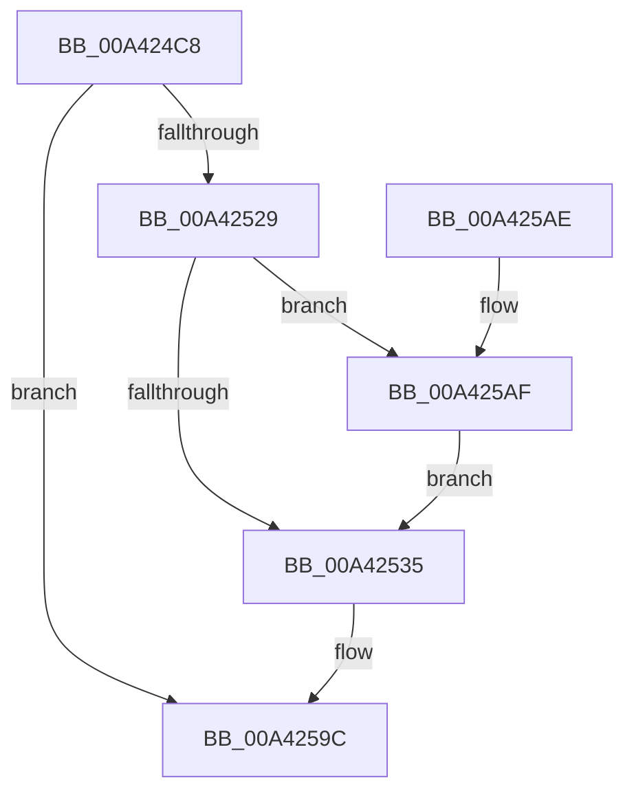

# SepSetProcessUniqueAttribute

- RVA: `0x00A424C8`–`0x00A425B9` (길이 `241` bytes)
- VA: `0x0000000140A424C8`
- 실행 섹션: `PAGE`
- PDB 이름 있음: `예`; PDB Function 태그: `아니요`
- unwind 정보 RVA: `0x000AED14`
- 디코드: `59`개 명령, `241/241` bytes 표시
- 미해석 바이트: `0` (있으면 어셈블리에 `.byte`로 보존)

> 이 문서는 커널 이미지의 기계어와 PDB 기호를 분석해 생성했습니다. 4번과 5번은 함수 원형과 자료형을 바이너리 사용 방식에서 추정한 C 해석이며 원본 소스 복구 결과는 아닙니다.

## 1. Dependencies

- 직접 호출 지점: **4**; 고유 호출 대상: **4**
- 직접 호출자로 확인된 함수: **1**
- RIP 상대 이미지 참조: **3**

### Outgoing calls
- `0x00A42520` → [SepAddLuidToIndexEntry](SepAddLuidToIndexEntry_function_00A425C0.md) (function, `0x00A425C0`)
- `0x00A4254B` → [RtlInitUnicodeString](../../text/42/RtlInitUnicodeString_function_0042A780.md) (function, `0x0042A780`)
- `0x00A42597` → [AuthzBasepSetSecurityAttributesToken](../../text/3A/AuthzBasepSetSecurityAttributesToken_function_003A8D1C.md) (function, `0x003A8D1C`)
- `0x00A425AF` → [SepDereferenceLuidToIndexEntry](../../text/45/SepDereferenceLuidToIndexEntry_function_0045CEE8.md) (function, `0x0045CEE8`)

### Direct callers
- [SeSubProcessToken](../AA/SeSubProcessToken_function_00AAD570.md) at `0x00AADBE7`

### Static image references
- `0x00A424DA` → RVA `0x00012D08` (`.rdata`; read)
- `0x00A424FE` → RVA `0x00E0EBF0` (`.data`; read/write)
- `0x00A42539` → RVA `0x00B06120` (` ?? ::NNGAKEGL::`string'`; read)

## 2. Other-region calls and transfers

- 다른 실행 섹션으로 향하는 call: **3**
  - `0x00A4254B` → [RtlInitUnicodeString](../../text/42/RtlInitUnicodeString_function_0042A780.md) (`PAGE` → `.text`)
  - `0x00A42597` → [AuthzBasepSetSecurityAttributesToken](../../text/3A/AuthzBasepSetSecurityAttributesToken_function_003A8D1C.md) (`PAGE` → `.text`)
  - `0x00A425AF` → [SepDereferenceLuidToIndexEntry](../../text/45/SepDereferenceLuidToIndexEntry_function_0045CEE8.md) (`PAGE` → `.text`)
- 별도 외부 분기/꼬리 이동을 확인하지 못했습니다.

## 3. Assembly (complete function range)

```asm
00A424C8  48 89 5C 24 10                  mov qword ptr [rsp + 0x10], rbx
00A424CD  48 89 7C 24 18                  mov qword ptr [rsp + 0x18], rdi
00A424D2  55                              push rbp
00A424D3  48 8B EC                        mov rbp, rsp
00A424D6  48 83 EC 70                     sub rsp, 0x70
00A424DA  48 8B 15 27 08 5D FF            mov rdx, qword ptr [rip - 0xa2f7d9]
00A424E1  33 C0                           xor eax, eax
00A424E3  0F 57 C0                        xorps xmm0, xmm0
00A424E6  48 89 45 F0                     mov qword ptr [rbp - 0x10], rax
00A424EA  33 FF                           xor edi, edi
00A424EC  48 8B D9                        mov rbx, rcx
00A424EF  48 89 7D 10                     mov qword ptr [rbp + 0x10], rdi
00A424F3  48 8B C2                        mov rax, rdx
00A424F6  0F 11 45 D0                     movups xmmword ptr [rbp - 0x30], xmm0
00A424FA  0F 11 45 E0                     movups xmmword ptr [rbp - 0x20], xmm0
00A424FE  F0 48 0F C1 05 E9 C6 3C 00      lock xadd qword ptr [rip + 0x3cc6e9], rax
00A42507  48 03 C2                        add rax, rdx
00A4250A  4C 8D 45 10                     lea r8, [rbp + 0x10]
00A4250E  89 45 B8                        mov dword ptr [rbp - 0x48], eax
00A42511  48 8D 55 B0                     lea rdx, [rbp - 0x50]
00A42515  48 C1 E8 20                     shr rax, 0x20
00A42519  48 8D 4D B8                     lea rcx, [rbp - 0x48]
00A4251D  89 45 BC                        mov dword ptr [rbp - 0x44], eax
00A42520  E8 9B 00 00 00                  call 0x140a425c0
00A42525  85 C0                           test eax, eax
00A42527  78 73                           js 0x140a4259c
00A42529  48 8B 8B 70 04 00 00            mov rcx, qword ptr [rbx + 0x470]
00A42530  48 85 C9                        test rcx, rcx
00A42533  75 7A                           jne 0x140a425af
00A42535  48 8B 45 10                     mov rax, qword ptr [rbp + 0x10]
00A42539  48 8D 15 E0 3B 0C 00            lea rdx, [rip + 0xc3be0]
00A42540  48 8D 4D D0                     lea rcx, [rbp - 0x30]
00A42544  48 89 83 70 04 00 00            mov qword ptr [rbx + 0x470], rax
00A4254B  E8 30 82 9E FF                  call 0x14042a780
00A42550  48 8B 8B 08 03 00 00            mov rcx, qword ptr [rbx + 0x308]
00A42557  4C 8D 45 C0                     lea r8, [rbp - 0x40]
00A4255B  B8 02 00 00 00                  mov eax, 2
00A42560  C7 45 E0 02 00 00 00            mov dword ptr [rbp - 0x20], 2
00A42567  89 45 E8                        mov dword ptr [rbp - 0x18], eax
00A4256A  48 8D 55 10                     lea rdx, [rbp + 0x10]
00A4256E  48 8D 45 B0                     lea rax, [rbp - 0x50]
00A42572  C7 45 E4 41 00 00 00            mov dword ptr [rbp - 0x1c], 0x41
00A42579  48 89 45 F0                     mov qword ptr [rbp - 0x10], rax
00A4257D  B8 01 00 00 00                  mov eax, 1
00A42582  89 45 C0                        mov dword ptr [rbp - 0x40], eax
00A42585  89 45 C4                        mov dword ptr [rbp - 0x3c], eax
00A42588  48 8D 45 D0                     lea rax, [rbp - 0x30]
00A4258C  48 89 45 C8                     mov qword ptr [rbp - 0x38], rax
00A42590  C7 45 10 04 00 00 00            mov dword ptr [rbp + 0x10], 4
00A42597  E8 80 67 96 FF                  call 0x1403a8d1c
00A4259C  4C 8D 5C 24 70                  lea r11, [rsp + 0x70]
00A425A1  49 8B 5B 18                     mov rbx, qword ptr [r11 + 0x18]
00A425A5  49 8B 7B 20                     mov rdi, qword ptr [r11 + 0x20]
00A425A9  49 8B E3                        mov rsp, r11
00A425AC  5D                              pop rbp
00A425AD  C3                              ret
00A425AE  CC                              int3
00A425AF  E8 34 A9 A1 FF                  call 0x14045cee8
00A425B4  E9 7C FF FF FF                  jmp 0x140a42535
```

## 4. C-style interpretation (structured pseudocode)

```c
__int64 __fastcall SepSetProcessUniqueAttribute(__int64 a1)
{
    __int64 result;
    __int64 v_rdi;
    __int64 v_rsp;
    unsigned __int64 v_stack_m18;
    unsigned int v_stack_m20;
    unsigned int v_stack_m24;
    unsigned __int64 v_stack_m28;
    unsigned __int64 v_stack_m38;
    unsigned __int64 v_stack_m40;
    unsigned int v_stack_m44;
    unsigned __int64 v_stack_m48;
    unsigned int v_stack_m4C;
    unsigned int v_stack_m50;
    unsigned __int64 v_stack_m58;
    unsigned __int64 v_stack_m8;
    unsigned __int64 v_stack_p10;
    unsigned __int64 v_stack_p18;
    unsigned __int64 v_stack_p8;

    v_stack_p10 = v_rbx;
    v_stack_p18 = v_rdi;
    v_rsp = (v_rsp) - (112);
    result = 0;
    v_stack_m18 = 0;
    v_rdi = 0;
    v_stack_p8 = 0;
    v_stack_m38 = v_xmm0;
    v_stack_m28 = v_xmm0;
    result = (*(unsigned __int64 *)(v_rip - 10680281)) + (*(unsigned __int64 *)(v_rip - 10680281));
    v_stack_m50 = (unsigned int)(result);
    result = (result) >> (32);
    v_stack_m4C = (unsigned int)(result);
    result = SepAddLuidToIndexEntry(v_stack_m50, v_stack_m58, v_stack_p8, a4);
    if (sign_flag) goto loc_00A4259C;
    if (*(unsigned __int64 *)(a1 + 1136) != 0) goto loc_00A425AF;
loc_00A42535:
    *(unsigned __int64 *)(a1 + 1136) = v_stack_p8;
    result = RtlInitUnicodeString(v_stack_m38, v_rip + 801760, v_stack_p8, a4);
    v_stack_m28 = 2;
    v_stack_m20 = 2;
    v_stack_m24 = 65;
    v_stack_m18 = v_stack_m58;
    v_stack_m48 = 1;
    v_stack_m44 = 1;
    v_stack_m40 = v_stack_m38;
    v_stack_p8 = 4;
    result = AuthzBasepSetSecurityAttributesToken(*(unsigned __int64 *)(a1 + 776), v_stack_p8, v_stack_m48, a4);
loc_00A4259C:
    return result;
loc_00A425AF:
    result = SepDereferenceLuidToIndexEntry(*(unsigned __int64 *)(a1 + 776), v_stack_p8, v_stack_m48, a4);
    goto loc_00A42535;
}
```

## 5. (Beta) C Style

```c
int64_t SepSetProcessUniqueAttribute(void *Arg1)
{
    uint8_t *arg1 = (uint8_t *)Arg1;

    int64_t result;
    int64_t local_rdi;
    int64_t local_rsp;
    uint64_t v_stack_m18;
    uint32_t v_stack_m20;
    uint32_t v_stack_m24;
    uint64_t v_stack_m28;
    uint64_t v_stack_m38;
    uint64_t v_stack_m40;
    uint32_t v_stack_m44;
    uint64_t v_stack_m48;
    uint32_t v_stack_m4C;
    uint32_t v_stack_m50;
    uint64_t v_stack_m58;
    uint64_t v_stack_m8;
    uint64_t v_stack_p10;
    uint64_t v_stack_p18;
    uint64_t v_stack_p8;

    v_stack_p10 = local_rbx;
    v_stack_p18 = local_rdi;
    local_rsp = (local_rsp) - (112);
    result = 0;
    v_stack_m18 = 0;
    local_rdi = 0;
    v_stack_p8 = 0;
    v_stack_m38 = v_xmm0;
    v_stack_m28 = v_xmm0;
    result = (*(uint64_t *)(v_rip - 0xA2F7D9)) + (*(uint64_t *)(v_rip - 0xA2F7D9));
    v_stack_m50 = (uint32_t)(result);
    result = (result) >> (32);
    v_stack_m4C = (uint32_t)(result);
    result = SepAddLuidToIndexEntry(v_stack_m50, v_stack_m58, v_stack_p8, a4);
    if (sign_flag) goto loc_00A4259C;
    if (*(uint64_t *)(arg1 + 0x470) != 0) goto loc_00A425AF;
loc_00A42535:
    *(uint64_t *)(arg1 + 0x470) = v_stack_p8;
    result = RtlInitUnicodeString(v_stack_m38, v_rip + 801760, v_stack_p8, a4);
    v_stack_m28 = 2;
    v_stack_m20 = 2;
    v_stack_m24 = 65;
    v_stack_m18 = v_stack_m58;
    v_stack_m48 = 1;
    v_stack_m44 = 1;
    v_stack_m40 = v_stack_m38;
    v_stack_p8 = 4;
    result = AuthzBasepSetSecurityAttributesToken(*(uint64_t *)(arg1 + 0x308), v_stack_p8, v_stack_m48, a4);
loc_00A4259C:
    return result;
loc_00A425AF:
    result = SepDereferenceLuidToIndexEntry(*(uint64_t *)(arg1 + 0x308), v_stack_p8, v_stack_m48, a4);
    goto loc_00A42535;
}
```

### 관측된 메모리 오프셋

구조체 형식이 확인되지 않은 접근은 인자 기준의 오프셋으로만 기록했습니다.

| 기준 인자 | 오프셋 표현 | 폭 (bit) | 접근 |
|---|---:|---:|---|
| `Arg1` | `+ 0x308` | `64` | `R` |
| `Arg1` | `+ 0x470` | `64` | `R` |
| `Arg1` | `+ 0x470` | `64` | `W` |

## 6. Execution-region graph

[열기: 2D/3D 그래프와 함수 탐색 컨트롤 패널](../../../control-panel.html?section=page&rva=0x00A424C8&view=graph)

- 2D 그래프는 위에서 아래로 흐르고, 3D 그래프는 빈 공간을 드래그해 회전합니다. Shift+드래그는 이동, 휠은 확대·축소, 함수 노드 선택은 대상 보고서 이동입니다.

### Static fallback


