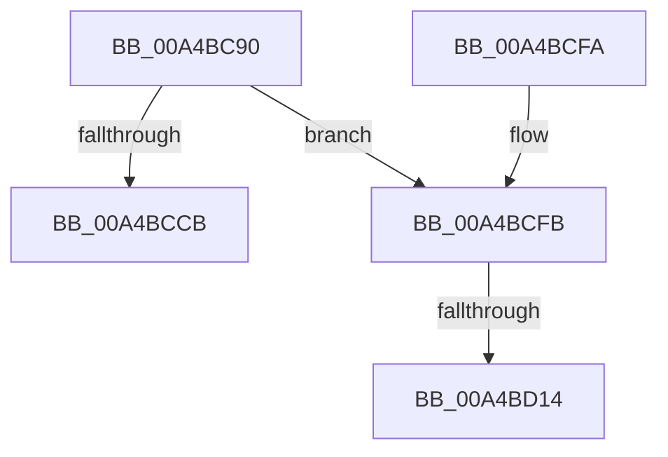

# SmCreatePartition

- RVA: `0x00A4BC90`–`0x00A4BD19` (길이 `137` bytes)
- VA: `0x0000000140A4BC90`
- 실행 섹션: `PAGE`
- PDB 이름 있음: `예`; PDB Function 태그: `예`
- unwind 정보 RVA: `0x000B02EC`
- 디코드: `36`개 명령, `137/137` bytes 표시
- 미해석 바이트: `0` (있으면 어셈블리에 `.byte`로 보존)

> 이 문서는 커널 이미지의 기계어와 PDB 기호를 분석해 생성했습니다. 4번과 5번은 함수 원형과 자료형을 바이너리 사용 방식에서 추정한 C 해석이며 원본 소스 복구 결과는 아닙니다.

## 1. Dependencies

- 직접 호출 지점: **1**; 고유 호출 대상: **1**
- 직접 호출자로 확인된 함수: **3**
- RIP 상대 이미지 참조: **2**

### Outgoing calls
- `0x00A4BCD8` → [_security_check_cookie](../../text/6A/_security_check_cookie_function_006AC640.md) (function, `0x006AC640`)

### Direct callers
- [MiMakePartitionActive](../../text/49/MiMakePartitionActive_function_004959B8.md) at `0x004959D6`
- [PspSetJobMemoryPartition](../78/PspSetJobMemoryPartition_function_00785574.md) at `0x0078564C`
- [SmProcessConfigRequest](../7A/SmProcessConfigRequest_function_007A62E4.md) at `0x007A6675`

### Static image references
- `0x00A4BCAB` → RVA `0x00E0A740` (`.data`; read)
- `0x00A4BD02` → RVA `0x00FC5000` (`ALMOSTRO`; read)

## 2. Other-region calls and transfers

- 다른 실행 섹션으로 향하는 call: **1**
  - `0x00A4BCD8` → [_security_check_cookie](../../text/6A/_security_check_cookie_function_006AC640.md) (`PAGE` → `.text`)
- call이 아닌 외부 분기/꼬리 이동: **2**
  - `0x00A4BD0E` → [sub_00B3B882](../B3/Unknown_function_00B3B882.md) (`tail-transfer`)
  - `0x00A4BD14` → [sub_00B3B882 + 0x43](../B3/Unknown_function_00B3B882.md) (`tail-transfer`)

## 3. Assembly (complete function range)

```asm
00A4BC90  48 89 5C 24 10                  mov qword ptr [rsp + 0x10], rbx
00A4BC95  48 89 6C 24 18                  mov qword ptr [rsp + 0x18], rbp
00A4BC9A  48 89 74 24 20                  mov qword ptr [rsp + 0x20], rsi
00A4BC9F  57                              push rdi
00A4BCA0  41 56                           push r14
00A4BCA2  41 57                           push r15
00A4BCA4  48 81 EC 20 01 00 00            sub rsp, 0x120
00A4BCAB  48 8B 05 8E EA 3B 00            mov rax, qword ptr [rip + 0x3bea8e]
00A4BCB2  48 33 C4                        xor rax, rsp
00A4BCB5  48 89 84 24 10 01 00 00         mov qword ptr [rsp + 0x110], rax
00A4BCBD  48 8B 41 18                     mov rax, qword ptr [rcx + 0x18]
00A4BCC1  33 FF                           xor edi, edi
00A4BCC3  48 8B E9                        mov rbp, rcx
00A4BCC6  48 85 C0                        test rax, rax
00A4BCC9  74 30                           je 0x140a4bcfb
00A4BCCB  8B C7                           mov eax, edi
00A4BCCD  48 8B 8C 24 10 01 00 00         mov rcx, qword ptr [rsp + 0x110]
00A4BCD5  48 33 CC                        xor rcx, rsp
00A4BCD8  E8 63 09 C6 FF                  call 0x1406ac640
00A4BCDD  4C 8D 9C 24 20 01 00 00         lea r11, [rsp + 0x120]
00A4BCE5  49 8B 5B 28                     mov rbx, qword ptr [r11 + 0x28]
00A4BCE9  49 8B 6B 30                     mov rbp, qword ptr [r11 + 0x30]
00A4BCED  49 8B 73 38                     mov rsi, qword ptr [r11 + 0x38]
00A4BCF1  49 8B E3                        mov rsp, r11
00A4BCF4  41 5F                           pop r15
00A4BCF6  41 5E                           pop r14
00A4BCF8  5F                              pop rdi
00A4BCF9  C3                              ret
00A4BCFA  CC                              int3
00A4BCFB  41 83 CF FF                     or r15d, 0xffffffff
00A4BCFF  4C 8B F7                        mov r14, rdi
00A4BD02  66 3B 3D F7 92 57 00            cmp di, word ptr [rip + 0x5792f7]
00A4BD09  41 8B F7                        mov esi, r15d
00A4BD0C  8B DF                           mov ebx, edi
00A4BD0E  0F 82 6E FB 0E 00               jb 0x140b3b882
00A4BD14  E9 AC FB 0E 00                  jmp 0x140b3b8c5
```

## 4. C-style interpretation (structured pseudocode)

```c
__int64 __fastcall SmCreatePartition(__int64 a1)
{
    __int64 result;
    __int64 v_r15;
    __int64 v_rdi;
    __int64 v_rsp;
    unsigned __int64 v_stack_m18;
    unsigned __int64 v_stack_m28;
    unsigned __int64 v_stack_p10;
    unsigned __int64 v_stack_p18;
    unsigned __int64 v_stack_p20;

    v_stack_p10 = v_rbx;
    v_stack_p18 = v_rbp;
    v_stack_p20 = v_rsi;
    v_rsp = (v_rsp) - (288);
    result = (*(unsigned __int64 *)(v_rip + 3926670)) ^ (v_rsp);
    v_stack_m28 = result;
    v_rdi = 0;
    if (*(unsigned __int64 *)(a1 + 24) == 0) goto loc_00A4BCFB;
    a1 = (v_stack_m28) ^ (v_rsp);
    result = _security_check_cookie(a1, a2, a3, a4);
    return result;
loc_00A4BCFB:
    v_r15 = (unsigned int)((v_r15) | (0xFFFFFFFFULL));
}
```

## 5. (Beta) C Style

```c
int64_t SmCreatePartition(void *Arg1)
{
    uint8_t *arg1 = (uint8_t *)Arg1;

    int64_t result;
    int64_t local_r15;
    int64_t local_rdi;
    int64_t local_rsp;
    uint64_t v_stack_m18;
    uint64_t v_stack_m28;
    uint64_t v_stack_p10;
    uint64_t v_stack_p18;
    uint64_t v_stack_p20;

    v_stack_p10 = local_rbx;
    v_stack_p18 = local_rbp;
    v_stack_p20 = local_rsi;
    local_rsp = (local_rsp) - (288);
    result = (*(uint64_t *)(v_rip + 0x3BEA8E)) ^ (local_rsp);
    v_stack_m28 = result;
    local_rdi = 0;
    if (*(uint64_t *)(arg1 + 0x18) == 0) goto loc_00A4BCFB;
    Arg1 = (v_stack_m28) ^ (local_rsp);
    result = _security_check_cookie(Arg1, a2, a3, a4);
    return result;
loc_00A4BCFB:
    local_r15 = (uint32_t)((local_r15) | (0xFFFFFFFFULL));
}
```

### 관측된 메모리 오프셋

구조체 형식이 확인되지 않은 접근은 인자 기준의 오프셋으로만 기록했습니다.

| 기준 인자 | 오프셋 표현 | 폭 (bit) | 접근 |
|---|---:|---:|---|
| `Arg1` | `+ 0x18` | `64` | `R` |

## 6. Execution-region graph

[열기: 2D/3D 그래프와 함수 탐색 컨트롤 패널](../../../control-panel.html?section=page&rva=0x00A4BC90&view=graph)

- 2D 그래프는 위에서 아래로 흐르고, 3D 그래프는 빈 공간을 드래그해 회전합니다. Shift+드래그는 이동, 휠은 확대·축소, 함수 노드 선택은 대상 보고서 이동입니다.

### Static fallback


