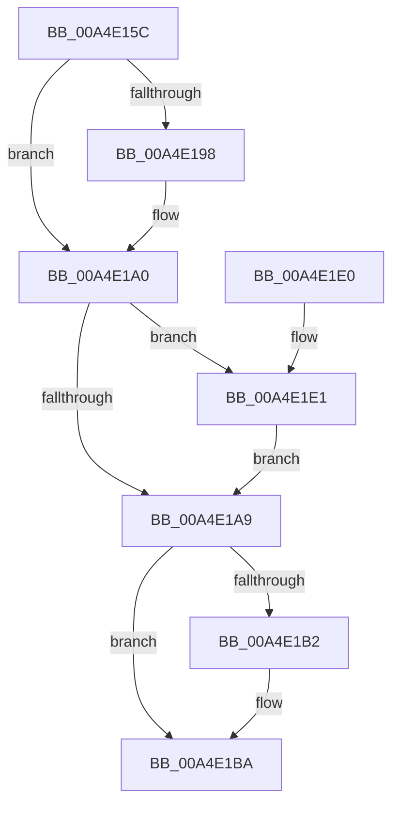

# SshpFreeBlockerEntry

- RVA: `0x00A4E15C`–`0x00A4E1EB` (길이 `143` bytes)
- VA: `0x0000000140A4E15C`
- 실행 섹션: `PAGE`
- PDB 이름 있음: `예`; PDB Function 태그: `아니요`
- unwind 정보 RVA: `0x0005C748`
- 디코드: `39`개 명령, `143/143` bytes 표시
- 미해석 바이트: `0` (있으면 어셈블리에 `.byte`로 보존)

> 이 문서는 커널 이미지의 기계어와 PDB 기호를 분석해 생성했습니다. 4번과 5번은 함수 원형과 자료형을 바이너리 사용 방식에서 추정한 C 해석이며 원본 소스 복구 결과는 아닙니다.

## 1. Dependencies

- 직접 호출 지점: **6**; 고유 호출 대상: **2**
- 직접 호출자로 확인된 함수: **3**
- RIP 상대 이미지 참조: **1**

### Outgoing calls
- `0x00A4E183` → [SshpTracingWriteBlockerStateRundown](../../text/49/SshpTracingWriteBlockerStateRundown_function_00491A20.md) (function, `0x00491A20`)
- `0x00A4E19B` → [CmpFreePoolWithTag](../../text/44/CmpFreePoolWithTag_function_004489E0.md) (function, `0x004489E0`)
- `0x00A4E1B5` → [CmpFreePoolWithTag](../../text/44/CmpFreePoolWithTag_function_004489E0.md) (function, `0x004489E0`)
- `0x00A4E1C0` → [CmpFreePoolWithTag](../../text/44/CmpFreePoolWithTag_function_004489E0.md) (function, `0x004489E0`)
- `0x00A4E1CB` → [CmpFreePoolWithTag](../../text/44/CmpFreePoolWithTag_function_004489E0.md) (function, `0x004489E0`)
- `0x00A4E1E4` → [CmpFreePoolWithTag](../../text/44/CmpFreePoolWithTag_function_004489E0.md) (function, `0x004489E0`)

### Direct callers
- [SshpDereferenceBlocker](../../text/48/SshpDereferenceBlocker_function_00486960.md) at `0x00486AFE`
- [SleepstudyHelperDestroyLibrary](../77/SleepstudyHelperDestroyLibrary_function_00774720.md) at `0x00774859`
- [SshpPurgeBlockersWorker](SshpPurgeBlockersWorker_function_00A4DE90.md) at `0x00A4E092`

### Static image references
- `0x00A4E178` → RVA `0x0001A640` (`.rdata`; read)

## 2. Other-region calls and transfers

- 다른 실행 섹션으로 향하는 call: **6**
  - `0x00A4E183` → [SshpTracingWriteBlockerStateRundown](../../text/49/SshpTracingWriteBlockerStateRundown_function_00491A20.md) (`PAGE` → `.text`)
  - `0x00A4E19B` → [CmpFreePoolWithTag](../../text/44/CmpFreePoolWithTag_function_004489E0.md) (`PAGE` → `.text`)
  - `0x00A4E1B5` → [CmpFreePoolWithTag](../../text/44/CmpFreePoolWithTag_function_004489E0.md) (`PAGE` → `.text`)
  - `0x00A4E1C0` → [CmpFreePoolWithTag](../../text/44/CmpFreePoolWithTag_function_004489E0.md) (`PAGE` → `.text`)
  - `0x00A4E1CB` → [CmpFreePoolWithTag](../../text/44/CmpFreePoolWithTag_function_004489E0.md) (`PAGE` → `.text`)
  - `0x00A4E1E4` → [CmpFreePoolWithTag](../../text/44/CmpFreePoolWithTag_function_004489E0.md) (`PAGE` → `.text`)
- 별도 외부 분기/꼬리 이동을 확인하지 못했습니다.

## 3. Assembly (complete function range)

```asm
00A4E15C  48 89 5C 24 08                  mov qword ptr [rsp + 8], rbx
00A4E161  48 89 74 24 10                  mov qword ptr [rsp + 0x10], rsi
00A4E166  57                              push rdi
00A4E167  48 83 EC 20                     sub rsp, 0x20
00A4E16B  48 8B 81 30 01 00 00            mov rax, qword ptr [rcx + 0x130]
00A4E172  48 8B F1                        mov rsi, rcx
00A4E175  48 8B D1                        mov rdx, rcx
00A4E178  48 8D 0D C1 C4 5C FF            lea rcx, [rip - 0xa33b3f]
00A4E17F  48 8B 58 20                     mov rbx, qword ptr [rax + 0x20]
00A4E183  E8 98 38 A4 FF                  call 0x140491a20
00A4E188  48 8B BE 30 01 00 00            mov rdi, qword ptr [rsi + 0x130]
00A4E18F  48 8B 4F 58                     mov rcx, qword ptr [rdi + 0x58]
00A4E193  48 85 C9                        test rcx, rcx
00A4E196  74 08                           je 0x140a4e1a0
00A4E198  8B 53 18                        mov edx, dword ptr [rbx + 0x18]
00A4E19B  E8 40 A8 9F FF                  call 0x1404489e0
00A4E1A0  48 8B 4F 60                     mov rcx, qword ptr [rdi + 0x60]
00A4E1A4  48 85 C9                        test rcx, rcx
00A4E1A7  75 38                           jne 0x140a4e1e1
00A4E1A9  48 8B 4F 68                     mov rcx, qword ptr [rdi + 0x68]
00A4E1AD  48 85 C9                        test rcx, rcx
00A4E1B0  74 08                           je 0x140a4e1ba
00A4E1B2  8B 53 18                        mov edx, dword ptr [rbx + 0x18]
00A4E1B5  E8 26 A8 9F FF                  call 0x1404489e0
00A4E1BA  8B 53 18                        mov edx, dword ptr [rbx + 0x18]
00A4E1BD  48 8B CF                        mov rcx, rdi
00A4E1C0  E8 1B A8 9F FF                  call 0x1404489e0
00A4E1C5  8B 53 18                        mov edx, dword ptr [rbx + 0x18]
00A4E1C8  48 8B CE                        mov rcx, rsi
00A4E1CB  E8 10 A8 9F FF                  call 0x1404489e0
00A4E1D0  48 8B 5C 24 30                  mov rbx, qword ptr [rsp + 0x30]
00A4E1D5  48 8B 74 24 38                  mov rsi, qword ptr [rsp + 0x38]
00A4E1DA  48 83 C4 20                     add rsp, 0x20
00A4E1DE  5F                              pop rdi
00A4E1DF  C3                              ret
00A4E1E0  CC                              int3
00A4E1E1  8B 53 18                        mov edx, dword ptr [rbx + 0x18]
00A4E1E4  E8 F7 A7 9F FF                  call 0x1404489e0
00A4E1E9  EB BE                           jmp 0x140a4e1a9
```

## 4. C-style interpretation (structured pseudocode)

```c
__int64 __fastcall SshpFreeBlockerEntry(__int64 a1)
{
    __int64 result;
    __int64 v_rsp;
    unsigned __int64 v_stack_p10;
    unsigned __int64 v_stack_p8;

    v_stack_p8 = v_rbx;
    v_stack_p10 = v_rsi;
    v_rsp = (v_rsp) - (32);
    result = SshpTracingWriteBlockerStateRundown(v_rip - 10697535, a1, a3, a4);
    if (*(unsigned __int64 *)(*(unsigned __int64 *)(a1 + 304) + 88) != 0) {
        a2 = *(unsigned int *)(*(unsigned __int64 *)(*(unsigned __int64 *)(a1 + 304) + 32) + 24);
        result = CmpFreePoolWithTag(*(unsigned __int64 *)(*(unsigned __int64 *)(a1 + 304) + 88), a2, a3, a4);
    }
    if (*(unsigned __int64 *)(*(unsigned __int64 *)(a1 + 304) + 96) != 0) goto loc_00A4E1E1;
loc_00A4E1A9:
    if (*(unsigned __int64 *)(*(unsigned __int64 *)(a1 + 304) + 104) != 0) {
        a2 = *(unsigned int *)(*(unsigned __int64 *)(*(unsigned __int64 *)(a1 + 304) + 32) + 24);
        result = CmpFreePoolWithTag(*(unsigned __int64 *)(*(unsigned __int64 *)(a1 + 304) + 104), a2, a3, a4);
    }
    result = CmpFreePoolWithTag(*(unsigned __int64 *)(a1 + 304), (unsigned int)(*(unsigned int *)(*(unsigned __int64 *)(*(unsigned __int64 *)(a1 + 304) + 32) + 24)), a3, a4);
    result = CmpFreePoolWithTag(a1, (unsigned int)(*(unsigned int *)(*(unsigned __int64 *)(*(unsigned __int64 *)(a1 + 304) + 32) + 24)), a3, a4);
    v_rsp = (v_rsp) + (32);
    return result;
loc_00A4E1E1:
    result = CmpFreePoolWithTag(a1, (unsigned int)(*(unsigned int *)(v_stack_p8 + 24)), a3, a4);
    goto loc_00A4E1A9;
}
```

## 5. (Beta) C Style

```c
int64_t SshpFreeBlockerEntry(void *Arg1)
{
    uint8_t *arg1 = (uint8_t *)Arg1;

    int64_t result;
    int64_t local_rsp;
    uint64_t v_stack_p10;
    uint64_t v_stack_p8;

    v_stack_p8 = local_rbx;
    v_stack_p10 = local_rsi;
    local_rsp = (local_rsp) - (32);
    result = SshpTracingWriteBlockerStateRundown(v_rip - 10697535, Arg1, a3, a4);
    if (*(uint64_t *)(*(uint64_t *)(arg1 + 0x130) + 0x58) != 0) {
        a2 = *(uint32_t *)(*(uint64_t *)(*(uint64_t *)(arg1 + 0x130) + 0x20) + 0x18);
        result = CmpFreePoolWithTag(*(uint64_t *)(*(uint64_t *)(arg1 + 0x130) + 0x58), a2, a3, a4);
    }
    if (*(uint64_t *)(*(uint64_t *)(arg1 + 0x130) + 0x60) != 0) goto loc_00A4E1E1;
loc_00A4E1A9:
    if (*(uint64_t *)(*(uint64_t *)(arg1 + 0x130) + 0x68) != 0) {
        a2 = *(uint32_t *)(*(uint64_t *)(*(uint64_t *)(arg1 + 0x130) + 0x20) + 0x18);
        result = CmpFreePoolWithTag(*(uint64_t *)(*(uint64_t *)(arg1 + 0x130) + 0x68), a2, a3, a4);
    }
    result = CmpFreePoolWithTag(*(uint64_t *)(arg1 + 0x130), (uint32_t)(*(uint32_t *)(*(uint64_t *)(*(uint64_t *)(arg1 + 0x130) + 0x20) + 0x18)), a3, a4);
    result = CmpFreePoolWithTag(Arg1, (uint32_t)(*(uint32_t *)(*(uint64_t *)(*(uint64_t *)(arg1 + 0x130) + 0x20) + 0x18)), a3, a4);
    local_rsp = (local_rsp) + (32);
    return result;
loc_00A4E1E1:
    result = CmpFreePoolWithTag(Arg1, (uint32_t)(*(uint32_t *)(v_stack_p8 + 0x18)), a3, a4);
    goto loc_00A4E1A9;
}
```

### 관측된 메모리 오프셋

구조체 형식이 확인되지 않은 접근은 인자 기준의 오프셋으로만 기록했습니다.

| 기준 인자 | 오프셋 표현 | 폭 (bit) | 접근 |
|---|---:|---:|---|
| `Arg1` | `+ 0x130` | `64` | `R` |

## 6. Execution-region graph

[열기: 2D/3D 그래프와 함수 탐색 컨트롤 패널](../../../control-panel.html?section=page&rva=0x00A4E15C&view=graph)

- 2D 그래프는 위에서 아래로 흐르고, 3D 그래프는 빈 공간을 드래그해 회전합니다. Shift+드래그는 이동, 휠은 확대·축소, 함수 노드 선택은 대상 보고서 이동입니다.

### Static fallback


