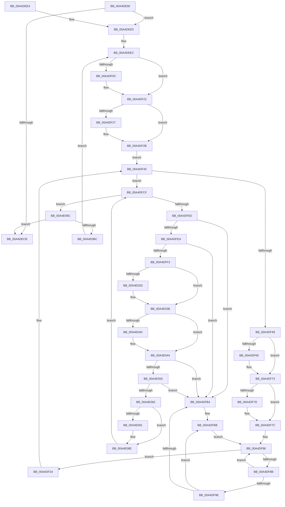

# SshpPurgeBlockersWorker

- RVA: `0x00A4DE90`–`0x00A4E0C1` (길이 `561` bytes)
- VA: `0x0000000140A4DE90`
- 실행 섹션: `PAGE`
- PDB 이름 있음: `예`; PDB Function 태그: `아니요`
- unwind 정보 RVA: `0x000B05F8`
- 디코드: `146`개 명령, `561/561` bytes 표시
- 미해석 바이트: `0` (있으면 어셈블리에 `.byte`로 보존)

> 이 문서는 커널 이미지의 기계어와 PDB 기호를 분석해 생성했습니다. 4번과 5번은 함수 원형과 자료형을 바이너리 사용 방식에서 추정한 C 해석이며 원본 소스 복구 결과는 아닙니다.

## 1. Dependencies

- 직접 호출 지점: **15**; 고유 호출 대상: **8**
- 직접 호출자로 확인된 함수: **0**
- RIP 상대 이미지 참조: **5**

### Outgoing calls
- `0x00A4DEC2` → [SshpWorkItemTryAllowNextWorker](../../text/4B/SshpWorkItemTryAllowNextWorker_function_004BC078.md) (function, `0x004BC078`)
- `0x00A4DEF8` → [KeAbPreAcquire](../../text/21/KeAbPreAcquire_function_00210230.md) (function, `0x00210230`)
- `0x00A4DF1D` → [ExfAcquirePushLockExclusiveEx](../../text/20/ExfAcquirePushLockExclusiveEx_function_0020FC90.md) (function, `0x0020FC90`)
- `0x00A4DF38` → [SSHSupportReleasePushLockExclusive](../../text/49/SSHSupportReleasePushLockExclusive_function_004954EC.md) (function, `0x004954EC`)
- `0x00A4DF55` → [KeAbPreAcquire](../../text/21/KeAbPreAcquire_function_00210230.md) (function, `0x00210230`)
- `0x00A4DF6E` → [ExfAcquirePushLockExclusiveEx](../../text/20/ExfAcquirePushLockExclusiveEx_function_0020FC90.md) (function, `0x0020FC90`)
- `0x00A4DF95` → [SshpQueryBlockerPendingDelete](../../text/49/SshpQueryBlockerPendingDelete_function_0049A814.md) (function, `0x0049A814`)
- `0x00A4DFA2` → [SshpUnlinkBlockerFromLibrary](SshpUnlinkBlockerFromLibrary_function_00A4E0C8.md) (function, `0x00A4E0C8`)
- `0x00A4E01D` → [KeAbPreAcquire](../../text/21/KeAbPreAcquire_function_00210230.md) (function, `0x00210230`)
- `0x00A4E036` → [ExfAcquirePushLockExclusiveEx](../../text/20/ExfAcquirePushLockExclusiveEx_function_0020FC90.md) (function, `0x0020FC90`)
- `0x00A4E06C` → [SSHSupportReleasePushLockExclusive](../../text/49/SSHSupportReleasePushLockExclusive_function_004954EC.md) (function, `0x004954EC`)
- `0x00A4E089` → [SshpDereferenceBlocker](../../text/48/SshpDereferenceBlocker_function_00486960.md) (function, `0x00486960`)
- `0x00A4E092` → [SshpFreeBlockerEntry](SshpFreeBlockerEntry_function_00A4E15C.md) (function, `0x00A4E15C`)
- `0x00A4E0A3` → [SSHSupportReleasePushLockExclusive](../../text/49/SSHSupportReleasePushLockExclusive_function_004954EC.md) (function, `0x004954EC`)
- `0x00A4E0AF` → [SshpWorkItemTryAllowNextWorker](../../text/4B/SshpWorkItemTryAllowNextWorker_function_004BC078.md) (function, `0x004BC078`)

### Direct callers
- 이 함수 시작 RVA로 연결되는 직접 call은 확인되지 않았습니다. 간접 호출은 완전히 역산할 수 없습니다.

### Static image references
- `0x00A4DEB3` → RVA `0x00F07060` (`.data`; read)
- `0x00A4DEE5` → RVA `0x00F07020` (`.data`; read)
- `0x00A4DEEF` → RVA `0x00F07030` (`.data`; read)
- `0x00A4DEFD` → RVA `0x00F07030` (`.data`; read/write)
- `0x00A4E00C` → RVA `0x00E08400` (`.data`; read)

## 2. Other-region calls and transfers

- 다른 실행 섹션으로 향하는 call: **13**
  - `0x00A4DEC2` → [SshpWorkItemTryAllowNextWorker](../../text/4B/SshpWorkItemTryAllowNextWorker_function_004BC078.md) (`PAGE` → `.text`)
  - `0x00A4DEF8` → [KeAbPreAcquire](../../text/21/KeAbPreAcquire_function_00210230.md) (`PAGE` → `.text`)
  - `0x00A4DF1D` → [ExfAcquirePushLockExclusiveEx](../../text/20/ExfAcquirePushLockExclusiveEx_function_0020FC90.md) (`PAGE` → `.text`)
  - `0x00A4DF38` → [SSHSupportReleasePushLockExclusive](../../text/49/SSHSupportReleasePushLockExclusive_function_004954EC.md) (`PAGE` → `.text`)
  - `0x00A4DF55` → [KeAbPreAcquire](../../text/21/KeAbPreAcquire_function_00210230.md) (`PAGE` → `.text`)
  - `0x00A4DF6E` → [ExfAcquirePushLockExclusiveEx](../../text/20/ExfAcquirePushLockExclusiveEx_function_0020FC90.md) (`PAGE` → `.text`)
  - `0x00A4DF95` → [SshpQueryBlockerPendingDelete](../../text/49/SshpQueryBlockerPendingDelete_function_0049A814.md) (`PAGE` → `.text`)
  - `0x00A4E01D` → [KeAbPreAcquire](../../text/21/KeAbPreAcquire_function_00210230.md) (`PAGE` → `.text`)
  - `0x00A4E036` → [ExfAcquirePushLockExclusiveEx](../../text/20/ExfAcquirePushLockExclusiveEx_function_0020FC90.md) (`PAGE` → `.text`)
  - `0x00A4E06C` → [SSHSupportReleasePushLockExclusive](../../text/49/SSHSupportReleasePushLockExclusive_function_004954EC.md) (`PAGE` → `.text`)
  - `0x00A4E089` → [SshpDereferenceBlocker](../../text/48/SshpDereferenceBlocker_function_00486960.md) (`PAGE` → `.text`)
  - `0x00A4E0A3` → [SSHSupportReleasePushLockExclusive](../../text/49/SSHSupportReleasePushLockExclusive_function_004954EC.md) (`PAGE` → `.text`)
  - `0x00A4E0AF` → [SshpWorkItemTryAllowNextWorker](../../text/4B/SshpWorkItemTryAllowNextWorker_function_004BC078.md) (`PAGE` → `.text`)
- 별도 외부 분기/꼬리 이동을 확인하지 못했습니다.

## 3. Assembly (complete function range)

```asm
00A4DE90  48 89 5C 24 08                  mov qword ptr [rsp + 8], rbx
00A4DE95  48 89 74 24 10                  mov qword ptr [rsp + 0x10], rsi
00A4DE9A  48 89 7C 24 18                  mov qword ptr [rsp + 0x18], rdi
00A4DE9F  55                              push rbp
00A4DEA0  41 54                           push r12
00A4DEA2  41 56                           push r14
00A4DEA4  48 8B EC                        mov rbp, rsp
00A4DEA7  48 83 EC 30                     sub rsp, 0x30
00A4DEAB  48 8D 45 F0                     lea rax, [rbp - 0x10]
00A4DEAF  48 89 45 F8                     mov qword ptr [rbp - 8], rax
00A4DEB3  48 8D 0D A6 91 4B 00            lea rcx, [rip + 0x4b91a6]
00A4DEBA  48 8D 45 F0                     lea rax, [rbp - 0x10]
00A4DEBE  48 89 45 F0                     mov qword ptr [rbp - 0x10], rax
00A4DEC2  E8 B1 E1 A6 FF                  call 0x1404bc078
00A4DEC7  84 C0                           test al, al
00A4DEC9  74 1A                           je 0x140a4dee5
00A4DECB  48 8B 5C 24 50                  mov rbx, qword ptr [rsp + 0x50]
00A4DED0  48 8B 74 24 58                  mov rsi, qword ptr [rsp + 0x58]
00A4DED5  48 8B 7C 24 60                  mov rdi, qword ptr [rsp + 0x60]
00A4DEDA  48 83 C4 30                     add rsp, 0x30
00A4DEDE  41 5E                           pop r14
00A4DEE0  41 5C                           pop r12
00A4DEE2  5D                              pop rbp
00A4DEE3  C3                              ret
00A4DEE4  CC                              int3
00A4DEE5  4C 8D 25 34 91 4B 00            lea r12, [rip + 0x4b9134]
00A4DEEC  45 33 C0                        xor r8d, r8d
00A4DEEF  48 8D 0D 3A 91 4B 00            lea rcx, [rip + 0x4b913a]
00A4DEF6  33 D2                           xor edx, edx
00A4DEF8  E8 33 23 7C FF                  call 0x140210230
00A4DEFD  F0 48 0F BA 2D 29 91 4B 00 00   lock bts qword ptr [rip + 0x4b9129], 0
00A4DF07  48 8B D8                        mov rbx, rax
00A4DF0A  73 16                           jae 0x140a4df22
00A4DF0C  4C 8D 05 1D 91 4B 00            lea r8, [rip + 0x4b911d]
00A4DF13  48 8B D0                        mov rdx, rax
00A4DF16  48 8D 0D 13 91 4B 00            lea rcx, [rip + 0x4b9113]
00A4DF1D  E8 6E 1D 7C FF                  call 0x14020fc90
00A4DF22  48 85 DB                        test rbx, rbx
00A4DF25  74 04                           je 0x140a4df2b
00A4DF27  C6 43 0A 01                     mov byte ptr [rbx + 0xa], 1
00A4DF2B  48 8B 1D EE 90 4B 00            mov rbx, qword ptr [rip + 0x4b90ee]
00A4DF32  EB 0C                           jmp 0x140a4df40
00A4DF34  48 8D 4B 10                     lea rcx, [rbx + 0x10]
00A4DF38  E8 AF 75 A4 FF                  call 0x1404954ec
00A4DF3D  48 8B 1B                        mov rbx, qword ptr [rbx]
00A4DF40  49 3B DC                        cmp rbx, r12
00A4DF43  0F 84 86 00 00 00               je 0x140a4dfcf
00A4DF49  48 8D 7B 10                     lea rdi, [rbx + 0x10]
00A4DF4D  45 33 C0                        xor r8d, r8d
00A4DF50  48 8B CF                        mov rcx, rdi
00A4DF53  33 D2                           xor edx, edx
00A4DF55  E8 D6 22 7C FF                  call 0x140210230
00A4DF5A  F0 48 0F BA 2F 00               lock bts qword ptr [rdi], 0
00A4DF60  48 8B F0                        mov rsi, rax
00A4DF63  73 0E                           jae 0x140a4df73
00A4DF65  4C 8B C7                        mov r8, rdi
00A4DF68  48 8B D0                        mov rdx, rax
00A4DF6B  48 8B CF                        mov rcx, rdi
00A4DF6E  E8 1D 1D 7C FF                  call 0x14020fc90
00A4DF73  48 85 F6                        test rsi, rsi
00A4DF76  74 04                           je 0x140a4df7c
00A4DF78  C6 46 0A 01                     mov byte ptr [rsi + 0xa], 1
00A4DF7C  4C 8D B3 98 00 00 00            lea r14, [rbx + 0x98]
00A4DF83  49 8B 36                        mov rsi, qword ptr [r14]
00A4DF86  49 3B F6                        cmp rsi, r14
00A4DF89  74 A9                           je 0x140a4df34
00A4DF8B  48 8B FE                        mov rdi, rsi
00A4DF8E  48 8B 36                        mov rsi, qword ptr [rsi]
00A4DF91  48 8B 4F 70                     mov rcx, qword ptr [rdi + 0x70]
00A4DF95  E8 7A C8 A4 FF                  call 0x14049a814
00A4DF9A  84 C0                           test al, al
00A4DF9C  74 E8                           je 0x140a4df86
00A4DF9E  48 8B 4F 70                     mov rcx, qword ptr [rdi + 0x70]
00A4DFA2  E8 21 01 00 00                  call 0x140a4e0c8
00A4DFA7  48 8B 45 F8                     mov rax, qword ptr [rbp - 8]
00A4DFAB  48 8D 4D F0                     lea rcx, [rbp - 0x10]
00A4DFAF  48 39 08                        cmp qword ptr [rax], rcx
00A4DFB2  74 07                           je 0x140a4dfbb
00A4DFB4  B9 03 00 00 00                  mov ecx, 3
00A4DFB9  CD 29                           int 0x29
00A4DFBB  48 89 47 08                     mov qword ptr [rdi + 8], rax
00A4DFBF  48 8D 4D F0                     lea rcx, [rbp - 0x10]
00A4DFC3  48 89 0F                        mov qword ptr [rdi], rcx
00A4DFC6  48 89 38                        mov qword ptr [rax], rdi
00A4DFC9  48 89 7D F8                     mov qword ptr [rbp - 8], rdi
00A4DFCD  EB B7                           jmp 0x140a4df86
00A4DFCF  48 8B 5D F0                     mov rbx, qword ptr [rbp - 0x10]
00A4DFD3  48 8D 45 F0                     lea rax, [rbp - 0x10]
00A4DFD7  48 3B D8                        cmp rbx, rax
00A4DFDA  0F 84 BC 00 00 00               je 0x140a4e09c
00A4DFE0  48 8D 45 F0                     lea rax, [rbp - 0x10]
00A4DFE4  48 39 43 08                     cmp qword ptr [rbx + 8], rax
00A4DFE8  75 CA                           jne 0x140a4dfb4
00A4DFEA  48 8B 03                        mov rax, qword ptr [rbx]
00A4DFED  48 39 58 08                     cmp qword ptr [rax + 8], rbx
00A4DFF1  75 C1                           jne 0x140a4dfb4
00A4DFF3  48 89 45 F0                     mov qword ptr [rbp - 0x10], rax
00A4DFF7  48 8D 4D F0                     lea rcx, [rbp - 0x10]
00A4DFFB  48 89 48 08                     mov qword ptr [rax + 8], rcx
00A4DFFF  45 33 C0                        xor r8d, r8d
00A4E002  48 63 43 28                     movsxd rax, dword ptr [rbx + 0x28]
00A4E006  33 D2                           xor edx, edx
00A4E008  48 8D 3C 40                     lea rdi, [rax + rax*2]
00A4E00C  48 8D 05 ED A3 3B 00            lea rax, [rip + 0x3ba3ed]
00A4E013  48 C1 E7 04                     shl rdi, 4
00A4E017  48 03 F8                        add rdi, rax
00A4E01A  48 8B CF                        mov rcx, rdi
00A4E01D  E8 0E 22 7C FF                  call 0x140210230
00A4E022  F0 48 0F BA 2F 00               lock bts qword ptr [rdi], 0
00A4E028  48 8B F0                        mov rsi, rax
00A4E02B  73 0E                           jae 0x140a4e03b
00A4E02D  4C 8B C7                        mov r8, rdi
00A4E030  48 8B D0                        mov rdx, rax
00A4E033  48 8B CF                        mov rcx, rdi
00A4E036  E8 55 1C 7C FF                  call 0x14020fc90
00A4E03B  48 85 F6                        test rsi, rsi
00A4E03E  74 04                           je 0x140a4e044
00A4E040  C6 46 0A 01                     mov byte ptr [rsi + 0xa], 1
00A4E044  48 8D 43 10                     lea rax, [rbx + 0x10]
00A4E048  48 8B 10                        mov rdx, qword ptr [rax]
00A4E04B  48 39 42 08                     cmp qword ptr [rdx + 8], rax
00A4E04F  0F 85 5F FF FF FF               jne 0x140a4dfb4
00A4E055  48 8B 48 08                     mov rcx, qword ptr [rax + 8]
00A4E059  48 39 01                        cmp qword ptr [rcx], rax
00A4E05C  0F 85 52 FF FF FF               jne 0x140a4dfb4
00A4E062  48 89 11                        mov qword ptr [rcx], rdx
00A4E065  48 89 4A 08                     mov qword ptr [rdx + 8], rcx
00A4E069  48 8B CF                        mov rcx, rdi
00A4E06C  E8 7B 74 A4 FF                  call 0x1404954ec
00A4E071  48 8B 43 70                     mov rax, qword ptr [rbx + 0x70]
00A4E075  48 8B 88 28 01 00 00            mov rcx, qword ptr [rax + 0x128]
00A4E07C  48 85 C9                        test rcx, rcx
00A4E07F  74 0D                           je 0x140a4e08e
00A4E081  41 B0 01                        mov r8b, 1
00A4E084  BA 01 00 00 00                  mov edx, 1
00A4E089  E8 D2 88 A3 FF                  call 0x140486960
00A4E08E  48 8B 4B 70                     mov rcx, qword ptr [rbx + 0x70]
00A4E092  E8 C5 00 00 00                  call 0x140a4e15c
00A4E097  E9 33 FF FF FF                  jmp 0x140a4dfcf
00A4E09C  48 8D 0D 8D 8F 4B 00            lea rcx, [rip + 0x4b8f8d]
00A4E0A3  E8 44 74 A4 FF                  call 0x1404954ec
00A4E0A8  48 8D 0D B1 8F 4B 00            lea rcx, [rip + 0x4b8fb1]
00A4E0AF  E8 C4 DF A6 FF                  call 0x1404bc078
00A4E0B4  84 C0                           test al, al
00A4E0B6  0F 85 0F FE FF FF               jne 0x140a4decb
00A4E0BC  E9 2B FE FF FF                  jmp 0x140a4deec
```

## 4. C-style interpretation (structured pseudocode)

```c
__int64 __fastcall SshpPurgeBlockersWorker(__int64 a1, int a2, int a3)
{
    __int64 result;
    __int64 v_rdi;
    __int64 v_rsp;
    unsigned __int64 v_stack_m20;
    unsigned __int64 v_stack_m28;
    unsigned __int64 v_stack_p10;
    unsigned __int64 v_stack_p18;
    unsigned __int64 v_stack_p8;

    v_stack_p8 = v_rbx;
    v_stack_p10 = v_rsi;
    v_stack_p18 = v_rdi;
    v_rsp = (v_rsp) - (48);
    v_stack_m20 = v_stack_m28;
    v_stack_m28 = v_stack_m28;
    result = SshpWorkItemTryAllowNextWorker(v_rip + 4952486, a2, a3, a4);
    if ((unsigned __int8)(result) == 0) goto loc_00A4DEE5;
loc_00A4DECB:
    v_rsp = (v_rsp) + (48);
    return result;
loc_00A4DEE5:
loc_00A4DEEC:
    a3 = 0;
    a2 = 0;
    result = KeAbPreAcquire(v_rip + 4952378, a2, a3, a4);
    if (!(condition_is_above_or_equal)) {
        a3 = v_rip + 4952349;
        a2 = result;
        a1 = v_rip + 4952339;
        result = ExfAcquirePushLockExclusiveEx(a1, a2, a3, a4);
    }
    if (result != 0) {
        *(unsigned __int8 *)(result + 10) = 1;
    }
    goto loc_00A4DF40;
loc_00A4DF34:
    result = SSHSupportReleasePushLockExclusive(*(unsigned __int64 *)(v_rip + 4952302) + 16, a2, a3, a4);
loc_00A4DF40:
    if ((*(unsigned __int64 *)(*(unsigned __int64 *)(v_rip + 4952302))) == (v_rip + 4952372)) goto loc_00A4DFCF;
    a3 = 0;
    a2 = 0;
    result = KeAbPreAcquire(*(unsigned __int64 *)(*(unsigned __int64 *)(v_rip + 4952302)) + 16, a2, a3, a4);
    if (!(condition_is_above_or_equal)) {
        a3 = *(unsigned __int64 *)(*(unsigned __int64 *)(v_rip + 4952302)) + 16;
        a2 = result;
        a1 = *(unsigned __int64 *)(*(unsigned __int64 *)(v_rip + 4952302)) + 16;
        result = ExfAcquirePushLockExclusiveEx(a1, a2, a3, a4);
    }
    if (result != 0) {
        *(unsigned __int8 *)(result + 10) = 1;
    }
loc_00A4DF86:
    if ((*(unsigned __int64 *)(*(unsigned __int64 *)(*(unsigned __int64 *)(v_rip + 4952302)) + 152)) == (*(unsigned __int64 *)(*(unsigned __int64 *)(v_rip + 4952302)) + 152)) goto loc_00A4DF34;
    result = SshpQueryBlockerPendingDelete(*(unsigned __int64 *)(*(unsigned __int64 *)(*(unsigned __int64 *)(*(unsigned __int64 *)(v_rip + 4952302)) + 152) + 112), a2, a3, a4);
    if ((unsigned __int8)(result) == 0) goto loc_00A4DF86;
    result = SshpUnlinkBlockerFromLibrary(*(unsigned __int64 *)(*(unsigned __int64 *)(*(unsigned __int64 *)(*(unsigned __int64 *)(v_rip + 4952302)) + 152) + 112), a2, a3, a4);
    if ((*(unsigned __int64 *)(v_stack_m20)) != v_stack_m28) {
        a1 = 3;
    }
    *(unsigned __int64 *)(*(unsigned __int64 *)(*(unsigned __int64 *)(*(unsigned __int64 *)(v_rip + 4952302)) + 152) + 8) = v_stack_m20;
    *(unsigned __int64 *)(*(unsigned __int64 *)(*(unsigned __int64 *)(*(unsigned __int64 *)(v_rip + 4952302)) + 152)) = v_stack_m28;
    *(unsigned __int64 *)(v_stack_m20) = *(unsigned __int64 *)(*(unsigned __int64 *)(*(unsigned __int64 *)(v_rip + 4952302)) + 152);
    v_stack_m20 = *(unsigned __int64 *)(*(unsigned __int64 *)(*(unsigned __int64 *)(v_rip + 4952302)) + 152);
    goto loc_00A4DF86;
loc_00A4DFCF:
    if (v_stack_m28 == v_stack_m28) goto loc_00A4E09C;
    if ((*(unsigned __int64 *)(v_stack_m28 + 8)) != v_stack_m28) goto loc_00A4DFB4;
    if ((*(unsigned __int64 *)(*(unsigned __int64 *)(v_stack_m28) + 8)) != v_stack_m28) goto loc_00A4DFB4;
    v_stack_m28 = *(unsigned __int64 *)(v_stack_m28);
    *(unsigned __int64 *)(*(unsigned __int64 *)(v_stack_m28) + 8) = v_stack_m28;
    a3 = 0;
    a2 = 0;
    v_rdi = ((int)(*(unsigned int *)(v_stack_m28 + 40)) + (int)(*(unsigned int *)(v_stack_m28 + 40)) * 2) << (4);
    v_rdi = (v_rdi) + (v_rip + 3908589);
    result = KeAbPreAcquire(v_rdi, a2, a3, a4);
    if (!(condition_is_above_or_equal)) {
        a3 = v_rdi;
        a2 = result;
        a1 = v_rdi;
        result = ExfAcquirePushLockExclusiveEx(a1, a2, a3, a4);
    }
    if (result != 0) {
        *(unsigned __int8 *)(result + 10) = 1;
    }
    if ((*(unsigned __int64 *)(*(unsigned __int64 *)(v_stack_m28 + 16) + 8)) != (v_stack_m28 + 16)) goto loc_00A4DFB4;
    if ((*(unsigned __int64 *)(*(unsigned __int64 *)(v_stack_m28 + 16 + 8))) != (v_stack_m28 + 16)) goto loc_00A4DFB4;
    *(unsigned __int64 *)(*(unsigned __int64 *)(v_stack_m28 + 16 + 8)) = *(unsigned __int64 *)(v_stack_m28 + 16);
    *(unsigned __int64 *)(*(unsigned __int64 *)(v_stack_m28 + 16) + 8) = *(unsigned __int64 *)(v_stack_m28 + 16 + 8);
    result = SSHSupportReleasePushLockExclusive(v_rdi, *(unsigned __int64 *)(v_stack_m28 + 16), a3, a4);
    result = *(unsigned __int64 *)(v_stack_m28 + 112);
    if (*(unsigned __int64 *)(*(unsigned __int64 *)(v_stack_m28 + 112) + 296) != 0) {
        a3 = 1;
        a2 = 1;
        result = SshpDereferenceBlocker(*(unsigned __int64 *)(*(unsigned __int64 *)(v_stack_m28 + 112) + 296), a2, a3, a4);
    }
    result = SshpFreeBlockerEntry(*(unsigned __int64 *)(v_stack_m28 + 112), a2, a3, a4);
    goto loc_00A4DFCF;
loc_00A4E09C:
    result = SSHSupportReleasePushLockExclusive(v_rip + 4951949, a2, a3, a4);
    result = SshpWorkItemTryAllowNextWorker(v_rip + 4951985, a2, a3, a4);
    if ((unsigned __int8)(result) != 0) goto loc_00A4DECB;
    goto loc_00A4DEEC;
}
```

## 5. (Beta) C Style

```c
int64_t SshpPurgeBlockersWorker(int64_t Arg1, int32_t Arg2, int32_t Arg3)
{
    int64_t result;
    int64_t local_rdi;
    int64_t local_rsp;
    uint64_t v_stack_m20;
    uint64_t v_stack_m28;
    uint64_t v_stack_p10;
    uint64_t v_stack_p18;
    uint64_t v_stack_p8;

    v_stack_p8 = local_rbx;
    v_stack_p10 = local_rsi;
    v_stack_p18 = local_rdi;
    local_rsp = (local_rsp) - (48);
    v_stack_m20 = v_stack_m28;
    v_stack_m28 = v_stack_m28;
    result = SshpWorkItemTryAllowNextWorker(v_rip + 4952486, Arg2, Arg3, a4);
    if ((uint8_t)(result) == 0) goto loc_00A4DEE5;
loc_00A4DECB:
    local_rsp = (local_rsp) + (48);
    return result;
loc_00A4DEE5:
loc_00A4DEEC:
    Arg3 = 0;
    Arg2 = 0;
    result = KeAbPreAcquire(v_rip + 4952378, Arg2, Arg3, a4);
    if (!(condition_is_above_or_equal)) {
        Arg3 = v_rip + 4952349;
        Arg2 = result;
        Arg1 = v_rip + 4952339;
        result = ExfAcquirePushLockExclusiveEx(Arg1, Arg2, Arg3, a4);
    }
    if (result != 0) {
        *(uint8_t *)(result + 0xA) = 1;
    }
    goto loc_00A4DF40;
loc_00A4DF34:
    result = SSHSupportReleasePushLockExclusive(*(uint64_t *)(v_rip + 0x4B90EE) + 16, Arg2, Arg3, a4);
loc_00A4DF40:
    if ((*(uint64_t *)(*(uint64_t *)(v_rip + 0x4B90EE))) == (v_rip + 4952372)) goto loc_00A4DFCF;
    Arg3 = 0;
    Arg2 = 0;
    result = KeAbPreAcquire(*(uint64_t *)(*(uint64_t *)(v_rip + 0x4B90EE)) + 16, Arg2, Arg3, a4);
    if (!(condition_is_above_or_equal)) {
        Arg3 = *(uint64_t *)(*(uint64_t *)(v_rip + 0x4B90EE)) + 16;
        Arg2 = result;
        Arg1 = *(uint64_t *)(*(uint64_t *)(v_rip + 0x4B90EE)) + 16;
        result = ExfAcquirePushLockExclusiveEx(Arg1, Arg2, Arg3, a4);
    }
    if (result != 0) {
        *(uint8_t *)(result + 0xA) = 1;
    }
loc_00A4DF86:
    if ((*(uint64_t *)(*(uint64_t *)(*(uint64_t *)(v_rip + 0x4B90EE)) + 0x98)) == (*(uint64_t *)(*(uint64_t *)(v_rip + 0x4B90EE)) + 152)) goto loc_00A4DF34;
    result = SshpQueryBlockerPendingDelete(*(uint64_t *)(*(uint64_t *)(*(uint64_t *)(*(uint64_t *)(v_rip + 0x4B90EE)) + 0x98) + 0x70), Arg2, Arg3, a4);
    if ((uint8_t)(result) == 0) goto loc_00A4DF86;
    result = SshpUnlinkBlockerFromLibrary(*(uint64_t *)(*(uint64_t *)(*(uint64_t *)(*(uint64_t *)(v_rip + 0x4B90EE)) + 0x98) + 0x70), Arg2, Arg3, a4);
    if ((*(uint64_t *)(v_stack_m20)) != v_stack_m28) {
        Arg1 = 3;
    }
    *(uint64_t *)(*(uint64_t *)(*(uint64_t *)(*(uint64_t *)(v_rip + 0x4B90EE)) + 0x98) + 0x8) = v_stack_m20;
    *(uint64_t *)(*(uint64_t *)(*(uint64_t *)(*(uint64_t *)(v_rip + 0x4B90EE)) + 0x98)) = v_stack_m28;
    *(uint64_t *)(v_stack_m20) = *(uint64_t *)(*(uint64_t *)(*(uint64_t *)(v_rip + 0x4B90EE)) + 0x98);
    v_stack_m20 = *(uint64_t *)(*(uint64_t *)(*(uint64_t *)(v_rip + 0x4B90EE)) + 0x98);
    goto loc_00A4DF86;
loc_00A4DFCF:
    if (v_stack_m28 == v_stack_m28) goto loc_00A4E09C;
    if ((*(uint64_t *)(v_stack_m28 + 0x8)) != v_stack_m28) goto loc_00A4DFB4;
    if ((*(uint64_t *)(*(uint64_t *)(v_stack_m28) + 0x8)) != v_stack_m28) goto loc_00A4DFB4;
    v_stack_m28 = *(uint64_t *)(v_stack_m28);
    *(uint64_t *)(*(uint64_t *)(v_stack_m28) + 0x8) = v_stack_m28;
    Arg3 = 0;
    Arg2 = 0;
    local_rdi = ((int32_t)(*(uint32_t *)(v_stack_m28 + 0x28)) + (int32_t)(*(uint32_t *)(v_stack_m28 + 0x28)) * 2) << (4);
    local_rdi = (local_rdi) + (v_rip + 3908589);
    result = KeAbPreAcquire(local_rdi, Arg2, Arg3, a4);
    if (!(condition_is_above_or_equal)) {
        Arg3 = local_rdi;
        Arg2 = result;
        Arg1 = local_rdi;
        result = ExfAcquirePushLockExclusiveEx(Arg1, Arg2, Arg3, a4);
    }
    if (result != 0) {
        *(uint8_t *)(result + 0xA) = 1;
    }
    if ((*(uint64_t *)(*(uint64_t *)(v_stack_m28 + 0x10) + 0x8)) != (v_stack_m28 + 16)) goto loc_00A4DFB4;
    if ((*(uint64_t *)(*(uint64_t *)(v_stack_m28 + 0x10 + 0x8))) != (v_stack_m28 + 16)) goto loc_00A4DFB4;
    *(uint64_t *)(*(uint64_t *)(v_stack_m28 + 0x10 + 0x8)) = *(uint64_t *)(v_stack_m28 + 0x10);
    *(uint64_t *)(*(uint64_t *)(v_stack_m28 + 0x10) + 0x8) = *(uint64_t *)(v_stack_m28 + 0x10 + 0x8);
    result = SSHSupportReleasePushLockExclusive(local_rdi, *(uint64_t *)(v_stack_m28 + 0x10), Arg3, a4);
    result = *(uint64_t *)(v_stack_m28 + 0x70);
    if (*(uint64_t *)(*(uint64_t *)(v_stack_m28 + 0x70) + 0x128) != 0) {
        Arg3 = 1;
        Arg2 = 1;
        result = SshpDereferenceBlocker(*(uint64_t *)(*(uint64_t *)(v_stack_m28 + 0x70) + 0x128), Arg2, Arg3, a4);
    }
    result = SshpFreeBlockerEntry(*(uint64_t *)(v_stack_m28 + 0x70), Arg2, Arg3, a4);
    goto loc_00A4DFCF;
loc_00A4E09C:
    result = SSHSupportReleasePushLockExclusive(v_rip + 4951949, Arg2, Arg3, a4);
    result = SshpWorkItemTryAllowNextWorker(v_rip + 4951985, Arg2, Arg3, a4);
    if ((uint8_t)(result) != 0) goto loc_00A4DECB;
    goto loc_00A4DEEC;
}
```

## 6. Execution-region graph

[열기: 2D/3D 그래프와 함수 탐색 컨트롤 패널](../../../control-panel.html?section=page&rva=0x00A4DE90&view=graph)

- 2D 그래프는 위에서 아래로 흐르고, 3D 그래프는 빈 공간을 드래그해 회전합니다. Shift+드래그는 이동, 휠은 확대·축소, 함수 노드 선택은 대상 보고서 이동입니다.

### Static fallback


