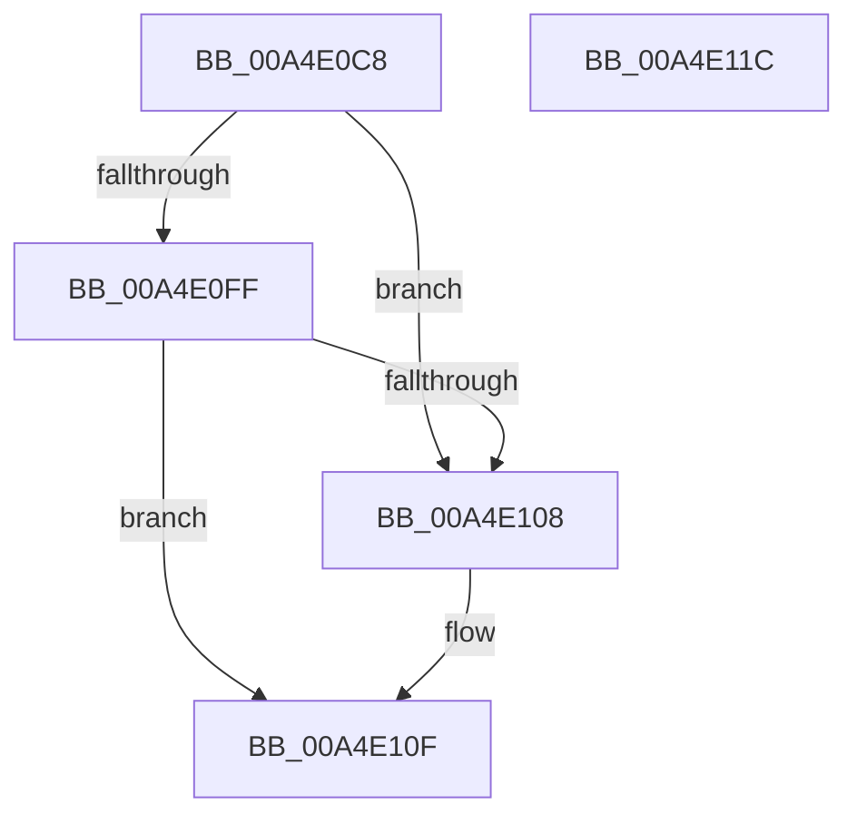

# SshpUnlinkBlockerFromLibrary

- RVA: `0x00A4E0C8`–`0x00A4E11D` (길이 `85` bytes)
- VA: `0x0000000140A4E0C8`
- 실행 섹션: `PAGE`
- PDB 이름 있음: `예`; PDB Function 태그: `아니요`
- unwind 정보 RVA: `0x0005CF00`
- 디코드: `24`개 명령, `85/85` bytes 표시
- 미해석 바이트: `0` (있으면 어셈블리에 `.byte`로 보존)

> 이 문서는 커널 이미지의 기계어와 PDB 기호를 분석해 생성했습니다. 4번과 5번은 함수 원형과 자료형을 바이너리 사용 방식에서 추정한 C 해석이며 원본 소스 복구 결과는 아닙니다.

## 1. Dependencies

- 직접 호출 지점: **1**; 고유 호출 대상: **1**
- 직접 호출자로 확인된 함수: **2**
- RIP 상대 이미지 참조: **1**

### Outgoing calls
- `0x00A4E0EA` → [SshpCacheRemoveBlocker](SshpCacheRemoveBlocker_function_00A4E124.md) (function, `0x00A4E124`)

### Direct callers
- [SshpDereferenceBlocker](../../text/48/SshpDereferenceBlocker_function_00486960.md) at `0x00486A4B`
- [SshpPurgeBlockersWorker](SshpPurgeBlockersWorker_function_00A4DE90.md) at `0x00A4DFA2`

### Static image references
- `0x00A4E0E2` → RVA `0x00F07088` (`.data`; read/write)

## 2. Other-region calls and transfers

- 다른 실행 섹션으로 향하는 call: **0**
- 별도 외부 분기/꼬리 이동을 확인하지 못했습니다.

## 3. Assembly (complete function range)

```asm
00A4E0C8  40 53                           push rbx
00A4E0CA  48 83 EC 20                     sub rsp, 0x20
00A4E0CE  48 8B 81 30 01 00 00            mov rax, qword ptr [rcx + 0x130]
00A4E0D5  48 8B D9                        mov rbx, rcx
00A4E0D8  48 8B D3                        mov rdx, rbx
00A4E0DB  48 8B 48 20                     mov rcx, qword ptr [rax + 0x20]
00A4E0DF  FF 49 28                        dec dword ptr [rcx + 0x28]
00A4E0E2  F0 48 FF 0D 9E 8F 4B 00         lock dec qword ptr [rip + 0x4b8f9e]
00A4E0EA  E8 35 00 00 00                  call 0x140a4e124
00A4E0EF  48 8B 8B 30 01 00 00            mov rcx, qword ptr [rbx + 0x130]
00A4E0F6  48 8B 11                        mov rdx, qword ptr [rcx]
00A4E0F9  48 39 4A 08                     cmp qword ptr [rdx + 8], rcx
00A4E0FD  75 09                           jne 0x140a4e108
00A4E0FF  48 8B 41 08                     mov rax, qword ptr [rcx + 8]
00A4E103  48 39 08                        cmp qword ptr [rax], rcx
00A4E106  74 07                           je 0x140a4e10f
00A4E108  B9 03 00 00 00                  mov ecx, 3
00A4E10D  CD 29                           int 0x29
00A4E10F  48 89 10                        mov qword ptr [rax], rdx
00A4E112  48 89 42 08                     mov qword ptr [rdx + 8], rax
00A4E116  48 83 C4 20                     add rsp, 0x20
00A4E11A  5B                              pop rbx
00A4E11B  C3                              ret
00A4E11C  CC                              int3
```

## 4. C-style interpretation (structured pseudocode)

```c
__int64 __fastcall SshpUnlinkBlockerFromLibrary(__int64 a1)
{
    __int64 result;
    __int64 v_rsp;

    v_rsp = (v_rsp) - (32);
    result = SshpCacheRemoveBlocker(*(unsigned __int64 *)(*(unsigned __int64 *)(a1 + 304) + 32), a1, a3, a4);
    if ((*(unsigned __int64 *)(*(unsigned __int64 *)(*(unsigned __int64 *)(a1 + 304)) + 8)) != (*(unsigned __int64 *)(a1 + 304))) goto loc_00A4E108;
    if ((*(unsigned __int64 *)(*(unsigned __int64 *)(*(unsigned __int64 *)(a1 + 304) + 8))) != (*(unsigned __int64 *)(a1 + 304))) {
        a1 = 3;
    }
    *(unsigned __int64 *)(*(unsigned __int64 *)(*(unsigned __int64 *)(a1 + 304) + 8)) = *(unsigned __int64 *)(*(unsigned __int64 *)(a1 + 304));
    *(unsigned __int64 *)(*(unsigned __int64 *)(*(unsigned __int64 *)(a1 + 304)) + 8) = *(unsigned __int64 *)(*(unsigned __int64 *)(a1 + 304) + 8);
    v_rsp = (v_rsp) + (32);
    return *(unsigned __int64 *)(*(unsigned __int64 *)(a1 + 304) + 8);
}
```

## 5. (Beta) C Style

```c
int64_t SshpUnlinkBlockerFromLibrary(void *Arg1)
{
    uint8_t *arg1 = (uint8_t *)Arg1;

    int64_t result;
    int64_t local_rsp;

    local_rsp = (local_rsp) - (32);
    result = SshpCacheRemoveBlocker(*(uint64_t *)(*(uint64_t *)(arg1 + 0x130) + 0x20), Arg1, a3, a4);
    if ((*(uint64_t *)(*(uint64_t *)(*(uint64_t *)(arg1 + 0x130)) + 0x8)) != (*(uint64_t *)(arg1 + 0x130))) goto loc_00A4E108;
    if ((*(uint64_t *)(*(uint64_t *)(*(uint64_t *)(arg1 + 0x130) + 0x8))) != (*(uint64_t *)(arg1 + 0x130))) {
        Arg1 = 3;
    }
    *(uint64_t *)(*(uint64_t *)(*(uint64_t *)(arg1 + 0x130) + 0x8)) = *(uint64_t *)(*(uint64_t *)(arg1 + 0x130));
    *(uint64_t *)(*(uint64_t *)(*(uint64_t *)(arg1 + 0x130)) + 0x8) = *(uint64_t *)(*(uint64_t *)(arg1 + 0x130) + 0x8);
    local_rsp = (local_rsp) + (32);
    return *(uint64_t *)(*(uint64_t *)(arg1 + 0x130) + 0x8);
}
```

### 관측된 메모리 오프셋

구조체 형식이 확인되지 않은 접근은 인자 기준의 오프셋으로만 기록했습니다.

| 기준 인자 | 오프셋 표현 | 폭 (bit) | 접근 |
|---|---:|---:|---|
| `Arg1` | `+ 0x130` | `64` | `R` |

## 6. Execution-region graph

[열기: 2D/3D 그래프와 함수 탐색 컨트롤 패널](../../../control-panel.html?section=page&rva=0x00A4E0C8&view=graph)

- 2D 그래프는 위에서 아래로 흐르고, 3D 그래프는 빈 공간을 드래그해 회전합니다. Shift+드래그는 이동, 휠은 확대·축소, 함수 노드 선택은 대상 보고서 이동입니다.

### Static fallback


