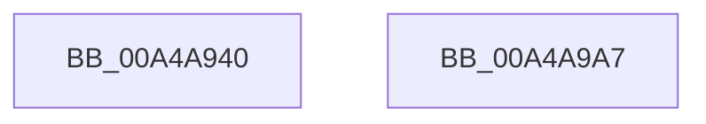

# sub_00A4A940

- RVA: `0x00A4A940`–`0x00A4A9A8` (길이 `104` bytes)
- VA: `0x0000000140A4A940`
- 실행 섹션: `PAGE`
- PDB 이름 있음: `아니요`; PDB Function 태그: `아니요`
- unwind 정보 RVA: `0x000DB714`
- 디코드: `27`개 명령, `104/104` bytes 표시
- 미해석 바이트: `0` (있으면 어셈블리에 `.byte`로 보존)

> 이 문서는 커널 이미지의 기계어와 PDB 기호를 분석해 생성했습니다. 4번과 5번은 함수 원형과 자료형을 바이너리 사용 방식에서 추정한 C 해석이며 원본 소스 복구 결과는 아닙니다.

## 1. Dependencies

- 직접 호출 지점: **0**; 고유 호출 대상: **0**
- 직접 호출자로 확인된 함수: **0**
- RIP 상대 이미지 참조: **0**

### Outgoing calls
- 직접 디코드된 call 명령이 없습니다.

### Direct callers
- 이 함수 시작 RVA로 연결되는 직접 call은 확인되지 않았습니다. 간접 호출은 완전히 역산할 수 없습니다.

### Static image references
- 디코드된 RIP-relative 메모리 참조가 없습니다.

## 2. Other-region calls and transfers

- 다른 실행 섹션으로 향하는 call: **0**
- 별도 외부 분기/꼬리 이동을 확인하지 못했습니다.

## 3. Assembly (complete function range)

```asm
00A4A940  4C 8B D2                        mov r10, rdx
00A4A943  4C 8B D9                        mov r11, rcx
00A4A946  48 B8 89 88 88 88 88 88 88 88   movabs rax, 0x8888888888888889
00A4A950  41 83 E3 03                     and r11d, 3
00A4A954  49 F7 E0                        mul r8
00A4A957  48 C1 EA 03                     shr rdx, 3
00A4A95B  0F B6 C2                        movzx eax, dl
00A4A95E  44 6B C8 0F                     imul r9d, eax, 0xf
00A4A962  48 B8 AB AA AA AA AA AA AA AA   movabs rax, 0xaaaaaaaaaaaaaaab
00A4A96C  49 F7 E2                        mul r10
00A4A96F  45 2A C1                        sub r8b, r9b
00A4A972  44 8B 4C 24 38                  mov r9d, dword ptr [rsp + 0x38]
00A4A977  48 D1 EA                        shr rdx, 1
00A4A97A  49 03 D3                        add rdx, r11
00A4A97D  41 8D 48 01                     lea ecx, [r8 + 1]
00A4A981  41 D3 E9                        shr r9d, cl
00A4A984  49 8D 4A 01                     lea rcx, [r10 + 1]
00A4A988  48 03 CA                        add rcx, rdx
00A4A98B  48 8B 54 24 30                  mov rdx, qword ptr [rsp + 0x30]
00A4A990  83 E1 03                        and ecx, 3
00A4A993  0F B7 04 4A                     movzx eax, word ptr [rdx + rcx*2]
00A4A997  33 44 24 38                     xor eax, dword ptr [rsp + 0x38]
00A4A99B  42 0F B7 0C 5A                  movzx ecx, word ptr [rdx + r11*2]
00A4A9A0  0F AF C1                        imul eax, ecx
00A4A9A3  41 03 C1                        add eax, r9d
00A4A9A6  C3                              ret
00A4A9A7  CC                              int3
```

## 4. C-style interpretation (structured pseudocode)

```c
__int64 __fastcall sub_00A4A940(__int64 a1, __int64 a2, __int64 a3, __int64 a4, __int64 a5, __int64 a6, unsigned int a7)
{
    __int64 result;
    __int64 v_r11;

    v_r11 = (unsigned int)((a1) & (3));
    a2 = (a2) >> (3);
    a4 = (unsigned int)((a4) * ((unsigned int)((unsigned __int8)(a2))));
    a3 = (unsigned __int8)((a3) - ((unsigned __int8)(a4)));
    a2 = (a2) >> (1);
    a2 = (a2) + (v_r11);
    a4 = (unsigned int)(((unsigned int)(a7)) >> ((unsigned __int8)(a3 + 1)));
    a1 = (a2 + 1) + (a2);
    a1 = (unsigned int)((a1) & (3));
    result = (unsigned int)((*(unsigned __int16 *)(a6 + a1 * 2)) ^ (a7));
    result = (unsigned int)((result) * ((unsigned int)(*(unsigned __int16 *)(a6 + v_r11 * 2))));
    result = (unsigned int)((result) + ((unsigned int)(a4)));
    return result;
}
```

## 5. (Beta) C Style

```c
int64_t sub_00A4A940(int64_t Arg1, int64_t Arg2, int64_t Arg3, int64_t Arg4, uint64_t Arg5, void *Arg6, uint32_t Arg7)
{
    uint8_t *arg6 = (uint8_t *)Arg6;

    int64_t result;
    int64_t local_r11;

    local_r11 = (uint32_t)((Arg1) & (3));
    Arg2 = (Arg2) >> (3);
    Arg4 = (uint32_t)((Arg4) * ((uint32_t)((uint8_t)(Arg2))));
    Arg3 = (uint8_t)((Arg3) - ((uint8_t)(Arg4)));
    Arg2 = (Arg2) >> (1);
    Arg2 = (Arg2) + (local_r11);
    Arg4 = (uint32_t)(((uint32_t)(Arg7)) >> ((uint8_t)(Arg3 + 1)));
    Arg1 = (Arg2 + 1) + (Arg2);
    Arg1 = (uint32_t)((Arg1) & (3));
    result = (uint32_t)((*(uint16_t *)(arg6 + Arg1 * 2)) ^ (Arg7));
    result = (uint32_t)((result) * ((uint32_t)(*(uint16_t *)(arg6 + local_r11 * 2))));
    result = (uint32_t)((result) + ((uint32_t)(Arg4)));
    return result;
}
```

### 관측된 메모리 오프셋

구조체 형식이 확인되지 않은 접근은 인자 기준의 오프셋으로만 기록했습니다.

| 기준 인자 | 오프셋 표현 | 폭 (bit) | 접근 |
|---|---:|---:|---|
| `Arg6` | `+ 0x0 + r11*2` | `16` | `R` |
| `Arg6` | `+ 0x0 + rcx*2` | `16` | `R` |

## 6. Execution-region graph

[열기: 2D/3D 그래프와 함수 탐색 컨트롤 패널](../../../control-panel.html?section=page&rva=0x00A4A940&view=graph)

- 2D 그래프는 위에서 아래로 흐르고, 3D 그래프는 빈 공간을 드래그해 회전합니다. Shift+드래그는 이동, 휠은 확대·축소, 함수 노드 선택은 대상 보고서 이동입니다.

### Static fallback


