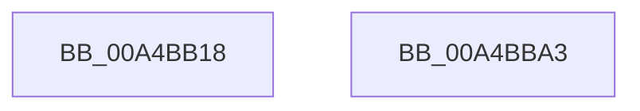

# VslCompleteSecureDriverLoad

- RVA: `0x00A4BB18`–`0x00A4BBA4` (길이 `140` bytes)
- VA: `0x0000000140A4BB18`
- 실행 섹션: `PAGE`
- PDB 이름 있음: `예`; PDB Function 태그: `아니요`
- unwind 정보 RVA: `0x000AFF04`
- 디코드: `33`개 명령, `140/140` bytes 표시
- 미해석 바이트: `0` (있으면 어셈블리에 `.byte`로 보존)

> 이 문서는 커널 이미지의 기계어와 PDB 기호를 분석해 생성했습니다. 4번과 5번은 함수 원형과 자료형을 바이너리 사용 방식에서 추정한 C 해석이며 원본 소스 복구 결과는 아닙니다.

## 1. Dependencies

- 직접 호출 지점: **3**; 고유 호출 대상: **3**
- 직접 호출자로 확인된 함수: **1**
- RIP 상대 이미지 참조: **1**

### Outgoing calls
- `0x00A4BB50` → [memset](../../text/6C/memset_function_006C6C40.md) (function, `0x006C6C40`)
- `0x00A4BB79` → [VslpEnterIumSecureMode](../../text/23/VslpEnterIumSecureMode_function_00235E50.md) (function, `0x00235E50`)
- `0x00A4BB89` → [_security_check_cookie](../../text/6A/_security_check_cookie_function_006AC640.md) (function, `0x006AC640`)

### Direct callers
- [MiCompleteSecureDriverLoad](MiCompleteSecureDriverLoad_function_00A4B920.md) at `0x00A4B972`

### Static image references
- `0x00A4BB2A` → RVA `0x00E0A740` (`.data`; read)

## 2. Other-region calls and transfers

- 다른 실행 섹션으로 향하는 call: **3**
  - `0x00A4BB50` → [memset](../../text/6C/memset_function_006C6C40.md) (`PAGE` → `.text`)
  - `0x00A4BB79` → [VslpEnterIumSecureMode](../../text/23/VslpEnterIumSecureMode_function_00235E50.md) (`PAGE` → `.text`)
  - `0x00A4BB89` → [_security_check_cookie](../../text/6A/_security_check_cookie_function_006AC640.md) (`PAGE` → `.text`)
- 별도 외부 분기/꼬리 이동을 확인하지 못했습니다.

## 3. Assembly (complete function range)

```asm
00A4BB18  48 89 5C 24 08                  mov qword ptr [rsp + 8], rbx
00A4BB1D  48 89 74 24 10                  mov qword ptr [rsp + 0x10], rsi
00A4BB22  57                              push rdi
00A4BB23  48 81 EC A0 00 00 00            sub rsp, 0xa0
00A4BB2A  48 8B 05 0F EC 3B 00            mov rax, qword ptr [rip + 0x3bec0f]
00A4BB31  48 33 C4                        xor rax, rsp
00A4BB34  48 89 84 24 90 00 00 00         mov qword ptr [rsp + 0x90], rax
00A4BB3C  48 8B FA                        mov rdi, rdx
00A4BB3F  41 8B F0                        mov esi, r8d
00A4BB42  33 D2                           xor edx, edx
00A4BB44  48 8B D9                        mov rbx, rcx
00A4BB47  48 8D 4C 24 20                  lea rcx, [rsp + 0x20]
00A4BB4C  44 8D 42 68                     lea r8d, [rdx + 0x68]
00A4BB50  E8 EB B0 C7 FF                  call 0x1406c6c40
00A4BB55  48 83 64 24 40 00               and qword ptr [rsp + 0x40], 0
00A4BB5B  4C 8D 4C 24 20                  lea r9, [rsp + 0x20]
00A4BB60  BA D9 00 00 00                  mov edx, 0xd9
00A4BB65  48 89 5C 24 28                  mov qword ptr [rsp + 0x28], rbx
00A4BB6A  45 33 C0                        xor r8d, r8d
00A4BB6D  48 89 7C 24 30                  mov qword ptr [rsp + 0x30], rdi
00A4BB72  B1 02                           mov cl, 2
00A4BB74  48 89 74 24 38                  mov qword ptr [rsp + 0x38], rsi
00A4BB79  E8 D2 A2 7E FF                  call 0x140235e50
00A4BB7E  48 8B 8C 24 90 00 00 00         mov rcx, qword ptr [rsp + 0x90]
00A4BB86  48 33 CC                        xor rcx, rsp
00A4BB89  E8 B2 0A C6 FF                  call 0x1406ac640
00A4BB8E  4C 8D 9C 24 A0 00 00 00         lea r11, [rsp + 0xa0]
00A4BB96  49 8B 5B 10                     mov rbx, qword ptr [r11 + 0x10]
00A4BB9A  49 8B 73 18                     mov rsi, qword ptr [r11 + 0x18]
00A4BB9E  49 8B E3                        mov rsp, r11
00A4BBA1  5F                              pop rdi
00A4BBA2  C3                              ret
00A4BBA3  CC                              int3
```

## 4. C-style interpretation (structured pseudocode)

```c
__int64 __fastcall VslCompleteSecureDriverLoad(__int64 a1, __int64 a2, int a3)
{
    __int64 result;
    __int64 v_rsp;
    unsigned __int64 v_stack_m18;
    unsigned __int64 v_stack_m68;
    unsigned __int64 v_stack_m70;
    unsigned __int64 v_stack_m78;
    unsigned __int64 v_stack_m8;
    unsigned __int64 v_stack_m80;
    unsigned __int64 v_stack_m88;
    unsigned __int64 v_stack_p10;
    unsigned __int64 v_stack_p8;

    v_stack_p8 = v_rbx;
    v_stack_p10 = v_rsi;
    v_rsp = (v_rsp) - (160);
    result = (*(unsigned __int64 *)(v_rip + 3927055)) ^ (v_rsp);
    v_stack_m18 = result;
    a2 = 0;
    result = memset(v_stack_m88, a2, a2 + 104, a4);
    v_stack_m80 = a1;
    a3 = 0;
    v_stack_m78 = 0;
    v_stack_m70 = (unsigned int)(a3);
    result = VslpEnterIumSecureMode(2, 217, a3, v_stack_m88);
    a1 = (v_stack_m18) ^ (v_rsp);
    result = _security_check_cookie(a1, 217, a3, v_stack_m88);
    return result;
}
```

## 5. (Beta) C Style

```c
int64_t VslCompleteSecureDriverLoad(int64_t Arg1, int64_t Arg2, int32_t Arg3)
{
    int64_t result;
    int64_t local_rsp;
    uint64_t v_stack_m18;
    uint64_t v_stack_m68;
    uint64_t v_stack_m70;
    uint64_t v_stack_m78;
    uint64_t v_stack_m8;
    uint64_t v_stack_m80;
    uint64_t v_stack_m88;
    uint64_t v_stack_p10;
    uint64_t v_stack_p8;

    v_stack_p8 = local_rbx;
    v_stack_p10 = local_rsi;
    local_rsp = (local_rsp) - (160);
    result = (*(uint64_t *)(v_rip + 0x3BEC0F)) ^ (local_rsp);
    v_stack_m18 = result;
    Arg2 = 0;
    result = memset(v_stack_m88, Arg2, Arg2 + 104, a4);
    v_stack_m80 = Arg1;
    Arg3 = 0;
    v_stack_m78 = 0;
    v_stack_m70 = (uint32_t)(Arg3);
    result = VslpEnterIumSecureMode(2, 217, Arg3, v_stack_m88);
    Arg1 = (v_stack_m18) ^ (local_rsp);
    result = _security_check_cookie(Arg1, 217, Arg3, v_stack_m88);
    return result;
}
```

## 6. Execution-region graph

[열기: 2D/3D 그래프와 함수 탐색 컨트롤 패널](../../../control-panel.html?section=page&rva=0x00A4BB18&view=graph)

- 2D 그래프는 위에서 아래로 흐르고, 3D 그래프는 빈 공간을 드래그해 회전합니다. Shift+드래그는 이동, 휠은 확대·축소, 함수 노드 선택은 대상 보고서 이동입니다.

### Static fallback


