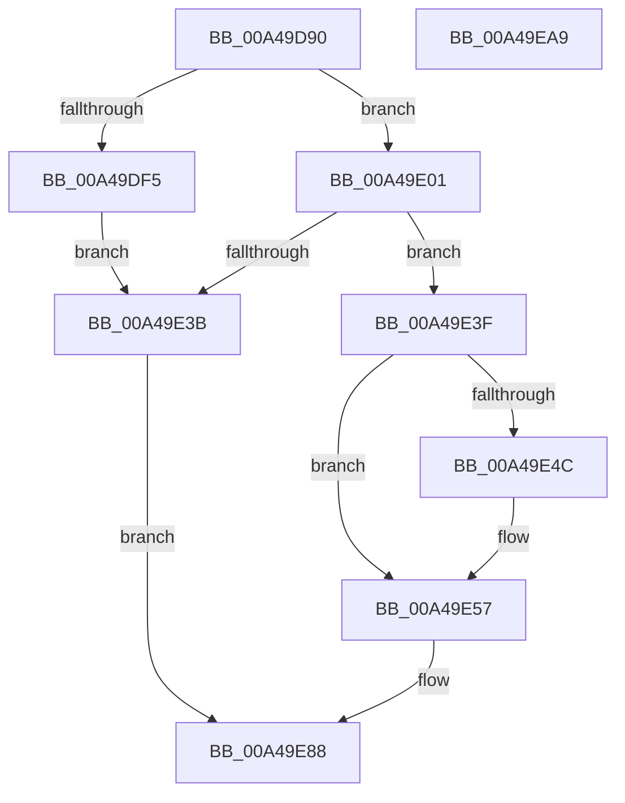

# VslpConnectedStandbyWnfCallback

- RVA: `0x00A49D90`–`0x00A49EAA` (길이 `282` bytes)
- VA: `0x0000000140A49D90`
- 실행 섹션: `PAGE`
- PDB 이름 있음: `예`; PDB Function 태그: `아니요`
- unwind 정보 RVA: `0x000AFF24`
- 디코드: `74`개 명령, `282/282` bytes 표시
- 미해석 바이트: `0` (있으면 어셈블리에 `.byte`로 보존)

> 이 문서는 커널 이미지의 기계어와 PDB 기호를 분석해 생성했습니다. 4번과 5번은 함수 원형과 자료형을 바이너리 사용 방식에서 추정한 C 해석이며 원본 소스 복구 결과는 아닙니다.

## 1. Dependencies

- 직접 호출 지점: **8**; 고유 호출 대상: **7**
- 직접 호출자로 확인된 함수: **0**
- RIP 상대 이미지 참조: **3**

### Outgoing calls
- `0x00A49DCF` → [memset](../../text/6C/memset_function_006C6C40.md) (function, `0x006C6C40`)
- `0x00A49DE8` → [ExpWnfAcquireSubscriptionNameInstance](ExpWnfAcquireSubscriptionNameInstance_function_00A4A51C.md) (function, `0x00A4A51C`)
- `0x00A49DFA` → [KeLeaveCriticalRegion](../../text/25/KeLeaveCriticalRegion_function_0025D8B0.md) (function, `0x0025D8B0`)
- `0x00A49E1B` → [ExpWnfReadStateData](../90/ExpWnfReadStateData_function_00909C50.md) (function, `0x00909C50`)
- `0x00A49E26` → [ExReleaseRundownProtection](../../text/34/ExReleaseRundownProtection_function_00349E80.md) (function, `0x00349E80`)
- `0x00A49E32` → [KeLeaveCriticalRegion](../../text/25/KeLeaveCriticalRegion_function_0025D8B0.md) (function, `0x0025D8B0`)
- `0x00A49E83` → [VslpEnterIumSecureMode](../../text/23/VslpEnterIumSecureMode_function_00235E50.md) (function, `0x00235E50`)
- `0x00A49E8F` → [_security_check_cookie](../../text/6A/_security_check_cookie_function_006AC640.md) (function, `0x006AC640`)

### Direct callers
- 이 함수 시작 RVA로 연결되는 직접 call은 확인되지 않았습니다. 간접 호출은 완전히 역산할 수 없습니다.

### Static image references
- `0x00A49DA7` → RVA `0x00E0A740` (`.data`; read)
- `0x00A49E43` → RVA `0x000146E0` (`.rdata`; read)
- `0x00A49E50` → RVA `0x000146E8` (`.rdata`; read)

## 2. Other-region calls and transfers

- 다른 실행 섹션으로 향하는 call: **6**
  - `0x00A49DCF` → [memset](../../text/6C/memset_function_006C6C40.md) (`PAGE` → `.text`)
  - `0x00A49DFA` → [KeLeaveCriticalRegion](../../text/25/KeLeaveCriticalRegion_function_0025D8B0.md) (`PAGE` → `.text`)
  - `0x00A49E26` → [ExReleaseRundownProtection](../../text/34/ExReleaseRundownProtection_function_00349E80.md) (`PAGE` → `.text`)
  - `0x00A49E32` → [KeLeaveCriticalRegion](../../text/25/KeLeaveCriticalRegion_function_0025D8B0.md) (`PAGE` → `.text`)
  - `0x00A49E83` → [VslpEnterIumSecureMode](../../text/23/VslpEnterIumSecureMode_function_00235E50.md) (`PAGE` → `.text`)
  - `0x00A49E8F` → [_security_check_cookie](../../text/6A/_security_check_cookie_function_006AC640.md) (`PAGE` → `.text`)
- 별도 외부 분기/꼬리 이동을 확인하지 못했습니다.

## 3. Assembly (complete function range)

```asm
00A49D90  48 89 5C 24 10                  mov qword ptr [rsp + 0x10], rbx
00A49D95  48 89 7C 24 18                  mov qword ptr [rsp + 0x18], rdi
00A49D9A  55                              push rbp
00A49D9B  48 8D 6C 24 B9                  lea rbp, [rsp - 0x47]
00A49DA0  48 81 EC E0 00 00 00            sub rsp, 0xe0
00A49DA7  48 8B 05 92 09 3C 00            mov rax, qword ptr [rip + 0x3c0992]
00A49DAE  48 33 C4                        xor rax, rsp
00A49DB1  48 89 45 37                     mov qword ptr [rbp + 0x37], rax
00A49DB5  33 C0                           xor eax, eax
00A49DB7  48 8B D9                        mov rbx, rcx
00A49DBA  0F 57 C0                        xorps xmm0, xmm0
00A49DBD  48 89 45 B7                     mov qword ptr [rbp - 0x49], rax
00A49DC1  33 D2                           xor edx, edx
00A49DC3  48 8D 4D C7                     lea rcx, [rbp - 0x39]
00A49DC7  0F 11 45 A7                     movups xmmword ptr [rbp - 0x59], xmm0
00A49DCB  44 8D 40 68                     lea r8d, [rax + 0x68]
00A49DCF  E8 6C CE C7 FF                  call 0x1406c6c40
00A49DD4  65 48 8B 04 25 88 01 00 00      mov rax, qword ptr gs:[0x188]
00A49DDD  48 8B D3                        mov rdx, rbx
00A49DE0  66 FF 88 E4 01 00 00            dec word ptr [rax + 0x1e4]
00A49DE7  90                              nop
00A49DE8  E8 2F 07 00 00                  call 0x140a4a51c
00A49DED  48 8B F8                        mov rdi, rax
00A49DF0  48 85 C0                        test rax, rax
00A49DF3  75 0C                           jne 0x140a49e01
00A49DF5  BF 34 00 00 C0                  mov edi, 0xc0000034
00A49DFA  E8 B1 3A 81 FF                  call 0x14025d8b0
00A49DFF  EB 3A                           jmp 0x140a49e3b
00A49E01  48 8D 45 97                     lea rax, [rbp - 0x69]
00A49E05  41 B9 18 00 00 00               mov r9d, 0x18
00A49E0B  4C 8D 45 A7                     lea r8, [rbp - 0x59]
00A49E0F  48 89 44 24 20                  mov qword ptr [rsp + 0x20], rax
00A49E14  48 8D 55 9F                     lea rdx, [rbp - 0x61]
00A49E18  48 8B CF                        mov rcx, rdi
00A49E1B  E8 30 FE EB FF                  call 0x140909c50
00A49E20  8B D8                           mov ebx, eax
00A49E22  48 8D 4F 08                     lea rcx, [rdi + 8]
00A49E26  E8 55 00 90 FF                  call 0x140349e80
00A49E2B  33 FF                           xor edi, edi
00A49E2D  85 DB                           test ebx, ebx
00A49E2F  0F 48 FB                        cmovs edi, ebx
00A49E32  E8 79 3A 81 FF                  call 0x14025d8b0
00A49E37  85 FF                           test edi, edi
00A49E39  79 04                           jns 0x140a49e3f
00A49E3B  8B C7                           mov eax, edi
00A49E3D  EB 49                           jmp 0x140a49e88
00A49E3F  48 8B 4D A7                     mov rcx, qword ptr [rbp - 0x59]
00A49E43  48 2B 0D 96 A8 5C FF            sub rcx, qword ptr [rip - 0xa3576a]
00A49E4A  75 0B                           jne 0x140a49e57
00A49E4C  48 8B 4D AF                     mov rcx, qword ptr [rbp - 0x51]
00A49E50  48 2B 0D 91 A8 5C FF            sub rcx, qword ptr [rip - 0xa3576f]
00A49E57  0F B6 45 CF                     movzx eax, byte ptr [rbp - 0x31]
00A49E5B  4C 8D 4D C7                     lea r9, [rbp - 0x39]
00A49E5F  48 85 C9                        test rcx, rcx
00A49E62  BA 01 00 00 00                  mov edx, 1
00A49E67  B1 02                           mov cl, 2
00A49E69  0F 44 C2                        cmove eax, edx
00A49E6C  83 65 DF 00                     and dword ptr [rbp - 0x21], 0
00A49E70  88 45 CF                        mov byte ptr [rbp - 0x31], al
00A49E73  BA 41 00 00 00                  mov edx, 0x41
00A49E78  48 8B 45 B7                     mov rax, qword ptr [rbp - 0x49]
00A49E7C  45 33 C0                        xor r8d, r8d
00A49E7F  48 89 45 D7                     mov qword ptr [rbp - 0x29], rax
00A49E83  E8 C8 BF 7E FF                  call 0x140235e50
00A49E88  48 8B 4D 37                     mov rcx, qword ptr [rbp + 0x37]
00A49E8C  48 33 CC                        xor rcx, rsp
00A49E8F  E8 AC 27 C6 FF                  call 0x1406ac640
00A49E94  4C 8D 9C 24 E0 00 00 00         lea r11, [rsp + 0xe0]
00A49E9C  49 8B 5B 18                     mov rbx, qword ptr [r11 + 0x18]
00A49EA0  49 8B 7B 20                     mov rdi, qword ptr [r11 + 0x20]
00A49EA4  49 8B E3                        mov rsp, r11
00A49EA7  5D                              pop rbp
00A49EA8  C3                              ret
00A49EA9  CC                              int3
```

## 4. C-style interpretation (structured pseudocode)

```c
__int64 __fastcall VslpConnectedStandbyWnfCallback(__int64 a1, int a2)
{
    __int64 result;
    __int64 v_rdi;
    __int64 v_rsp;
    unsigned __int64 v_stack_m18;
    unsigned __int64 v_stack_m4F;
    unsigned int v_stack_m70;
    unsigned __int64 v_stack_m78;
    unsigned __int64 v_stack_m8;
    unsigned __int8 v_stack_m80;
    unsigned __int64 v_stack_m88;
    unsigned __int64 v_stack_m98;
    unsigned __int64 v_stack_mA0;
    unsigned __int64 v_stack_mA8;
    unsigned __int64 v_stack_mB0;
    unsigned __int64 v_stack_mB8;
    unsigned __int64 v_stack_mC8;
    unsigned __int64 v_stack_p10;
    unsigned __int64 v_stack_p18;

    v_stack_p10 = v_rbx;
    v_stack_p18 = v_rdi;
    v_rsp = (v_rsp) - (224);
    result = (*(unsigned __int64 *)(v_rip + 3934610)) ^ (v_rsp);
    v_stack_m18 = result;
    result = 0;
    v_stack_m98 = 0;
    a2 = 0;
    v_stack_mA8 = v_xmm0;
    result = memset(v_stack_m88, a2, result + 104, a4);
    result = ExpWnfAcquireSubscriptionNameInstance(v_stack_m88, a1, result + 104, a4);
    if (result != 0) goto loc_00A49E01;
    result = KeLeaveCriticalRegion(v_stack_m88, a1, result + 104, a4);
    goto loc_00A49E3B;
loc_00A49E01:
    v_stack_mC8 = v_stack_mB8;
    result = ExpWnfReadStateData((unsigned int)(0xC0000034ULL), v_stack_mB0, v_stack_mA8, 24);
    result = ExReleaseRundownProtection((unsigned int)(0xC0000034ULL) + 8, v_stack_mB0, v_stack_mA8, 24);
    v_rdi = 0;
    if (sign_flag) { v_rdi = (unsigned int)((unsigned int)((unsigned int)(result))); }
    result = KeLeaveCriticalRegion((unsigned int)(0xC0000034ULL) + 8, v_stack_mB0, v_stack_mA8, 24);
    if (!sign_flag) goto loc_00A49E3F;
loc_00A49E3B:
    goto loc_00A49E88;
loc_00A49E3F:
    a1 = (v_stack_mA8) - (*(unsigned __int64 *)(v_rip - 10704746));
    if (!(condition_is_not_equal)) {
        a1 = v_stack_mA0;
        a1 = (a1) - (*(unsigned __int64 *)(v_rip - 10704751));
    }
    result = v_stack_m80;
    if (a1 == 0) { result = 1; }
    v_stack_m80 = (unsigned __int8)(result);
    a3 = 0;
    v_stack_m78 = v_stack_m98;
    result = VslpEnterIumSecureMode(2, 65, a3, v_stack_m88);
loc_00A49E88:
    a1 = (v_stack_m18) ^ (v_rsp);
    result = _security_check_cookie(a1, 65, a3, v_stack_m88);
    return result;
}
```

## 5. (Beta) C Style

```c
int64_t VslpConnectedStandbyWnfCallback(int64_t Arg1, int32_t Arg2)
{
    int64_t result;
    int64_t local_rdi;
    int64_t local_rsp;
    uint64_t v_stack_m18;
    uint64_t v_stack_m4F;
    uint32_t v_stack_m70;
    uint64_t v_stack_m78;
    uint64_t v_stack_m8;
    uint8_t v_stack_m80;
    uint64_t v_stack_m88;
    uint64_t v_stack_m98;
    uint64_t v_stack_mA0;
    uint64_t v_stack_mA8;
    uint64_t v_stack_mB0;
    uint64_t v_stack_mB8;
    uint64_t v_stack_mC8;
    uint64_t v_stack_p10;
    uint64_t v_stack_p18;

    v_stack_p10 = local_rbx;
    v_stack_p18 = local_rdi;
    local_rsp = (local_rsp) - (224);
    result = (*(uint64_t *)(v_rip + 0x3C0992)) ^ (local_rsp);
    v_stack_m18 = result;
    result = 0;
    v_stack_m98 = 0;
    Arg2 = 0;
    v_stack_mA8 = v_xmm0;
    result = memset(v_stack_m88, Arg2, result + 104, a4);
    result = ExpWnfAcquireSubscriptionNameInstance(v_stack_m88, Arg1, result + 104, a4);
    if (result != 0) goto loc_00A49E01;
    result = KeLeaveCriticalRegion(v_stack_m88, Arg1, result + 104, a4);
    goto loc_00A49E3B;
loc_00A49E01:
    v_stack_mC8 = v_stack_mB8;
    result = ExpWnfReadStateData((uint32_t)(0xC0000034ULL), v_stack_mB0, v_stack_mA8, 24);
    result = ExReleaseRundownProtection((uint32_t)(0xC0000034ULL) + 8, v_stack_mB0, v_stack_mA8, 24);
    local_rdi = 0;
    if (sign_flag) { local_rdi = (uint32_t)((uint32_t)((uint32_t)(result))); }
    result = KeLeaveCriticalRegion((uint32_t)(0xC0000034ULL) + 8, v_stack_mB0, v_stack_mA8, 24);
    if (!sign_flag) goto loc_00A49E3F;
loc_00A49E3B:
    goto loc_00A49E88;
loc_00A49E3F:
    Arg1 = (v_stack_mA8) - (*(uint64_t *)(v_rip - 0xA3576A));
    if (!(condition_is_not_equal)) {
        Arg1 = v_stack_mA0;
        Arg1 = (Arg1) - (*(uint64_t *)(v_rip - 0xA3576F));
    }
    result = v_stack_m80;
    if (Arg1 == 0) { result = 1; }
    v_stack_m80 = (uint8_t)(result);
    a3 = 0;
    v_stack_m78 = v_stack_m98;
    result = VslpEnterIumSecureMode(2, 65, a3, v_stack_m88);
loc_00A49E88:
    Arg1 = (v_stack_m18) ^ (local_rsp);
    result = _security_check_cookie(Arg1, 65, a3, v_stack_m88);
    return result;
}
```

## 6. Execution-region graph

[열기: 2D/3D 그래프와 함수 탐색 컨트롤 패널](../../../control-panel.html?section=page&rva=0x00A49D90&view=graph)

- 2D 그래프는 위에서 아래로 흐르고, 3D 그래프는 빈 공간을 드래그해 회전합니다. Shift+드래그는 이동, 휠은 확대·축소, 함수 노드 선택은 대상 보고서 이동입니다.

### Static fallback


