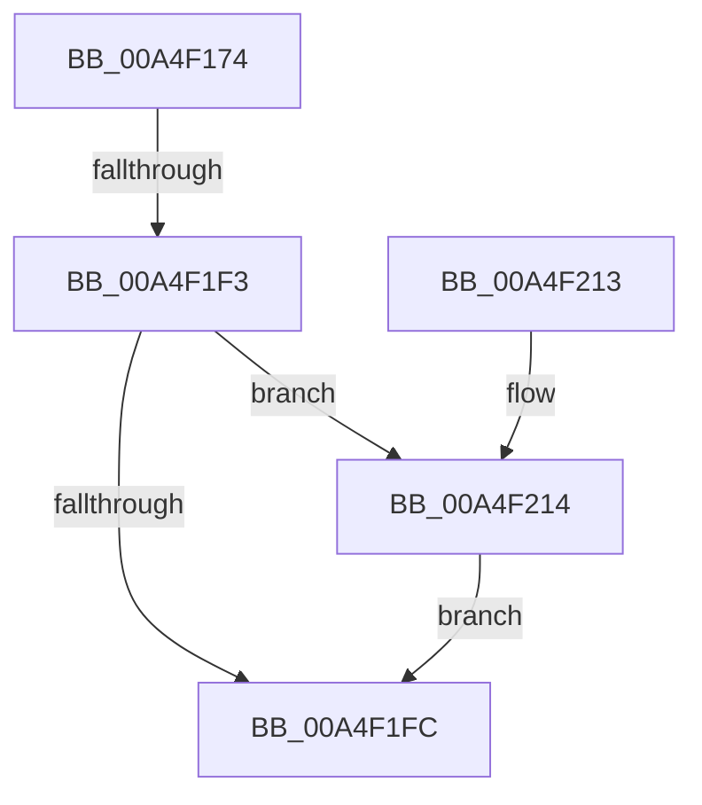

# WmipGetRegistryHideMachine

- RVA: `0x00A4F174`–`0x00A4F21B` (길이 `167` bytes)
- VA: `0x0000000140A4F174`
- 실행 섹션: `PAGE`
- PDB 이름 있음: `예`; PDB Function 태그: `예`
- unwind 정보 RVA: `0x000B0750`
- 디코드: `46`개 명령, `167/167` bytes 표시
- 미해석 바이트: `0` (있으면 어셈블리에 `.byte`로 보존)

> 이 문서는 커널 이미지의 기계어와 PDB 기호를 분석해 생성했습니다. 4번과 5번은 함수 원형과 자료형을 바이너리 사용 방식에서 추정한 C 해석이며 원본 소스 복구 결과는 아닙니다.

## 1. Dependencies

- 직접 호출 지점: **3**; 고유 호출 대상: **3**
- 직접 호출자로 확인된 함수: **1**
- RIP 상대 이미지 참조: **1**

### Outgoing calls
- `0x00A4F1AC` → [RtlInitUnicodeString](../../text/42/RtlInitUnicodeString_function_0042A780.md) (function, `0x0042A780`)
- `0x00A4F1E6` → [ZwOpenKey](../../text/6A/ZwOpenKey_function_006AD310.md) (function, `0x006AD310`)
- `0x00A4F214` → [ZwClose](../../text/6A/ZwClose_function_006AD2B0.md) (function, `0x006AD2B0`)

### Direct callers
- [WmipGetSMBiosTableData](WmipGetSMBiosTableData_function_00A4F078.md) at `0x00A4F0C2`

### Static image references
- `0x00A4F188` → RVA `0x00B06F00` (` ?? ::NNGAKEGL::`string'`; read)

## 2. Other-region calls and transfers

- 다른 실행 섹션으로 향하는 call: **3**
  - `0x00A4F1AC` → [RtlInitUnicodeString](../../text/42/RtlInitUnicodeString_function_0042A780.md) (`PAGE` → `.text`)
  - `0x00A4F1E6` → [ZwOpenKey](../../text/6A/ZwOpenKey_function_006AD310.md) (`PAGE` → `.text`)
  - `0x00A4F214` → [ZwClose](../../text/6A/ZwClose_function_006AD2B0.md) (`PAGE` → `.text`)
- call이 아닌 외부 분기/꼬리 이동: **1**
  - `0x00A4F1ED` → [sub_00B3C4A0](../B3/Unknown_function_00B3C4A0.md) (`tail-transfer`)

## 3. Assembly (complete function range)

```asm
00A4F174  48 89 5C 24 18                  mov qword ptr [rsp + 0x18], rbx
00A4F179  48 89 7C 24 20                  mov qword ptr [rsp + 0x20], rdi
00A4F17E  55                              push rbp
00A4F17F  48 8B EC                        mov rbp, rsp
00A4F182  48 83 EC 70                     sub rsp, 0x70
00A4F186  33 C0                           xor eax, eax
00A4F188  48 8D 15 71 7D 0B 00            lea rdx, [rip + 0xb7d71]
00A4F18F  21 45 EC                        and dword ptr [rbp - 0x14], eax
00A4F192  48 8D 4D C0                     lea rcx, [rbp - 0x40]
00A4F196  21 45 10                        and dword ptr [rbp + 0x10], eax
00A4F199  0F 57 C0                        xorps xmm0, xmm0
00A4F19C  48 21 45 18                     and qword ptr [rbp + 0x18], rax
00A4F1A0  33 FF                           xor edi, edi
00A4F1A2  89 45 D4                        mov dword ptr [rbp - 0x2c], eax
00A4F1A5  21 45 D4                        and dword ptr [rbp - 0x2c], eax
00A4F1A8  0F 11 45 C0                     movups xmmword ptr [rbp - 0x40], xmm0
00A4F1AC  E8 CF B5 9D FF                  call 0x14042a780
00A4F1B1  21 7D D4                        and dword ptr [rbp - 0x2c], edi
00A4F1B4  48 8D 45 C0                     lea rax, [rbp - 0x40]
00A4F1B8  21 7D EC                        and dword ptr [rbp - 0x14], edi
00A4F1BB  4C 8D 45 D0                     lea r8, [rbp - 0x30]
00A4F1BF  48 21 7D D8                     and qword ptr [rbp - 0x28], rdi
00A4F1C3  48 8D 4D 18                     lea rcx, [rbp + 0x18]
00A4F1C7  0F 57 C0                        xorps xmm0, xmm0
00A4F1CA  48 89 45 E0                     mov qword ptr [rbp - 0x20], rax
00A4F1CE  BA 19 00 02 00                  mov edx, 0x20019
00A4F1D3  C7 45 D0 30 00 00 00            mov dword ptr [rbp - 0x30], 0x30
00A4F1DA  F3 0F 7F 45 F0                  movdqu xmmword ptr [rbp - 0x10], xmm0
00A4F1DF  C7 45 E8 40 02 00 00            mov dword ptr [rbp - 0x18], 0x240
00A4F1E6  E8 25 E1 C5 FF                  call 0x1406ad310
00A4F1EB  85 C0                           test eax, eax
00A4F1ED  0F 89 AD D2 0E 00               jns 0x140b3c4a0
00A4F1F3  48 8B 4D 18                     mov rcx, qword ptr [rbp + 0x18]
00A4F1F7  48 85 C9                        test rcx, rcx
00A4F1FA  75 18                           jne 0x140a4f214
00A4F1FC  85 FF                           test edi, edi
00A4F1FE  4C 8D 5C 24 70                  lea r11, [rsp + 0x70]
00A4F203  49 8B 5B 20                     mov rbx, qword ptr [r11 + 0x20]
00A4F207  49 8B 7B 28                     mov rdi, qword ptr [r11 + 0x28]
00A4F20B  0F 95 C0                        setne al
00A4F20E  49 8B E3                        mov rsp, r11
00A4F211  5D                              pop rbp
00A4F212  C3                              ret
00A4F213  CC                              int3
00A4F214  E8 97 E0 C5 FF                  call 0x1406ad2b0
00A4F219  EB E1                           jmp 0x140a4f1fc
```

## 4. C-style interpretation (structured pseudocode)

```c
__int64 __fastcall WmipGetRegistryHideMachine(void)
{
    __int64 result;
    __int64 v_rdi;
    __int64 v_rsp;
    unsigned __int64 v_stack_m18;
    unsigned int v_stack_m1C;
    unsigned int v_stack_m20;
    unsigned __int64 v_stack_m28;
    unsigned __int64 v_stack_m30;
    unsigned int v_stack_m34;
    unsigned __int64 v_stack_m38;
    unsigned __int64 v_stack_m48;
    unsigned __int64 v_stack_m8;
    unsigned __int64 v_stack_p10;
    unsigned __int64 v_stack_p18;
    unsigned __int64 v_stack_p20;
    unsigned int v_stack_p8;

    v_stack_p18 = v_rbx;
    v_stack_p20 = v_rdi;
    v_rsp = (v_rsp) - (112);
    result = 0;
    v_rdi = 0;
    v_stack_m34 = 0;
    v_stack_m48 = v_xmm0;
    result = RtlInitUnicodeString(v_stack_m48, v_rip + 753009, a3, a4);
    v_stack_m28 = v_stack_m48;
    v_stack_m38 = 48;
    v_stack_m18 = v_xmm0;
    v_stack_m20 = 576;
    result = ZwOpenKey(v_stack_p10, (unsigned int)(0x20019ULL), v_stack_m38, a4);
    if (v_stack_p10 != 0) goto loc_00A4F214;
loc_00A4F1FC:
    result = (0 != 0) ? 1 : 0;
    return result;
loc_00A4F214:
    result = ZwClose(v_stack_p10, (unsigned int)(0x20019ULL), v_stack_m38, a4);
    goto loc_00A4F1FC;
}
```

## 5. (Beta) C Style

```c
void WmipGetRegistryHideMachine(void)
{
    int64_t result;
    int64_t local_rdi;
    int64_t local_rsp;
    uint64_t v_stack_m18;
    uint32_t v_stack_m1C;
    uint32_t v_stack_m20;
    uint64_t v_stack_m28;
    uint64_t v_stack_m30;
    uint32_t v_stack_m34;
    uint64_t v_stack_m38;
    uint64_t v_stack_m48;
    uint64_t v_stack_m8;
    uint64_t v_stack_p10;
    uint64_t v_stack_p18;
    uint64_t v_stack_p20;
    uint32_t v_stack_p8;

    v_stack_p18 = local_rbx;
    v_stack_p20 = local_rdi;
    local_rsp = (local_rsp) - (112);
    result = 0;
    local_rdi = 0;
    v_stack_m34 = 0;
    v_stack_m48 = v_xmm0;
    result = RtlInitUnicodeString(v_stack_m48, v_rip + 753009, a3, a4);
    v_stack_m28 = v_stack_m48;
    v_stack_m38 = 48;
    v_stack_m18 = v_xmm0;
    v_stack_m20 = 576;
    result = ZwOpenKey(v_stack_p10, (uint32_t)(0x20019ULL), v_stack_m38, a4);
    if (v_stack_p10 != 0) goto loc_00A4F214;
loc_00A4F1FC:
    result = (0 != 0) ? 1 : 0;
    return result;
loc_00A4F214:
    result = ZwClose(v_stack_p10, (uint32_t)(0x20019ULL), v_stack_m38, a4);
    goto loc_00A4F1FC;
}
```

## 6. Execution-region graph

[열기: 2D/3D 그래프와 함수 탐색 컨트롤 패널](../../../control-panel.html?section=page&rva=0x00A4F174&view=graph)

- 2D 그래프는 위에서 아래로 흐르고, 3D 그래프는 빈 공간을 드래그해 회전합니다. Shift+드래그는 이동, 휠은 확대·축소, 함수 노드 선택은 대상 보고서 이동입니다.

### Static fallback


