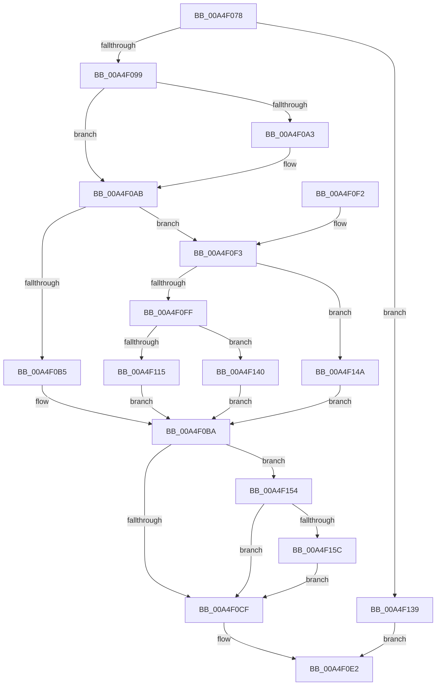

# WmipGetSMBiosTableData

- RVA: `0x00A4F078`–`0x00A4F16B` (길이 `243` bytes)
- VA: `0x0000000140A4F078`
- 실행 섹션: `PAGE`
- PDB 이름 있음: `예`; PDB Function 태그: `아니요`
- unwind 정보 RVA: `0x0009F838`
- 디코드: `63`개 명령, `243/243` bytes 표시
- 미해석 바이트: `0` (있으면 어셈블리에 `.byte`로 보존)

> 이 문서는 커널 이미지의 기계어와 PDB 기호를 분석해 생성했습니다. 4번과 5번은 함수 원형과 자료형을 바이너리 사용 방식에서 추정한 C 해석이며 원본 소스 복구 결과는 아닙니다.

## 1. Dependencies

- 직접 호출 지점: **8**; 고유 호출 대상: **8**
- 직접 호출자로 확인된 함수: **2**
- RIP 상대 이미지 참조: **4**

### Outgoing calls
- `0x00A4F099` → [WmipAcquireSmbiosLockShared](WmipAcquireSmbiosLockShared_function_00A4F224.md) (function, `0x00A4F224`)
- `0x00A4F0C2` → [WmipGetRegistryHideMachine](WmipGetRegistryHideMachine_function_00A4F174.md) (function, `0x00A4F174`)
- `0x00A4F0D6` → [ExReleaseResourceLite](../../text/25/ExReleaseResourceLite_function_0025FA10.md) (function, `0x0025FA10`)
- `0x00A4F0DB` → [KeLeaveCriticalRegion](../../text/25/KeLeaveCriticalRegion_function_0025D8B0.md) (function, `0x0025D8B0`)
- `0x00A4F108` → [MmMapIoSpaceEx](../../text/32/MmMapIoSpaceEx_function_00327830.md) (function, `0x00327830`)
- `0x00A4F122` → [RtlCopyDeviceMemory](../../text/52/RtlCopyDeviceMemory_function_00522BFC.md) (function, `0x00522BFC`)
- `0x00A4F130` → [MmUnmapIoSpace](../../text/3F/MmUnmapIoSpace_function_003F78F0.md) (function, `0x003F78F0`)
- `0x00A4F161` → [WmipSMBiosHideMachine](../7B/WmipSMBiosHideMachine_function_007B335C.md) (function, `0x007B335C`)

### Direct callers
- [WmipRawSMBiosTableHandler](../../text/49/WmipRawSMBiosTableHandler_function_00496840.md) at `0x0049686D`
- [WmipRawSMBiosTableHandler](../../text/49/WmipRawSMBiosTableHandler_function_00496840.md) at `0x0049689A`
- [WmipQueryWmiDataBlock](WmipQueryWmiDataBlock_function_00A4EDA0.md) at `0x00A4EE28`

### Static image references
- `0x00A4F0A3` → RVA `0x00FD805C` (`PAGEDATA`; read)
- `0x00A4F0AB` → RVA `0x00FD8038` (`PAGEDATA`; read)
- `0x00A4F0CF` → RVA `0x00EFFB40` (`.data`; read)
- `0x00A4F0F3` → RVA `0x00FD80E8` (`PAGEDATA`; read)

## 2. Other-region calls and transfers

- 다른 실행 섹션으로 향하는 call: **5**
  - `0x00A4F0D6` → [ExReleaseResourceLite](../../text/25/ExReleaseResourceLite_function_0025FA10.md) (`PAGE` → `.text`)
  - `0x00A4F0DB` → [KeLeaveCriticalRegion](../../text/25/KeLeaveCriticalRegion_function_0025D8B0.md) (`PAGE` → `.text`)
  - `0x00A4F108` → [MmMapIoSpaceEx](../../text/32/MmMapIoSpaceEx_function_00327830.md) (`PAGE` → `.text`)
  - `0x00A4F122` → [RtlCopyDeviceMemory](../../text/52/RtlCopyDeviceMemory_function_00522BFC.md) (`PAGE` → `.text`)
  - `0x00A4F130` → [MmUnmapIoSpace](../../text/3F/MmUnmapIoSpace_function_003F78F0.md) (`PAGE` → `.text`)
- 별도 외부 분기/꼬리 이동을 확인하지 못했습니다.

## 3. Assembly (complete function range)

```asm
00A4F078  48 89 5C 24 08                  mov qword ptr [rsp + 8], rbx
00A4F07D  48 89 74 24 10                  mov qword ptr [rsp + 0x10], rsi
00A4F082  57                              push rdi
00A4F083  48 83 EC 20                     sub rsp, 0x20
00A4F087  49 8B D8                        mov rbx, r8
00A4F08A  48 8B FA                        mov rdi, rdx
00A4F08D  48 8B F1                        mov rsi, rcx
00A4F090  48 85 D2                        test rdx, rdx
00A4F093  0F 84 A0 00 00 00               je 0x140a4f139
00A4F099  E8 86 01 00 00                  call 0x140a4f224
00A4F09E  48 85 DB                        test rbx, rbx
00A4F0A1  74 08                           je 0x140a4f0ab
00A4F0A3  8B 05 B3 8F 58 00               mov eax, dword ptr [rip + 0x588fb3]
00A4F0A9  89 03                           mov dword ptr [rbx], eax
00A4F0AB  8B 05 87 8F 58 00               mov eax, dword ptr [rip + 0x588f87]
00A4F0B1  39 07                           cmp dword ptr [rdi], eax
00A4F0B3  73 3E                           jae 0x140a4f0f3
00A4F0B5  BB 23 00 00 C0                  mov ebx, 0xc0000023
00A4F0BA  8B 05 78 8F 58 00               mov eax, dword ptr [rip + 0x588f78]
00A4F0C0  89 07                           mov dword ptr [rdi], eax
00A4F0C2  E8 AD 00 00 00                  call 0x140a4f174
00A4F0C7  84 C0                           test al, al
00A4F0C9  0F 85 85 00 00 00               jne 0x140a4f154
00A4F0CF  48 8D 0D 6A 0A 4B 00            lea rcx, [rip + 0x4b0a6a]
00A4F0D6  E8 35 09 81 FF                  call 0x14025fa10
00A4F0DB  E8 D0 E7 80 FF                  call 0x14025d8b0
00A4F0E0  8B C3                           mov eax, ebx
00A4F0E2  48 8B 5C 24 30                  mov rbx, qword ptr [rsp + 0x30]
00A4F0E7  48 8B 74 24 38                  mov rsi, qword ptr [rsp + 0x38]
00A4F0EC  48 83 C4 20                     add rsp, 0x20
00A4F0F0  5F                              pop rdi
00A4F0F1  C3                              ret
00A4F0F2  CC                              int3
00A4F0F3  48 8B 0D EE 8F 58 00            mov rcx, qword ptr [rip + 0x588fee]
00A4F0FA  48 85 C9                        test rcx, rcx
00A4F0FD  74 4B                           je 0x140a4f14a
00A4F0FF  48 8B D0                        mov rdx, rax
00A4F102  41 B8 04 00 00 00               mov r8d, 4
00A4F108  E8 23 87 8D FF                  call 0x140327830
00A4F10D  48 8B D8                        mov rbx, rax
00A4F110  48 85 C0                        test rax, rax
00A4F113  74 2B                           je 0x140a4f140
00A4F115  44 8B 05 1C 8F 58 00            mov r8d, dword ptr [rip + 0x588f1c]
00A4F11C  48 8B D0                        mov rdx, rax
00A4F11F  48 8B CE                        mov rcx, rsi
00A4F122  E8 D5 3A AD FF                  call 0x140522bfc
00A4F127  8B 15 0B 8F 58 00               mov edx, dword ptr [rip + 0x588f0b]
00A4F12D  48 8B CB                        mov rcx, rbx
00A4F130  E8 BB 87 9A FF                  call 0x1403f78f0
00A4F135  33 DB                           xor ebx, ebx
00A4F137  EB 81                           jmp 0x140a4f0ba
00A4F139  B8 0D 00 00 C0                  mov eax, 0xc000000d
00A4F13E  EB A2                           jmp 0x140a4f0e2
00A4F140  BB 9A 00 00 C0                  mov ebx, 0xc000009a
00A4F145  E9 70 FF FF FF                  jmp 0x140a4f0ba
00A4F14A  BB 10 00 00 C0                  mov ebx, 0xc0000010
00A4F14F  E9 66 FF FF FF                  jmp 0x140a4f0ba
00A4F154  85 DB                           test ebx, ebx
00A4F156  0F 88 73 FF FF FF               js 0x140a4f0cf
00A4F15C  8B 17                           mov edx, dword ptr [rdi]
00A4F15E  48 8B CE                        mov rcx, rsi
00A4F161  E8 F6 41 D6 FF                  call 0x1407b335c
00A4F166  E9 64 FF FF FF                  jmp 0x140a4f0cf
```

## 4. C-style interpretation (structured pseudocode)

```c
__int64 __fastcall WmipGetSMBiosTableData(__int64 a1, __int64 a2, __int64 a3)
{
    __int64 result;
    __int64 v_rbx;
    __int64 v_rsp;
    unsigned __int64 v_stack_p10;
    unsigned __int64 v_stack_p8;

    v_stack_p8 = v_rbx;
    v_stack_p10 = v_rsi;
    v_rsp = (v_rsp) - (32);
    if (a2 == 0) goto loc_00A4F139;
    result = WmipAcquireSmbiosLockShared(a1, a2, a3, a4);
    if (a3 != 0) {
        result = *(unsigned int *)(v_rip + 5803955);
        *(unsigned int *)(a3) = (unsigned int)(result);
    }
    if ((*(unsigned int *)(a2)) >= ((unsigned int)((unsigned int)(*(unsigned int *)(v_rip + 5803911))))) goto loc_00A4F0F3;
loc_00A4F0BA:
    *(unsigned int *)(a2) = (unsigned int)((unsigned int)(*(unsigned int *)(v_rip + 5803896)));
    result = WmipGetRegistryHideMachine(a1, a2, a3, a4);
    if ((unsigned __int8)(result) != 0) goto loc_00A4F154;
loc_00A4F0CF:
    result = ExReleaseResourceLite(v_rip + 4917866, a2, a3, a4);
    result = KeLeaveCriticalRegion(v_rip + 4917866, a2, a3, a4);
loc_00A4F0E2:
    v_rsp = (v_rsp) + (32);
    return (unsigned int)((unsigned int)((unsigned int)(0xC0000023ULL)));
loc_00A4F0F3:
    if (*(unsigned __int64 *)(v_rip + 5804014) == 0) goto loc_00A4F14A;
    result = MmMapIoSpaceEx(*(unsigned __int64 *)(v_rip + 5804014), (unsigned int)((unsigned int)((unsigned int)(0xC0000023ULL))), 4, a4);
    if (result == 0) goto loc_00A4F140;
    result = RtlCopyDeviceMemory(v_stack_p10, result, (unsigned int)(*(unsigned int *)(v_rip + 5803804)), a4);
    result = MmUnmapIoSpace(result, (unsigned int)(*(unsigned int *)(v_rip + 5803787)), (unsigned int)(*(unsigned int *)(v_rip + 5803804)), a4);
    v_rbx = 0;
    goto loc_00A4F0BA;
loc_00A4F139:
    goto loc_00A4F0E2;
loc_00A4F140:
    goto loc_00A4F0BA;
loc_00A4F14A:
    goto loc_00A4F0BA;
loc_00A4F154:
    if (sign_flag) goto loc_00A4F0CF;
    result = WmipSMBiosHideMachine(v_stack_p10, (unsigned int)(*(unsigned int *)(a2)), (unsigned int)(*(unsigned int *)(v_rip + 5803804)), a4);
    goto loc_00A4F0CF;
}
```

## 5. (Beta) C Style

```c
int64_t WmipGetSMBiosTableData(int64_t Arg1, void *Arg2, int64_t Arg3)
{
    uint8_t *arg2 = (uint8_t *)Arg2;

    int64_t result;
    int64_t local_rbx;
    int64_t local_rsp;
    uint64_t v_stack_p10;
    uint64_t v_stack_p8;

    v_stack_p8 = local_rbx;
    v_stack_p10 = local_rsi;
    local_rsp = (local_rsp) - (32);
    if (Arg2 == NULL) goto loc_00A4F139;
    result = WmipAcquireSmbiosLockShared(Arg1, Arg2, Arg3, a4);
    if (Arg3 != 0) {
        result = *(uint32_t *)(v_rip + 0x588FB3);
        *(uint32_t *)(Arg3) = (uint32_t)(result);
    }
    if ((*(uint32_t *)(arg2)) >= ((uint32_t)((uint32_t)(*(uint32_t *)(v_rip + 0x588F87))))) goto loc_00A4F0F3;
loc_00A4F0BA:
    *(uint32_t *)(arg2) = (uint32_t)((uint32_t)(*(uint32_t *)(v_rip + 0x588F78)));
    result = WmipGetRegistryHideMachine(Arg1, Arg2, Arg3, a4);
    if ((uint8_t)(result) != 0) goto loc_00A4F154;
loc_00A4F0CF:
    result = ExReleaseResourceLite(v_rip + 4917866, Arg2, Arg3, a4);
    result = KeLeaveCriticalRegion(v_rip + 4917866, Arg2, Arg3, a4);
loc_00A4F0E2:
    local_rsp = (local_rsp) + (32);
    return (uint32_t)((uint32_t)((uint32_t)(0xC0000023ULL)));
loc_00A4F0F3:
    if (*(uint64_t *)(v_rip + 0x588FEE) == 0) goto loc_00A4F14A;
    result = MmMapIoSpaceEx(*(uint64_t *)(v_rip + 0x588FEE), (uint32_t)((uint32_t)((uint32_t)(0xC0000023ULL))), 4, a4);
    if (result == 0) goto loc_00A4F140;
    result = RtlCopyDeviceMemory(v_stack_p10, result, (uint32_t)(*(uint32_t *)(v_rip + 0x588F1C)), a4);
    result = MmUnmapIoSpace(result, (uint32_t)(*(uint32_t *)(v_rip + 0x588F0B)), (uint32_t)(*(uint32_t *)(v_rip + 0x588F1C)), a4);
    local_rbx = 0;
    goto loc_00A4F0BA;
loc_00A4F139:
    goto loc_00A4F0E2;
loc_00A4F140:
    goto loc_00A4F0BA;
loc_00A4F14A:
    goto loc_00A4F0BA;
loc_00A4F154:
    if (sign_flag) goto loc_00A4F0CF;
    result = WmipSMBiosHideMachine(v_stack_p10, (uint32_t)(*(uint32_t *)(arg2)), (uint32_t)(*(uint32_t *)(v_rip + 0x588F1C)), a4);
    goto loc_00A4F0CF;
}
```

### 관측된 메모리 오프셋

구조체 형식이 확인되지 않은 접근은 인자 기준의 오프셋으로만 기록했습니다.

| 기준 인자 | 오프셋 표현 | 폭 (bit) | 접근 |
|---|---:|---:|---|
| `Arg2` | `+ 0x0` | `32` | `R` |
| `Arg2` | `+ 0x0` | `32` | `W` |

## 6. Execution-region graph

[열기: 2D/3D 그래프와 함수 탐색 컨트롤 패널](../../../control-panel.html?section=page&rva=0x00A4F078&view=graph)

- 2D 그래프는 위에서 아래로 흐르고, 3D 그래프는 빈 공간을 드래그해 회전합니다. Shift+드래그는 이동, 휠은 확대·축소, 함수 노드 선택은 대상 보고서 이동입니다.

### Static fallback


