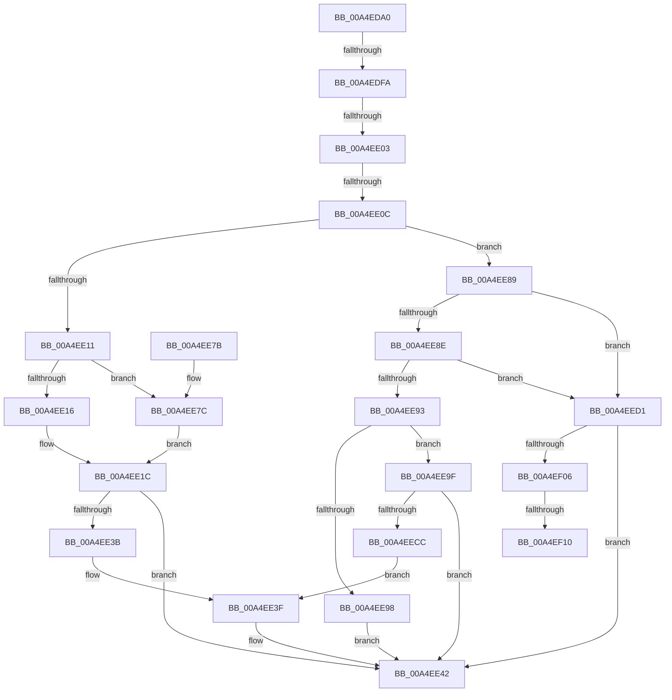

# WmipQueryWmiDataBlock

- RVA: `0x00A4EDA0`–`0x00A4EF26` (길이 `390` bytes)
- VA: `0x0000000140A4EDA0`
- 실행 섹션: `PAGE`
- PDB 이름 있음: `예`; PDB Function 태그: `예`
- unwind 정보 RVA: `0x000B06F4`
- 디코드: `109`개 명령, `390/390` bytes 표시
- 미해석 바이트: `0` (있으면 어셈블리에 `.byte`로 보존)

> 이 문서는 커널 이미지의 기계어와 PDB 기호를 분석해 생성했습니다. 4번과 5번은 함수 원형과 자료형을 바이너리 사용 방식에서 추정한 C 해석이며 원본 소스 복구 결과는 아닙니다.

## 1. Dependencies

- 직접 호출 지점: **5**; 고유 호출 대상: **5**
- 직접 호출자로 확인된 함수: **1**
- RIP 상대 이미지 참조: **1**

### Outgoing calls
- `0x00A4EE28` → [WmipGetSMBiosTableData](WmipGetSMBiosTableData_function_00A4F078.md) (function, `0x00A4F078`)
- `0x00A4EE4F` → [IoWMICompleteRequest](IoWMICompleteRequest_function_00A4EF2C.md) (function, `0x00A4EF2C`)
- `0x00A4EE5B` → [_security_check_cookie](../../text/6A/_security_check_cookie_function_006AC640.md) (function, `0x006AC640`)
- `0x00A4EEB8` → [WmipGetSMBiosEventlog](../7B/WmipGetSMBiosEventlog_function_007B2B58.md) (function, `0x007B2B58`)
- `0x00A4EEF7` → [WmipGetSysIds](../7B/WmipGetSysIds_function_007B2DB0.md) (function, `0x007B2DB0`)

### Direct callers
- [IoWMISystemControl](IoWMISystemControl_function_00A4EB04.md) at `0x00A4EC65`

### Static image references
- `0x00A4EDBC` → RVA `0x00E0A740` (`.data`; read)

## 2. Other-region calls and transfers

- 다른 실행 섹션으로 향하는 call: **1**
  - `0x00A4EE5B` → [_security_check_cookie](../../text/6A/_security_check_cookie_function_006AC640.md) (`PAGE` → `.text`)
- call이 아닌 외부 분기/꼬리 이동: **5**
  - `0x00A4EDF4` → [sub_00B3C216 + 0x188](../B3/Unknown_function_00B3C216.md) (`tail-transfer`)
  - `0x00A4EDFD` → [sub_00B3C216 + 0x105](../B3/Unknown_function_00B3C216.md) (`tail-transfer`)
  - `0x00A4EE06` → [sub_00B3C216 + 0x39](../B3/Unknown_function_00B3C216.md) (`tail-transfer`)
  - `0x00A4EF0A` → [sub_00B3C216](../B3/Unknown_function_00B3C216.md) (`tail-transfer`)
  - `0x00A4EF21` → [sub_00B3C216 + 0x10](../B3/Unknown_function_00B3C216.md) (`tail-transfer`)

## 3. Assembly (complete function range)

```asm
00A4EDA0  48 89 5C 24 18                  mov qword ptr [rsp + 0x18], rbx
00A4EDA5  55                              push rbp
00A4EDA6  56                              push rsi
00A4EDA7  57                              push rdi
00A4EDA8  41 54                           push r12
00A4EDAA  41 55                           push r13
00A4EDAC  41 56                           push r14
00A4EDAE  41 57                           push r15
00A4EDB0  48 8D 6C 24 B0                  lea rbp, [rsp - 0x50]
00A4EDB5  48 81 EC 50 01 00 00            sub rsp, 0x150
00A4EDBC  48 8B 05 7D B9 3B 00            mov rax, qword ptr [rip + 0x3bb97d]
00A4EDC3  48 33 C4                        xor rax, rsp
00A4EDC6  48 89 45 40                     mov qword ptr [rbp + 0x40], rax
00A4EDCA  48 8B B5 C8 00 00 00            mov rsi, qword ptr [rbp + 0xc8]
00A4EDD1  33 FF                           xor edi, edi
00A4EDD3  8B 9D C0 00 00 00               mov ebx, dword ptr [rbp + 0xc0]
00A4EDD9  45 8B E8                        mov r13d, r8d
00A4EDDC  4C 8B BD B8 00 00 00            mov r15, qword ptr [rbp + 0xb8]
00A4EDE3  44 8B F7                        mov r14d, edi
00A4EDE6  48 89 54 24 58                  mov qword ptr [rsp + 0x58], rdx
00A4EDEB  44 8B E7                        mov r12d, edi
00A4EDEE  41 8B C0                        mov eax, r8d
00A4EDF1  45 85 C0                        test r8d, r8d
00A4EDF4  0F 84 A4 D5 0E 00               je 0x140b3c39e
00A4EDFA  83 E8 01                        sub eax, 1
00A4EDFD  0F 84 18 D5 0E 00               je 0x140b3c31b
00A4EE03  83 E8 01                        sub eax, 1
00A4EE06  0F 84 43 D4 0E 00               je 0x140b3c24f
00A4EE0C  83 E8 01                        sub eax, 1
00A4EE0F  75 78                           jne 0x140a4ee89
00A4EE11  83 FB 08                        cmp ebx, 8
00A4EE14  73 66                           jae 0x140a4ee7c
00A4EE16  8B CF                           mov ecx, edi
00A4EE18  8B F7                           mov esi, edi
00A4EE1A  8B DF                           mov ebx, edi
00A4EE1C  4C 8B C6                        mov r8, rsi
00A4EE1F  89 5C 24 30                     mov dword ptr [rsp + 0x30], ebx
00A4EE23  48 8D 54 24 30                  lea rdx, [rsp + 0x30]
00A4EE28  E8 4B 02 00 00                  call 0x140a4f078
00A4EE2D  8B F8                           mov edi, eax
00A4EE2F  8B 44 24 30                     mov eax, dword ptr [rsp + 0x30]
00A4EE33  44 8D 70 08                     lea r14d, [rax + 8]
00A4EE37  85 FF                           test edi, edi
00A4EE39  78 07                           js 0x140a4ee42
00A4EE3B  41 89 04 24                     mov dword ptr [r12], eax
00A4EE3F  45 89 37                        mov dword ptr [r15], r14d
00A4EE42  4C 8B 44 24 58                  mov r8, qword ptr [rsp + 0x58]
00A4EE47  44 8B CF                        mov r9d, edi
00A4EE4A  44 89 74 24 20                  mov dword ptr [rsp + 0x20], r14d
00A4EE4F  E8 D8 00 00 00                  call 0x140a4ef2c
00A4EE54  48 8B 4D 40                     mov rcx, qword ptr [rbp + 0x40]
00A4EE58  48 33 CC                        xor rcx, rsp
00A4EE5B  E8 E0 D7 C5 FF                  call 0x1406ac640
00A4EE60  48 8B 9C 24 A0 01 00 00         mov rbx, qword ptr [rsp + 0x1a0]
00A4EE68  48 81 C4 50 01 00 00            add rsp, 0x150
00A4EE6F  41 5F                           pop r15
00A4EE71  41 5E                           pop r14
00A4EE73  41 5D                           pop r13
00A4EE75  41 5C                           pop r12
00A4EE77  5F                              pop rdi
00A4EE78  5E                              pop rsi
00A4EE79  5D                              pop rbp
00A4EE7A  C3                              ret
00A4EE7B  CC                              int3
00A4EE7C  4C 8D 66 04                     lea r12, [rsi + 4]
00A4EE80  83 C3 F8                        add ebx, -8
00A4EE83  48 8D 4E 08                     lea rcx, [rsi + 8]
00A4EE87  EB 93                           jmp 0x140a4ee1c
00A4EE89  83 E8 01                        sub eax, 1
00A4EE8C  74 43                           je 0x140a4eed1
00A4EE8E  83 E8 01                        sub eax, 1
00A4EE91  74 3E                           je 0x140a4eed1
00A4EE93  83 F8 01                        cmp eax, 1
00A4EE96  74 07                           je 0x140a4ee9f
00A4EE98  BF 95 02 00 C0                  mov edi, 0xc0000295
00A4EE9D  EB A3                           jmp 0x140a4ee42
00A4EE9F  8B C3                           mov eax, ebx
00A4EEA1  48 8D 54 24 34                  lea rdx, [rsp + 0x34]
00A4EEA6  F7 D8                           neg eax
00A4EEA8  1B C9                           sbb ecx, ecx
00A4EEAA  23 CB                           and ecx, ebx
00A4EEAC  89 4C 24 34                     mov dword ptr [rsp + 0x34], ecx
00A4EEB0  F7 DB                           neg ebx
00A4EEB2  48 1B C9                        sbb rcx, rcx
00A4EEB5  48 23 CE                        and rcx, rsi
00A4EEB8  E8 9B 3C D6 FF                  call 0x1407b2b58
00A4EEBD  44 8B 74 24 34                  mov r14d, dword ptr [rsp + 0x34]
00A4EEC2  8B F8                           mov edi, eax
00A4EEC4  85 C0                           test eax, eax
00A4EEC6  0F 88 76 FF FF FF               js 0x140a4ee42
00A4EECC  E9 6E FF FF FF                  jmp 0x140a4ee3f
00A4EED1  4C 8D 4C 24 34                  lea r9, [rsp + 0x34]
00A4EED6  48 89 7C 24 50                  mov qword ptr [rsp + 0x50], rdi
00A4EEDB  4C 8D 44 24 38                  lea r8, [rsp + 0x38]
00A4EEE0  89 7C 24 30                     mov dword ptr [rsp + 0x30], edi
00A4EEE4  48 8D 54 24 30                  lea rdx, [rsp + 0x30]
00A4EEE9  48 89 7C 24 38                  mov qword ptr [rsp + 0x38], rdi
00A4EEEE  48 8D 4C 24 50                  lea rcx, [rsp + 0x50]
00A4EEF3  89 7C 24 34                     mov dword ptr [rsp + 0x34], edi
00A4EEF7  E8 B4 3E D6 FF                  call 0x1407b2db0
00A4EEFC  8B F8                           mov edi, eax
00A4EEFE  85 C0                           test eax, eax
00A4EF00  0F 88 3C FF FF FF               js 0x140a4ee42
00A4EF06  41 83 FD 05                     cmp r13d, 5
00A4EF0A  0F 85 06 D3 0E 00               jne 0x140b3c216
00A4EF10  8B 44 24 34                     mov eax, dword ptr [rsp + 0x34]
00A4EF14  48 8B 54 24 38                  mov rdx, qword ptr [rsp + 0x38]
00A4EF19  44 8D 34 C5 00 00 00 00         lea r14d, [rax*8]
00A4EF21  E9 00 D3 0E 00                  jmp 0x140b3c226
```

## 4. C-style interpretation (structured pseudocode)

```c
__int64 __fastcall WmipQueryWmiDataBlock(__int64 a1, __int64 a2, int a3, __int64 a4, __int64 a5, __int64 a6, unsigned int a7, __int64 a8)
{
    __int64 result;
    __int64 v_rbx;
    __int64 v_rdi;
    __int64 v_rsp;
    unsigned __int64 v_stack_m130;
    unsigned int v_stack_m158;
    unsigned int v_stack_m168;
    unsigned __int64 v_stack_m48;
    unsigned __int64 v_stack_m88;
    unsigned __int64 v_stack_p18;
    unsigned int v_stack_p30;
    unsigned __int64 v_stack_p34;
    unsigned __int64 v_stack_p38;
    unsigned __int64 v_stack_p50;

    v_stack_p18 = v_rbx;
    v_rsp = (v_rsp) - (336);
    result = (*(unsigned __int64 *)(v_rip + 3914109)) ^ (v_rsp);
    v_stack_m48 = result;
    v_rdi = 0;
    v_stack_m130 = a2;
    result = (unsigned int)(((unsigned int)(a3)) - (1));
    result = (unsigned int)((result) - (1));
    result = (unsigned int)((result) - (1));
    if (condition_is_not_equal) goto loc_00A4EE89;
    if (((unsigned int)((unsigned int)(a7))) >= 8) goto loc_00A4EE7C;
loc_00A4EE1C:
    v_stack_m158 = 0;
    result = WmipGetSMBiosTableData(0, v_stack_m158, 0, a4);
    if (sign_flag) goto loc_00A4EE42;
    *(unsigned int *)(0) = (unsigned int)((unsigned int)(v_stack_m158));
loc_00A4EE3F:
    *(unsigned int *)(a6) = (unsigned int)((unsigned int)(v_stack_m158) + 8);
loc_00A4EE42:
    v_stack_m168 = (unsigned int)((unsigned int)(v_stack_m158) + 8);
    result = IoWMICompleteRequest(0, v_stack_m158, v_stack_m130, (unsigned int)((unsigned int)((unsigned int)((unsigned int)(result)))));
    a1 = (v_stack_m48) ^ (v_rsp);
    result = _security_check_cookie(a1, v_stack_m158, v_stack_m130, (unsigned int)((unsigned int)((unsigned int)((unsigned int)(result)))));
    v_rsp = (v_rsp) + (336);
    return result;
loc_00A4EE7C:
    v_rbx = (unsigned int)((v_stack_p18) + (-8));
    goto loc_00A4EE1C;
loc_00A4EE89:
    result = (unsigned int)((result) - (1));
    if (condition_is_equal) goto loc_00A4EED1;
    result = (unsigned int)((result) - (1));
    if (condition_is_equal) goto loc_00A4EED1;
    if (((unsigned int)(result)) == 1) goto loc_00A4EE9F;
    goto loc_00A4EE42;
loc_00A4EE9F:
    result = (unsigned int)(-((unsigned int)((unsigned int)(v_rbx))));
    a1 = (unsigned int)((0 + 8) & ((unsigned int)(v_rbx)));
    v_stack_p34 = (unsigned int)(a1);
    v_rbx = (unsigned int)(-(v_rbx));
    a1 = (a1) & (0);
    result = WmipGetSMBiosEventlog(a1, v_stack_p34, v_stack_m130, (unsigned int)((unsigned int)((unsigned int)((unsigned int)(result)))));
    if (sign_flag) goto loc_00A4EE42;
    goto loc_00A4EE3F;
loc_00A4EED1:
    v_stack_p50 = (unsigned int)((unsigned int)(result));
    v_stack_p30 = (unsigned int)((unsigned int)((unsigned int)(result)));
    v_stack_p38 = (unsigned int)((unsigned int)(result));
    v_stack_p34 = (unsigned int)((unsigned int)((unsigned int)(result)));
    result = WmipGetSysIds(v_stack_p50, v_stack_p30, v_stack_p38, v_stack_p34);
    if (sign_flag) goto loc_00A4EE42;
}
```

## 5. (Beta) C Style

```c
int64_t WmipQueryWmiDataBlock(int64_t Arg1, int64_t Arg2, int32_t Arg3, int64_t Arg4, uint64_t Arg5, void *Arg6, uint32_t Arg7, void *Arg8)
{
    uint8_t *arg6 = (uint8_t *)Arg6;
    uint8_t *arg8 = (uint8_t *)Arg8;

    int64_t result;
    int64_t local_rbx;
    int64_t local_rdi;
    int64_t local_rsp;
    uint64_t v_stack_m130;
    uint32_t v_stack_m158;
    uint32_t v_stack_m168;
    uint64_t v_stack_m48;
    uint64_t v_stack_m88;
    uint64_t v_stack_p18;
    uint32_t v_stack_p30;
    uint64_t v_stack_p34;
    uint64_t v_stack_p38;
    uint64_t v_stack_p50;

    v_stack_p18 = local_rbx;
    local_rsp = (local_rsp) - (336);
    result = (*(uint64_t *)(v_rip + 0x3BB97D)) ^ (local_rsp);
    v_stack_m48 = result;
    local_rdi = 0;
    v_stack_m130 = Arg2;
    result = (uint32_t)(((uint32_t)(Arg3)) - (1));
    result = (uint32_t)((result) - (1));
    result = (uint32_t)((result) - (1));
    if (condition_is_not_equal) goto loc_00A4EE89;
    if (((uint32_t)((uint32_t)(Arg7))) >= 8) goto loc_00A4EE7C;
loc_00A4EE1C:
    v_stack_m158 = 0;
    result = WmipGetSMBiosTableData(0, v_stack_m158, 0, Arg4);
    if (sign_flag) goto loc_00A4EE42;
    *(uint32_t *)(0) = (uint32_t)((uint32_t)(v_stack_m158));
loc_00A4EE3F:
    *(uint32_t *)(arg6) = (uint32_t)((uint32_t)(v_stack_m158) + 8);
loc_00A4EE42:
    v_stack_m168 = (uint32_t)((uint32_t)(v_stack_m158) + 8);
    result = IoWMICompleteRequest(0, v_stack_m158, v_stack_m130, (uint32_t)((uint32_t)((uint32_t)((uint32_t)(result)))));
    Arg1 = (v_stack_m48) ^ (local_rsp);
    result = _security_check_cookie(Arg1, v_stack_m158, v_stack_m130, (uint32_t)((uint32_t)((uint32_t)((uint32_t)(result)))));
    local_rsp = (local_rsp) + (336);
    return result;
loc_00A4EE7C:
    local_rbx = (uint32_t)((v_stack_p18) + (-8));
    goto loc_00A4EE1C;
loc_00A4EE89:
    result = (uint32_t)((result) - (1));
    if (condition_is_equal) goto loc_00A4EED1;
    result = (uint32_t)((result) - (1));
    if (condition_is_equal) goto loc_00A4EED1;
    if (((uint32_t)(result)) == 1) goto loc_00A4EE9F;
    goto loc_00A4EE42;
loc_00A4EE9F:
    result = (uint32_t)(-((uint32_t)((uint32_t)(local_rbx))));
    Arg1 = (uint32_t)((0 + 8) & ((uint32_t)(local_rbx)));
    v_stack_p34 = (uint32_t)(Arg1);
    local_rbx = (uint32_t)(-(local_rbx));
    Arg1 = (Arg1) & (0);
    result = WmipGetSMBiosEventlog(Arg1, v_stack_p34, v_stack_m130, (uint32_t)((uint32_t)((uint32_t)((uint32_t)(result)))));
    if (sign_flag) goto loc_00A4EE42;
    goto loc_00A4EE3F;
loc_00A4EED1:
    v_stack_p50 = (uint32_t)((uint32_t)(result));
    v_stack_p30 = (uint32_t)((uint32_t)((uint32_t)(result)));
    v_stack_p38 = (uint32_t)((uint32_t)(result));
    v_stack_p34 = (uint32_t)((uint32_t)((uint32_t)(result)));
    result = WmipGetSysIds(v_stack_p50, v_stack_p30, v_stack_p38, v_stack_p34);
    if (sign_flag) goto loc_00A4EE42;
}
```

### 관측된 메모리 오프셋

구조체 형식이 확인되지 않은 접근은 인자 기준의 오프셋으로만 기록했습니다.

| 기준 인자 | 오프셋 표현 | 폭 (bit) | 접근 |
|---|---:|---:|---|
| `Arg6` | `+ 0x0` | `32` | `W` |
| `Arg8` | `+ 0x4` | `64` | `R` |
| `Arg8` | `+ 0x8` | `64` | `R` |

## 6. Execution-region graph

[열기: 2D/3D 그래프와 함수 탐색 컨트롤 패널](../../../control-panel.html?section=page&rva=0x00A4EDA0&view=graph)

- 2D 그래프는 위에서 아래로 흐르고, 3D 그래프는 빈 공간을 드래그해 회전합니다. Shift+드래그는 이동, 휠은 확대·축소, 함수 노드 선택은 대상 보고서 이동입니다.

### Static fallback


