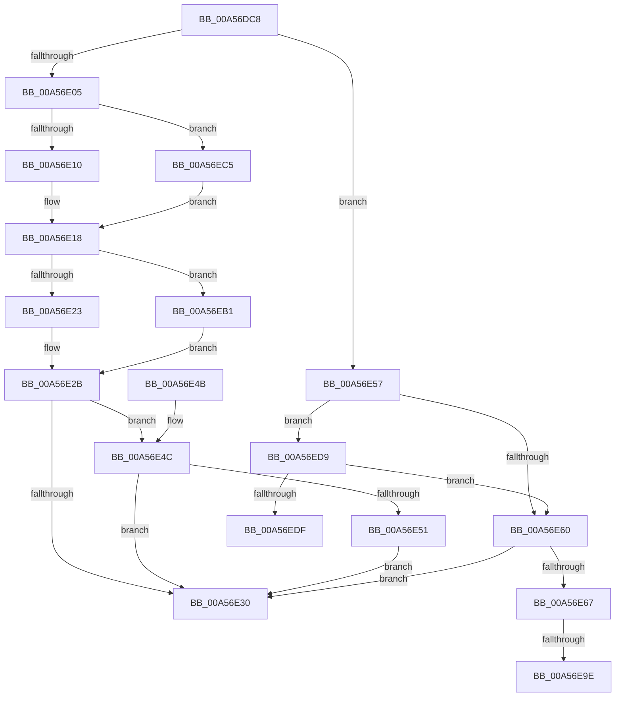

# AdtpBuildLogonIdStrings

- RVA: `0x00A56DC8`–`0x00A56F12` (길이 `330` bytes)
- VA: `0x0000000140A56DC8`
- 실행 섹션: `PAGE`
- PDB 이름 있음: `예`; PDB Function 태그: `예`
- unwind 정보 RVA: `0x00078E58`
- 디코드: `84`개 명령, `330/330` bytes 표시
- 미해석 바이트: `0` (있으면 어셈블리에 `.byte`로 보존)

> 이 문서는 커널 이미지의 기계어와 PDB 기호를 분석해 생성했습니다. 4번과 5번은 함수 원형과 자료형을 바이너리 사용 방식에서 추정한 C 해석이며 원본 소스 복구 결과는 아닙니다.

## 1. Dependencies

- 직접 호출 지점: **7**; 고유 호출 대상: **2**
- 직접 호출자로 확인된 함수: **1**
- RIP 상대 이미지 참조: **3**

### Outgoing calls
- `0x00A56DFA` → [SepGetLogonSessionAccountInfo](SepGetLogonSessionAccountInfo_function_00A56F18.md) (function, `0x00A56F18`)
- `0x00A56E71` → [RtlInitUnicodeString](../../text/42/RtlInitUnicodeString_function_0042A780.md) (function, `0x0042A780`)
- `0x00A56E80` → [RtlInitUnicodeString](../../text/42/RtlInitUnicodeString_function_0042A780.md) (function, `0x0042A780`)
- `0x00A56EBB` → [RtlInitUnicodeString](../../text/42/RtlInitUnicodeString_function_0042A780.md) (function, `0x0042A780`)
- `0x00A56ECF` → [RtlInitUnicodeString](../../text/42/RtlInitUnicodeString_function_0042A780.md) (function, `0x0042A780`)
- `0x00A56EE9` → [RtlInitUnicodeString](../../text/42/RtlInitUnicodeString_function_0042A780.md) (function, `0x0042A780`)
- `0x00A56EF8` → [RtlInitUnicodeString](../../text/42/RtlInitUnicodeString_function_0042A780.md) (function, `0x0042A780`)

### Direct callers
- [AdtpPackageParameters](../../text/45/AdtpPackageParameters_function_00459964.md) at `0x00459D5B`

### Static image references
- `0x00A56E67` → RVA `0x0001A748` (`.rdata`; read)
- `0x00A56E9E` → RVA `0x00FD9EC0` (`PAGEDATA`; read)
- `0x00A56EDF` → RVA `0x00028470` (`.rdata`; read)

## 2. Other-region calls and transfers

- 다른 실행 섹션으로 향하는 call: **6**
  - `0x00A56E71` → [RtlInitUnicodeString](../../text/42/RtlInitUnicodeString_function_0042A780.md) (`PAGE` → `.text`)
  - `0x00A56E80` → [RtlInitUnicodeString](../../text/42/RtlInitUnicodeString_function_0042A780.md) (`PAGE` → `.text`)
  - `0x00A56EBB` → [RtlInitUnicodeString](../../text/42/RtlInitUnicodeString_function_0042A780.md) (`PAGE` → `.text`)
  - `0x00A56ECF` → [RtlInitUnicodeString](../../text/42/RtlInitUnicodeString_function_0042A780.md) (`PAGE` → `.text`)
  - `0x00A56EE9` → [RtlInitUnicodeString](../../text/42/RtlInitUnicodeString_function_0042A780.md) (`PAGE` → `.text`)
  - `0x00A56EF8` → [RtlInitUnicodeString](../../text/42/RtlInitUnicodeString_function_0042A780.md) (`PAGE` → `.text`)
- call이 아닌 외부 분기/꼬리 이동: **3**
  - `0x00A56E98` → [sub_00B3D91E](../B3/Unknown_function_00B3D91E.md) (`tail-transfer`)
  - `0x00A56EAC` → [sub_00B3D91E](../B3/Unknown_function_00B3D91E.md) (`tail-transfer`)
  - `0x00A56F0D` → [sub_00B3D91E](../B3/Unknown_function_00B3D91E.md) (`tail-transfer`)

## 3. Assembly (complete function range)

```asm
00A56DC8  48 89 5C 24 08                  mov qword ptr [rsp + 8], rbx
00A56DCD  48 89 6C 24 10                  mov qword ptr [rsp + 0x10], rbp
00A56DD2  48 89 74 24 18                  mov qword ptr [rsp + 0x18], rsi
00A56DD7  57                              push rdi
00A56DD8  41 56                           push r14
00A56DDA  41 57                           push r15
00A56DDC  48 83 EC 20                     sub rsp, 0x20
00A56DE0  48 8B 74 24 68                  mov rsi, qword ptr [rsp + 0x68]
00A56DE5  49 8B F9                        mov rdi, r9
00A56DE8  4C 8B CA                        mov r9, rdx
00A56DEB  4D 8B F0                        mov r14, r8
00A56DEE  4C 8B FA                        mov r15, rdx
00A56DF1  4C 8B C6                        mov r8, rsi
00A56DF4  48 8B D7                        mov rdx, rdi
00A56DF7  48 8B E9                        mov rbp, rcx
00A56DFA  E8 19 01 00 00                  call 0x140a56f18
00A56DFF  8B D8                           mov ebx, eax
00A56E01  85 C0                           test eax, eax
00A56E03  78 52                           js 0x140a56e57
00A56E05  48 83 7F 08 00                  cmp qword ptr [rdi + 8], 0
00A56E0A  0F 84 B5 00 00 00               je 0x140a56ec5
00A56E10  48 8B 4C 24 60                  mov rcx, qword ptr [rsp + 0x60]
00A56E15  C6 01 01                        mov byte ptr [rcx], 1
00A56E18  48 83 7E 08 00                  cmp qword ptr [rsi + 8], 0
00A56E1D  0F 84 8E 00 00 00               je 0x140a56eb1
00A56E23  48 8B 44 24 70                  mov rax, qword ptr [rsp + 0x70]
00A56E28  C6 00 01                        mov byte ptr [rax], 1
00A56E2B  4D 85 FF                        test r15, r15
00A56E2E  75 1C                           jne 0x140a56e4c
00A56E30  48 8B 6C 24 48                  mov rbp, qword ptr [rsp + 0x48]
00A56E35  8B C3                           mov eax, ebx
00A56E37  48 8B 5C 24 40                  mov rbx, qword ptr [rsp + 0x40]
00A56E3C  48 8B 74 24 50                  mov rsi, qword ptr [rsp + 0x50]
00A56E41  48 83 C4 20                     add rsp, 0x20
00A56E45  41 5F                           pop r15
00A56E47  41 5E                           pop r14
00A56E49  5F                              pop rdi
00A56E4A  C3                              ret
00A56E4B  CC                              int3
00A56E4C  4D 85 F6                        test r14, r14
00A56E4F  74 DF                           je 0x140a56e30
00A56E51  41 C6 06 01                     mov byte ptr [r14], 1
00A56E55  EB D9                           jmp 0x140a56e30
00A56E57  81 7D 00 E7 03 00 00            cmp dword ptr [rbp], 0x3e7
00A56E5E  74 79                           je 0x140a56ed9
00A56E60  3D 5F 00 00 C0                  cmp eax, 0xc000005f
00A56E65  75 C9                           jne 0x140a56e30
00A56E67  48 8D 15 DA 38 5C FF            lea rdx, [rip - 0xa3c726]
00A56E6E  48 8B CF                        mov rcx, rdi
00A56E71  E8 0A 39 9D FF                  call 0x14042a780
00A56E76  48 8D 15 CB 38 5C FF            lea rdx, [rip - 0xa3c735]
00A56E7D  48 8B CE                        mov rcx, rsi
00A56E80  E8 FB 38 9D FF                  call 0x14042a780
00A56E85  48 8B 44 24 60                  mov rax, qword ptr [rsp + 0x60]
00A56E8A  C6 00 00                        mov byte ptr [rax], 0
00A56E8D  48 8B 44 24 70                  mov rax, qword ptr [rsp + 0x70]
00A56E92  C6 00 00                        mov byte ptr [rax], 0
00A56E95  4D 85 FF                        test r15, r15
00A56E98  0F 84 80 6A 0E 00               je 0x140b3d91e
00A56E9E  48 8D 05 1B 30 58 00            lea rax, [rip + 0x58301b]
00A56EA5  41 C6 06 00                     mov byte ptr [r14], 0
00A56EA9  49 89 07                        mov qword ptr [r15], rax
00A56EAC  E9 6D 6A 0E 00                  jmp 0x140b3d91e
00A56EB1  48 8D 15 90 38 5C FF            lea rdx, [rip - 0xa3c770]
00A56EB8  48 8B CE                        mov rcx, rsi
00A56EBB  E8 C0 38 9D FF                  call 0x14042a780
00A56EC0  E9 66 FF FF FF                  jmp 0x140a56e2b
00A56EC5  48 8D 15 7C 38 5C FF            lea rdx, [rip - 0xa3c784]
00A56ECC  48 8B CF                        mov rcx, rdi
00A56ECF  E8 AC 38 9D FF                  call 0x14042a780
00A56ED4  E9 3F FF FF FF                  jmp 0x140a56e18
00A56ED9  83 7D 04 00                     cmp dword ptr [rbp + 4], 0
00A56EDD  75 81                           jne 0x140a56e60
00A56EDF  48 8D 15 8A 15 5D FF            lea rdx, [rip - 0xa2ea76]
00A56EE6  48 8B CF                        mov rcx, rdi
00A56EE9  E8 92 38 9D FF                  call 0x14042a780
00A56EEE  48 8D 15 7B 15 5D FF            lea rdx, [rip - 0xa2ea85]
00A56EF5  48 8B CE                        mov rcx, rsi
00A56EF8  E8 83 38 9D FF                  call 0x14042a780
00A56EFD  48 8B 44 24 60                  mov rax, qword ptr [rsp + 0x60]
00A56F02  C6 00 00                        mov byte ptr [rax], 0
00A56F05  48 8B 44 24 70                  mov rax, qword ptr [rsp + 0x70]
00A56F0A  C6 00 00                        mov byte ptr [rax], 0
00A56F0D  E9 0C 6A 0E 00                  jmp 0x140b3d91e
```

## 4. C-style interpretation (structured pseudocode)

```c
__int64 __fastcall AdtpBuildLogonIdStrings(__int64 a1, __int64 a2, __int64 a3, __int64 a4, __int64 a5, __int64 a6, __int64 a7)
{
    __int64 result;
    __int64 v_rsp;
    unsigned __int64 v_stack_p10;
    unsigned __int64 v_stack_p18;
    unsigned __int64 v_stack_p8;

    v_stack_p8 = v_rbx;
    v_stack_p10 = v_rbp;
    v_stack_p18 = v_rsi;
    v_rsp = (v_rsp) - (32);
    result = SepGetLogonSessionAccountInfo(a1, a4, a6, a2);
    if (sign_flag) goto loc_00A56E57;
    if ((*(unsigned __int64 *)(a4 + 8)) == 0) goto loc_00A56EC5;
    *(unsigned __int8 *)(a5) = 1;
loc_00A56E18:
    if ((*(unsigned __int64 *)(a6 + 8)) == 0) goto loc_00A56EB1;
    *(unsigned __int8 *)(a7) = 1;
loc_00A56E2B:
    if (a2 != 0) goto loc_00A56E4C;
loc_00A56E30:
    v_rsp = (v_rsp) + (32);
    return (unsigned int)((unsigned int)((unsigned int)((unsigned int)(result))));
loc_00A56E4C:
    if (a3 == 0) goto loc_00A56E30;
    *(unsigned __int8 *)(a3) = 1;
    goto loc_00A56E30;
loc_00A56E57:
    if ((*(unsigned int *)(v_stack_p10)) == 999) goto loc_00A56ED9;
loc_00A56E60:
    if (((unsigned int)((unsigned int)((unsigned int)((unsigned int)((unsigned int)(result)))))) != 0xC000005FULL) goto loc_00A56E30;
    result = RtlInitUnicodeString(a4, v_rip - 10733350, a6, a2);
    result = RtlInitUnicodeString(v_stack_p18, v_rip - 10733365, a6, a2);
    *(unsigned __int8 *)(a5) = 0;
    *(unsigned __int8 *)(a7) = 0;
    *(unsigned __int8 *)(a3) = 0;
    *(unsigned __int64 *)(a2) = v_rip + 5779483;
loc_00A56EB1:
    result = RtlInitUnicodeString(v_stack_p18, v_rip - 10733424, a6, a2);
    goto loc_00A56E2B;
loc_00A56EC5:
    result = RtlInitUnicodeString(a4, v_rip - 10733444, a6, a2);
    goto loc_00A56E18;
loc_00A56ED9:
    if ((*(unsigned int *)(v_stack_p10 + 4)) != 0) goto loc_00A56E60;
    result = RtlInitUnicodeString(a4, v_rip - 10676854, a6, a2);
    result = RtlInitUnicodeString(v_stack_p18, v_rip - 10676869, a6, a2);
    *(unsigned __int8 *)(a5) = 0;
    *(unsigned __int8 *)(a7) = 0;
}
```

## 5. (Beta) C Style

```c
int64_t AdtpBuildLogonIdStrings(void *Arg1, int64_t Arg2, void *Arg3, void *Arg4, void *Arg5, void *Arg6, void *Arg7)
{
    uint8_t *arg1 = (uint8_t *)Arg1;
    uint8_t *arg3 = (uint8_t *)Arg3;
    uint8_t *arg4 = (uint8_t *)Arg4;
    uint8_t *arg5 = (uint8_t *)Arg5;
    uint8_t *arg6 = (uint8_t *)Arg6;
    uint8_t *arg7 = (uint8_t *)Arg7;

    int64_t result;
    int64_t local_rsp;
    uint64_t v_stack_p10;
    uint64_t v_stack_p18;
    uint64_t v_stack_p8;

    v_stack_p8 = local_rbx;
    v_stack_p10 = local_rbp;
    v_stack_p18 = local_rsi;
    local_rsp = (local_rsp) - (32);
    result = SepGetLogonSessionAccountInfo(Arg1, Arg4, Arg6, Arg2);
    if (sign_flag) goto loc_00A56E57;
    if ((*(uint64_t *)(arg4 + 0x8)) == 0) goto loc_00A56EC5;
    *(uint8_t *)(arg5) = 1;
loc_00A56E18:
    if ((*(uint64_t *)(arg6 + 0x8)) == 0) goto loc_00A56EB1;
    *(uint8_t *)(arg7) = 1;
loc_00A56E2B:
    if (Arg2 != 0) goto loc_00A56E4C;
loc_00A56E30:
    local_rsp = (local_rsp) + (32);
    return (uint32_t)((uint32_t)((uint32_t)((uint32_t)(result))));
loc_00A56E4C:
    if (Arg3 == NULL) goto loc_00A56E30;
    *(uint8_t *)(arg3) = 1;
    goto loc_00A56E30;
loc_00A56E57:
    if ((*(uint32_t *)(v_stack_p10)) == 999) goto loc_00A56ED9;
loc_00A56E60:
    if (((uint32_t)((uint32_t)((uint32_t)((uint32_t)((uint32_t)(result)))))) != 0xC000005FULL) goto loc_00A56E30;
    result = RtlInitUnicodeString(Arg4, v_rip - 10733350, Arg6, Arg2);
    result = RtlInitUnicodeString(v_stack_p18, v_rip - 10733365, Arg6, Arg2);
    *(uint8_t *)(arg5) = 0;
    *(uint8_t *)(arg7) = 0;
    *(uint8_t *)(arg3) = 0;
    *(uint64_t *)(Arg2) = v_rip + 5779483;
loc_00A56EB1:
    result = RtlInitUnicodeString(v_stack_p18, v_rip - 10733424, Arg6, Arg2);
    goto loc_00A56E2B;
loc_00A56EC5:
    result = RtlInitUnicodeString(Arg4, v_rip - 10733444, Arg6, Arg2);
    goto loc_00A56E18;
loc_00A56ED9:
    if ((*(uint32_t *)(v_stack_p10 + 0x4)) != 0) goto loc_00A56E60;
    result = RtlInitUnicodeString(Arg4, v_rip - 10676854, Arg6, Arg2);
    result = RtlInitUnicodeString(v_stack_p18, v_rip - 10676869, Arg6, Arg2);
    *(uint8_t *)(arg5) = 0;
    *(uint8_t *)(arg7) = 0;
}
```

### 관측된 메모리 오프셋

구조체 형식이 확인되지 않은 접근은 인자 기준의 오프셋으로만 기록했습니다.

| 기준 인자 | 오프셋 표현 | 폭 (bit) | 접근 |
|---|---:|---:|---|
| `Arg1` | `+ 0x0` | `32` | `R` |
| `Arg1` | `+ 0x4` | `32` | `R` |
| `Arg3` | `+ 0x0` | `8` | `W` |
| `Arg4` | `+ 0x8` | `64` | `R` |
| `Arg5` | `+ 0x0` | `8` | `W` |
| `Arg6` | `+ 0x8` | `64` | `R` |
| `Arg7` | `+ 0x0` | `8` | `W` |

## 6. Execution-region graph

[열기: 2D/3D 그래프와 함수 탐색 컨트롤 패널](../../../control-panel.html?section=page&rva=0x00A56DC8&view=graph)

- 2D 그래프는 위에서 아래로 흐르고, 3D 그래프는 빈 공간을 드래그해 회전합니다. Shift+드래그는 이동, 휠은 확대·축소, 함수 노드 선택은 대상 보고서 이동입니다.

### Static fallback


