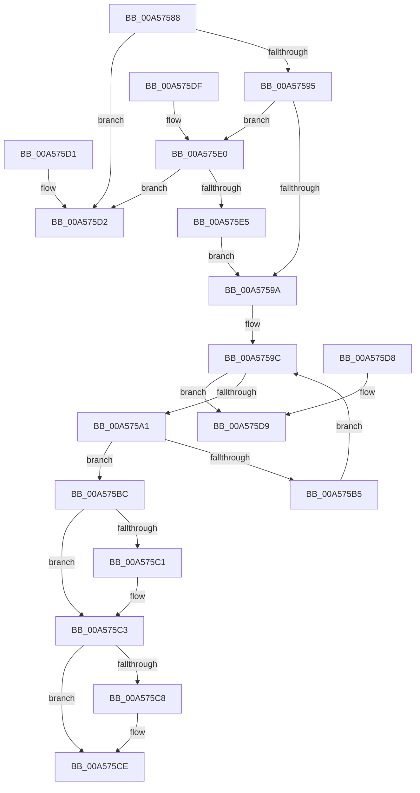

# AdtpGetCategoryAndSubCategoryId

- RVA: `0x00A57588`–`0x00A575E7` (길이 `95` bytes)
- VA: `0x0000000140A57588`
- 실행 섹션: `PAGE`
- PDB 이름 있음: `예`; PDB Function 태그: `아니요`
- unwind 정보 RVA: `0x000DB714`
- 디코드: `36`개 명령, `95/95` bytes 표시
- 미해석 바이트: `0` (있으면 어셈블리에 `.byte`로 보존)

> 이 문서는 커널 이미지의 기계어와 PDB 기호를 분석해 생성했습니다. 4번과 5번은 함수 원형과 자료형을 바이너리 사용 방식에서 추정한 C 해석이며 원본 소스 복구 결과는 아닙니다.

## 1. Dependencies

- 직접 호출 지점: **0**; 고유 호출 대상: **0**
- 직접 호출자로 확인된 함수: **2**
- RIP 상대 이미지 참조: **1**

### Outgoing calls
- 직접 디코드된 call 명령이 없습니다.

### Direct callers
- [AdtpWriteToEtwEx](../../text/45/AdtpWriteToEtwEx_function_004595EC.md) at `0x004596FB`
- [AdtpWriteToEtw](../AF/AdtpWriteToEtw_function_00AF98B0.md) at `0x00AF99C2`

### Static image references
- `0x00A575A1` → RVA `0x00FD8160` (`PAGEDATA`; read)

## 2. Other-region calls and transfers

- 다른 실행 섹션으로 향하는 call: **0**
- 별도 외부 분기/꼬리 이동을 확인하지 못했습니다.

## 3. Assembly (complete function range)

```asm
00A57588  45 33 D2                        xor r10d, r10d
00A5758B  44 8D 49 9C                     lea r9d, [rcx - 0x64]
00A5758F  41 83 F9 3B                     cmp r9d, 0x3b
00A57593  77 3D                           ja 0x140a575d2
00A57595  48 85 D2                        test rdx, rdx
00A57598  74 46                           je 0x140a575e0
00A5759A  33 C9                           xor ecx, ecx
00A5759C  83 F9 09                        cmp ecx, 9
00A5759F  73 38                           jae 0x140a575d9
00A575A1  4C 8D 1D B8 0B 58 00            lea r11, [rip + 0x580bb8]
00A575A8  45 0F B7 1C 4B                  movzx r11d, word ptr [r11 + rcx*2]
00A575AD  45 03 DA                        add r11d, r10d
00A575B0  45 3B D9                        cmp r11d, r9d
00A575B3  77 07                           ja 0x140a575bc
00A575B5  45 8B D3                        mov r10d, r11d
00A575B8  FF C1                           inc ecx
00A575BA  EB E0                           jmp 0x140a5759c
00A575BC  48 85 D2                        test rdx, rdx
00A575BF  74 02                           je 0x140a575c3
00A575C1  89 0A                           mov dword ptr [rdx], ecx
00A575C3  4D 85 C0                        test r8, r8
00A575C6  74 06                           je 0x140a575ce
00A575C8  45 2B CA                        sub r9d, r10d
00A575CB  45 89 08                        mov dword ptr [r8], r9d
00A575CE  33 C0                           xor eax, eax
00A575D0  C3                              ret
00A575D1  CC                              int3
00A575D2  B8 0D 00 00 C0                  mov eax, 0xc000000d
00A575D7  C3                              ret
00A575D8  CC                              int3
00A575D9  B8 01 00 00 C0                  mov eax, 0xc0000001
00A575DE  C3                              ret
00A575DF  CC                              int3
00A575E0  4D 85 C0                        test r8, r8
00A575E3  74 ED                           je 0x140a575d2
00A575E5  EB B3                           jmp 0x140a5759a
```

## 4. C-style interpretation (structured pseudocode)

```c
__int64 __fastcall AdtpGetCategoryAndSubCategoryId(__int64 a1, __int64 a2, __int64 a3)
{
    __int64 result;
    __int64 v_r10;
    __int64 v_r11;

    v_r10 = 0;
    if (((unsigned int)(a1 - 100)) > 59) goto loc_00A575D2;
    if (a2 == 0) goto loc_00A575E0;
loc_00A5759A:
    a1 = 0;
loc_00A5759C:
    if (0 >= 9) goto loc_00A575D9;
    v_r11 = (unsigned int)((*(unsigned __int16 *)(v_rip + 5770168 + a1 * 2)) + (0));
    if (((unsigned int)(v_r11)) > ((unsigned int)(a1 - 100))) goto loc_00A575BC;
    a1 = (unsigned int)((a1) + 1);
    goto loc_00A5759C;
loc_00A575BC:
    if (a2 != 0) {
        *(unsigned int *)(a2) = (unsigned int)(a1);
    }
    if (a3 != 0) {
        a4 = (unsigned int)((a1 - 100) - ((unsigned int)((unsigned int)((unsigned int)(v_r11)))));
        *(unsigned int *)(a3) = (unsigned int)(a4);
    }
    result = 0;
    return result;
loc_00A575D2:
    return (unsigned int)(0xC000000DULL);
loc_00A575D9:
    return (unsigned int)(0xC0000001ULL);
loc_00A575E0:
    if (a3 == 0) goto loc_00A575D2;
    goto loc_00A5759A;
}
```

## 5. (Beta) C Style

```c
int64_t AdtpGetCategoryAndSubCategoryId(void *Arg1, int64_t Arg2, int64_t Arg3)
{
    uint8_t *arg1 = (uint8_t *)Arg1;

    int64_t result;
    int64_t local_r10;
    int64_t local_r11;

    local_r10 = 0;
    if (((uint32_t)(Arg1 - 100)) > 59) goto loc_00A575D2;
    if (Arg2 == 0) goto loc_00A575E0;
loc_00A5759A:
    Arg1 = 0;
loc_00A5759C:
    if (0 >= 9) goto loc_00A575D9;
    local_r11 = (uint32_t)((*(uint16_t *)(v_rip + 0x580BB8 + arg1 * 2)) + (0));
    if (((uint32_t)(local_r11)) > ((uint32_t)(Arg1 - 100))) goto loc_00A575BC;
    Arg1 = (uint32_t)((Arg1) + 1);
    goto loc_00A5759C;
loc_00A575BC:
    if (Arg2 != 0) {
        *(uint32_t *)(Arg2) = (uint32_t)(Arg1);
    }
    if (Arg3 != 0) {
        a4 = (uint32_t)((Arg1 - 100) - ((uint32_t)((uint32_t)((uint32_t)(local_r11)))));
        *(uint32_t *)(Arg3) = (uint32_t)(a4);
    }
    result = 0;
    return result;
loc_00A575D2:
    return (uint32_t)(0xC000000DULL);
loc_00A575D9:
    return (uint32_t)(0xC0000001ULL);
loc_00A575E0:
    if (Arg3 == 0) goto loc_00A575D2;
    goto loc_00A5759A;
}
```

### 관측된 메모리 오프셋

구조체 형식이 확인되지 않은 접근은 인자 기준의 오프셋으로만 기록했습니다.

| 기준 인자 | 오프셋 표현 | 폭 (bit) | 접근 |
|---|---:|---:|---|
| `Arg1` | `- 0x64` | `32` | `R` |

## 6. Execution-region graph

[열기: 2D/3D 그래프와 함수 탐색 컨트롤 패널](../../../control-panel.html?section=page&rva=0x00A57588&view=graph)

- 2D 그래프는 위에서 아래로 흐르고, 3D 그래프는 빈 공간을 드래그해 회전합니다. Shift+드래그는 이동, 휠은 확대·축소, 함수 노드 선택은 대상 보고서 이동입니다.

### Static fallback


