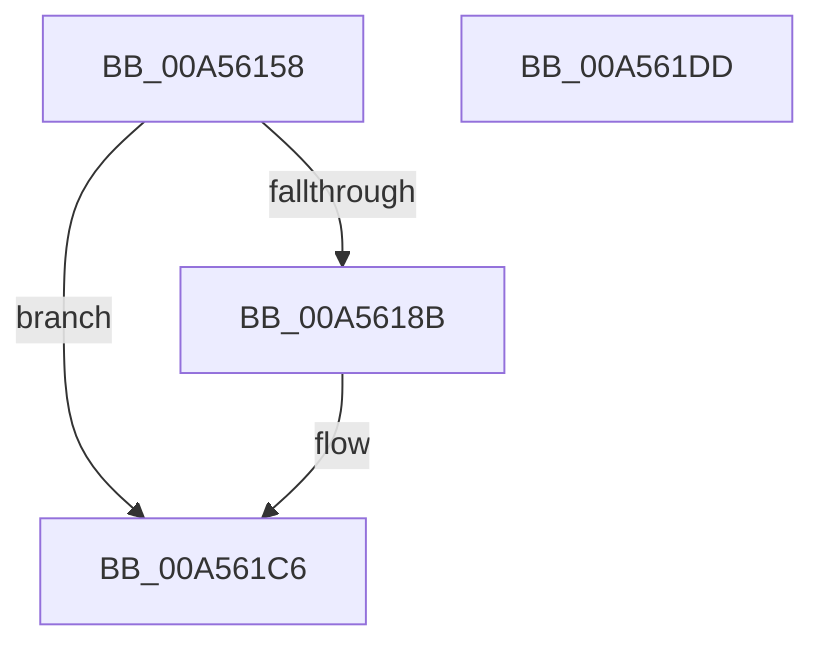

# BCryptGetProperty

- RVA: `0x00A56158`–`0x00A561DE` (길이 `134` bytes)
- VA: `0x0000000140A56158`
- 실행 섹션: `PAGE`
- PDB 이름 있음: `예`; PDB Function 태그: `아니요`
- unwind 정보 RVA: `0x0007D3C0`
- 디코드: `34`개 명령, `134/134` bytes 표시
- 미해석 바이트: `0` (있으면 어셈블리에 `.byte`로 보존)

> 이 문서는 커널 이미지의 기계어와 PDB 기호를 분석해 생성했습니다. 4번과 5번은 함수 원형과 자료형을 바이너리 사용 방식에서 추정한 C 해석이며 원본 소스 복구 결과는 아닙니다.

## 1. Dependencies

- 직접 호출 지점: **3**; 고유 호출 대상: **3**
- 직접 호출자로 확인된 함수: **4**
- RIP 상대 이미지 참조: **1**

### Outgoing calls
- `0x00A56181` → [ExGetExtensionTable](../../text/42/ExGetExtensionTable_function_00428814.md) (function, `0x00428814`)
- `0x00A561B3` → [guard_dispatch_icall](../../text/6B/guard_dispatch_icall_function_006BAAD0.md) (function, `0x006BAAD0`)
- `0x00A561C1` → [ExReleaseExtensionTable](../../text/45/ExReleaseExtensionTable_function_00456DC0.md) (function, `0x00456DC0`)

### Direct callers
- [SecureDump_EncryptSymmetricKeyWithPublicKey](../../text/5A/SecureDump_EncryptSymmetricKeyWithPublicKey_function_005A27A4.md) at `0x005A28F7`
- [SecureDump_SymmetricEncryptionSetup](../../text/5A/SecureDump_SymmetricEncryptionSetup_function_005A3774.md) at `0x005A384F`
- [SmCrEncStart](../7A/SmCrEncStart_function_007AA208.md) at `0x007AA268`
- [SmCrEncStart](../7A/SmCrEncStart_function_007AA208.md) at `0x007AA313`
- [RtlGenerateClass5Guid](../AC/RtlGenerateClass5Guid_function_00AC4510.md) at `0x00AC45CA`

### Static image references
- `0x00A56172` → RVA `0x00F04E30` (`.data`; read)

## 2. Other-region calls and transfers

- 다른 실행 섹션으로 향하는 call: **3**
  - `0x00A56181` → [ExGetExtensionTable](../../text/42/ExGetExtensionTable_function_00428814.md) (`PAGE` → `.text`)
  - `0x00A561B3` → [guard_dispatch_icall](../../text/6B/guard_dispatch_icall_function_006BAAD0.md) (`PAGE` → `.text`)
  - `0x00A561C1` → [ExReleaseExtensionTable](../../text/45/ExReleaseExtensionTable_function_00456DC0.md) (`PAGE` → `.text`)
- 별도 외부 분기/꼬리 이동을 확인하지 못했습니다.

## 3. Assembly (complete function range)

```asm
00A56158  48 89 5C 24 08                  mov qword ptr [rsp + 8], rbx
00A5615D  48 89 6C 24 10                  mov qword ptr [rsp + 0x10], rbp
00A56162  48 89 74 24 18                  mov qword ptr [rsp + 0x18], rsi
00A56167  57                              push rdi
00A56168  48 83 EC 40                     sub rsp, 0x40
00A5616C  48 8B E9                        mov rbp, rcx
00A5616F  49 8B F8                        mov rdi, r8
00A56172  48 8B 0D B7 EC 4A 00            mov rcx, qword ptr [rip + 0x4aecb7]
00A56179  48 8B F2                        mov rsi, rdx
00A5617C  BB 02 00 00 C0                  mov ebx, 0xc0000002
00A56181  E8 8E 26 9D FF                  call 0x140428814
00A56186  48 85 C0                        test rax, rax
00A56189  74 3B                           je 0x140a561c6
00A5618B  4C 8B 90 A8 00 00 00            mov r10, qword ptr [rax + 0xa8]
00A56192  41 B9 04 00 00 00               mov r9d, 4
00A56198  48 8B 44 24 70                  mov rax, qword ptr [rsp + 0x70]
00A5619D  4C 8B C7                        mov r8, rdi
00A561A0  83 64 24 28 00                  and dword ptr [rsp + 0x28], 0
00A561A5  48 8B D6                        mov rdx, rsi
00A561A8  48 89 44 24 20                  mov qword ptr [rsp + 0x20], rax
00A561AD  48 8B CD                        mov rcx, rbp
00A561B0  49 8B C2                        mov rax, r10
00A561B3  E8 18 49 C6 FF                  call 0x1406baad0
00A561B8  48 8B 0D 71 EC 4A 00            mov rcx, qword ptr [rip + 0x4aec71]
00A561BF  8B D8                           mov ebx, eax
00A561C1  E8 FA 0B A0 FF                  call 0x140456dc0
00A561C6  48 8B 6C 24 58                  mov rbp, qword ptr [rsp + 0x58]
00A561CB  8B C3                           mov eax, ebx
00A561CD  48 8B 5C 24 50                  mov rbx, qword ptr [rsp + 0x50]
00A561D2  48 8B 74 24 60                  mov rsi, qword ptr [rsp + 0x60]
00A561D7  48 83 C4 40                     add rsp, 0x40
00A561DB  5F                              pop rdi
00A561DC  C3                              ret
00A561DD  CC                              int3
```

## 4. C-style interpretation (structured pseudocode)

```c
__int64 __fastcall BCryptGetProperty(__int64 a1, __int64 a2, __int64 a3, __int64 a4, __int64 a5)
{
    __int64 result;
    __int64 v_r10;
    __int64 v_rbx;
    __int64 v_rsp;
    unsigned int v_stack_m20;
    unsigned __int64 v_stack_m28;
    unsigned __int64 v_stack_p10;
    unsigned __int64 v_stack_p18;
    unsigned __int64 v_stack_p8;

    v_stack_p8 = v_rbx;
    v_stack_p10 = v_rbp;
    v_stack_p18 = v_rsi;
    v_rsp = (v_rsp) - (64);
    result = ExGetExtensionTable(*(unsigned __int64 *)(v_rip + 4910263), a2, a3, a4);
    v_rbx = (unsigned int)(0xC0000002ULL);
    if (result != 0) {
        v_r10 = *(unsigned __int64 *)(result + 168);
        a4 = 4;
        result = a5;
        a3 = a3;
        a2 = a2;
        v_stack_m28 = result;
        a1 = a1;
        result = v_r10;
        result = guard_dispatch_icall(a1, a2, a3, a4);
        a1 = *(unsigned __int64 *)(v_rip + 4910193);
        v_rbx = (unsigned int)(result);
        result = ExReleaseExtensionTable(a1, a2, a3, a4);
    }
    v_rsp = (v_rsp) + (64);
    return (unsigned int)((unsigned int)(v_rbx));
}
```

## 5. (Beta) C Style

```c
int64_t BCryptGetProperty(int64_t Arg1, int64_t Arg2, int64_t Arg3, int64_t Arg4, int64_t Arg5)
{
    int64_t result;
    int64_t local_r10;
    int64_t local_rbx;
    int64_t local_rsp;
    uint32_t v_stack_m20;
    uint64_t v_stack_m28;
    uint64_t v_stack_p10;
    uint64_t v_stack_p18;
    uint64_t v_stack_p8;

    v_stack_p8 = local_rbx;
    v_stack_p10 = local_rbp;
    v_stack_p18 = local_rsi;
    local_rsp = (local_rsp) - (64);
    result = ExGetExtensionTable(*(uint64_t *)(v_rip + 0x4AECB7), Arg2, Arg3, Arg4);
    local_rbx = (uint32_t)(0xC0000002ULL);
    if (result != 0) {
        local_r10 = *(uint64_t *)(result + 0xA8);
        Arg4 = 4;
        result = Arg5;
        Arg3 = Arg3;
        Arg2 = Arg2;
        v_stack_m28 = result;
        Arg1 = Arg1;
        result = local_r10;
        result = guard_dispatch_icall(Arg1, Arg2, Arg3, Arg4);
        Arg1 = *(uint64_t *)(v_rip + 0x4AEC71);
        local_rbx = (uint32_t)(result);
        result = ExReleaseExtensionTable(Arg1, Arg2, Arg3, Arg4);
    }
    local_rsp = (local_rsp) + (64);
    return (uint32_t)((uint32_t)(local_rbx));
}
```

## 6. Execution-region graph

[열기: 2D/3D 그래프와 함수 탐색 컨트롤 패널](../../../control-panel.html?section=page&rva=0x00A56158&view=graph)

- 2D 그래프는 위에서 아래로 흐르고, 3D 그래프는 빈 공간을 드래그해 회전합니다. Shift+드래그는 이동, 휠은 확대·축소, 함수 노드 선택은 대상 보고서 이동입니다.

### Static fallback


