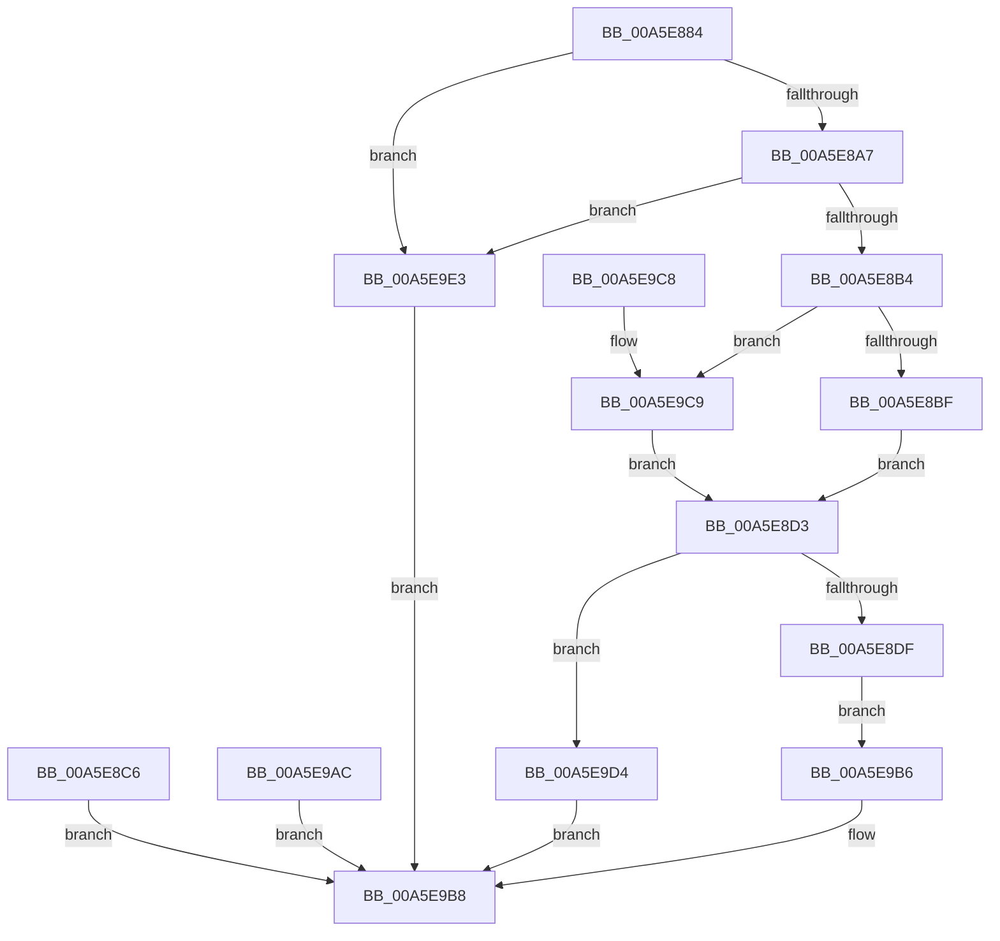

# CmQueryBuildVersionInformation

- RVA: `0x00A5E884`–`0x00A5E9F2` (길이 `366` bytes)
- VA: `0x0000000140A5E884`
- 실행 섹션: `PAGE`
- PDB 이름 있음: `예`; PDB Function 태그: `아니요`
- unwind 정보 RVA: `0x000B29DC`
- 디코드: `92`개 명령, `366/366` bytes 표시
- 미해석 바이트: `0` (있으면 어셈블리에 `.byte`로 보존)

> 이 문서는 커널 이미지의 기계어와 PDB 기호를 분석해 생성했습니다. 4번과 5번은 함수 원형과 자료형을 바이너리 사용 방식에서 추정한 C 해석이며 원본 소스 복구 결과는 아닙니다.

## 1. Dependencies

- 직접 호출 지점: **7**; 고유 호출 대상: **2**
- 직접 호출자로 확인된 함수: **1**
- RIP 상대 이미지 참조: **2**

### Outgoing calls
- `0x00A5E8F9` → [memset](../../text/6C/memset_function_006C6C40.md) (function, `0x006C6C40`)
- `0x00A5E93E` → [CmpQueryDowncastString](CmpQueryDowncastString_function_00A5E9F8.md) (function, `0x00A5E9F8`)
- `0x00A5E950` → [CmpQueryDowncastString](CmpQueryDowncastString_function_00A5E9F8.md) (function, `0x00A5E9F8`)
- `0x00A5E962` → [CmpQueryDowncastString](CmpQueryDowncastString_function_00A5E9F8.md) (function, `0x00A5E9F8`)
- `0x00A5E974` → [CmpQueryDowncastString](CmpQueryDowncastString_function_00A5E9F8.md) (function, `0x00A5E9F8`)
- `0x00A5E987` → [CmpQueryDowncastString](CmpQueryDowncastString_function_00A5E9F8.md) (function, `0x00A5E9F8`)
- `0x00A5E99A` → [CmpQueryDowncastString](CmpQueryDowncastString_function_00A5E9F8.md) (function, `0x00A5E9F8`)

### Direct callers
- [ExpQuerySystemInformation](ExpQuerySystemInformation_function_00A57858.md) at `0x00A5B29F`

### Static image references
- `0x00A5E8D3` → RVA `0x00EF7240` (`.data`; read)
- `0x00A5E8E1` → RVA `0x00EF7260` (`.data`; read)

## 2. Other-region calls and transfers

- 다른 실행 섹션으로 향하는 call: **1**
  - `0x00A5E8F9` → [memset](../../text/6C/memset_function_006C6C40.md) (`PAGE` → `.text`)
- 별도 외부 분기/꼬리 이동을 확인하지 못했습니다.

## 3. Assembly (complete function range)

```asm
00A5E884  48 8B C4                        mov rax, rsp
00A5E887  48 89 58 08                     mov qword ptr [rax + 8], rbx
00A5E88B  48 89 70 18                     mov qword ptr [rax + 0x18], rsi
00A5E88F  57                              push rdi
00A5E890  48 83 EC 40                     sub rsp, 0x40
00A5E894  49 8B F0                        mov rsi, r8
00A5E897  45 33 C0                        xor r8d, r8d
00A5E89A  44 89 40 10                     mov dword ptr [rax + 0x10], r8d
00A5E89E  83 FA 04                        cmp edx, 4
00A5E8A1  0F 85 3C 01 00 00               jne 0x140a5e9e3
00A5E8A7  41 81 F9 44 02 00 00            cmp r9d, 0x244
00A5E8AE  0F 82 2F 01 00 00               jb 0x140a5e9e3
00A5E8B4  44 38 44 24 78                  cmp byte ptr [rsp + 0x78], r8b
00A5E8B9  0F 84 0A 01 00 00               je 0x140a5e9c9
00A5E8BF  8B 39                           mov edi, dword ptr [rcx]
00A5E8C1  89 78 10                        mov dword ptr [rax + 0x10], edi
00A5E8C4  EB 0D                           jmp 0x140a5e8d3
00A5E8C6  48 8B 4C 24 70                  mov rcx, qword ptr [rsp + 0x70]
00A5E8CB  83 21 00                        and dword ptr [rcx], 0
00A5E8CE  E9 E5 00 00 00                  jmp 0x140a5e9b8
00A5E8D3  3B 3D 67 89 49 00               cmp edi, dword ptr [rip + 0x498967]
00A5E8D9  0F 83 F5 00 00 00               jae 0x140a5e9d4
00A5E8DF  8B C7                           mov eax, edi
00A5E8E1  48 8D 1D 78 89 49 00            lea rbx, [rip + 0x498978]
00A5E8E8  48 8B 1C C3                     mov rbx, qword ptr [rbx + rax*8]
00A5E8EC  48 89 5C 24 38                  mov qword ptr [rsp + 0x38], rbx
00A5E8F1  45 8B C1                        mov r8d, r9d
00A5E8F4  33 D2                           xor edx, edx
00A5E8F6  48 8B CE                        mov rcx, rsi
00A5E8F9  E8 42 83 C6 FF                  call 0x1406c6c40
00A5E8FE  66 89 3E                        mov word ptr [rsi], di
00A5E901  0F B7 05 38 89 49 00            movzx eax, word ptr [rip + 0x498938]
00A5E908  66 89 46 02                     mov word ptr [rsi + 2], ax
00A5E90C  8B 03                           mov eax, dword ptr [rbx]
00A5E90E  89 46 04                        mov dword ptr [rsi + 4], eax
00A5E911  8B 43 04                        mov eax, dword ptr [rbx + 4]
00A5E914  89 46 08                        mov dword ptr [rsi + 8], eax
00A5E917  8B 43 08                        mov eax, dword ptr [rbx + 8]
00A5E91A  89 46 0C                        mov dword ptr [rsi + 0xc], eax
00A5E91D  8B 43 0C                        mov eax, dword ptr [rbx + 0xc]
00A5E920  89 46 10                        mov dword ptr [rsi + 0x10], eax
00A5E923  8B 83 20 03 00 00               mov eax, dword ptr [rbx + 0x320]
00A5E929  89 86 40 02 00 00               mov dword ptr [rsi + 0x240], eax
00A5E92F  4C 8D 43 10                     lea r8, [rbx + 0x10]
00A5E933  BF 80 00 00 00                  mov edi, 0x80
00A5E938  8B D7                           mov edx, edi
00A5E93A  48 8D 4E 14                     lea rcx, [rsi + 0x14]
00A5E93E  E8 B5 00 00 00                  call 0x140a5e9f8
00A5E943  4C 8D 43 40                     lea r8, [rbx + 0x40]
00A5E947  8B D7                           mov edx, edi
00A5E949  48 8D 8E 94 00 00 00            lea rcx, [rsi + 0x94]
00A5E950  E8 A3 00 00 00                  call 0x140a5e9f8
00A5E955  4C 8D 43 50                     lea r8, [rbx + 0x50]
00A5E959  8B D7                           mov edx, edi
00A5E95B  48 8D 8E 14 01 00 00            lea rcx, [rsi + 0x114]
00A5E962  E8 91 00 00 00                  call 0x140a5e9f8
00A5E967  4C 8D 43 60                     lea r8, [rbx + 0x60]
00A5E96B  8B D7                           mov edx, edi
00A5E96D  48 8D 8E 94 01 00 00            lea rcx, [rsi + 0x194]
00A5E974  E8 7F 00 00 00                  call 0x140a5e9f8
00A5E979  4C 8D 43 20                     lea r8, [rbx + 0x20]
00A5E97D  8D 57 9A                        lea edx, [rdi - 0x66]
00A5E980  48 8D 8E 14 02 00 00            lea rcx, [rsi + 0x214]
00A5E987  E8 6C 00 00 00                  call 0x140a5e9f8
00A5E98C  4C 8D 43 30                     lea r8, [rbx + 0x30]
00A5E990  8D 57 90                        lea edx, [rdi - 0x70]
00A5E993  48 8D 8E 2E 02 00 00            lea rcx, [rsi + 0x22e]
00A5E99A  E8 59 00 00 00                  call 0x140a5e9f8
00A5E99F  48 8B 44 24 70                  mov rax, qword ptr [rsp + 0x70]
00A5E9A4  C7 00 44 02 00 00               mov dword ptr [rax], 0x244
00A5E9AA  EB 0A                           jmp 0x140a5e9b6
00A5E9AC  48 8B 4C 24 70                  mov rcx, qword ptr [rsp + 0x70]
00A5E9B1  83 21 00                        and dword ptr [rcx], 0
00A5E9B4  EB 02                           jmp 0x140a5e9b8
00A5E9B6  33 C0                           xor eax, eax
00A5E9B8  48 8B 5C 24 50                  mov rbx, qword ptr [rsp + 0x50]
00A5E9BD  48 8B 74 24 60                  mov rsi, qword ptr [rsp + 0x60]
00A5E9C2  48 83 C4 40                     add rsp, 0x40
00A5E9C6  5F                              pop rdi
00A5E9C7  C3                              ret
00A5E9C8  CC                              int3
00A5E9C9  8B 39                           mov edi, dword ptr [rcx]
00A5E9CB  89 7C 24 58                     mov dword ptr [rsp + 0x58], edi
00A5E9CF  E9 FF FE FF FF                  jmp 0x140a5e8d3
00A5E9D4  48 8B 44 24 70                  mov rax, qword ptr [rsp + 0x70]
00A5E9D9  44 89 00                        mov dword ptr [rax], r8d
00A5E9DC  B8 1A 00 00 80                  mov eax, 0x8000001a
00A5E9E1  EB D5                           jmp 0x140a5e9b8
00A5E9E3  48 8B 44 24 70                  mov rax, qword ptr [rsp + 0x70]
00A5E9E8  44 89 00                        mov dword ptr [rax], r8d
00A5E9EB  B8 04 00 00 C0                  mov eax, 0xc0000004
00A5E9F0  EB C6                           jmp 0x140a5e9b8
```

## 4. C-style interpretation (structured pseudocode)

```c
__int64 __fastcall CmQueryBuildVersionInformation(__int64 a1, int a2, __int64 a3, int a4, __int64 a5, unsigned __int8 a6)
{
    __int64 result;
    __int64 v_rsp;
    unsigned __int64 v_stack_m10;
    unsigned __int64 v_stack_p18;
    unsigned __int64 v_stack_p28;
    unsigned int v_stack_p58;
    unsigned __int64 v_stack_p8;

    *(unsigned __int64 *)(v_rsp + 8) = v_rbx;
    *(unsigned __int64 *)(v_rsp + 24) = v_rsi;
    v_rsp = (v_rsp) - (64);
    a3 = 0;
    *(unsigned int *)(v_rsp + 16) = 0;
    if (a2 != 4) goto loc_00A5E9E3;
    if (a4 < 580) goto loc_00A5E9E3;
    if (a6 == 0) goto loc_00A5E9C9;
    *(unsigned int *)(v_rsp + 16) = (unsigned int)((unsigned int)(*(unsigned int *)(a1)));
    goto loc_00A5E8D3;
loc_00A5E8D3:
    if (((unsigned int)((unsigned int)(*(unsigned int *)(a1)))) >= (*(unsigned int *)(v_rip + 4819303))) goto loc_00A5E9D4;
    v_stack_m10 = *(unsigned __int64 *)(v_rip + 4819320 + (unsigned int)((unsigned int)((unsigned int)(*(unsigned int *)(a1)))) * 8);
    a2 = 0;
    result = memset(0, a2, (unsigned int)(a4), a4);
    *(unsigned __int16 *)(a3) = (unsigned __int16)((unsigned int)(*(unsigned int *)(a1)));
    *(unsigned __int16 *)(a3 + 2) = (unsigned __int16)(*(unsigned __int16 *)(v_rip + 4819256));
    *(unsigned int *)(a3 + 4) = (unsigned int)((unsigned int)(*(unsigned int *)(*(unsigned __int64 *)(v_rip + 4819320 + (unsigned int)((unsigned int)((unsigned int)(*(unsigned int *)(a1)))) * 8))));
    *(unsigned int *)(a3 + 8) = (unsigned int)((unsigned int)(*(unsigned int *)(*(unsigned __int64 *)(v_rip + 4819320 + (unsigned int)((unsigned int)((unsigned int)(*(unsigned int *)(a1)))) * 8) + 4)));
    *(unsigned int *)(a3 + 12) = (unsigned int)((unsigned int)(*(unsigned int *)(*(unsigned __int64 *)(v_rip + 4819320 + (unsigned int)((unsigned int)((unsigned int)(*(unsigned int *)(a1)))) * 8) + 8)));
    *(unsigned int *)(a3 + 16) = (unsigned int)((unsigned int)(*(unsigned int *)(*(unsigned __int64 *)(v_rip + 4819320 + (unsigned int)((unsigned int)((unsigned int)(*(unsigned int *)(a1)))) * 8) + 12)));
    *(unsigned int *)(a3 + 576) = (unsigned int)((unsigned int)(*(unsigned int *)(*(unsigned __int64 *)(v_rip + 4819320 + (unsigned int)((unsigned int)((unsigned int)(*(unsigned int *)(a1)))) * 8) + 800)));
    result = CmpQueryDowncastString(a3 + 20, 128, *(unsigned __int64 *)(v_rip + 4819320 + (unsigned int)((unsigned int)((unsigned int)(*(unsigned int *)(a1)))) * 8) + 16, a4);
    result = CmpQueryDowncastString(a3 + 148, 128, *(unsigned __int64 *)(v_rip + 4819320 + (unsigned int)((unsigned int)((unsigned int)(*(unsigned int *)(a1)))) * 8) + 64, a4);
    result = CmpQueryDowncastString(a3 + 276, 128, *(unsigned __int64 *)(v_rip + 4819320 + (unsigned int)((unsigned int)((unsigned int)(*(unsigned int *)(a1)))) * 8) + 80, a4);
    result = CmpQueryDowncastString(a3 + 404, 128, *(unsigned __int64 *)(v_rip + 4819320 + (unsigned int)((unsigned int)((unsigned int)(*(unsigned int *)(a1)))) * 8) + 96, a4);
    result = CmpQueryDowncastString(a3 + 532, 128 - 102, *(unsigned __int64 *)(v_rip + 4819320 + (unsigned int)((unsigned int)((unsigned int)(*(unsigned int *)(a1)))) * 8) + 32, a4);
    result = CmpQueryDowncastString(a3 + 558, 128 - 112, *(unsigned __int64 *)(v_rip + 4819320 + (unsigned int)((unsigned int)((unsigned int)(*(unsigned int *)(a1)))) * 8) + 48, a4);
    *(unsigned int *)(a5) = 580;
    goto loc_00A5E9B6;
loc_00A5E9B6:
    result = 0;
loc_00A5E9B8:
    v_rsp = (v_rsp) + (64);
    return result;
loc_00A5E9C9:
    v_stack_p58 = (unsigned int)((unsigned int)(*(unsigned int *)(a3 + 558)));
    goto loc_00A5E8D3;
loc_00A5E9D4:
    *(unsigned int *)(a5) = (unsigned int)(*(unsigned __int64 *)(v_rip + 4819320 + (unsigned int)((unsigned int)((unsigned int)(*(unsigned int *)(a1)))) * 8) + 48);
    goto loc_00A5E9B8;
loc_00A5E9E3:
    *(unsigned int *)(a5) = (unsigned int)(*(unsigned __int64 *)(v_rip + 4819320 + (unsigned int)((unsigned int)((unsigned int)(*(unsigned int *)(a1)))) * 8) + 48);
    goto loc_00A5E9B8;
}
```

## 5. (Beta) C Style

```c
int64_t CmQueryBuildVersionInformation(void *Arg1, int32_t Arg2, void *Arg3, int32_t Arg4, void *Arg5, uint8_t Arg6)
{
    uint8_t *arg1 = (uint8_t *)Arg1;
    uint8_t *arg3 = (uint8_t *)Arg3;
    uint8_t *arg5 = (uint8_t *)Arg5;

    int64_t result;
    int64_t local_rsp;
    uint64_t v_stack_m10;
    uint64_t v_stack_p18;
    uint64_t v_stack_p28;
    uint32_t v_stack_p58;
    uint64_t v_stack_p8;

    *(uint64_t *)(local_rsp + 0x8) = local_rbx;
    *(uint64_t *)(local_rsp + 0x18) = local_rsi;
    local_rsp = (local_rsp) - (64);
    Arg3 = 0;
    *(uint32_t *)(local_rsp + 0x10) = 0;
    if (Arg2 != 4) goto loc_00A5E9E3;
    if (Arg4 < 580) goto loc_00A5E9E3;
    if (Arg6 == 0) goto loc_00A5E9C9;
    *(uint32_t *)(local_rsp + 0x10) = (uint32_t)((uint32_t)(*(uint32_t *)(arg1)));
    goto loc_00A5E8D3;
loc_00A5E8D3:
    if (((uint32_t)((uint32_t)(*(uint32_t *)(arg1)))) >= (*(uint32_t *)(v_rip + 0x498967))) goto loc_00A5E9D4;
    v_stack_m10 = *(uint64_t *)(v_rip + 0x498978 + (uint32_t)((uint32_t)((uint32_t)(*(uint32_t *)(arg1)))) * 8);
    Arg2 = 0;
    result = memset(0, Arg2, (uint32_t)(Arg4), Arg4);
    *(uint16_t *)(arg3) = (uint16_t)((uint32_t)(*(uint32_t *)(arg1)));
    *(uint16_t *)(arg3 + 0x2) = (uint16_t)(*(uint16_t *)(v_rip + 0x498938));
    *(uint32_t *)(arg3 + 0x4) = (uint32_t)((uint32_t)(*(uint32_t *)(*(uint64_t *)(v_rip + 0x498978 + (uint32_t)((uint32_t)((uint32_t)(*(uint32_t *)(arg1)))) * 8))));
    *(uint32_t *)(arg3 + 0x8) = (uint32_t)((uint32_t)(*(uint32_t *)(*(uint64_t *)(v_rip + 0x498978 + (uint32_t)((uint32_t)((uint32_t)(*(uint32_t *)(arg1)))) * 8) + 0x4)));
    *(uint32_t *)(arg3 + 0xC) = (uint32_t)((uint32_t)(*(uint32_t *)(*(uint64_t *)(v_rip + 0x498978 + (uint32_t)((uint32_t)((uint32_t)(*(uint32_t *)(arg1)))) * 8) + 0x8)));
    *(uint32_t *)(arg3 + 0x10) = (uint32_t)((uint32_t)(*(uint32_t *)(*(uint64_t *)(v_rip + 0x498978 + (uint32_t)((uint32_t)((uint32_t)(*(uint32_t *)(arg1)))) * 8) + 0xC)));
    *(uint32_t *)(arg3 + 0x240) = (uint32_t)((uint32_t)(*(uint32_t *)(*(uint64_t *)(v_rip + 0x498978 + (uint32_t)((uint32_t)((uint32_t)(*(uint32_t *)(arg1)))) * 8) + 0x320)));
    result = CmpQueryDowncastString(Arg3 + 20, 128, *(uint64_t *)(v_rip + 0x498978 + (uint32_t)((uint32_t)((uint32_t)(*(uint32_t *)(arg1)))) * 8) + 16, Arg4);
    result = CmpQueryDowncastString(Arg3 + 148, 128, *(uint64_t *)(v_rip + 0x498978 + (uint32_t)((uint32_t)((uint32_t)(*(uint32_t *)(arg1)))) * 8) + 64, Arg4);
    result = CmpQueryDowncastString(Arg3 + 276, 128, *(uint64_t *)(v_rip + 0x498978 + (uint32_t)((uint32_t)((uint32_t)(*(uint32_t *)(arg1)))) * 8) + 80, Arg4);
    result = CmpQueryDowncastString(Arg3 + 404, 128, *(uint64_t *)(v_rip + 0x498978 + (uint32_t)((uint32_t)((uint32_t)(*(uint32_t *)(arg1)))) * 8) + 96, Arg4);
    result = CmpQueryDowncastString(Arg3 + 532, 128 - 102, *(uint64_t *)(v_rip + 0x498978 + (uint32_t)((uint32_t)((uint32_t)(*(uint32_t *)(arg1)))) * 8) + 32, Arg4);
    result = CmpQueryDowncastString(Arg3 + 558, 128 - 112, *(uint64_t *)(v_rip + 0x498978 + (uint32_t)((uint32_t)((uint32_t)(*(uint32_t *)(arg1)))) * 8) + 48, Arg4);
    *(uint32_t *)(arg5) = 580;
    goto loc_00A5E9B6;
loc_00A5E9B6:
    result = 0;
loc_00A5E9B8:
    local_rsp = (local_rsp) + (64);
    return result;
loc_00A5E9C9:
    v_stack_p58 = (uint32_t)((uint32_t)(*(uint32_t *)(arg3 + 0x22E)));
    goto loc_00A5E8D3;
loc_00A5E9D4:
    *(uint32_t *)(arg5) = (uint32_t)(*(uint64_t *)(v_rip + 0x498978 + (uint32_t)((uint32_t)((uint32_t)(*(uint32_t *)(arg1)))) * 8) + 48);
    goto loc_00A5E9B8;
loc_00A5E9E3:
    *(uint32_t *)(arg5) = (uint32_t)(*(uint64_t *)(v_rip + 0x498978 + (uint32_t)((uint32_t)((uint32_t)(*(uint32_t *)(arg1)))) * 8) + 48);
    goto loc_00A5E9B8;
}
```

### 관측된 메모리 오프셋

구조체 형식이 확인되지 않은 접근은 인자 기준의 오프셋으로만 기록했습니다.

| 기준 인자 | 오프셋 표현 | 폭 (bit) | 접근 |
|---|---:|---:|---|
| `Arg1` | `+ 0x0` | `32` | `R` |
| `Arg3` | `+ 0x0` | `16` | `W` |
| `Arg3` | `+ 0x2` | `16` | `W` |
| `Arg3` | `+ 0x4` | `32` | `W` |
| `Arg3` | `+ 0x8` | `32` | `W` |
| `Arg3` | `+ 0xC` | `32` | `W` |
| `Arg3` | `+ 0x10` | `32` | `W` |
| `Arg3` | `+ 0x14` | `64` | `R` |
| `Arg3` | `+ 0x94` | `64` | `R` |
| `Arg3` | `+ 0x114` | `64` | `R` |
| `Arg3` | `+ 0x194` | `64` | `R` |
| `Arg3` | `+ 0x214` | `64` | `R` |
| `Arg3` | `+ 0x22E` | `64` | `R` |
| `Arg3` | `+ 0x240` | `32` | `W` |
| `Arg5` | `+ 0x0` | `32` | `W` |

## 6. Execution-region graph

[열기: 2D/3D 그래프와 함수 탐색 컨트롤 패널](../../../control-panel.html?section=page&rva=0x00A5E884&view=graph)

- 2D 그래프는 위에서 아래로 흐르고, 3D 그래프는 빈 공간을 드래그해 회전합니다. Shift+드래그는 이동, 휠은 확대·축소, 함수 노드 선택은 대상 보고서 이동입니다.

### Static fallback


