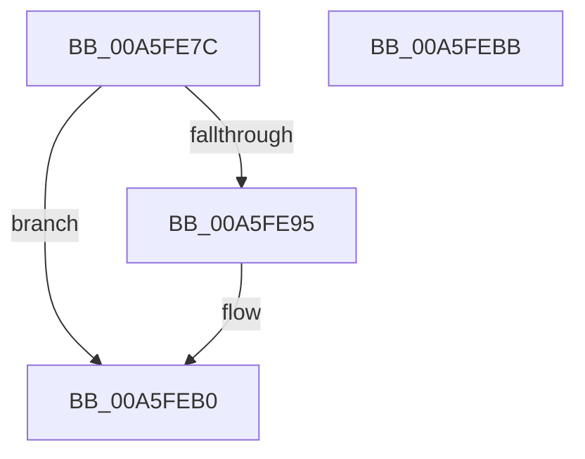

# CmSetDeviceInterfacePathFormat

- RVA: `0x00A5FE7C`–`0x00A5FEBC` (길이 `64` bytes)
- VA: `0x0000000140A5FE7C`
- 실행 섹션: `PAGE`
- PDB 이름 있음: `예`; PDB Function 태그: `아니요`
- unwind 정보 RVA: `0x0005CAAC`
- 디코드: `18`개 명령, `64/64` bytes 표시
- 미해석 바이트: `0` (있으면 어셈블리에 `.byte`로 보존)

> 이 문서는 커널 이미지의 기계어와 PDB 기호를 분석해 생성했습니다. 4번과 5번은 함수 원형과 자료형을 바이너리 사용 방식에서 추정한 C 해석이며 원본 소스 복구 결과는 아닙니다.

## 1. Dependencies

- 직접 호출 지점: **1**; 고유 호출 대상: **1**
- 직접 호출자로 확인된 함수: **1**
- RIP 상대 이미지 참조: **1**

### Outgoing calls
- `0x00A5FE8C` → [CmValidateDeviceInterfaceName](../8F/CmValidateDeviceInterfaceName_function_008F1A40.md) (function, `0x008F1A40`)

### Direct callers
- [PiDmObjectCreate](../94/PiDmObjectCreate_function_0094F5CC.md) at `0x0094F6A9`

### Static image references
- `0x00A5FE95` → RVA `0x00B0D4E0` (` ?? ::NNGAKEGL::`string'`; read)

## 2. Other-region calls and transfers

- 다른 실행 섹션으로 향하는 call: **0**
- 별도 외부 분기/꼬리 이동을 확인하지 못했습니다.

## 3. Assembly (complete function range)

```asm
00A5FE7C  48 89 5C 24 08                  mov qword ptr [rsp + 8], rbx
00A5FE81  57                              push rdi
00A5FE82  48 83 EC 20                     sub rsp, 0x20
00A5FE86  41 8A F8                        mov dil, r8b
00A5FE89  48 8B DA                        mov rbx, rdx
00A5FE8C  E8 AF 1B E9 FF                  call 0x1408f1a40
00A5FE91  85 C0                           test eax, eax
00A5FE93  78 1B                           js 0x140a5feb0
00A5FE95  48 8B 0D 44 D6 0A 00            mov rcx, qword ptr [rip + 0xad644]
00A5FE9C  40 84 FF                        test dil, dil
00A5FE9F  48 BA 5C 00 3F 00 3F 00 5C 00   movabs rdx, 0x5c003f003f005c
00A5FEA9  48 0F 45 CA                     cmovne rcx, rdx
00A5FEAD  48 89 0B                        mov qword ptr [rbx], rcx
00A5FEB0  48 8B 5C 24 30                  mov rbx, qword ptr [rsp + 0x30]
00A5FEB5  48 83 C4 20                     add rsp, 0x20
00A5FEB9  5F                              pop rdi
00A5FEBA  C3                              ret
00A5FEBB  CC                              int3
```

## 4. C-style interpretation (structured pseudocode)

```c
__int64 __fastcall CmSetDeviceInterfacePathFormat(__int64 a1, __int64 a2, unsigned __int8 a3)
{
    __int64 result;
    __int64 v_rsp;
    unsigned __int64 v_stack_p8;

    v_stack_p8 = v_rbx;
    v_rsp = (v_rsp) - (32);
    result = CmValidateDeviceInterfaceName(a1, a2, a3, a4);
    if (!(sign_flag)) {
        a1 = *(unsigned __int64 *)(v_rip + 710212);
        if (a3 != 0) { a1 = a2; }
        *(unsigned __int64 *)(a2) = a1;
    }
    v_rsp = (v_rsp) + (32);
    return result;
}
```

## 5. (Beta) C Style

```c
int64_t CmSetDeviceInterfacePathFormat(int64_t Arg1, void *Arg2, uint8_t Arg3)
{
    uint8_t *arg2 = (uint8_t *)Arg2;

    int64_t result;
    int64_t local_rsp;
    uint64_t v_stack_p8;

    v_stack_p8 = local_rbx;
    local_rsp = (local_rsp) - (32);
    result = CmValidateDeviceInterfaceName(Arg1, Arg2, Arg3, a4);
    if (!(sign_flag)) {
        Arg1 = *(uint64_t *)(v_rip + 0xAD644);
        if (Arg3 != 0) { Arg1 = Arg2; }
        *(uint64_t *)(arg2) = Arg1;
    }
    local_rsp = (local_rsp) + (32);
    return result;
}
```

### 관측된 메모리 오프셋

구조체 형식이 확인되지 않은 접근은 인자 기준의 오프셋으로만 기록했습니다.

| 기준 인자 | 오프셋 표현 | 폭 (bit) | 접근 |
|---|---:|---:|---|
| `Arg2` | `+ 0x0` | `64` | `W` |

## 6. Execution-region graph

[열기: 2D/3D 그래프와 함수 탐색 컨트롤 패널](../../../control-panel.html?section=page&rva=0x00A5FE7C&view=graph)

- 2D 그래프는 위에서 아래로 흐르고, 3D 그래프는 빈 공간을 드래그해 회전합니다. Shift+드래그는 이동, 휠은 확대·축소, 함수 노드 선택은 대상 보고서 이동입니다.

### Static fallback


