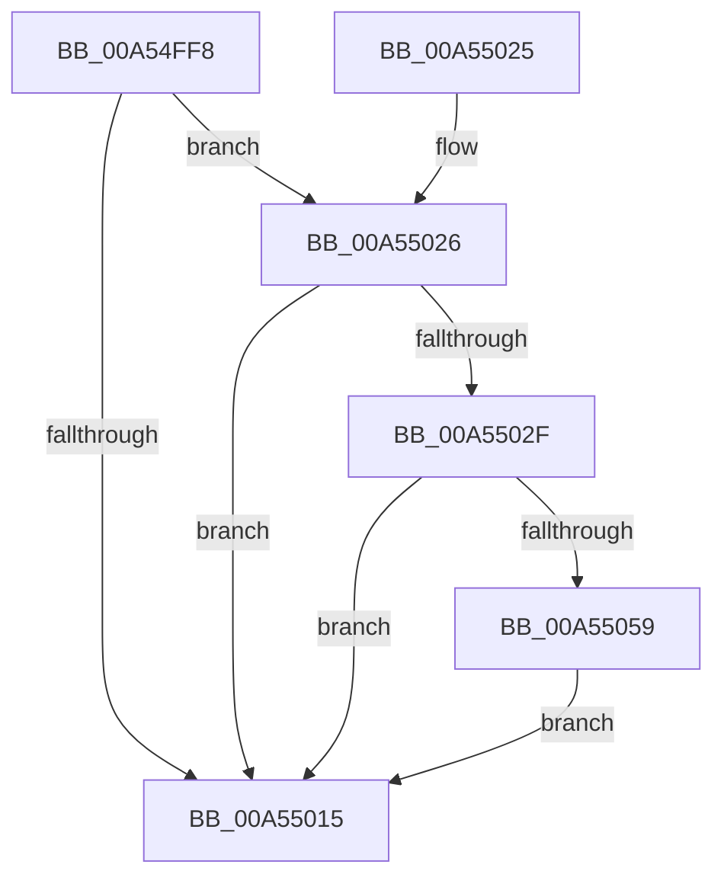

# CmpCleanupDiscardReplaceContext

- RVA: `0x00A54FF8`–`0x00A55069` (길이 `113` bytes)
- VA: `0x0000000140A54FF8`
- 실행 섹션: `PAGE`
- PDB 이름 있음: `예`; PDB Function 태그: `아니요`
- unwind 정보 RVA: `0x000B11B0`
- 디코드: `32`개 명령, `113/113` bytes 표시
- 미해석 바이트: `0` (있으면 어셈블리에 `.byte`로 보존)

> 이 문서는 커널 이미지의 기계어와 PDB 기호를 분석해 생성했습니다. 4번과 5번은 함수 원형과 자료형을 바이너리 사용 방식에서 추정한 C 해석이며 원본 소스 복구 결과는 아닙니다.

## 1. Dependencies

- 직접 호출 지점: **2**; 고유 호출 대상: **2**
- 직접 호출자로 확인된 함수: **4**
- RIP 상대 이미지 참조: **2**

### Outgoing calls
- `0x00A5504F` → [CmpEnumerateAllHigherLayerKcbs](CmpEnumerateAllHigherLayerKcbs_function_00A55234.md) (function, `0x00A55234`)
- `0x00A55062` → [CmpCleanupDiscardReplacePost](../7F/CmpCleanupDiscardReplacePost_function_007F1480.md) (function, `0x007F1480`)

### Direct callers
- [CmDeleteLayeredKey](../../text/41/CmDeleteLayeredKey_function_0041B598.md) at `0x0041B82F`
- [CmDeleteLayeredKey](../../text/41/CmDeleteLayeredKey_function_0041B598.md) at `0x0041B8DA`
- [CmpCleanupLightWeightUoWData](../9B/CmpCleanupLightWeightUoWData_function_009B0A68.md) at `0x009B0B62`
- [CmpLightWeightCommitDeleteKeyUoW](CmpLightWeightCommitDeleteKeyUoW_function_00A54610.md) at `0x00A5477D`
- [sub_00B3D5B8](../B3/Unknown_function_00B3D5B8.md) at `0x00B3D61F`

### Static image references
- `0x00A55034` → RVA `0x007F1480` (`CmpCleanupDiscardReplacePost`; read)
- `0x00A55040` → RVA `0x007F14F0` (`CmpCleanupDiscardReplacePre`; read)

## 2. Other-region calls and transfers

- 다른 실행 섹션으로 향하는 call: **0**
- 별도 외부 분기/꼬리 이동을 확인하지 못했습니다.

## 3. Assembly (complete function range)

```asm
00A54FF8  48 89 5C 24 08                  mov qword ptr [rsp + 8], rbx
00A54FFD  48 89 74 24 10                  mov qword ptr [rsp + 0x10], rsi
00A55002  57                              push rdi
00A55003  48 83 EC 40                     sub rsp, 0x40
00A55007  48 8B D9                        mov rbx, rcx
00A5500A  48 8B F2                        mov rsi, rdx
00A5500D  48 8B 09                        mov rcx, qword ptr [rcx]
00A55010  48 85 C9                        test rcx, rcx
00A55013  75 11                           jne 0x140a55026
00A55015  48 8B 5C 24 50                  mov rbx, qword ptr [rsp + 0x50]
00A5501A  48 8B 74 24 58                  mov rsi, qword ptr [rsp + 0x58]
00A5501F  48 83 C4 40                     add rsp, 0x40
00A55023  5F                              pop rdi
00A55024  C3                              ret
00A55025  CC                              int3
00A55026  48 8D 7B 10                     lea rdi, [rbx + 0x10]
00A5502A  48 39 3F                        cmp qword ptr [rdi], rdi
00A5502D  74 E6                           je 0x140a55015
00A5502F  C6 44 24 30 00                  mov byte ptr [rsp + 0x30], 0
00A55034  4C 8D 05 45 C4 D9 FF            lea r8, [rip - 0x263bbb]
00A5503B  C6 44 24 28 01                  mov byte ptr [rsp + 0x28], 1
00A55040  48 8D 15 A9 C4 D9 FF            lea rdx, [rip - 0x263b57]
00A55047  4C 8B CE                        mov r9, rsi
00A5504A  48 89 5C 24 20                  mov qword ptr [rsp + 0x20], rbx
00A5504F  E8 E0 01 00 00                  call 0x140a55234
00A55054  48 39 3F                        cmp qword ptr [rdi], rdi
00A55057  74 BC                           je 0x140a55015
00A55059  48 8B 0B                        mov rcx, qword ptr [rbx]
00A5505C  4C 8B C3                        mov r8, rbx
00A5505F  48 8B D6                        mov rdx, rsi
00A55062  E8 19 C4 D9 FF                  call 0x1407f1480
00A55067  EB AC                           jmp 0x140a55015
```

## 4. C-style interpretation (structured pseudocode)

```c
__int64 __fastcall CmpCleanupDiscardReplaceContext(__int64 a1, __int64 a2)
{
    __int64 result;
    __int64 v_rsp;
    unsigned __int64 v_stack_p10;
    unsigned __int64 v_stack_p20;
    unsigned __int8 v_stack_p28;
    unsigned __int8 v_stack_p30;
    unsigned __int64 v_stack_p8;

    v_stack_p8 = v_rbx;
    v_stack_p10 = v_rsi;
    v_rsp = (v_rsp) - (64);
    if (*(unsigned __int64 *)(a1) != 0) goto loc_00A55026;
loc_00A55015:
    v_rsp = (v_rsp) + (64);
    return result;
loc_00A55026:
    if ((*(unsigned __int64 *)(v_stack_p8 + 16)) == (v_stack_p8 + 16)) goto loc_00A55015;
    v_stack_p30 = 0;
    v_stack_p28 = 1;
    v_stack_p20 = v_stack_p8;
    result = CmpEnumerateAllHigherLayerKcbs(*(unsigned __int64 *)(a1), v_rip - 2505559, v_rip - 2505659, v_stack_p10);
    if ((*(unsigned __int64 *)(v_stack_p8 + 16)) == (v_stack_p8 + 16)) goto loc_00A55015;
    result = CmpCleanupDiscardReplacePost(*(unsigned __int64 *)(v_stack_p8), v_stack_p10, v_stack_p8, v_stack_p10);
    goto loc_00A55015;
}
```

## 5. (Beta) C Style

```c
int64_t CmpCleanupDiscardReplaceContext(void *Arg1, int64_t Arg2)
{
    uint8_t *arg1 = (uint8_t *)Arg1;

    int64_t result;
    int64_t local_rsp;
    uint64_t v_stack_p10;
    uint64_t v_stack_p20;
    uint8_t v_stack_p28;
    uint8_t v_stack_p30;
    uint64_t v_stack_p8;

    v_stack_p8 = local_rbx;
    v_stack_p10 = local_rsi;
    local_rsp = (local_rsp) - (64);
    if (*(uint64_t *)(arg1) != 0) goto loc_00A55026;
loc_00A55015:
    local_rsp = (local_rsp) + (64);
    return result;
loc_00A55026:
    if ((*(uint64_t *)(v_stack_p8 + 0x10)) == (v_stack_p8 + 16)) goto loc_00A55015;
    v_stack_p30 = 0;
    v_stack_p28 = 1;
    v_stack_p20 = v_stack_p8;
    result = CmpEnumerateAllHigherLayerKcbs(*(uint64_t *)(arg1), v_rip - 2505559, v_rip - 2505659, v_stack_p10);
    if ((*(uint64_t *)(v_stack_p8 + 0x10)) == (v_stack_p8 + 16)) goto loc_00A55015;
    result = CmpCleanupDiscardReplacePost(*(uint64_t *)(v_stack_p8), v_stack_p10, v_stack_p8, v_stack_p10);
    goto loc_00A55015;
}
```

### 관측된 메모리 오프셋

구조체 형식이 확인되지 않은 접근은 인자 기준의 오프셋으로만 기록했습니다.

| 기준 인자 | 오프셋 표현 | 폭 (bit) | 접근 |
|---|---:|---:|---|
| `Arg1` | `+ 0x0` | `64` | `R` |
| `Arg1` | `+ 0x10` | `64` | `R` |

## 6. Execution-region graph

[열기: 2D/3D 그래프와 함수 탐색 컨트롤 패널](../../../control-panel.html?section=page&rva=0x00A54FF8&view=graph)

- 2D 그래프는 위에서 아래로 흐르고, 3D 그래프는 빈 공간을 드래그해 회전합니다. Shift+드래그는 이동, 휠은 확대·축소, 함수 노드 선택은 대상 보고서 이동입니다.

### Static fallback


