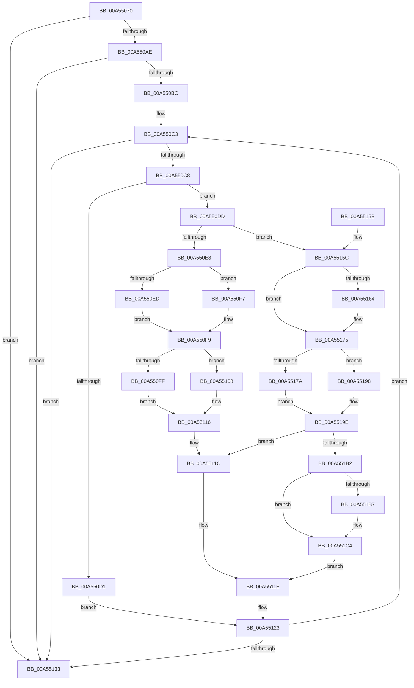

# CmpCommitDiscardAndReplaceKcbAndUnbackedHigherLayers

- RVA: `0x00A55070`–`0x00A551D3` (길이 `355` bytes)
- VA: `0x0000000140A55070`
- 실행 섹션: `PAGE`
- PDB 이름 있음: `예`; PDB Function 태그: `아니요`
- unwind 정보 RVA: `0x000B11C4`
- 디코드: `108`개 명령, `355/355` bytes 표시
- 미해석 바이트: `0` (있으면 어셈블리에 `.byte`로 보존)

> 이 문서는 커널 이미지의 기계어와 PDB 기호를 분석해 생성했습니다. 4번과 5번은 함수 원형과 자료형을 바이너리 사용 방식에서 추정한 C 해석이며 원본 소스 복구 결과는 아닙니다.

## 1. Dependencies

- 직접 호출 지점: **7**; 고유 호출 대상: **3**
- 직접 호출자로 확인된 함수: **4**
- RIP 상대 이미지 참조: **0**

### Outgoing calls
- `0x00A550F0` → [CmpReferenceKeyControlBlock](../85/CmpReferenceKeyControlBlock_function_0085D370.md) (function, `0x0085D370`)
- `0x00A55111` → [CmpDelayDerefKeyControlBlock](../84/CmpDelayDerefKeyControlBlock_function_0084FA50.md) (function, `0x0084FA50`)
- `0x00A55139` → [CmpCommitDiscardReplacePost](../86/CmpCommitDiscardReplacePost_function_008624D4.md) (function, `0x008624D4`)
- `0x00A5516B` → [CmpReferenceKeyControlBlock](../85/CmpReferenceKeyControlBlock_function_0085D370.md) (function, `0x0085D370`)
- `0x00A55180` → [CmpCommitDiscardReplacePost](../86/CmpCommitDiscardReplacePost_function_008624D4.md) (function, `0x008624D4`)
- `0x00A551A4` → [CmpDelayDerefKeyControlBlock](../84/CmpDelayDerefKeyControlBlock_function_0084FA50.md) (function, `0x0084FA50`)
- `0x00A551BD` → [CmpDelayDerefKeyControlBlock](../84/CmpDelayDerefKeyControlBlock_function_0084FA50.md) (function, `0x0084FA50`)

### Direct callers
- [CmDeleteLayeredKey](../../text/41/CmDeleteLayeredKey_function_0041B598.md) at `0x0041B86B`
- [sub_006ED542](../../text/6E/Unknown_function_006ED542.md) at `0x006ED65A`
- [CmpLightWeightCommitDeleteKeyUoW](CmpLightWeightCommitDeleteKeyUoW_function_00A54610.md) at `0x00A54771`
- [sub_00B16440](../B1/Unknown_function_00B16440.md) at `0x00B165D4`

### Static image references
- 디코드된 RIP-relative 메모리 참조가 없습니다.

## 2. Other-region calls and transfers

- 다른 실행 섹션으로 향하는 call: **0**
- 별도 외부 분기/꼬리 이동을 확인하지 못했습니다.

## 3. Assembly (complete function range)

```asm
00A55070  48 8B C4                        mov rax, rsp
00A55073  48 89 58 08                     mov qword ptr [rax + 8], rbx
00A55077  48 89 68 18                     mov qword ptr [rax + 0x18], rbp
00A5507B  48 89 70 20                     mov qword ptr [rax + 0x20], rsi
00A5507F  48 89 50 10                     mov qword ptr [rax + 0x10], rdx
00A55083  57                              push rdi
00A55084  41 54                           push r12
00A55086  41 55                           push r13
00A55088  41 56                           push r14
00A5508A  41 57                           push r15
00A5508C  48 83 EC 20                     sub rsp, 0x20
00A55090  48 8B B9 C0 00 00 00            mov rdi, qword ptr [rcx + 0xc0]
00A55097  33 F6                           xor esi, esi
00A55099  45 32 FF                        xor r15b, r15b
00A5509C  4D 8B F0                        mov r14, r8
00A5509F  4C 8B C2                        mov r8, rdx
00A550A2  4C 8B E9                        mov r13, rcx
00A550A5  48 85 FF                        test rdi, rdi
00A550A8  0F 84 85 00 00 00               je 0x140a55133
00A550AE  48 8D 47 20                     lea rax, [rdi + 0x20]
00A550B2  32 D2                           xor dl, dl
00A550B4  48 8B 18                        mov rbx, qword ptr [rax]
00A550B7  48 3B D8                        cmp rbx, rax
00A550BA  74 77                           je 0x140a55133
00A550BC  48 8B CF                        mov rcx, rdi
00A550BF  44 8D 66 01                     lea r12d, [rsi + 1]
00A550C3  48 3B D9                        cmp rbx, rcx
00A550C6  74 6B                           je 0x140a55133
00A550C8  48 8D 47 20                     lea rax, [rdi + 0x20]
00A550CC  48 3B D8                        cmp rbx, rax
00A550CF  75 0C                           jne 0x140a550dd
00A550D1  48 8B DF                        mov rbx, rdi
00A550D4  41 8A D4                        mov dl, r12b
00A550D7  48 8B 7F 18                     mov rdi, qword ptr [rdi + 0x18]
00A550DB  EB 46                           jmp 0x140a55123
00A550DD  48 8B 6B 10                     mov rbp, qword ptr [rbx + 0x10]
00A550E1  4C 8B E3                        mov r12, rbx
00A550E4  84 D2                           test dl, dl
00A550E6  75 74                           jne 0x140a5515c
00A550E8  48 3B EE                        cmp rbp, rsi
00A550EB  74 0A                           je 0x140a550f7
00A550ED  48 8B CD                        mov rcx, rbp
00A550F0  E8 7B 82 E0 FF                  call 0x14085d370
00A550F5  EB 02                           jmp 0x140a550f9
00A550F7  33 F6                           xor esi, esi
00A550F9  83 7D 28 FF                     cmp dword ptr [rbp + 0x28], -1
00A550FD  75 09                           jne 0x140a55108
00A550FF  48 8B 5B 20                     mov rbx, qword ptr [rbx + 0x20]
00A55103  49 8B FC                        mov rdi, r12
00A55106  EB 0E                           jmp 0x140a55116
00A55108  48 8B 1B                        mov rbx, qword ptr [rbx]
00A5510B  49 8B D6                        mov rdx, r14
00A5510E  48 8B CD                        mov rcx, rbp
00A55111  E8 3A A9 DF FF                  call 0x14084fa50
00A55116  41 BC 01 00 00 00               mov r12d, 1
00A5511C  32 D2                           xor dl, dl
00A5511E  4C 8B 44 24 58                  mov r8, qword ptr [rsp + 0x58]
00A55123  49 8B 8D C0 00 00 00            mov rcx, qword ptr [r13 + 0xc0]
00A5512A  48 8D 41 20                     lea rax, [rcx + 0x20]
00A5512E  48 3B D8                        cmp rbx, rax
00A55131  75 90                           jne 0x140a550c3
00A55133  49 8B D6                        mov rdx, r14
00A55136  49 8B CD                        mov rcx, r13
00A55139  E8 96 D3 E0 FF                  call 0x1408624d4
00A5513E  48 8B 5C 24 50                  mov rbx, qword ptr [rsp + 0x50]
00A55143  48 8B 6C 24 60                  mov rbp, qword ptr [rsp + 0x60]
00A55148  48 8B 74 24 68                  mov rsi, qword ptr [rsp + 0x68]
00A5514D  48 83 C4 20                     add rsp, 0x20
00A55151  41 5F                           pop r15
00A55153  41 5E                           pop r14
00A55155  41 5D                           pop r13
00A55157  41 5C                           pop r12
00A55159  5F                              pop rdi
00A5515A  C3                              ret
00A5515B  CC                              int3
00A5515C  48 8B 1B                        mov rbx, qword ptr [rbx]
00A5515F  48 3B D8                        cmp rbx, rax
00A55162  74 11                           je 0x140a55175
00A55164  48 8B 73 10                     mov rsi, qword ptr [rbx + 0x10]
00A55168  48 8B CE                        mov rcx, rsi
00A5516B  E8 00 82 E0 FF                  call 0x14085d370
00A55170  4C 8B 44 24 58                  mov r8, qword ptr [rsp + 0x58]
00A55175  45 84 FF                        test r15b, r15b
00A55178  75 1E                           jne 0x140a55198
00A5517A  49 8B D6                        mov rdx, r14
00A5517D  48 8B CD                        mov rcx, rbp
00A55180  E8 4F D3 E0 FF                  call 0x1408624d4
00A55185  41 BC 01 00 00 00               mov r12d, 1
00A5518B  45 0F B6 FF                     movzx r15d, r15b
00A5518F  41 3B C4                        cmp eax, r12d
00A55192  45 0F 44 FC                     cmove r15d, r12d
00A55196  EB 06                           jmp 0x140a5519e
00A55198  41 BC 01 00 00 00               mov r12d, 1
00A5519E  49 8B D6                        mov rdx, r14
00A551A1  48 8B CD                        mov rcx, rbp
00A551A4  E8 A7 A8 DF FF                  call 0x14084fa50
00A551A9  45 84 FF                        test r15b, r15b
00A551AC  0F 84 6A FF FF FF               je 0x140a5511c
00A551B2  48 85 F6                        test rsi, rsi
00A551B5  74 0D                           je 0x140a551c4
00A551B7  49 8B D6                        mov rdx, r14
00A551BA  48 8B CE                        mov rcx, rsi
00A551BD  E8 8E A8 DF FF                  call 0x14084fa50
00A551C2  33 F6                           xor esi, esi
00A551C4  48 8B DF                        mov rbx, rdi
00A551C7  41 8A D4                        mov dl, r12b
00A551CA  48 8B 7F 18                     mov rdi, qword ptr [rdi + 0x18]
00A551CE  E9 4B FF FF FF                  jmp 0x140a5511e
```

## 4. C-style interpretation (structured pseudocode)

```c
__int64 __fastcall CmpCommitDiscardAndReplaceKcbAndUnbackedHigherLayers(__int64 a1, __int64 a2, __int64 a3)
{
    __int64 result;
    __int64 v_r15;
    __int64 v_rsi;
    __int64 v_rsp;
    unsigned __int64 v_stack_p10;
    unsigned __int64 v_stack_p18;
    unsigned __int64 v_stack_p20;
    unsigned __int64 v_stack_p58;
    unsigned __int64 v_stack_p8;

    *(unsigned __int64 *)(v_rsp + 8) = v_rbx;
    *(unsigned __int64 *)(v_rsp + 24) = v_rbp;
    *(unsigned __int64 *)(v_rsp + 32) = v_rsi;
    *(unsigned __int64 *)(v_rsp + 16) = a2;
    v_rsp = (v_rsp) - (32);
    v_rsi = 0;
    v_r15 = 0;
    if (*(unsigned __int64 *)(a1 + 192) == 0) goto loc_00A55133;
    a2 = 0;
    if ((*(unsigned __int64 *)(*(unsigned __int64 *)(a1 + 192) + 32)) == (*(unsigned __int64 *)(a1 + 192) + 32)) goto loc_00A55133;
loc_00A550C3:
    if ((*(unsigned __int64 *)(*(unsigned __int64 *)(a1 + 192) + 32)) == (*(unsigned __int64 *)(a1 + 192))) goto loc_00A55133;
    if ((*(unsigned __int64 *)(*(unsigned __int64 *)(a1 + 192) + 32)) != (*(unsigned __int64 *)(a1 + 192) + 32)) goto loc_00A550DD;
    goto loc_00A55123;
loc_00A550DD:
    if ((unsigned __int8)((unsigned __int8)(v_rsi + 1)) != 0) goto loc_00A5515C;
    if ((*(unsigned __int64 *)(*(unsigned __int64 *)(a1 + 192) + 16)) == 0) goto loc_00A550F7;
    result = CmpReferenceKeyControlBlock(*(unsigned __int64 *)(*(unsigned __int64 *)(a1 + 192) + 16), (unsigned __int8)(v_rsi + 1), a2, a4);
    goto loc_00A550F9;
loc_00A550F7:
    v_rsi = 0;
loc_00A550F9:
    if ((*(unsigned int *)(*(unsigned __int64 *)(*(unsigned __int64 *)(a1 + 192) + 16) + 40)) != -1) goto loc_00A55108;
    goto loc_00A55116;
loc_00A55108:
    result = CmpDelayDerefKeyControlBlock(*(unsigned __int64 *)(*(unsigned __int64 *)(a1 + 192) + 16), a3, a2, a4);
loc_00A55116:
loc_00A5511C:
    a2 = 0;
loc_00A5511E:
loc_00A55123:
    if ((*(unsigned __int64 *)(*(unsigned __int64 *)(*(unsigned __int64 *)(a1 + 192) + 32))) != (*(unsigned __int64 *)(a1 + 192) + 32)) goto loc_00A550C3;
loc_00A55133:
    result = CmpCommitDiscardReplacePost(a1, a3, v_stack_p10, a4);
    v_rsp = (v_rsp) + (32);
    return result;
loc_00A5515C:
    v_rsi = v_stack_p20;
    if ((*(unsigned __int64 *)(v_stack_p8)) != result) {
        v_rsi = *(unsigned __int64 *)(*(unsigned __int64 *)(v_stack_p8) + 16);
        a1 = v_rsi;
        result = CmpReferenceKeyControlBlock(a1, a3, v_stack_p10, a4);
        a3 = v_stack_p58;
    }
    if (0 != 0) goto loc_00A55198;
    result = CmpCommitDiscardReplacePost(v_stack_p18, a3, a3, a4);
    v_r15 = 0;
    if (((unsigned int)(result)) == 1) { v_r15 = 1; }
    goto loc_00A5519E;
loc_00A55198:
loc_00A5519E:
    result = CmpDelayDerefKeyControlBlock(v_stack_p18, a3, a3, a4);
    if ((unsigned __int8)(v_r15) == 0) goto loc_00A5511C;
    if (v_rsi != 0) {
        a2 = a3;
        a1 = v_rsi;
        result = CmpDelayDerefKeyControlBlock(a1, a2, a3, a4);
        v_rsi = 0;
    }
    goto loc_00A5511E;
}
```

## 5. (Beta) C Style

```c
int64_t CmpCommitDiscardAndReplaceKcbAndUnbackedHigherLayers(void *Arg1, int64_t Arg2, int64_t Arg3)
{
    uint8_t *arg1 = (uint8_t *)Arg1;

    int64_t result;
    int64_t local_r15;
    int64_t local_rsi;
    int64_t local_rsp;
    uint64_t v_stack_p10;
    uint64_t v_stack_p18;
    uint64_t v_stack_p20;
    uint64_t v_stack_p58;
    uint64_t v_stack_p8;

    *(uint64_t *)(local_rsp + 0x8) = local_rbx;
    *(uint64_t *)(local_rsp + 0x18) = local_rbp;
    *(uint64_t *)(local_rsp + 0x20) = local_rsi;
    *(uint64_t *)(local_rsp + 0x10) = Arg2;
    local_rsp = (local_rsp) - (32);
    local_rsi = 0;
    local_r15 = 0;
    if (*(uint64_t *)(arg1 + 0xC0) == 0) goto loc_00A55133;
    Arg2 = 0;
    if ((*(uint64_t *)(*(uint64_t *)(arg1 + 0xC0) + 0x20)) == (*(uint64_t *)(arg1 + 0xC0) + 32)) goto loc_00A55133;
loc_00A550C3:
    if ((*(uint64_t *)(*(uint64_t *)(arg1 + 0xC0) + 0x20)) == (*(uint64_t *)(arg1 + 0xC0))) goto loc_00A55133;
    if ((*(uint64_t *)(*(uint64_t *)(arg1 + 0xC0) + 0x20)) != (*(uint64_t *)(arg1 + 0xC0) + 32)) goto loc_00A550DD;
    goto loc_00A55123;
loc_00A550DD:
    if ((uint8_t)((uint8_t)(local_rsi + 1)) != 0) goto loc_00A5515C;
    if ((*(uint64_t *)(*(uint64_t *)(arg1 + 0xC0) + 0x10)) == 0) goto loc_00A550F7;
    result = CmpReferenceKeyControlBlock(*(uint64_t *)(*(uint64_t *)(arg1 + 0xC0) + 0x10), (uint8_t)(local_rsi + 1), Arg2, a4);
    goto loc_00A550F9;
loc_00A550F7:
    local_rsi = 0;
loc_00A550F9:
    if ((*(uint32_t *)(*(uint64_t *)(*(uint64_t *)(arg1 + 0xC0) + 0x10) + 0x28)) != -1) goto loc_00A55108;
    goto loc_00A55116;
loc_00A55108:
    result = CmpDelayDerefKeyControlBlock(*(uint64_t *)(*(uint64_t *)(arg1 + 0xC0) + 0x10), Arg3, Arg2, a4);
loc_00A55116:
loc_00A5511C:
    Arg2 = 0;
loc_00A5511E:
loc_00A55123:
    if ((*(uint64_t *)(*(uint64_t *)(*(uint64_t *)(arg1 + 0xC0) + 0x20))) != (*(uint64_t *)(arg1 + 0xC0) + 32)) goto loc_00A550C3;
loc_00A55133:
    result = CmpCommitDiscardReplacePost(Arg1, Arg3, v_stack_p10, a4);
    local_rsp = (local_rsp) + (32);
    return result;
loc_00A5515C:
    local_rsi = v_stack_p20;
    if ((*(uint64_t *)(v_stack_p8)) != result) {
        local_rsi = *(uint64_t *)(*(uint64_t *)(v_stack_p8) + 0x10);
        Arg1 = local_rsi;
        result = CmpReferenceKeyControlBlock(Arg1, Arg3, v_stack_p10, a4);
        Arg3 = v_stack_p58;
    }
    if (0 != 0) goto loc_00A55198;
    result = CmpCommitDiscardReplacePost(v_stack_p18, Arg3, Arg3, a4);
    local_r15 = 0;
    if (((uint32_t)(result)) == 1) { local_r15 = 1; }
    goto loc_00A5519E;
loc_00A55198:
loc_00A5519E:
    result = CmpDelayDerefKeyControlBlock(v_stack_p18, Arg3, Arg3, a4);
    if ((uint8_t)(local_r15) == 0) goto loc_00A5511C;
    if (local_rsi != 0) {
        Arg2 = Arg3;
        Arg1 = local_rsi;
        result = CmpDelayDerefKeyControlBlock(Arg1, Arg2, Arg3, a4);
        local_rsi = 0;
    }
    goto loc_00A5511E;
}
```

### 관측된 메모리 오프셋

구조체 형식이 확인되지 않은 접근은 인자 기준의 오프셋으로만 기록했습니다.

| 기준 인자 | 오프셋 표현 | 폭 (bit) | 접근 |
|---|---:|---:|---|
| `Arg1` | `+ 0xC0` | `64` | `R` |

## 6. Execution-region graph

[열기: 2D/3D 그래프와 함수 탐색 컨트롤 패널](../../../control-panel.html?section=page&rva=0x00A55070&view=graph)

- 2D 그래프는 위에서 아래로 흐르고, 3D 그래프는 빈 공간을 드래그해 회전합니다. Shift+드래그는 이동, 휠은 확대·축소, 함수 노드 선택은 대상 보고서 이동입니다.

### Static fallback


