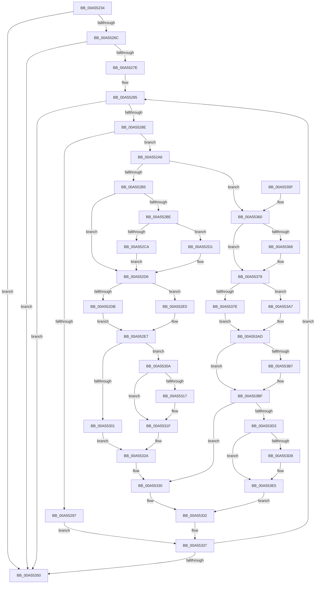

# CmpEnumerateAllHigherLayerKcbs

- RVA: `0x00A55234`–`0x00A553F4` (길이 `448` bytes)
- VA: `0x0000000140A55234`
- 실행 섹션: `PAGE`
- PDB 이름 있음: `예`; PDB Function 태그: `아니요`
- unwind 정보 RVA: `0x000B11E4`
- 디코드: `126`개 명령, `448/448` bytes 표시
- 미해석 바이트: `0` (있으면 어셈블리에 `.byte`로 보존)

> 이 문서는 커널 이미지의 기계어와 PDB 기호를 분석해 생성했습니다. 4번과 5번은 함수 원형과 자료형을 바이너리 사용 방식에서 추정한 C 해석이며 원본 소스 복구 결과는 아닙니다.

## 1. Dependencies

- 직접 호출 지점: **11**; 고유 호출 대상: **6**
- 직접 호출자로 확인된 함수: **7**
- RIP 상대 이미지 참조: **0**

### Outgoing calls
- `0x00A552CA` → [CmpLockKcbExclusive](../86/CmpLockKcbExclusive_function_00861EB0.md) (function, `0x00861EB0`)
- `0x00A552D1` → [CmpLockKcbShared](../../pagecmrc/BC/CmpLockKcbShared_function_00BC9A1C.md) (function, `0x00BC9A1C`)
- `0x00A552DE` → [CmpReferenceKeyControlBlock](../85/CmpReferenceKeyControlBlock_function_0085D370.md) (function, `0x0085D370`)
- `0x00A552F7` → [guard_dispatch_icall](../../text/6B/guard_dispatch_icall_function_006BAAD0.md) (function, `0x006BAAD0`)
- `0x00A5531A` → [CmpUnlockKcb](../../pagecmrc/BC/CmpUnlockKcb_function_00BC92C0.md) (function, `0x00BC92C0`)
- `0x00A55325` → [CmpDelayDerefKeyControlBlock](../84/CmpDelayDerefKeyControlBlock_function_0084FA50.md) (function, `0x0084FA50`)
- `0x00A5536F` → [CmpReferenceKeyControlBlock](../85/CmpReferenceKeyControlBlock_function_0085D370.md) (function, `0x0085D370`)
- `0x00A5538F` → [guard_dispatch_icall](../../text/6B/guard_dispatch_icall_function_006BAAD0.md) (function, `0x006BAAD0`)
- `0x00A553BA` → [CmpUnlockKcb](../../pagecmrc/BC/CmpUnlockKcb_function_00BC92C0.md) (function, `0x00BC92C0`)
- `0x00A553C5` → [CmpDelayDerefKeyControlBlock](../84/CmpDelayDerefKeyControlBlock_function_0084FA50.md) (function, `0x0084FA50`)
- `0x00A553DE` → [CmpDelayDerefKeyControlBlock](../84/CmpDelayDerefKeyControlBlock_function_0084FA50.md) (function, `0x0084FA50`)

### Direct callers
- [CmRestoreKey](../7D/CmRestoreKey_function_007DCF04.md) at `0x007DD54A`
- [CmpInvalidateAllHigherLayerKcbs](../7F/CmpInvalidateAllHigherLayerKcbs_function_007F1560.md) at `0x007F158D`
- [CmpPrepareDiscardAndReplaceKcbAndUnbackedHigherLayers](../7F/CmpPrepareDiscardAndReplaceKcbAndUnbackedHigherLayers_function_007F1610.md) at `0x007F1662`
- [CmpPrepareToInvalidateAllHigherLayerKcbs](../7F/CmpPrepareToInvalidateAllHigherLayerKcbs_function_007F174C.md) at `0x007F17A3`
- [CmpFlushNotifiesOnAllUnbackedHigherLayerKcbs](CmpFlushNotifiesOnAllUnbackedHigherLayerKcbs_function_00A547AC.md) at `0x00A547E9`
- [CmpCleanupDiscardReplaceContext](CmpCleanupDiscardReplaceContext_function_00A54FF8.md) at `0x00A5504F`
- [sub_00B16440](../B1/Unknown_function_00B16440.md) at `0x00B16613`

### Static image references
- 디코드된 RIP-relative 메모리 참조가 없습니다.

## 2. Other-region calls and transfers

- 다른 실행 섹션으로 향하는 call: **5**
  - `0x00A552D1` → [CmpLockKcbShared](../../pagecmrc/BC/CmpLockKcbShared_function_00BC9A1C.md) (`PAGE` → `PAGECMRC`)
  - `0x00A552F7` → [guard_dispatch_icall](../../text/6B/guard_dispatch_icall_function_006BAAD0.md) (`PAGE` → `.text`)
  - `0x00A5531A` → [CmpUnlockKcb](../../pagecmrc/BC/CmpUnlockKcb_function_00BC92C0.md) (`PAGE` → `PAGECMRC`)
  - `0x00A5538F` → [guard_dispatch_icall](../../text/6B/guard_dispatch_icall_function_006BAAD0.md) (`PAGE` → `.text`)
  - `0x00A553BA` → [CmpUnlockKcb](../../pagecmrc/BC/CmpUnlockKcb_function_00BC92C0.md) (`PAGE` → `PAGECMRC`)
- 별도 외부 분기/꼬리 이동을 확인하지 못했습니다.

## 3. Assembly (complete function range)

```asm
00A55234  4C 89 44 24 18                  mov qword ptr [rsp + 0x18], r8
00A55239  48 89 54 24 10                  mov qword ptr [rsp + 0x10], rdx
00A5523E  48 89 4C 24 08                  mov qword ptr [rsp + 8], rcx
00A55243  53                              push rbx
00A55244  55                              push rbp
00A55245  56                              push rsi
00A55246  57                              push rdi
00A55247  41 55                           push r13
00A55249  41 56                           push r14
00A5524B  41 57                           push r15
00A5524D  48 83 EC 20                     sub rsp, 0x20
00A55251  48 8B B9 C0 00 00 00            mov rdi, qword ptr [rcx + 0xc0]
00A55258  33 ED                           xor ebp, ebp
00A5525A  45 32 ED                        xor r13b, r13b
00A5525D  4D 8B F9                        mov r15, r9
00A55260  4D 8B C8                        mov r9, r8
00A55263  48 85 FF                        test rdi, rdi
00A55266  0F 84 E4 00 00 00               je 0x140a55350
00A5526C  48 8D 47 20                     lea rax, [rdi + 0x20]
00A55270  32 D2                           xor dl, dl
00A55272  48 8B 18                        mov rbx, qword ptr [rax]
00A55275  48 3B D8                        cmp rbx, rax
00A55278  0F 84 D2 00 00 00               je 0x140a55350
00A5527E  48 8B CF                        mov rcx, rdi
00A55281  44 8D 75 01                     lea r14d, [rbp + 1]
00A55285  48 3B D9                        cmp rbx, rcx
00A55288  0F 84 C2 00 00 00               je 0x140a55350
00A5528E  48 8D 47 20                     lea rax, [rdi + 0x20]
00A55292  48 3B D8                        cmp rbx, rax
00A55295  75 0F                           jne 0x140a552a6
00A55297  48 8B DF                        mov rbx, rdi
00A5529A  41 8A D6                        mov dl, r14b
00A5529D  48 8B 7F 18                     mov rdi, qword ptr [rdi + 0x18]
00A552A1  E9 91 00 00 00                  jmp 0x140a55337
00A552A6  48 8B 73 10                     mov rsi, qword ptr [rbx + 0x10]
00A552AA  4C 8B F3                        mov r14, rbx
00A552AD  84 D2                           test dl, dl
00A552AF  0F 85 AB 00 00 00               jne 0x140a55360
00A552B5  38 94 24 88 00 00 00            cmp byte ptr [rsp + 0x88], dl
00A552BC  75 18                           jne 0x140a552d6
00A552BE  48 8B CE                        mov rcx, rsi
00A552C1  38 94 24 90 00 00 00            cmp byte ptr [rsp + 0x90], dl
00A552C8  74 07                           je 0x140a552d1
00A552CA  E8 E1 CB E0 FF                  call 0x140861eb0
00A552CF  EB 05                           jmp 0x140a552d6
00A552D1  E8 46 47 17 00                  call 0x140bc9a1c
00A552D6  48 3B F5                        cmp rsi, rbp
00A552D9  74 0A                           je 0x140a552e5
00A552DB  48 8B CE                        mov rcx, rsi
00A552DE  E8 8D 80 E0 FF                  call 0x14085d370
00A552E3  EB 02                           jmp 0x140a552e7
00A552E5  33 ED                           xor ebp, ebp
00A552E7  48 8B 94 24 80 00 00 00         mov rdx, qword ptr [rsp + 0x80]
00A552EF  48 8B CE                        mov rcx, rsi
00A552F2  48 8B 44 24 68                  mov rax, qword ptr [rsp + 0x68]
00A552F7  E8 D4 57 C6 FF                  call 0x1406baad0
00A552FC  83 F8 01                        cmp eax, 1
00A552FF  75 09                           jne 0x140a5530a
00A55301  48 8B 5B 20                     mov rbx, qword ptr [rbx + 0x20]
00A55305  49 8B FE                        mov rdi, r14
00A55308  EB 20                           jmp 0x140a5532a
00A5530A  80 BC 24 88 00 00 00 00         cmp byte ptr [rsp + 0x88], 0
00A55312  48 8B 1B                        mov rbx, qword ptr [rbx]
00A55315  75 08                           jne 0x140a5531f
00A55317  48 8B CE                        mov rcx, rsi
00A5531A  E8 A1 3F 17 00                  call 0x140bc92c0
00A5531F  49 8B D7                        mov rdx, r15
00A55322  48 8B CE                        mov rcx, rsi
00A55325  E8 26 A7 DF FF                  call 0x14084fa50
00A5532A  41 BE 01 00 00 00               mov r14d, 1
00A55330  32 D2                           xor dl, dl
00A55332  4C 8B 4C 24 70                  mov r9, qword ptr [rsp + 0x70]
00A55337  48 8B 44 24 60                  mov rax, qword ptr [rsp + 0x60]
00A5533C  48 8B 88 C0 00 00 00            mov rcx, qword ptr [rax + 0xc0]
00A55343  48 8D 41 20                     lea rax, [rcx + 0x20]
00A55347  48 3B D8                        cmp rbx, rax
00A5534A  0F 85 35 FF FF FF               jne 0x140a55285
00A55350  48 83 C4 20                     add rsp, 0x20
00A55354  41 5F                           pop r15
00A55356  41 5E                           pop r14
00A55358  41 5D                           pop r13
00A5535A  5F                              pop rdi
00A5535B  5E                              pop rsi
00A5535C  5D                              pop rbp
00A5535D  5B                              pop rbx
00A5535E  C3                              ret
00A5535F  CC                              int3
00A55360  48 8B 1B                        mov rbx, qword ptr [rbx]
00A55363  48 3B D8                        cmp rbx, rax
00A55366  74 11                           je 0x140a55379
00A55368  48 8B 6B 10                     mov rbp, qword ptr [rbx + 0x10]
00A5536C  48 8B CD                        mov rcx, rbp
00A5536F  E8 FC 7F E0 FF                  call 0x14085d370
00A55374  4C 8B 4C 24 70                  mov r9, qword ptr [rsp + 0x70]
00A55379  45 84 ED                        test r13b, r13b
00A5537C  75 29                           jne 0x140a553a7
00A5537E  4C 8B 84 24 80 00 00 00         mov r8, qword ptr [rsp + 0x80]
00A55386  49 8B D7                        mov rdx, r15
00A55389  48 8B CE                        mov rcx, rsi
00A5538C  49 8B C1                        mov rax, r9
00A5538F  E8 3C 57 C6 FF                  call 0x1406baad0
00A55394  41 BE 01 00 00 00               mov r14d, 1
00A5539A  45 0F B6 ED                     movzx r13d, r13b
00A5539E  41 3B C6                        cmp eax, r14d
00A553A1  45 0F 44 EE                     cmove r13d, r14d
00A553A5  EB 06                           jmp 0x140a553ad
00A553A7  41 BE 01 00 00 00               mov r14d, 1
00A553AD  80 BC 24 88 00 00 00 00         cmp byte ptr [rsp + 0x88], 0
00A553B5  75 08                           jne 0x140a553bf
00A553B7  48 8B CE                        mov rcx, rsi
00A553BA  E8 01 3F 17 00                  call 0x140bc92c0
00A553BF  49 8B D7                        mov rdx, r15
00A553C2  48 8B CE                        mov rcx, rsi
00A553C5  E8 86 A6 DF FF                  call 0x14084fa50
00A553CA  45 84 ED                        test r13b, r13b
00A553CD  0F 84 5D FF FF FF               je 0x140a55330
00A553D3  48 85 ED                        test rbp, rbp
00A553D6  74 0D                           je 0x140a553e5
00A553D8  49 8B D7                        mov rdx, r15
00A553DB  48 8B CD                        mov rcx, rbp
00A553DE  E8 6D A6 DF FF                  call 0x14084fa50
00A553E3  33 ED                           xor ebp, ebp
00A553E5  48 8B DF                        mov rbx, rdi
00A553E8  41 8A D6                        mov dl, r14b
00A553EB  48 8B 7F 18                     mov rdi, qword ptr [rdi + 0x18]
00A553EF  E9 3E FF FF FF                  jmp 0x140a55332
```

## 4. C-style interpretation (structured pseudocode)

```c
__int64 __fastcall CmpEnumerateAllHigherLayerKcbs(__int64 a1, __int64 a2, __int64 a3, __int64 a4, __int64 a5, unsigned __int8 a6, unsigned __int8 a7)
{
    __int64 result;
    __int64 v_r13;
    __int64 v_rbp;
    __int64 v_rsp;
    unsigned __int64 v_stack_p10;
    unsigned __int64 v_stack_p18;
    unsigned __int64 v_stack_p70;
    unsigned __int64 v_stack_p8;

    v_stack_p18 = a3;
    v_stack_p10 = a2;
    v_stack_p8 = a1;
    v_rsp = (v_rsp) - (32);
    v_rbp = 0;
    v_r13 = 0;
    if (*(unsigned __int64 *)(a1 + 192) == 0) goto loc_00A55350;
    a2 = 0;
    if ((*(unsigned __int64 *)(*(unsigned __int64 *)(a1 + 192) + 32)) == (*(unsigned __int64 *)(a1 + 192) + 32)) goto loc_00A55350;
loc_00A55285:
    if ((*(unsigned __int64 *)(*(unsigned __int64 *)(a1 + 192) + 32)) == (*(unsigned __int64 *)(a1 + 192))) goto loc_00A55350;
    if ((*(unsigned __int64 *)(*(unsigned __int64 *)(a1 + 192) + 32)) != (*(unsigned __int64 *)(a1 + 192) + 32)) goto loc_00A552A6;
    goto loc_00A55337;
loc_00A552A6:
    if ((unsigned __int8)((unsigned __int8)(v_rbp + 1)) != 0) goto loc_00A55360;
    if (a6 != ((unsigned __int8)((unsigned __int8)(v_rbp + 1)))) goto loc_00A552D6;
    if (a7 == ((unsigned __int8)((unsigned __int8)(v_rbp + 1)))) goto loc_00A552D1;
    result = CmpLockKcbExclusive(*(unsigned __int64 *)(*(unsigned __int64 *)(a1 + 192) + 16), (unsigned __int8)(v_rbp + 1), a3, a3);
    goto loc_00A552D6;
loc_00A552D1:
    result = CmpLockKcbShared(*(unsigned __int64 *)(*(unsigned __int64 *)(a1 + 192) + 16), (unsigned __int8)(v_rbp + 1), a3, a3);
loc_00A552D6:
    if ((*(unsigned __int64 *)(*(unsigned __int64 *)(a1 + 192) + 16)) == 0) goto loc_00A552E5;
    result = CmpReferenceKeyControlBlock(*(unsigned __int64 *)(*(unsigned __int64 *)(a1 + 192) + 16), (unsigned __int8)(v_rbp + 1), a3, a3);
    goto loc_00A552E7;
loc_00A552E5:
    v_rbp = 0;
loc_00A552E7:
    result = guard_dispatch_icall(*(unsigned __int64 *)(*(unsigned __int64 *)(a1 + 192) + 16), a5, a3, a3);
    if (((unsigned int)(result)) != 1) goto loc_00A5530A;
    goto loc_00A5532A;
loc_00A5530A:
    if (a6 == 0) {
        a1 = *(unsigned __int64 *)(*(unsigned __int64 *)(a1 + 192) + 16);
        result = CmpUnlockKcb(a1, a5, a3, a3);
    }
    result = CmpDelayDerefKeyControlBlock(*(unsigned __int64 *)(*(unsigned __int64 *)(a1 + 192) + 16), a4, a3, a3);
loc_00A5532A:
loc_00A55330:
    a2 = 0;
loc_00A55332:
loc_00A55337:
    if ((*(unsigned __int64 *)(*(unsigned __int64 *)(*(unsigned __int64 *)(a1 + 192) + 32))) != (*(unsigned __int64 *)(v_stack_p8 + 192) + 32)) goto loc_00A55285;
loc_00A55350:
    v_rsp = (v_rsp) + (32);
    return *(unsigned __int64 *)(v_stack_p8 + 192) + 32;
loc_00A55360:
    result = *(unsigned __int64 *)(v_stack_p8 + 192) + 32;
    if ((*(unsigned __int64 *)(*(unsigned __int64 *)(*(unsigned __int64 *)(*(unsigned __int64 *)(a1 + 192) + 32)))) != (*(unsigned __int64 *)(v_stack_p8 + 192) + 32)) {
        v_rbp = *(unsigned __int64 *)(*(unsigned __int64 *)(*(unsigned __int64 *)(*(unsigned __int64 *)(*(unsigned __int64 *)(a1 + 192) + 32))) + 16);
        a1 = v_rbp;
        result = CmpReferenceKeyControlBlock(a1, a2, a3, v_stack_p18);
        a4 = v_stack_p70;
    }
    if (0 != 0) goto loc_00A553A7;
    result = guard_dispatch_icall(*(unsigned __int64 *)(*(unsigned __int64 *)(a1 + 192) + 16), a4, a5, a4);
    v_r13 = 0;
    if (((unsigned int)(result)) == 1) { v_r13 = 1; }
    goto loc_00A553AD;
loc_00A553A7:
loc_00A553AD:
    if (a6 == 0) {
        a1 = *(unsigned __int64 *)(*(unsigned __int64 *)(a1 + 192) + 16);
        result = CmpUnlockKcb(a1, a4, a5, a4);
    }
    result = CmpDelayDerefKeyControlBlock(*(unsigned __int64 *)(*(unsigned __int64 *)(a1 + 192) + 16), a4, a5, a4);
    if ((unsigned __int8)(v_r13) == 0) goto loc_00A55330;
    if (v_rbp != 0) {
        a2 = a4;
        a1 = v_rbp;
        result = CmpDelayDerefKeyControlBlock(a1, a2, a5, a4);
        v_rbp = 0;
    }
    goto loc_00A55332;
}
```

## 5. (Beta) C Style

```c
int64_t CmpEnumerateAllHigherLayerKcbs(void *Arg1, int64_t Arg2, int64_t Arg3, int64_t Arg4, int64_t Arg5, uint8_t Arg6, uint8_t Arg7)
{
    uint8_t *arg1 = (uint8_t *)Arg1;

    int64_t result;
    int64_t local_r13;
    int64_t local_rbp;
    int64_t local_rsp;
    uint64_t v_stack_p10;
    uint64_t v_stack_p18;
    uint64_t v_stack_p70;
    uint64_t v_stack_p8;

    v_stack_p18 = Arg3;
    v_stack_p10 = Arg2;
    v_stack_p8 = Arg1;
    local_rsp = (local_rsp) - (32);
    local_rbp = 0;
    local_r13 = 0;
    if (*(uint64_t *)(arg1 + 0xC0) == 0) goto loc_00A55350;
    Arg2 = 0;
    if ((*(uint64_t *)(*(uint64_t *)(arg1 + 0xC0) + 0x20)) == (*(uint64_t *)(arg1 + 0xC0) + 32)) goto loc_00A55350;
loc_00A55285:
    if ((*(uint64_t *)(*(uint64_t *)(arg1 + 0xC0) + 0x20)) == (*(uint64_t *)(arg1 + 0xC0))) goto loc_00A55350;
    if ((*(uint64_t *)(*(uint64_t *)(arg1 + 0xC0) + 0x20)) != (*(uint64_t *)(arg1 + 0xC0) + 32)) goto loc_00A552A6;
    goto loc_00A55337;
loc_00A552A6:
    if ((uint8_t)((uint8_t)(local_rbp + 1)) != 0) goto loc_00A55360;
    if (Arg6 != ((uint8_t)((uint8_t)(local_rbp + 1)))) goto loc_00A552D6;
    if (Arg7 == ((uint8_t)((uint8_t)(local_rbp + 1)))) goto loc_00A552D1;
    result = CmpLockKcbExclusive(*(uint64_t *)(*(uint64_t *)(arg1 + 0xC0) + 0x10), (uint8_t)(local_rbp + 1), Arg3, Arg3);
    goto loc_00A552D6;
loc_00A552D1:
    result = CmpLockKcbShared(*(uint64_t *)(*(uint64_t *)(arg1 + 0xC0) + 0x10), (uint8_t)(local_rbp + 1), Arg3, Arg3);
loc_00A552D6:
    if ((*(uint64_t *)(*(uint64_t *)(arg1 + 0xC0) + 0x10)) == 0) goto loc_00A552E5;
    result = CmpReferenceKeyControlBlock(*(uint64_t *)(*(uint64_t *)(arg1 + 0xC0) + 0x10), (uint8_t)(local_rbp + 1), Arg3, Arg3);
    goto loc_00A552E7;
loc_00A552E5:
    local_rbp = 0;
loc_00A552E7:
    result = guard_dispatch_icall(*(uint64_t *)(*(uint64_t *)(arg1 + 0xC0) + 0x10), Arg5, Arg3, Arg3);
    if (((uint32_t)(result)) != 1) goto loc_00A5530A;
    goto loc_00A5532A;
loc_00A5530A:
    if (Arg6 == 0) {
        Arg1 = *(uint64_t *)(*(uint64_t *)(arg1 + 0xC0) + 0x10);
        result = CmpUnlockKcb(Arg1, Arg5, Arg3, Arg3);
    }
    result = CmpDelayDerefKeyControlBlock(*(uint64_t *)(*(uint64_t *)(arg1 + 0xC0) + 0x10), Arg4, Arg3, Arg3);
loc_00A5532A:
loc_00A55330:
    Arg2 = 0;
loc_00A55332:
loc_00A55337:
    if ((*(uint64_t *)(*(uint64_t *)(*(uint64_t *)(arg1 + 0xC0) + 0x20))) != (*(uint64_t *)(v_stack_p8 + 0xC0) + 32)) goto loc_00A55285;
loc_00A55350:
    local_rsp = (local_rsp) + (32);
    return *(uint64_t *)(v_stack_p8 + 0xC0) + 32;
loc_00A55360:
    result = *(uint64_t *)(v_stack_p8 + 0xC0) + 32;
    if ((*(uint64_t *)(*(uint64_t *)(*(uint64_t *)(*(uint64_t *)(arg1 + 0xC0) + 0x20)))) != (*(uint64_t *)(v_stack_p8 + 0xC0) + 32)) {
        local_rbp = *(uint64_t *)(*(uint64_t *)(*(uint64_t *)(*(uint64_t *)(*(uint64_t *)(arg1 + 0xC0) + 0x20))) + 0x10);
        Arg1 = local_rbp;
        result = CmpReferenceKeyControlBlock(Arg1, Arg2, Arg3, v_stack_p18);
        Arg4 = v_stack_p70;
    }
    if (0 != 0) goto loc_00A553A7;
    result = guard_dispatch_icall(*(uint64_t *)(*(uint64_t *)(arg1 + 0xC0) + 0x10), Arg4, Arg5, Arg4);
    local_r13 = 0;
    if (((uint32_t)(result)) == 1) { local_r13 = 1; }
    goto loc_00A553AD;
loc_00A553A7:
loc_00A553AD:
    if (Arg6 == 0) {
        Arg1 = *(uint64_t *)(*(uint64_t *)(arg1 + 0xC0) + 0x10);
        result = CmpUnlockKcb(Arg1, Arg4, Arg5, Arg4);
    }
    result = CmpDelayDerefKeyControlBlock(*(uint64_t *)(*(uint64_t *)(arg1 + 0xC0) + 0x10), Arg4, Arg5, Arg4);
    if ((uint8_t)(local_r13) == 0) goto loc_00A55330;
    if (local_rbp != 0) {
        Arg2 = Arg4;
        Arg1 = local_rbp;
        result = CmpDelayDerefKeyControlBlock(Arg1, Arg2, Arg5, Arg4);
        local_rbp = 0;
    }
    goto loc_00A55332;
}
```

### 관측된 메모리 오프셋

구조체 형식이 확인되지 않은 접근은 인자 기준의 오프셋으로만 기록했습니다.

| 기준 인자 | 오프셋 표현 | 폭 (bit) | 접근 |
|---|---:|---:|---|
| `Arg1` | `+ 0xC0` | `64` | `R` |

## 6. Execution-region graph

[열기: 2D/3D 그래프와 함수 탐색 컨트롤 패널](../../../control-panel.html?section=page&rva=0x00A55234&view=graph)

- 2D 그래프는 위에서 아래로 흐르고, 3D 그래프는 빈 공간을 드래그해 회전합니다. Shift+드래그는 이동, 휠은 확대·축소, 함수 노드 선택은 대상 보고서 이동입니다.

### Static fallback


