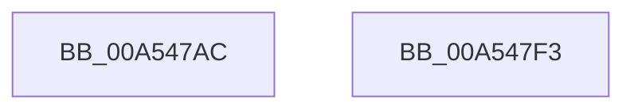

# CmpFlushNotifiesOnAllUnbackedHigherLayerKcbs

- RVA: `0x00A547AC`–`0x00A547F4` (길이 `72` bytes)
- VA: `0x0000000140A547AC`
- 실행 섹션: `PAGE`
- PDB 이름 있음: `예`; PDB Function 태그: `아니요`
- unwind 정보 RVA: `0x0005CC98`
- 디코드: `17`개 명령, `72/72` bytes 표시
- 미해석 바이트: `0` (있으면 어셈블리에 `.byte`로 보존)

> 이 문서는 커널 이미지의 기계어와 PDB 기호를 분석해 생성했습니다. 4번과 5번은 함수 원형과 자료형을 바이너리 사용 방식에서 추정한 C 해석이며 원본 소스 복구 결과는 아닙니다.

## 1. Dependencies

- 직접 호출 지점: **1**; 고유 호출 대상: **1**
- 직접 호출자로 확인된 함수: **5**
- RIP 상대 이미지 참조: **2**

### Outgoing calls
- `0x00A547E9` → [CmpEnumerateAllHigherLayerKcbs](CmpEnumerateAllHigherLayerKcbs_function_00A55234.md) (function, `0x00A55234`)

### Direct callers
- [CmDeleteLayeredKey](../../text/41/CmDeleteLayeredKey_function_0041B598.md) at `0x0041B7BD`
- [sub_006ED542](../../text/6E/Unknown_function_006ED542.md) at `0x006ED622`
- [CmpLightWeightCommitRecreateKeyUoW](CmpLightWeightCommitRecreateKeyUoW_function_00A543CC.md) at `0x00A54460`
- [CmpLightWeightCommitDeleteKeyUoW](CmpLightWeightCommitDeleteKeyUoW_function_00A54610.md) at `0x00A546FF`
- [sub_00B16440](../B1/Unknown_function_00B16440.md) at `0x00B1653B`

### Static image references
- `0x00A547B8` → RVA `0x007F1540` (`CmpFlushNotifiesPreCallback`; read)
- `0x00A547D5` → RVA `0x007F1510` (`CmpFlushNotifiesPostCallback`; read)

## 2. Other-region calls and transfers

- 다른 실행 섹션으로 향하는 call: **0**
- 별도 외부 분기/꼬리 이동을 확인하지 못했습니다.

## 3. Assembly (complete function range)

```asm
00A547AC  48 8B C4                        mov rax, rsp
00A547AF  48 83 EC 58                     sub rsp, 0x58
00A547B3  48 83 60 E8 00                  and qword ptr [rax - 0x18], 0
00A547B8  48 8D 15 81 CD D9 FF            lea rdx, [rip - 0x26327f]
00A547BF  C6 40 D8 01                     mov byte ptr [rax - 0x28], 1
00A547C3  44 88 48 D0                     mov byte ptr [rax - 0x30], r9b
00A547C7  44 88 48 ED                     mov byte ptr [rax - 0x13], r9b
00A547CB  4D 8B C8                        mov r9, r8
00A547CE  C7 40 E8 08 00 00 00            mov dword ptr [rax - 0x18], 8
00A547D5  4C 8D 05 34 CD D9 FF            lea r8, [rip - 0x2632cc]
00A547DC  C6 40 EC 01                     mov byte ptr [rax - 0x14], 1
00A547E0  48 8D 40 E8                     lea rax, [rax - 0x18]
00A547E4  48 89 44 24 20                  mov qword ptr [rsp + 0x20], rax
00A547E9  E8 46 0A 00 00                  call 0x140a55234
00A547EE  48 83 C4 58                     add rsp, 0x58
00A547F2  C3                              ret
00A547F3  CC                              int3
```

## 4. C-style interpretation (structured pseudocode)

```c
__int64 __fastcall CmpFlushNotifiesOnAllUnbackedHigherLayerKcbs(__int64 a1, __int64 a2, __int64 a3, unsigned __int8 a4)
{
    __int64 result;
    __int64 v_rsp;
    unsigned __int64 v_stack_m38;

    v_rsp = (v_rsp) - (88);
    *(unsigned __int8 *)(v_rsp - 40) = 1;
    *(unsigned __int8 *)(v_rsp - 48) = a4;
    *(unsigned __int8 *)(v_rsp - 19) = a4;
    *(unsigned int *)(v_rsp - 24) = 8;
    *(unsigned __int8 *)(v_rsp - 20) = 1;
    v_stack_m38 = v_rsp - 24;
    result = CmpEnumerateAllHigherLayerKcbs(a1, v_rip - 2503295, v_rip - 2503372, a3);
    v_rsp = (v_rsp) + (88);
    return result;
}
```

## 5. (Beta) C Style

```c
int64_t CmpFlushNotifiesOnAllUnbackedHigherLayerKcbs(int64_t Arg1, int64_t Arg2, int64_t Arg3, uint8_t Arg4)
{
    int64_t result;
    int64_t local_rsp;
    uint64_t v_stack_m38;

    local_rsp = (local_rsp) - (88);
    *(uint8_t *)(local_rsp - 0x28) = 1;
    *(uint8_t *)(local_rsp - 0x30) = Arg4;
    *(uint8_t *)(local_rsp - 0x13) = Arg4;
    *(uint32_t *)(local_rsp - 0x18) = 8;
    *(uint8_t *)(local_rsp - 0x14) = 1;
    v_stack_m38 = local_rsp - 24;
    result = CmpEnumerateAllHigherLayerKcbs(Arg1, v_rip - 2503295, v_rip - 2503372, Arg3);
    local_rsp = (local_rsp) + (88);
    return result;
}
```

## 6. Execution-region graph

[열기: 2D/3D 그래프와 함수 탐색 컨트롤 패널](../../../control-panel.html?section=page&rva=0x00A547AC&view=graph)

- 2D 그래프는 위에서 아래로 흐르고, 3D 그래프는 빈 공간을 드래그해 회전합니다. Shift+드래그는 이동, 휠은 확대·축소, 함수 노드 선택은 대상 보고서 이동입니다.

### Static fallback


