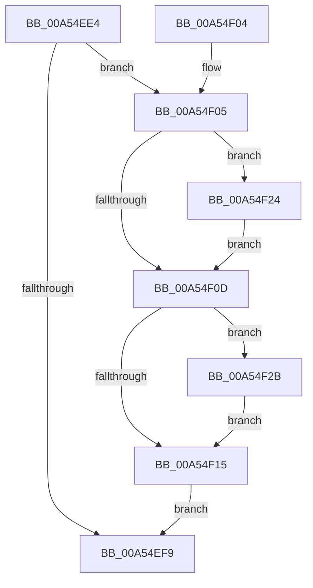

# CmpLightWeightCleanupModifyKeyDataUoW

- RVA: `0x00A54EE4`–`0x00A54F35` (길이 `81` bytes)
- VA: `0x0000000140A54EE4`
- 실행 섹션: `PAGE`
- PDB 이름 있음: `예`; PDB Function 태그: `아니요`
- unwind 정보 RVA: `0x00062F94`
- 디코드: `27`개 명령, `81/81` bytes 표시
- 미해석 바이트: `0` (있으면 어셈블리에 `.byte`로 보존)

> 이 문서는 커널 이미지의 기계어와 PDB 기호를 분석해 생성했습니다. 4번과 5번은 함수 원형과 자료형을 바이너리 사용 방식에서 추정한 C 해석이며 원본 소스 복구 결과는 아닙니다.

## 1. Dependencies

- 직접 호출 지점: **3**; 고유 호출 대상: **2**
- 직접 호출자로 확인된 함수: **6**
- RIP 상대 이미지 참조: **0**

### Outgoing calls
- `0x00A54F1D` → [CmpFreePoolWithTag](../../text/44/CmpFreePoolWithTag_function_004489E0.md) (function, `0x004489E0`)
- `0x00A54F24` → [CmpFreeIndexByCell](../AA/CmpFreeIndexByCell_function_00AA6F0C.md) (function, `0x00AA6F0C`)
- `0x00A54F2E` → [CmpFreeIndexByCell](../AA/CmpFreeIndexByCell_function_00AA6F0C.md) (function, `0x00AA6F0C`)

### Direct callers
- [CmpCleanupLightWeightUoWData](../9B/CmpCleanupLightWeightUoWData_function_009B0A68.md) at `0x009B0B4C`
- [CmpLightWeightPrepareDeleteKeyUoW](CmpLightWeightPrepareDeleteKeyUoW_function_00A54494.md) at `0x00A545D9`
- [CmpLightWeightCommitDeleteKeyUoW](CmpLightWeightCommitDeleteKeyUoW_function_00A54610.md) at `0x00A5473C`
- [CmpLightWeightPrepareAddKeyUoW](CmpLightWeightPrepareAddKeyUoW_function_00A547FC.md) at `0x00A54AD1`
- [CmpLightWeightCreateModificationData](CmpLightWeightCreateModificationData_function_00A54AE8.md) at `0x00A54B61`
- [CmpLightWeightCommitAddKeyUoW](CmpLightWeightCommitAddKeyUoW_function_00A54CA8.md) at `0x00A54E48`

### Static image references
- 디코드된 RIP-relative 메모리 참조가 없습니다.

## 2. Other-region calls and transfers

- 다른 실행 섹션으로 향하는 call: **1**
  - `0x00A54F1D` → [CmpFreePoolWithTag](../../text/44/CmpFreePoolWithTag_function_004489E0.md) (`PAGE` → `.text`)
- 별도 외부 분기/꼬리 이동을 확인하지 못했습니다.

## 3. Assembly (complete function range)

```asm
00A54EE4  48 89 5C 24 08                  mov qword ptr [rsp + 8], rbx
00A54EE9  57                              push rdi
00A54EEA  48 83 EC 20                     sub rsp, 0x20
00A54EEE  83 02 FF                        add dword ptr [rdx], -1
00A54EF1  48 8B DA                        mov rbx, rdx
00A54EF4  48 8B F9                        mov rdi, rcx
00A54EF7  74 0C                           je 0x140a54f05
00A54EF9  48 8B 5C 24 30                  mov rbx, qword ptr [rsp + 0x30]
00A54EFE  48 83 C4 20                     add rsp, 0x20
00A54F02  5F                              pop rdi
00A54F03  C3                              ret
00A54F04  CC                              int3
00A54F05  8B 52 0C                        mov edx, dword ptr [rdx + 0xc]
00A54F08  83 FA FF                        cmp edx, -1
00A54F0B  75 17                           jne 0x140a54f24
00A54F0D  8B 53 10                        mov edx, dword ptr [rbx + 0x10]
00A54F10  83 FA FF                        cmp edx, -1
00A54F13  75 16                           jne 0x140a54f2b
00A54F15  BA 43 4D 55 77                  mov edx, 0x77554d43
00A54F1A  48 8B CB                        mov rcx, rbx
00A54F1D  E8 BE 3A 9F FF                  call 0x1404489e0
00A54F22  EB D5                           jmp 0x140a54ef9
00A54F24  E8 E3 1F 05 00                  call 0x140aa6f0c
00A54F29  EB E2                           jmp 0x140a54f0d
00A54F2B  48 8B CF                        mov rcx, rdi
00A54F2E  E8 D9 1F 05 00                  call 0x140aa6f0c
00A54F33  EB E0                           jmp 0x140a54f15
```

## 4. C-style interpretation (structured pseudocode)

```c
__int64 __fastcall CmpLightWeightCleanupModifyKeyDataUoW(__int64 a1, __int64 a2)
{
    __int64 result;
    __int64 v_rsp;
    unsigned __int64 v_stack_p8;

    v_stack_p8 = v_rbx;
    v_rsp = (v_rsp) - (32);
    if (condition_is_equal) goto loc_00A54F05;
loc_00A54EF9:
    v_rsp = (v_rsp) + (32);
    return result;
loc_00A54F05:
    if (((unsigned int)((unsigned int)(*(unsigned int *)(a2 + 12)))) != -1) goto loc_00A54F24;
loc_00A54F0D:
    if (((unsigned int)((unsigned int)(*(unsigned int *)(v_stack_p8 + 16)))) != -1) goto loc_00A54F2B;
loc_00A54F15:
    result = CmpFreePoolWithTag(v_stack_p8, (unsigned int)(0x77554D43ULL), a3, a4);
    goto loc_00A54EF9;
loc_00A54F24:
    result = CmpFreeIndexByCell(v_stack_p8, (unsigned int)(0x77554D43ULL), a3, a4);
    goto loc_00A54F0D;
loc_00A54F2B:
    result = CmpFreeIndexByCell(a1, (unsigned int)(0x77554D43ULL), a3, a4);
    goto loc_00A54F15;
}
```

## 5. (Beta) C Style

```c
int64_t CmpLightWeightCleanupModifyKeyDataUoW(int64_t Arg1, void *Arg2)
{
    uint8_t *arg2 = (uint8_t *)Arg2;

    int64_t result;
    int64_t local_rsp;
    uint64_t v_stack_p8;

    v_stack_p8 = local_rbx;
    local_rsp = (local_rsp) - (32);
    if (condition_is_equal) goto loc_00A54F05;
loc_00A54EF9:
    local_rsp = (local_rsp) + (32);
    return result;
loc_00A54F05:
    if (((uint32_t)((uint32_t)(*(uint32_t *)(arg2 + 0xC)))) != -1) goto loc_00A54F24;
loc_00A54F0D:
    if (((uint32_t)((uint32_t)(*(uint32_t *)(v_stack_p8 + 0x10)))) != -1) goto loc_00A54F2B;
loc_00A54F15:
    result = CmpFreePoolWithTag(v_stack_p8, (uint32_t)(0x77554D43ULL), a3, a4);
    goto loc_00A54EF9;
loc_00A54F24:
    result = CmpFreeIndexByCell(v_stack_p8, (uint32_t)(0x77554D43ULL), a3, a4);
    goto loc_00A54F0D;
loc_00A54F2B:
    result = CmpFreeIndexByCell(Arg1, (uint32_t)(0x77554D43ULL), a3, a4);
    goto loc_00A54F15;
}
```

### 관측된 메모리 오프셋

구조체 형식이 확인되지 않은 접근은 인자 기준의 오프셋으로만 기록했습니다.

| 기준 인자 | 오프셋 표현 | 폭 (bit) | 접근 |
|---|---:|---:|---|
| `Arg2` | `+ 0x0` | `32` | `R/W` |
| `Arg2` | `+ 0xC` | `32` | `R` |
| `Arg2` | `+ 0x10` | `32` | `R` |

## 6. Execution-region graph

[열기: 2D/3D 그래프와 함수 탐색 컨트롤 패널](../../../control-panel.html?section=page&rva=0x00A54EE4&view=graph)

- 2D 그래프는 위에서 아래로 흐르고, 3D 그래프는 빈 공간을 드래그해 회전합니다. Shift+드래그는 이동, 휠은 확대·축소, 함수 노드 선택은 대상 보고서 이동입니다.

### Static fallback


