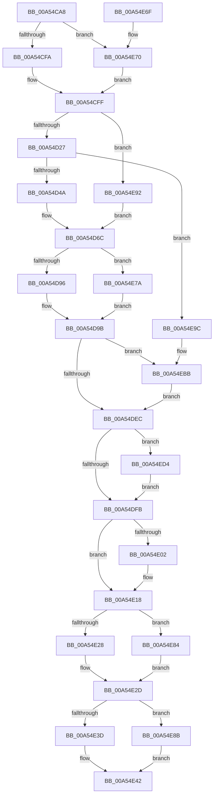

# CmpLightWeightCommitAddKeyUoW

- RVA: `0x00A54CA8`–`0x00A54EDD` (길이 `565` bytes)
- VA: `0x0000000140A54CA8`
- 실행 섹션: `PAGE`
- PDB 이름 있음: `예`; PDB Function 태그: `아니요`
- unwind 정보 RVA: `0x000B1180`
- 디코드: `148`개 명령, `565/565` bytes 표시
- 미해석 바이트: `0` (있으면 어셈블리에 `.byte`로 보존)

> 이 문서는 커널 이미지의 기계어와 PDB 기호를 분석해 생성했습니다. 4번과 5번은 함수 원형과 자료형을 바이너리 사용 방식에서 추정한 C 해석이며 원본 소스 복구 결과는 아닙니다.

## 1. Dependencies

- 직접 호출 지점: **14**; 고유 호출 대상: **10**
- 직접 호출자로 확인된 함수: **1**
- RIP 상대 이미지 참조: **0**

### Outgoing calls
- `0x00A54CFA` → [HvpGetCellFlat](../85/HvpGetCellFlat_function_00854C60.md) (function, `0x00854C60`)
- `0x00A54D2E` → [CmLockHiveSecurityShared](../../pagecmrc/BC/CmLockHiveSecurityShared_function_00BC996C.md) (function, `0x00BC996C`)
- `0x00A54D3D` → [CmpFindSecurityCellCacheIndex](../../text/42/CmpFindSecurityCellCacheIndex_function_00428060.md) (function, `0x00428060`)
- `0x00A54D63` → [CmUnlockHiveSecurity](../../pagecmrc/BC/CmUnlockHiveSecurity_function_00BC99C8.md) (function, `0x00BC99C8`)
- `0x00A54D96` → [HvpGetCellFlat](../85/HvpGetCellFlat_function_00854C60.md) (function, `0x00854C60`)
- `0x00A54E13` → [CmpLightWeightSwapParentSubKeyList](CmpLightWeightSwapParentSubKeyList_function_00A54F3C.md) (function, `0x00A54F3C`)
- `0x00A54E28` → [HvpReleaseCellPaged](../85/HvpReleaseCellPaged_function_00855F40.md) (function, `0x00855F40`)
- `0x00A54E3D` → [HvpReleaseCellPaged](../85/HvpReleaseCellPaged_function_00855F40.md) (function, `0x00855F40`)
- `0x00A54E48` → [CmpLightWeightCleanupModifyKeyDataUoW](CmpLightWeightCleanupModifyKeyDataUoW_function_00A54EE4.md) (function, `0x00A54EE4`)
- `0x00A54E70` → [HvpGetCellPaged](../85/HvpGetCellPaged_function_00854CB0.md) (function, `0x00854CB0`)
- `0x00A54E7A` → [HvpGetCellPaged](../85/HvpGetCellPaged_function_00854CB0.md) (function, `0x00854CB0`)
- `0x00A54E84` → [HvpReleaseCellFlat](../85/HvpReleaseCellFlat_function_0085CC20.md) (function, `0x0085CC20`)
- `0x00A54E8B` → [HvpReleaseCellFlat](../85/HvpReleaseCellFlat_function_0085CC20.md) (function, `0x0085CC20`)
- `0x00A54EB5` → [KeBugCheckEx](../../text/4F/KeBugCheckEx_function_004FD660.md) (function, `0x004FD660`)

### Direct callers
- [sub_00B2DAE6](../B2/Unknown_function_00B2DAE6.md) at `0x00B2DB0D`

### Static image references
- 디코드된 RIP-relative 메모리 참조가 없습니다.

## 2. Other-region calls and transfers

- 다른 실행 섹션으로 향하는 call: **4**
  - `0x00A54D2E` → [CmLockHiveSecurityShared](../../pagecmrc/BC/CmLockHiveSecurityShared_function_00BC996C.md) (`PAGE` → `PAGECMRC`)
  - `0x00A54D3D` → [CmpFindSecurityCellCacheIndex](../../text/42/CmpFindSecurityCellCacheIndex_function_00428060.md) (`PAGE` → `.text`)
  - `0x00A54D63` → [CmUnlockHiveSecurity](../../pagecmrc/BC/CmUnlockHiveSecurity_function_00BC99C8.md) (`PAGE` → `PAGECMRC`)
  - `0x00A54EB5` → [KeBugCheckEx](../../text/4F/KeBugCheckEx_function_004FD660.md) (`PAGE` → `.text`)
- 별도 외부 분기/꼬리 이동을 확인하지 못했습니다.

## 3. Assembly (complete function range)

```asm
00A54CA8  48 89 54 24 10                  mov qword ptr [rsp + 0x10], rdx
00A54CAD  55                              push rbp
00A54CAE  53                              push rbx
00A54CAF  56                              push rsi
00A54CB0  57                              push rdi
00A54CB1  41 54                           push r12
00A54CB3  41 55                           push r13
00A54CB5  41 56                           push r14
00A54CB7  41 57                           push r15
00A54CB9  48 8B EC                        mov rbp, rsp
00A54CBC  48 83 EC 38                     sub rsp, 0x38
00A54CC0  48 8B F9                        mov rdi, rcx
00A54CC3  4C 8D 45 60                     lea r8, [rbp + 0x60]
00A54CC7  33 C9                           xor ecx, ecx
00A54CC9  4C 8B FA                        mov r15, rdx
00A54CCC  83 CA FF                        or edx, 0xffffffff
00A54CCF  89 4D 64                        mov dword ptr [rbp + 0x64], ecx
00A54CD2  89 55 60                        mov dword ptr [rbp + 0x60], edx
00A54CD5  48 8B 47 30                     mov rax, qword ptr [rdi + 0x30]
00A54CD9  4C 8B 6F 68                     mov r13, qword ptr [rdi + 0x68]
00A54CDD  89 55 58                        mov dword ptr [rbp + 0x58], edx
00A54CE0  89 4D 5C                        mov dword ptr [rbp + 0x5c], ecx
00A54CE3  48 8B 58 20                     mov rbx, qword ptr [rax + 0x20]
00A54CE7  8B 50 28                        mov edx, dword ptr [rax + 0x28]
00A54CEA  48 8B CB                        mov rcx, rbx
00A54CED  F6 83 8C 00 00 00 01            test byte ptr [rbx + 0x8c], 1
00A54CF4  0F 84 76 01 00 00               je 0x140a54e70
00A54CFA  E8 61 FF DF FF                  call 0x140854c60
00A54CFF  83 65 48 00                     and dword ptr [rbp + 0x48], 0
00A54D03  4C 8B F0                        mov r14, rax
00A54D06  48 8B 47 30                     mov rax, qword ptr [rdi + 0x30]
00A54D0A  45 8B 66 2C                     mov r12d, dword ptr [r14 + 0x2c]
00A54D0E  48 8B 48 48                     mov rcx, qword ptr [rax + 0x48]
00A54D12  8B 41 28                        mov eax, dword ptr [rcx + 0x28]
00A54D15  41 89 46 10                     mov dword ptr [r14 + 0x10], eax
00A54D19  48 8B 77 30                     mov rsi, qword ptr [rdi + 0x30]
00A54D1D  41 83 FC FF                     cmp r12d, -1
00A54D21  0F 84 6B 01 00 00               je 0x140a54e92
00A54D27  4C 8B 7E 20                     mov r15, qword ptr [rsi + 0x20]
00A54D2B  49 8B CF                        mov rcx, r15
00A54D2E  E8 39 4C 17 00                  call 0x140bc996c
00A54D33  4C 8D 45 48                     lea r8, [rbp + 0x48]
00A54D37  41 8B D4                        mov edx, r12d
00A54D3A  49 8B CF                        mov rcx, r15
00A54D3D  E8 1E 33 9D FF                  call 0x140428060
00A54D42  84 C0                           test al, al
00A54D44  0F 84 52 01 00 00               je 0x140a54e9c
00A54D4A  49 8B 87 60 07 00 00            mov rax, qword ptr [r15 + 0x760]
00A54D51  8B 55 48                        mov edx, dword ptr [rbp + 0x48]
00A54D54  48 03 D2                        add rdx, rdx
00A54D57  48 8B 54 D0 08                  mov rdx, qword ptr [rax + rdx*8 + 8]
00A54D5C  48 89 56 58                     mov qword ptr [rsi + 0x58], rdx
00A54D60  49 8B CF                        mov rcx, r15
00A54D63  E8 60 4C 17 00                  call 0x140bc99c8
00A54D68  4C 8B 7D 50                     mov r15, qword ptr [rbp + 0x50]
00A54D6C  48 8B 47 30                     mov rax, qword ptr [rdi + 0x30]
00A54D70  4C 8D 45 58                     lea r8, [rbp + 0x58]
00A54D74  48 FF 80 30 01 00 00            inc qword ptr [rax + 0x130]
00A54D7B  F6 83 8C 00 00 00 01            test byte ptr [rbx + 0x8c], 1
00A54D82  48 8B 47 30                     mov rax, qword ptr [rdi + 0x30]
00A54D86  48 8B 48 48                     mov rcx, qword ptr [rax + 0x48]
00A54D8A  8B 51 28                        mov edx, dword ptr [rcx + 0x28]
00A54D8D  48 8B CB                        mov rcx, rbx
00A54D90  0F 84 E4 00 00 00               je 0x140a54e7a
00A54D96  E8 C5 FE DF FF                  call 0x140854c60
00A54D9B  4C 8B C0                        mov r8, rax
00A54D9E  49 8B 07                        mov rax, qword ptr [r15]
00A54DA1  49 89 40 04                     mov qword ptr [r8 + 4], rax
00A54DA5  48 8B 47 30                     mov rax, qword ptr [rdi + 0x30]
00A54DA9  48 8B 48 48                     mov rcx, qword ptr [rax + 0x48]
00A54DAD  49 8B 07                        mov rax, qword ptr [r15]
00A54DB0  48 89 81 A8 00 00 00            mov qword ptr [rcx + 0xa8], rax
00A54DB7  48 8B 47 30                     mov rax, qword ptr [rdi + 0x30]
00A54DBB  48 8B 48 48                     mov rcx, qword ptr [rax + 0x48]
00A54DBF  48 FF 81 30 01 00 00            inc qword ptr [rcx + 0x130]
00A54DC6  41 0F B7 56 48                  movzx edx, word ptr [r14 + 0x48]
00A54DCB  41 8B 40 34                     mov eax, dword ptr [r8 + 0x34]
00A54DCF  0F B7 CA                        movzx ecx, dx
00A54DD2  66 03 C9                        add cx, cx
00A54DD5  41 F6 46 02 20                  test byte ptr [r14 + 2], 0x20
00A54DDA  66 0F 44 CA                     cmove cx, dx
00A54DDE  0F B7 D1                        movzx edx, cx
00A54DE1  0F B7 C8                        movzx ecx, ax
00A54DE4  3B CA                           cmp ecx, edx
00A54DE6  0F 82 CF 00 00 00               jb 0x140a54ebb
00A54DEC  41 0F B7 46 4A                  movzx eax, word ptr [r14 + 0x4a]
00A54DF1  41 39 40 38                     cmp dword ptr [r8 + 0x38], eax
00A54DF5  0F 82 D9 00 00 00               jb 0x140a54ed4
00A54DFB  41 83 7D 00 01                  cmp dword ptr [r13], 1
00A54E00  75 16                           jne 0x140a54e18
00A54E02  48 8B 47 30                     mov rax, qword ptr [rdi + 0x30]
00A54E06  4D 8B C5                        mov r8, r13
00A54E09  48 8B CB                        mov rcx, rbx
00A54E0C  48 8B 50 48                     mov rdx, qword ptr [rax + 0x48]
00A54E10  8B 52 28                        mov edx, dword ptr [rdx + 0x28]
00A54E13  E8 24 01 00 00                  call 0x140a54f3c
00A54E18  F6 83 8C 00 00 00 01            test byte ptr [rbx + 0x8c], 1
00A54E1F  48 8D 55 58                     lea rdx, [rbp + 0x58]
00A54E23  48 8B CB                        mov rcx, rbx
00A54E26  75 5C                           jne 0x140a54e84
00A54E28  E8 13 11 E0 FF                  call 0x140855f40
00A54E2D  F6 83 8C 00 00 00 01            test byte ptr [rbx + 0x8c], 1
00A54E34  48 8D 55 60                     lea rdx, [rbp + 0x60]
00A54E38  48 8B CB                        mov rcx, rbx
00A54E3B  75 4E                           jne 0x140a54e8b
00A54E3D  E8 FE 10 E0 FF                  call 0x140855f40
00A54E42  49 8B D5                        mov rdx, r13
00A54E45  48 8B CB                        mov rcx, rbx
00A54E48  E8 97 00 00 00                  call 0x140a54ee4
00A54E4D  48 8B 47 30                     mov rax, qword ptr [rdi + 0x30]
00A54E51  48 83 67 68 00                  and qword ptr [rdi + 0x68], 0
00A54E56  48 83 A0 F0 00 00 00 00         and qword ptr [rax + 0xf0], 0
00A54E5E  48 83 C4 38                     add rsp, 0x38
00A54E62  41 5F                           pop r15
00A54E64  41 5E                           pop r14
00A54E66  41 5D                           pop r13
00A54E68  41 5C                           pop r12
00A54E6A  5F                              pop rdi
00A54E6B  5E                              pop rsi
00A54E6C  5B                              pop rbx
00A54E6D  5D                              pop rbp
00A54E6E  C3                              ret
00A54E6F  CC                              int3
00A54E70  E8 3B FE DF FF                  call 0x140854cb0
00A54E75  E9 85 FE FF FF                  jmp 0x140a54cff
00A54E7A  E8 31 FE DF FF                  call 0x140854cb0
00A54E7F  E9 17 FF FF FF                  jmp 0x140a54d9b
00A54E84  E8 97 7D E0 FF                  call 0x14085cc20
00A54E89  EB A2                           jmp 0x140a54e2d
00A54E8B  E8 90 7D E0 FF                  call 0x14085cc20
00A54E90  EB B0                           jmp 0x140a54e42
00A54E92  48 83 66 58 00                  and qword ptr [rsi + 0x58], 0
00A54E97  E9 D0 FE FF FF                  jmp 0x140a54d6c
00A54E9C  48 83 66 58 00                  and qword ptr [rsi + 0x58], 0
00A54EA1  BA 04 00 00 00                  mov edx, 4
00A54EA6  4C 8B CE                        mov r9, rsi
00A54EA9  4C 89 64 24 20                  mov qword ptr [rsp + 0x20], r12
00A54EAE  8D 4A 4D                        lea ecx, [rdx + 0x4d]
00A54EB1  44 8D 42 FD                     lea r8d, [rdx - 3]
00A54EB5  E8 A6 87 AA FF                  call 0x1404fd660
00A54EBA  CC                              int3
00A54EBB  66 41 89 50 34                  mov word ptr [r8 + 0x34], dx
00A54EC0  48 8B 47 30                     mov rax, qword ptr [rdi + 0x30]
00A54EC4  48 8B 48 48                     mov rcx, qword ptr [rax + 0x48]
00A54EC8  66 89 91 B0 00 00 00            mov word ptr [rcx + 0xb0], dx
00A54ECF  E9 18 FF FF FF                  jmp 0x140a54dec
00A54ED4  41 89 40 38                     mov dword ptr [r8 + 0x38], eax
00A54ED8  E9 1E FF FF FF                  jmp 0x140a54dfb
```

## 4. C-style interpretation (structured pseudocode)

```c
__int64 __fastcall CmpLightWeightCommitAddKeyUoW(__int64 a1, __int64 a2)
{
    __int64 result;
    __int64 v_rsp;
    unsigned __int64 v_stack_p10;
    unsigned int v_stack_p18;
    unsigned int v_stack_p1C;
    unsigned __int64 v_stack_p20;
    unsigned int v_stack_p24;
    unsigned int v_stack_p8;

    v_stack_p10 = a2;
    v_rsp = (v_rsp) - (56);
    a1 = 0;
    a2 = (unsigned int)((a2) | (0xFFFFFFFFULL));
    v_stack_p24 = 0;
    v_stack_p20 = (unsigned int)(a2);
    v_stack_p18 = (unsigned int)(a2);
    v_stack_p1C = 0;
    if (((*(unsigned __int8 *)(*(unsigned __int64 *)(*(unsigned __int64 *)(a1 + 48) + 32) + 140)) & (1)) == 0) goto loc_00A54E70;
    result = HvpGetCellFlat(*(unsigned __int64 *)(*(unsigned __int64 *)(a1 + 48) + 32), (unsigned int)(*(unsigned int *)(*(unsigned __int64 *)(a1 + 48) + 40)), v_stack_p20, a4);
loc_00A54CFF:
    *(unsigned int *)(result + 16) = (unsigned int)((unsigned int)(*(unsigned int *)(*(unsigned __int64 *)(*(unsigned __int64 *)(a1 + 48) + 72) + 40)));
    if (((unsigned int)((unsigned int)(*(unsigned int *)(result + 44)))) == -1) goto loc_00A54E92;
    result = CmLockHiveSecurityShared(*(unsigned __int64 *)(*(unsigned __int64 *)(a1 + 48) + 32), (unsigned int)(*(unsigned int *)(*(unsigned __int64 *)(a1 + 48) + 40)), v_stack_p20, a4);
    result = CmpFindSecurityCellCacheIndex(*(unsigned __int64 *)(*(unsigned __int64 *)(a1 + 48) + 32), (unsigned int)((unsigned int)((unsigned int)(*(unsigned int *)(result + 44)))), v_stack_p8, a4);
    if ((unsigned __int8)(result) == 0) goto loc_00A54E9C;
    a2 = ((unsigned int)(v_stack_p8)) + ((unsigned int)(v_stack_p8));
    *(unsigned __int64 *)(*(unsigned __int64 *)(a1 + 48) + 88) = *(unsigned __int64 *)(*(unsigned __int64 *)(*(unsigned __int64 *)(*(unsigned __int64 *)(a1 + 48) + 32) + 1888) + a2 * 8 + 8);
    result = CmUnlockHiveSecurity(*(unsigned __int64 *)(*(unsigned __int64 *)(a1 + 48) + 32), *(unsigned __int64 *)(*(unsigned __int64 *)(*(unsigned __int64 *)(*(unsigned __int64 *)(a1 + 48) + 32) + 1888) + a2 * 8 + 8), v_stack_p8, a4);
loc_00A54D6C:
    if (((*(unsigned __int8 *)(*(unsigned __int64 *)(*(unsigned __int64 *)(a1 + 48) + 32) + 140)) & (1)) == 0) goto loc_00A54E7A;
    result = HvpGetCellFlat(*(unsigned __int64 *)(*(unsigned __int64 *)(a1 + 48) + 32), (unsigned int)(*(unsigned int *)(*(unsigned __int64 *)(*(unsigned __int64 *)(a1 + 48) + 72) + 40)), v_stack_p18, a4);
loc_00A54D9B:
    *(unsigned __int64 *)(result + 4) = *(unsigned __int64 *)(v_stack_p10);
    *(unsigned __int64 *)(*(unsigned __int64 *)(*(unsigned __int64 *)(a1 + 48) + 72) + 168) = *(unsigned __int64 *)(v_stack_p10);
    a1 = (unsigned __int16)(((unsigned __int16)(*(unsigned __int16 *)(result + 72))) + ((unsigned __int16)((unsigned __int16)(*(unsigned __int16 *)(result + 72)))));
    if (((*(unsigned __int8 *)(result + 2)) & (32)) == 0) { a1 = (unsigned __int16)(*(unsigned __int16 *)(result + 72)); }
    if (((unsigned int)((unsigned __int16)((unsigned int)(*(unsigned int *)(result + 52))))) < ((unsigned int)((unsigned __int16)(a1)))) goto loc_00A54EBB;
loc_00A54DEC:
    if ((*(unsigned int *)(result + 56)) < ((unsigned int)(*(unsigned __int16 *)(result + 74)))) goto loc_00A54ED4;
loc_00A54DFB:
    result = *(unsigned __int16 *)(result + 74);
    if ((*(unsigned int *)(*(unsigned __int64 *)(a1 + 104))) == 1) {
        result = *(unsigned __int64 *)(a1 + 48);
        a3 = *(unsigned __int64 *)(a1 + 104);
        a1 = *(unsigned __int64 *)(*(unsigned __int64 *)(a1 + 48) + 32);
        a2 = *(unsigned __int64 *)(result + 72);
        a2 = *(unsigned int *)(a2 + 40);
        result = CmpLightWeightSwapParentSubKeyList(a1, a2, a3, a4);
    }
    if (((*(unsigned __int8 *)(*(unsigned __int64 *)(*(unsigned __int64 *)(a1 + 48) + 32) + 140)) & (1)) != 0) goto loc_00A54E84;
    result = HvpReleaseCellPaged(*(unsigned __int64 *)(*(unsigned __int64 *)(a1 + 48) + 32), v_stack_p18, a3, a4);
loc_00A54E2D:
    if (((*(unsigned __int8 *)(*(unsigned __int64 *)(*(unsigned __int64 *)(a1 + 48) + 32) + 140)) & (1)) != 0) goto loc_00A54E8B;
    result = HvpReleaseCellPaged(*(unsigned __int64 *)(*(unsigned __int64 *)(a1 + 48) + 32), v_stack_p20, a3, a4);
loc_00A54E42:
    result = CmpLightWeightCleanupModifyKeyDataUoW(*(unsigned __int64 *)(*(unsigned __int64 *)(a1 + 48) + 32), *(unsigned __int64 *)(a1 + 104), a3, a4);
    v_rsp = (v_rsp) + (56);
    return *(unsigned __int64 *)(a1 + 48);
loc_00A54E70:
    result = HvpGetCellPaged(*(unsigned __int64 *)(*(unsigned __int64 *)(a1 + 48) + 32), *(unsigned __int64 *)(a1 + 104), a3, a4);
    goto loc_00A54CFF;
loc_00A54E7A:
    result = HvpGetCellPaged(*(unsigned __int64 *)(*(unsigned __int64 *)(a1 + 48) + 32), *(unsigned __int64 *)(a1 + 104), a3, a4);
    goto loc_00A54D9B;
loc_00A54E84:
    result = HvpReleaseCellFlat(*(unsigned __int64 *)(*(unsigned __int64 *)(a1 + 48) + 32), *(unsigned __int64 *)(a1 + 104), a3, a4);
    goto loc_00A54E2D;
loc_00A54E8B:
    result = HvpReleaseCellFlat(*(unsigned __int64 *)(*(unsigned __int64 *)(a1 + 48) + 32), *(unsigned __int64 *)(a1 + 104), a3, a4);
    goto loc_00A54E42;
loc_00A54E92:
    goto loc_00A54D6C;
loc_00A54E9C:
    v_stack_p20 = (unsigned int)(*(unsigned int *)(result + 44));
    result = KeBugCheckEx(4 + 77, 4, 4 - 3, *(unsigned __int64 *)(a1 + 48));
loc_00A54EBB:
    *(unsigned __int16 *)(4 - 3 + 52) = 4;
    *(unsigned __int16 *)(*(unsigned __int64 *)(*(unsigned __int64 *)(a1 + 48) + 72) + 176) = 4;
    goto loc_00A54DEC;
loc_00A54ED4:
    *(unsigned int *)(4 - 3 + 56) = (unsigned int)(*(unsigned __int64 *)(a1 + 48));
    goto loc_00A54DFB;
}
```

## 5. (Beta) C Style

```c
int64_t CmpLightWeightCommitAddKeyUoW(void *Arg1, int64_t Arg2)
{
    uint8_t *arg1 = (uint8_t *)Arg1;

    int64_t result;
    int64_t local_rsp;
    uint64_t v_stack_p10;
    uint32_t v_stack_p18;
    uint32_t v_stack_p1C;
    uint64_t v_stack_p20;
    uint32_t v_stack_p24;
    uint32_t v_stack_p8;

    v_stack_p10 = Arg2;
    local_rsp = (local_rsp) - (56);
    Arg1 = 0;
    Arg2 = (uint32_t)((Arg2) | (0xFFFFFFFFULL));
    v_stack_p24 = 0;
    v_stack_p20 = (uint32_t)(Arg2);
    v_stack_p18 = (uint32_t)(Arg2);
    v_stack_p1C = 0;
    if (((*(uint8_t *)(*(uint64_t *)(*(uint64_t *)(arg1 + 0x30) + 0x20) + 0x8C)) & (1)) == 0) goto loc_00A54E70;
    result = HvpGetCellFlat(*(uint64_t *)(*(uint64_t *)(arg1 + 0x30) + 0x20), (uint32_t)(*(uint32_t *)(*(uint64_t *)(arg1 + 0x30) + 0x28)), v_stack_p20, a4);
loc_00A54CFF:
    *(uint32_t *)(result + 0x10) = (uint32_t)((uint32_t)(*(uint32_t *)(*(uint64_t *)(*(uint64_t *)(arg1 + 0x30) + 0x48) + 0x28)));
    if (((uint32_t)((uint32_t)(*(uint32_t *)(result + 0x2C)))) == -1) goto loc_00A54E92;
    result = CmLockHiveSecurityShared(*(uint64_t *)(*(uint64_t *)(arg1 + 0x30) + 0x20), (uint32_t)(*(uint32_t *)(*(uint64_t *)(arg1 + 0x30) + 0x28)), v_stack_p20, a4);
    result = CmpFindSecurityCellCacheIndex(*(uint64_t *)(*(uint64_t *)(arg1 + 0x30) + 0x20), (uint32_t)((uint32_t)((uint32_t)(*(uint32_t *)(result + 0x2C)))), v_stack_p8, a4);
    if ((uint8_t)(result) == 0) goto loc_00A54E9C;
    Arg2 = ((uint32_t)(v_stack_p8)) + ((uint32_t)(v_stack_p8));
    *(uint64_t *)(*(uint64_t *)(arg1 + 0x30) + 0x58) = *(uint64_t *)(*(uint64_t *)(*(uint64_t *)(*(uint64_t *)(arg1 + 0x30) + 0x20) + 0x760) + Arg2 * 8 + 0x8);
    result = CmUnlockHiveSecurity(*(uint64_t *)(*(uint64_t *)(arg1 + 0x30) + 0x20), *(uint64_t *)(*(uint64_t *)(*(uint64_t *)(*(uint64_t *)(arg1 + 0x30) + 0x20) + 0x760) + Arg2 * 8 + 0x8), v_stack_p8, a4);
loc_00A54D6C:
    if (((*(uint8_t *)(*(uint64_t *)(*(uint64_t *)(arg1 + 0x30) + 0x20) + 0x8C)) & (1)) == 0) goto loc_00A54E7A;
    result = HvpGetCellFlat(*(uint64_t *)(*(uint64_t *)(arg1 + 0x30) + 0x20), (uint32_t)(*(uint32_t *)(*(uint64_t *)(*(uint64_t *)(arg1 + 0x30) + 0x48) + 0x28)), v_stack_p18, a4);
loc_00A54D9B:
    *(uint64_t *)(result + 0x4) = *(uint64_t *)(v_stack_p10);
    *(uint64_t *)(*(uint64_t *)(*(uint64_t *)(arg1 + 0x30) + 0x48) + 0xA8) = *(uint64_t *)(v_stack_p10);
    Arg1 = (uint16_t)(((uint16_t)(*(uint16_t *)(result + 0x48))) + ((uint16_t)((uint16_t)(*(uint16_t *)(result + 0x48)))));
    if (((*(uint8_t *)(result + 0x2)) & (32)) == 0) { Arg1 = (uint16_t)(*(uint16_t *)(result + 0x48)); }
    if (((uint32_t)((uint16_t)((uint32_t)(*(uint32_t *)(result + 0x34))))) < ((uint32_t)((uint16_t)(Arg1)))) goto loc_00A54EBB;
loc_00A54DEC:
    if ((*(uint32_t *)(result + 0x38)) < ((uint32_t)(*(uint16_t *)(result + 0x4A)))) goto loc_00A54ED4;
loc_00A54DFB:
    result = *(uint16_t *)(result + 0x4A);
    if ((*(uint32_t *)(*(uint64_t *)(arg1 + 0x68))) == 1) {
        result = *(uint64_t *)(arg1 + 0x30);
        a3 = *(uint64_t *)(arg1 + 0x68);
        Arg1 = *(uint64_t *)(*(uint64_t *)(arg1 + 0x30) + 0x20);
        Arg2 = *(uint64_t *)(result + 0x48);
        Arg2 = *(uint32_t *)(Arg2 + 0x28);
        result = CmpLightWeightSwapParentSubKeyList(Arg1, Arg2, a3, a4);
    }
    if (((*(uint8_t *)(*(uint64_t *)(*(uint64_t *)(arg1 + 0x30) + 0x20) + 0x8C)) & (1)) != 0) goto loc_00A54E84;
    result = HvpReleaseCellPaged(*(uint64_t *)(*(uint64_t *)(arg1 + 0x30) + 0x20), v_stack_p18, a3, a4);
loc_00A54E2D:
    if (((*(uint8_t *)(*(uint64_t *)(*(uint64_t *)(arg1 + 0x30) + 0x20) + 0x8C)) & (1)) != 0) goto loc_00A54E8B;
    result = HvpReleaseCellPaged(*(uint64_t *)(*(uint64_t *)(arg1 + 0x30) + 0x20), v_stack_p20, a3, a4);
loc_00A54E42:
    result = CmpLightWeightCleanupModifyKeyDataUoW(*(uint64_t *)(*(uint64_t *)(arg1 + 0x30) + 0x20), *(uint64_t *)(arg1 + 0x68), a3, a4);
    local_rsp = (local_rsp) + (56);
    return *(uint64_t *)(arg1 + 0x30);
loc_00A54E70:
    result = HvpGetCellPaged(*(uint64_t *)(*(uint64_t *)(arg1 + 0x30) + 0x20), *(uint64_t *)(arg1 + 0x68), a3, a4);
    goto loc_00A54CFF;
loc_00A54E7A:
    result = HvpGetCellPaged(*(uint64_t *)(*(uint64_t *)(arg1 + 0x30) + 0x20), *(uint64_t *)(arg1 + 0x68), a3, a4);
    goto loc_00A54D9B;
loc_00A54E84:
    result = HvpReleaseCellFlat(*(uint64_t *)(*(uint64_t *)(arg1 + 0x30) + 0x20), *(uint64_t *)(arg1 + 0x68), a3, a4);
    goto loc_00A54E2D;
loc_00A54E8B:
    result = HvpReleaseCellFlat(*(uint64_t *)(*(uint64_t *)(arg1 + 0x30) + 0x20), *(uint64_t *)(arg1 + 0x68), a3, a4);
    goto loc_00A54E42;
loc_00A54E92:
    goto loc_00A54D6C;
loc_00A54E9C:
    v_stack_p20 = (uint32_t)(*(uint32_t *)(result + 0x2C));
    result = KeBugCheckEx(4 + 77, 4, 4 - 3, *(uint64_t *)(arg1 + 0x30));
loc_00A54EBB:
    *(uint16_t *)(4 - 0x3 + 0x34) = 4;
    *(uint16_t *)(*(uint64_t *)(*(uint64_t *)(arg1 + 0x30) + 0x48) + 0xB0) = 4;
    goto loc_00A54DEC;
loc_00A54ED4:
    *(uint32_t *)(4 - 0x3 + 0x38) = (uint32_t)(*(uint64_t *)(arg1 + 0x30));
    goto loc_00A54DFB;
}
```

### 관측된 메모리 오프셋

구조체 형식이 확인되지 않은 접근은 인자 기준의 오프셋으로만 기록했습니다.

| 기준 인자 | 오프셋 표현 | 폭 (bit) | 접근 |
|---|---:|---:|---|
| `Arg1` | `+ 0x30` | `64` | `R` |
| `Arg1` | `+ 0x68` | `64` | `R` |
| `Arg1` | `+ 0x68` | `64` | `R/W` |

## 6. Execution-region graph

[열기: 2D/3D 그래프와 함수 탐색 컨트롤 패널](../../../control-panel.html?section=page&rva=0x00A54CA8&view=graph)

- 2D 그래프는 위에서 아래로 흐르고, 3D 그래프는 빈 공간을 드래그해 회전합니다. Shift+드래그는 이동, 휠은 확대·축소, 함수 노드 선택은 대상 보고서 이동입니다.

### Static fallback


