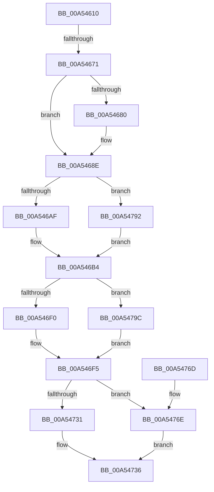

# CmpLightWeightCommitDeleteKeyUoW

- RVA: `0x00A54610`–`0x00A547A6` (길이 `406` bytes)
- VA: `0x0000000140A54610`
- 실행 섹션: `PAGE`
- PDB 이름 있음: `예`; PDB Function 태그: `예`
- unwind 정보 RVA: `0x000B10E4`
- 디코드: `107`개 명령, `406/406` bytes 표시
- 미해석 바이트: `0` (있으면 어셈블리에 `.byte`로 보존)

> 이 문서는 커널 이미지의 기계어와 PDB 기호를 분석해 생성했습니다. 4번과 5번은 함수 원형과 자료형을 바이너리 사용 방식에서 추정한 C 해석이며 원본 소스 복구 결과는 아닙니다.

## 1. Dependencies

- 직접 호출 지점: **16**; 고유 호출 대상: **16**
- 직접 호출자로 확인된 함수: **1**
- RIP 상대 이미지 참조: **1**

### Outgoing calls
- `0x00A54661` → [CmpFreeKeyByCell](../84/CmpFreeKeyByCell_function_0084AD70.md) (function, `0x0084AD70`)
- `0x00A54689` → [CmpLightWeightSwapParentSubKeyList](CmpLightWeightSwapParentSubKeyList_function_00A54F3C.md) (function, `0x00A54F3C`)
- `0x00A54693` → [CmpCleanUpSubKeyInfo](../84/CmpCleanUpSubKeyInfo_function_0084C6F4.md) (function, `0x0084C6F4`)
- `0x00A546AF` → [HvpGetCellFlat](../85/HvpGetCellFlat_function_00854C60.md) (function, `0x00854C60`)
- `0x00A546F0` → [HvpReleaseCellPaged](../85/HvpReleaseCellPaged_function_00855F40.md) (function, `0x00855F40`)
- `0x00A546FF` → [CmpFlushNotifiesOnAllUnbackedHigherLayerKcbs](CmpFlushNotifiesOnAllUnbackedHigherLayerKcbs_function_00A547AC.md) (function, `0x00A547AC`)
- `0x00A54713` → [CmpFlushNotifiesOnKeyBodyList](../9B/CmpFlushNotifiesOnKeyBodyList_function_009B3594.md) (function, `0x009B3594`)
- `0x00A5471F` → [CmpMarkKeyUnbacked](../9B/CmpMarkKeyUnbacked_function_009B3C4C.md) (function, `0x009B3C4C`)
- `0x00A54731` → [CmpDiscardKcb](../9B/CmpDiscardKcb_function_009B2F34.md) (function, `0x009B2F34`)
- `0x00A5473C` → [CmpLightWeightCleanupModifyKeyDataUoW](CmpLightWeightCleanupModifyKeyDataUoW_function_00A54EE4.md) (function, `0x00A54EE4`)
- `0x00A5474D` → [_security_check_cookie](../../text/6A/_security_check_cookie_function_006AC640.md) (function, `0x006AC640`)
- `0x00A54771` → [CmpCommitDiscardAndReplaceKcbAndUnbackedHigherLayers](CmpCommitDiscardAndReplaceKcbAndUnbackedHigherLayers_function_00A55070.md) (function, `0x00A55070`)
- `0x00A5477D` → [CmpCleanupDiscardReplaceContext](CmpCleanupDiscardReplaceContext_function_00A54FF8.md) (function, `0x00A54FF8`)
- `0x00A54786` → [CmSiFreeMemory](../../text/47/CmSiFreeMemory_function_00475D80.md) (function, `0x00475D80`)
- `0x00A54792` → [HvpGetCellPaged](../85/HvpGetCellPaged_function_00854CB0.md) (function, `0x00854CB0`)
- `0x00A5479C` → [HvpReleaseCellFlat](../85/HvpReleaseCellFlat_function_0085CC20.md) (function, `0x0085CC20`)

### Direct callers
- [sub_00B2DAE6](../B2/Unknown_function_00B2DAE6.md) at `0x00B2DB02`

### Static image references
- `0x00A5462C` → RVA `0x00E0A740` (`.data`; read)

## 2. Other-region calls and transfers

- 다른 실행 섹션으로 향하는 call: **2**
  - `0x00A5474D` → [_security_check_cookie](../../text/6A/_security_check_cookie_function_006AC640.md) (`PAGE` → `.text`)
  - `0x00A54786` → [CmSiFreeMemory](../../text/47/CmSiFreeMemory_function_00475D80.md) (`PAGE` → `.text`)
- call이 아닌 외부 분기/꼬리 이동: **1**
  - `0x00A5466B` → [sub_00B3D632](../B3/Unknown_function_00B3D632.md) (`tail-transfer`)

## 3. Assembly (complete function range)

```asm
00A54610  48 89 5C 24 10                  mov qword ptr [rsp + 0x10], rbx
00A54615  55                              push rbp
00A54616  56                              push rsi
00A54617  57                              push rdi
00A54618  41 54                           push r12
00A5461A  41 55                           push r13
00A5461C  41 56                           push r14
00A5461E  41 57                           push r15
00A54620  48 8D 6C 24 D9                  lea rbp, [rsp - 0x27]
00A54625  48 81 EC A0 00 00 00            sub rsp, 0xa0
00A5462C  48 8B 05 0D 61 3B 00            mov rax, qword ptr [rip + 0x3b610d]
00A54633  48 33 C4                        xor rax, rsp
00A54636  48 89 45 17                     mov qword ptr [rbp + 0x17], rax
00A5463A  48 8B 41 30                     mov rax, qword ptr [rcx + 0x30]
00A5463E  4D 8B F8                        mov r15, r8
00A54641  4C 8B 61 68                     mov r12, qword ptr [rcx + 0x68]
00A54645  4C 8B EA                        mov r13, rdx
00A54648  83 4D B7 FF                     or dword ptr [rbp - 0x49], 0xffffffff
00A5464C  48 8B F9                        mov rdi, rcx
00A5464F  33 F6                           xor esi, esi
00A54651  45 33 C0                        xor r8d, r8d
00A54654  48 8B 58 20                     mov rbx, qword ptr [rax + 0x20]
00A54658  8B 50 28                        mov edx, dword ptr [rax + 0x28]
00A5465B  48 8B CB                        mov rcx, rbx
00A5465E  89 75 BB                        mov dword ptr [rbp - 0x45], esi
00A54661  E8 0A 67 DF FF                  call 0x14084ad70
00A54666  44 8B C0                        mov r8d, eax
00A54669  85 C0                           test eax, eax
00A5466B  0F 88 C1 8F 0E 00               js 0x140b3d632
00A54671  41 83 3C 24 01                  cmp dword ptr [r12], 1
00A54676  48 8B 47 30                     mov rax, qword ptr [rdi + 0x30]
00A5467A  48 8B 70 48                     mov rsi, qword ptr [rax + 0x48]
00A5467E  75 0E                           jne 0x140a5468e
00A54680  8B 56 28                        mov edx, dword ptr [rsi + 0x28]
00A54683  4D 8B C4                        mov r8, r12
00A54686  48 8B CB                        mov rcx, rbx
00A54689  E8 AE 08 00 00                  call 0x140a54f3c
00A5468E  B2 01                           mov dl, 1
00A54690  48 8B CE                        mov rcx, rsi
00A54693  E8 5C 80 DF FF                  call 0x14084c6f4
00A54698  F6 83 8C 00 00 00 01            test byte ptr [rbx + 0x8c], 1
00A5469F  4C 8D 45 B7                     lea r8, [rbp - 0x49]
00A546A3  8B 56 28                        mov edx, dword ptr [rsi + 0x28]
00A546A6  48 8B CB                        mov rcx, rbx
00A546A9  0F 84 E3 00 00 00               je 0x140a54792
00A546AF  E8 AC 05 E0 FF                  call 0x140854c60
00A546B4  48 8B C8                        mov rcx, rax
00A546B7  48 8D 55 B7                     lea rdx, [rbp - 0x49]
00A546BB  0F B7 40 34                     movzx eax, word ptr [rax + 0x34]
00A546BF  66 89 86 B0 00 00 00            mov word ptr [rsi + 0xb0], ax
00A546C6  49 8B 45 00                     mov rax, qword ptr [r13]
00A546CA  48 89 41 04                     mov qword ptr [rcx + 4], rax
00A546CE  48 8B CB                        mov rcx, rbx
00A546D1  49 8B 45 00                     mov rax, qword ptr [r13]
00A546D5  48 FF 86 30 01 00 00            inc qword ptr [rsi + 0x130]
00A546DC  48 89 86 A8 00 00 00            mov qword ptr [rsi + 0xa8], rax
00A546E3  F6 83 8C 00 00 00 01            test byte ptr [rbx + 0x8c], 1
00A546EA  0F 85 AC 00 00 00               jne 0x140a5479c
00A546F0  E8 4B 18 E0 FF                  call 0x140855f40
00A546F5  48 8B 4F 30                     mov rcx, qword ptr [rdi + 0x30]
00A546F9  41 B1 01                        mov r9b, 1
00A546FC  4D 8B C7                        mov r8, r15
00A546FF  E8 A8 00 00 00                  call 0x140a547ac
00A54704  48 8B 4F 30                     mov rcx, qword ptr [rdi + 0x30]
00A54708  41 B1 01                        mov r9b, 1
00A5470B  4D 8B C7                        mov r8, r15
00A5470E  BA 08 00 00 00                  mov edx, 8
00A54713  E8 7C EE F5 FF                  call 0x1409b3594
00A54718  48 8B 4F 30                     mov rcx, qword ptr [rdi + 0x30]
00A5471C  49 8B D7                        mov rdx, r15
00A5471F  E8 28 F5 F5 FF                  call 0x1409b3c4c
00A54724  48 8B 57 70                     mov rdx, qword ptr [rdi + 0x70]
00A54728  48 8B 4F 30                     mov rcx, qword ptr [rdi + 0x30]
00A5472C  48 85 D2                        test rdx, rdx
00A5472F  75 3D                           jne 0x140a5476e
00A54731  E8 FE E7 F5 FF                  call 0x1409b2f34
00A54736  49 8B D4                        mov rdx, r12
00A54739  48 8B CB                        mov rcx, rbx
00A5473C  E8 A3 07 00 00                  call 0x140a54ee4
00A54741  48 83 67 68 00                  and qword ptr [rdi + 0x68], 0
00A54746  48 8B 4D 17                     mov rcx, qword ptr [rbp + 0x17]
00A5474A  48 33 CC                        xor rcx, rsp
00A5474D  E8 EE 7E C5 FF                  call 0x1406ac640
00A54752  48 8B 9C 24 E8 00 00 00         mov rbx, qword ptr [rsp + 0xe8]
00A5475A  48 81 C4 A0 00 00 00            add rsp, 0xa0
00A54761  41 5F                           pop r15
00A54763  41 5E                           pop r14
00A54765  41 5D                           pop r13
00A54767  41 5C                           pop r12
00A54769  5F                              pop rdi
00A5476A  5E                              pop rsi
00A5476B  5D                              pop rbp
00A5476C  C3                              ret
00A5476D  CC                              int3
00A5476E  4D 8B C7                        mov r8, r15
00A54771  E8 FA 08 00 00                  call 0x140a55070
00A54776  48 8B 4F 70                     mov rcx, qword ptr [rdi + 0x70]
00A5477A  49 8B D7                        mov rdx, r15
00A5477D  E8 76 08 00 00                  call 0x140a54ff8
00A54782  48 8B 4F 70                     mov rcx, qword ptr [rdi + 0x70]
00A54786  E8 F5 15 A2 FF                  call 0x140475d80
00A5478B  48 83 67 70 00                  and qword ptr [rdi + 0x70], 0
00A54790  EB A4                           jmp 0x140a54736
00A54792  E8 19 05 E0 FF                  call 0x140854cb0
00A54797  E9 18 FF FF FF                  jmp 0x140a546b4
00A5479C  E8 7F 84 E0 FF                  call 0x14085cc20
00A547A1  E9 4F FF FF FF                  jmp 0x140a546f5
```

## 4. C-style interpretation (structured pseudocode)

```c
__int64 __fastcall CmpLightWeightCommitDeleteKeyUoW(__int64 a1, __int64 a2, __int64 a3)
{
    __int64 result;
    __int64 v_rsi;
    __int64 v_rsp;
    unsigned __int64 v_stack_m48;
    unsigned __int64 v_stack_m5F;
    unsigned int v_stack_mA4;
    unsigned int v_stack_mA8;
    unsigned __int64 v_stack_p10;

    v_stack_p10 = v_rbx;
    v_rsp = (v_rsp) - (160);
    result = (*(unsigned __int64 *)(v_rip + 3891469)) ^ (v_rsp);
    v_stack_m48 = result;
    v_rsi = 0;
    a3 = 0;
    v_stack_mA4 = 0;
    result = CmpFreeKeyByCell(*(unsigned __int64 *)(*(unsigned __int64 *)(a1 + 48) + 32), (unsigned int)(*(unsigned int *)(*(unsigned __int64 *)(a1 + 48) + 40)), a3, a4);
    result = *(unsigned __int64 *)(a1 + 48);
    if ((*(unsigned int *)(*(unsigned __int64 *)(a1 + 104))) == 1) {
        a2 = *(unsigned int *)(*(unsigned __int64 *)(*(unsigned __int64 *)(a1 + 48) + 72) + 40);
        a3 = *(unsigned __int64 *)(a1 + 104);
        a1 = *(unsigned __int64 *)(*(unsigned __int64 *)(a1 + 48) + 32);
        result = CmpLightWeightSwapParentSubKeyList(a1, a2, a3, a4);
    }
    result = CmpCleanUpSubKeyInfo(*(unsigned __int64 *)(*(unsigned __int64 *)(a1 + 48) + 72), 1, a3, a4);
    if (((*(unsigned __int8 *)(*(unsigned __int64 *)(*(unsigned __int64 *)(a1 + 48) + 32) + 140)) & (1)) == 0) goto loc_00A54792;
    result = HvpGetCellFlat(*(unsigned __int64 *)(*(unsigned __int64 *)(a1 + 48) + 32), (unsigned int)(*(unsigned int *)(*(unsigned __int64 *)(*(unsigned __int64 *)(a1 + 48) + 72) + 40)), v_stack_mA8, a4);
loc_00A546B4:
    *(unsigned __int16 *)(*(unsigned __int64 *)(*(unsigned __int64 *)(a1 + 48) + 72) + 176) = (unsigned __int16)(*(unsigned __int16 *)(result + 52));
    *(unsigned __int64 *)(result + 4) = *(unsigned __int64 *)(a2);
    *(unsigned __int64 *)(*(unsigned __int64 *)(*(unsigned __int64 *)(a1 + 48) + 72) + 168) = *(unsigned __int64 *)(a2);
    if (((*(unsigned __int8 *)(*(unsigned __int64 *)(*(unsigned __int64 *)(a1 + 48) + 32) + 140)) & (1)) != 0) goto loc_00A5479C;
    result = HvpReleaseCellPaged(*(unsigned __int64 *)(*(unsigned __int64 *)(a1 + 48) + 32), v_stack_mA8, v_stack_mA8, a4);
loc_00A546F5:
    result = CmpFlushNotifiesOnAllUnbackedHigherLayerKcbs(*(unsigned __int64 *)(a1 + 48), v_stack_mA8, a3, 1);
    result = CmpFlushNotifiesOnKeyBodyList(*(unsigned __int64 *)(a1 + 48), 8, a3, 1);
    result = CmpMarkKeyUnbacked(*(unsigned __int64 *)(a1 + 48), a3, a3, 1);
    if (*(unsigned __int64 *)(a1 + 112) != 0) goto loc_00A5476E;
    result = CmpDiscardKcb(*(unsigned __int64 *)(a1 + 48), *(unsigned __int64 *)(a1 + 112), a3, 1);
loc_00A54736:
    result = CmpLightWeightCleanupModifyKeyDataUoW(*(unsigned __int64 *)(*(unsigned __int64 *)(a1 + 48) + 32), *(unsigned __int64 *)(a1 + 104), a3, 1);
    a1 = (v_stack_m48) ^ (v_rsp);
    result = _security_check_cookie(a1, *(unsigned __int64 *)(a1 + 104), a3, 1);
    v_rsp = (v_rsp) + (160);
    return result;
loc_00A5476E:
    result = CmpCommitDiscardAndReplaceKcbAndUnbackedHigherLayers(a1, *(unsigned __int64 *)(a1 + 104), a3, 1);
    result = CmpCleanupDiscardReplaceContext(*(unsigned __int64 *)(a1 + 112), a3, a3, 1);
    result = CmSiFreeMemory(*(unsigned __int64 *)(a1 + 112), a3, a3, 1);
    goto loc_00A54736;
loc_00A54792:
    result = HvpGetCellPaged(*(unsigned __int64 *)(a1 + 112), a3, a3, 1);
    goto loc_00A546B4;
loc_00A5479C:
    result = HvpReleaseCellFlat(*(unsigned __int64 *)(a1 + 112), a3, a3, 1);
    goto loc_00A546F5;
}
```

## 5. (Beta) C Style

```c
int64_t CmpLightWeightCommitDeleteKeyUoW(void *Arg1, void *Arg2, int64_t Arg3)
{
    uint8_t *arg1 = (uint8_t *)Arg1;
    uint8_t *arg2 = (uint8_t *)Arg2;

    int64_t result;
    int64_t local_rsi;
    int64_t local_rsp;
    uint64_t v_stack_m48;
    uint64_t v_stack_m5F;
    uint32_t v_stack_mA4;
    uint32_t v_stack_mA8;
    uint64_t v_stack_p10;

    v_stack_p10 = local_rbx;
    local_rsp = (local_rsp) - (160);
    result = (*(uint64_t *)(v_rip + 0x3B610D)) ^ (local_rsp);
    v_stack_m48 = result;
    local_rsi = 0;
    Arg3 = 0;
    v_stack_mA4 = 0;
    result = CmpFreeKeyByCell(*(uint64_t *)(*(uint64_t *)(arg1 + 0x30) + 0x20), (uint32_t)(*(uint32_t *)(*(uint64_t *)(arg1 + 0x30) + 0x28)), Arg3, a4);
    result = *(uint64_t *)(arg1 + 0x30);
    if ((*(uint32_t *)(*(uint64_t *)(arg1 + 0x68))) == 1) {
        Arg2 = *(uint32_t *)(*(uint64_t *)(*(uint64_t *)(arg1 + 0x30) + 0x48) + 0x28);
        Arg3 = *(uint64_t *)(arg1 + 0x68);
        Arg1 = *(uint64_t *)(*(uint64_t *)(arg1 + 0x30) + 0x20);
        result = CmpLightWeightSwapParentSubKeyList(Arg1, Arg2, Arg3, a4);
    }
    result = CmpCleanUpSubKeyInfo(*(uint64_t *)(*(uint64_t *)(arg1 + 0x30) + 0x48), 1, Arg3, a4);
    if (((*(uint8_t *)(*(uint64_t *)(*(uint64_t *)(arg1 + 0x30) + 0x20) + 0x8C)) & (1)) == 0) goto loc_00A54792;
    result = HvpGetCellFlat(*(uint64_t *)(*(uint64_t *)(arg1 + 0x30) + 0x20), (uint32_t)(*(uint32_t *)(*(uint64_t *)(*(uint64_t *)(arg1 + 0x30) + 0x48) + 0x28)), v_stack_mA8, a4);
loc_00A546B4:
    *(uint16_t *)(*(uint64_t *)(*(uint64_t *)(arg1 + 0x30) + 0x48) + 0xB0) = (uint16_t)(*(uint16_t *)(result + 0x34));
    *(uint64_t *)(result + 0x4) = *(uint64_t *)(arg2);
    *(uint64_t *)(*(uint64_t *)(*(uint64_t *)(arg1 + 0x30) + 0x48) + 0xA8) = *(uint64_t *)(arg2);
    if (((*(uint8_t *)(*(uint64_t *)(*(uint64_t *)(arg1 + 0x30) + 0x20) + 0x8C)) & (1)) != 0) goto loc_00A5479C;
    result = HvpReleaseCellPaged(*(uint64_t *)(*(uint64_t *)(arg1 + 0x30) + 0x20), v_stack_mA8, v_stack_mA8, a4);
loc_00A546F5:
    result = CmpFlushNotifiesOnAllUnbackedHigherLayerKcbs(*(uint64_t *)(arg1 + 0x30), v_stack_mA8, Arg3, 1);
    result = CmpFlushNotifiesOnKeyBodyList(*(uint64_t *)(arg1 + 0x30), 8, Arg3, 1);
    result = CmpMarkKeyUnbacked(*(uint64_t *)(arg1 + 0x30), Arg3, Arg3, 1);
    if (*(uint64_t *)(arg1 + 0x70) != 0) goto loc_00A5476E;
    result = CmpDiscardKcb(*(uint64_t *)(arg1 + 0x30), *(uint64_t *)(arg1 + 0x70), Arg3, 1);
loc_00A54736:
    result = CmpLightWeightCleanupModifyKeyDataUoW(*(uint64_t *)(*(uint64_t *)(arg1 + 0x30) + 0x20), *(uint64_t *)(arg1 + 0x68), Arg3, 1);
    Arg1 = (v_stack_m48) ^ (local_rsp);
    result = _security_check_cookie(Arg1, *(uint64_t *)(arg1 + 0x68), Arg3, 1);
    local_rsp = (local_rsp) + (160);
    return result;
loc_00A5476E:
    result = CmpCommitDiscardAndReplaceKcbAndUnbackedHigherLayers(Arg1, *(uint64_t *)(arg1 + 0x68), Arg3, 1);
    result = CmpCleanupDiscardReplaceContext(*(uint64_t *)(arg1 + 0x70), Arg3, Arg3, 1);
    result = CmSiFreeMemory(*(uint64_t *)(arg1 + 0x70), Arg3, Arg3, 1);
    goto loc_00A54736;
loc_00A54792:
    result = HvpGetCellPaged(*(uint64_t *)(arg1 + 0x70), Arg3, Arg3, 1);
    goto loc_00A546B4;
loc_00A5479C:
    result = HvpReleaseCellFlat(*(uint64_t *)(arg1 + 0x70), Arg3, Arg3, 1);
    goto loc_00A546F5;
}
```

### 관측된 메모리 오프셋

구조체 형식이 확인되지 않은 접근은 인자 기준의 오프셋으로만 기록했습니다.

| 기준 인자 | 오프셋 표현 | 폭 (bit) | 접근 |
|---|---:|---:|---|
| `Arg1` | `+ 0x30` | `64` | `R` |
| `Arg1` | `+ 0x68` | `64` | `R` |
| `Arg1` | `+ 0x68` | `64` | `R/W` |
| `Arg1` | `+ 0x70` | `64` | `R` |
| `Arg1` | `+ 0x70` | `64` | `R/W` |
| `Arg2` | `+ 0x0` | `64` | `R` |

## 6. Execution-region graph

[열기: 2D/3D 그래프와 함수 탐색 컨트롤 패널](../../../control-panel.html?section=page&rva=0x00A54610&view=graph)

- 2D 그래프는 위에서 아래로 흐르고, 3D 그래프는 빈 공간을 드래그해 회전합니다. Shift+드래그는 이동, 휠은 확대·축소, 함수 노드 선택은 대상 보고서 이동입니다.

### Static fallback


