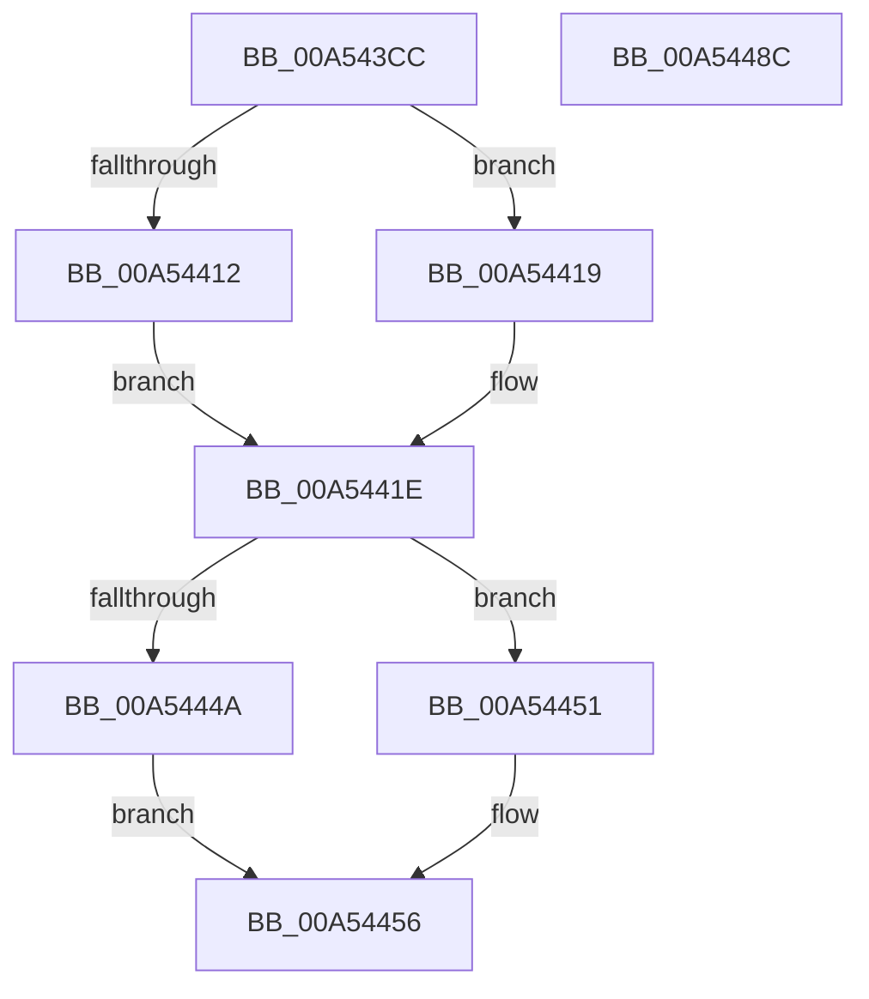

# CmpLightWeightCommitRecreateKeyUoW

- RVA: `0x00A543CC`–`0x00A5448D` (길이 `193` bytes)
- VA: `0x0000000140A543CC`
- 실행 섹션: `PAGE`
- PDB 이름 있음: `예`; PDB Function 태그: `아니요`
- unwind 정보 RVA: `0x000701D4`
- 디코드: `53`개 명령, `193/193` bytes 표시
- 미해석 바이트: `0` (있으면 어셈블리에 `.byte`로 보존)

> 이 문서는 커널 이미지의 기계어와 PDB 기호를 분석해 생성했습니다. 4번과 5번은 함수 원형과 자료형을 바이너리 사용 방식에서 추정한 C 해석이며 원본 소스 복구 결과는 아닙니다.

## 1. Dependencies

- 직접 호출 지점: **6**; 고유 호출 대상: **6**
- 직접 호출자로 확인된 함수: **1**
- RIP 상대 이미지 참조: **0**

### Outgoing calls
- `0x00A54412` → [HvpGetCellFlat](../85/HvpGetCellFlat_function_00854C60.md) (function, `0x00854C60`)
- `0x00A54419` → [HvpGetCellPaged](../85/HvpGetCellPaged_function_00854CB0.md) (function, `0x00854CB0`)
- `0x00A5444A` → [HvpReleaseCellFlat](../85/HvpReleaseCellFlat_function_0085CC20.md) (function, `0x0085CC20`)
- `0x00A54451` → [HvpReleaseCellPaged](../85/HvpReleaseCellPaged_function_00855F40.md) (function, `0x00855F40`)
- `0x00A54460` → [CmpFlushNotifiesOnAllUnbackedHigherLayerKcbs](CmpFlushNotifiesOnAllUnbackedHigherLayerKcbs_function_00A547AC.md) (function, `0x00A547AC`)
- `0x00A54474` → [CmpFlushNotifiesOnKeyBodyList](../9B/CmpFlushNotifiesOnKeyBodyList_function_009B3594.md) (function, `0x009B3594`)

### Direct callers
- [CmpProcessLightWeightUOW](../9B/CmpProcessLightWeightUOW_function_009B0EAC.md) at `0x009B1098`

### Static image references
- 디코드된 RIP-relative 메모리 참조가 없습니다.

## 2. Other-region calls and transfers

- 다른 실행 섹션으로 향하는 call: **0**
- 별도 외부 분기/꼬리 이동을 확인하지 못했습니다.

## 3. Assembly (complete function range)

```asm
00A543CC  48 89 5C 24 10                  mov qword ptr [rsp + 0x10], rbx
00A543D1  48 89 6C 24 18                  mov qword ptr [rsp + 0x18], rbp
00A543D6  56                              push rsi
00A543D7  57                              push rdi
00A543D8  41 56                           push r14
00A543DA  48 83 EC 20                     sub rsp, 0x20
00A543DE  83 4C 24 40 FF                  or dword ptr [rsp + 0x40], 0xffffffff
00A543E3  33 C0                           xor eax, eax
00A543E5  89 44 24 44                     mov dword ptr [rsp + 0x44], eax
00A543E9  49 8B E8                        mov rbp, r8
00A543EC  48 8B 41 30                     mov rax, qword ptr [rcx + 0x30]
00A543F0  4C 8D 44 24 40                  lea r8, [rsp + 0x40]
00A543F5  4C 8B F2                        mov r14, rdx
00A543F8  48 8B F1                        mov rsi, rcx
00A543FB  48 8B 58 20                     mov rbx, qword ptr [rax + 0x20]
00A543FF  48 8B 78 48                     mov rdi, qword ptr [rax + 0x48]
00A54403  48 8B CB                        mov rcx, rbx
00A54406  F6 83 8C 00 00 00 01            test byte ptr [rbx + 0x8c], 1
00A5440D  8B 57 28                        mov edx, dword ptr [rdi + 0x28]
00A54410  74 07                           je 0x140a54419
00A54412  E8 49 08 E0 FF                  call 0x140854c60
00A54417  EB 05                           jmp 0x140a5441e
00A54419  E8 92 08 E0 FF                  call 0x140854cb0
00A5441E  48 8B C8                        mov rcx, rax
00A54421  48 8D 54 24 40                  lea rdx, [rsp + 0x40]
00A54426  49 8B 06                        mov rax, qword ptr [r14]
00A54429  48 89 41 04                     mov qword ptr [rcx + 4], rax
00A5442D  48 8B CB                        mov rcx, rbx
00A54430  49 8B 06                        mov rax, qword ptr [r14]
00A54433  48 FF 87 30 01 00 00            inc qword ptr [rdi + 0x130]
00A5443A  48 89 87 A8 00 00 00            mov qword ptr [rdi + 0xa8], rax
00A54441  F6 83 8C 00 00 00 01            test byte ptr [rbx + 0x8c], 1
00A54448  74 07                           je 0x140a54451
00A5444A  E8 D1 87 E0 FF                  call 0x14085cc20
00A5444F  EB 05                           jmp 0x140a54456
00A54451  E8 EA 1A E0 FF                  call 0x140855f40
00A54456  48 8B 4E 30                     mov rcx, qword ptr [rsi + 0x30]
00A5445A  41 B1 01                        mov r9b, 1
00A5445D  4C 8B C5                        mov r8, rbp
00A54460  E8 47 03 00 00                  call 0x140a547ac
00A54465  48 8B 4E 30                     mov rcx, qword ptr [rsi + 0x30]
00A54469  41 B1 01                        mov r9b, 1
00A5446C  4C 8B C5                        mov r8, rbp
00A5446F  BA 08 00 00 00                  mov edx, 8
00A54474  E8 1B F1 F5 FF                  call 0x1409b3594
00A54479  48 8B 5C 24 48                  mov rbx, qword ptr [rsp + 0x48]
00A5447E  48 8B 6C 24 50                  mov rbp, qword ptr [rsp + 0x50]
00A54483  48 83 C4 20                     add rsp, 0x20
00A54487  41 5E                           pop r14
00A54489  5F                              pop rdi
00A5448A  5E                              pop rsi
00A5448B  C3                              ret
00A5448C  CC                              int3
```

## 4. C-style interpretation (structured pseudocode)

```c
__int64 __fastcall CmpLightWeightCommitRecreateKeyUoW(__int64 a1, __int64 a2, __int64 a3)
{
    __int64 result;
    __int64 v_rsp;
    unsigned __int64 v_stack_p10;
    unsigned __int64 v_stack_p18;
    unsigned int v_stack_p8;
    unsigned int v_stack_pC;

    v_stack_p10 = v_rbx;
    v_stack_p18 = v_rbp;
    v_rsp = (v_rsp) - (32);
    result = 0;
    v_stack_pC = 0;
    if (((*(unsigned __int8 *)(*(unsigned __int64 *)(*(unsigned __int64 *)(a1 + 48) + 32) + 140)) & (1)) == 0) goto loc_00A54419;
    result = HvpGetCellFlat(*(unsigned __int64 *)(*(unsigned __int64 *)(a1 + 48) + 32), (unsigned int)(*(unsigned int *)(*(unsigned __int64 *)(*(unsigned __int64 *)(a1 + 48) + 72) + 40)), v_stack_p8, a4);
    goto loc_00A5441E;
loc_00A54419:
    result = HvpGetCellPaged(*(unsigned __int64 *)(*(unsigned __int64 *)(a1 + 48) + 32), (unsigned int)(*(unsigned int *)(*(unsigned __int64 *)(*(unsigned __int64 *)(a1 + 48) + 72) + 40)), v_stack_p8, a4);
loc_00A5441E:
    *(unsigned __int64 *)(result + 4) = *(unsigned __int64 *)(a2);
    *(unsigned __int64 *)(*(unsigned __int64 *)(*(unsigned __int64 *)(a1 + 48) + 72) + 168) = *(unsigned __int64 *)(a2);
    if (((*(unsigned __int8 *)(*(unsigned __int64 *)(*(unsigned __int64 *)(a1 + 48) + 32) + 140)) & (1)) == 0) goto loc_00A54451;
    result = HvpReleaseCellFlat(*(unsigned __int64 *)(*(unsigned __int64 *)(a1 + 48) + 32), v_stack_p8, v_stack_p8, a4);
    goto loc_00A54456;
loc_00A54451:
    result = HvpReleaseCellPaged(*(unsigned __int64 *)(*(unsigned __int64 *)(a1 + 48) + 32), v_stack_p8, v_stack_p8, a4);
loc_00A54456:
    result = CmpFlushNotifiesOnAllUnbackedHigherLayerKcbs(*(unsigned __int64 *)(a1 + 48), v_stack_p8, a3, 1);
    result = CmpFlushNotifiesOnKeyBodyList(*(unsigned __int64 *)(a1 + 48), 8, a3, 1);
    v_rsp = (v_rsp) + (32);
    return result;
}
```

## 5. (Beta) C Style

```c
int64_t CmpLightWeightCommitRecreateKeyUoW(void *Arg1, void *Arg2, int64_t Arg3)
{
    uint8_t *arg1 = (uint8_t *)Arg1;
    uint8_t *arg2 = (uint8_t *)Arg2;

    int64_t result;
    int64_t local_rsp;
    uint64_t v_stack_p10;
    uint64_t v_stack_p18;
    uint32_t v_stack_p8;
    uint32_t v_stack_pC;

    v_stack_p10 = local_rbx;
    v_stack_p18 = local_rbp;
    local_rsp = (local_rsp) - (32);
    result = 0;
    v_stack_pC = 0;
    if (((*(uint8_t *)(*(uint64_t *)(*(uint64_t *)(arg1 + 0x30) + 0x20) + 0x8C)) & (1)) == 0) goto loc_00A54419;
    result = HvpGetCellFlat(*(uint64_t *)(*(uint64_t *)(arg1 + 0x30) + 0x20), (uint32_t)(*(uint32_t *)(*(uint64_t *)(*(uint64_t *)(arg1 + 0x30) + 0x48) + 0x28)), v_stack_p8, a4);
    goto loc_00A5441E;
loc_00A54419:
    result = HvpGetCellPaged(*(uint64_t *)(*(uint64_t *)(arg1 + 0x30) + 0x20), (uint32_t)(*(uint32_t *)(*(uint64_t *)(*(uint64_t *)(arg1 + 0x30) + 0x48) + 0x28)), v_stack_p8, a4);
loc_00A5441E:
    *(uint64_t *)(result + 0x4) = *(uint64_t *)(arg2);
    *(uint64_t *)(*(uint64_t *)(*(uint64_t *)(arg1 + 0x30) + 0x48) + 0xA8) = *(uint64_t *)(arg2);
    if (((*(uint8_t *)(*(uint64_t *)(*(uint64_t *)(arg1 + 0x30) + 0x20) + 0x8C)) & (1)) == 0) goto loc_00A54451;
    result = HvpReleaseCellFlat(*(uint64_t *)(*(uint64_t *)(arg1 + 0x30) + 0x20), v_stack_p8, v_stack_p8, a4);
    goto loc_00A54456;
loc_00A54451:
    result = HvpReleaseCellPaged(*(uint64_t *)(*(uint64_t *)(arg1 + 0x30) + 0x20), v_stack_p8, v_stack_p8, a4);
loc_00A54456:
    result = CmpFlushNotifiesOnAllUnbackedHigherLayerKcbs(*(uint64_t *)(arg1 + 0x30), v_stack_p8, Arg3, 1);
    result = CmpFlushNotifiesOnKeyBodyList(*(uint64_t *)(arg1 + 0x30), 8, Arg3, 1);
    local_rsp = (local_rsp) + (32);
    return result;
}
```

### 관측된 메모리 오프셋

구조체 형식이 확인되지 않은 접근은 인자 기준의 오프셋으로만 기록했습니다.

| 기준 인자 | 오프셋 표현 | 폭 (bit) | 접근 |
|---|---:|---:|---|
| `Arg1` | `+ 0x30` | `64` | `R` |
| `Arg2` | `+ 0x0` | `64` | `R` |

## 6. Execution-region graph

[열기: 2D/3D 그래프와 함수 탐색 컨트롤 패널](../../../control-panel.html?section=page&rva=0x00A543CC&view=graph)

- 2D 그래프는 위에서 아래로 흐르고, 3D 그래프는 빈 공간을 드래그해 회전합니다. Shift+드래그는 이동, 휠은 확대·축소, 함수 노드 선택은 대상 보고서 이동입니다.

### Static fallback


