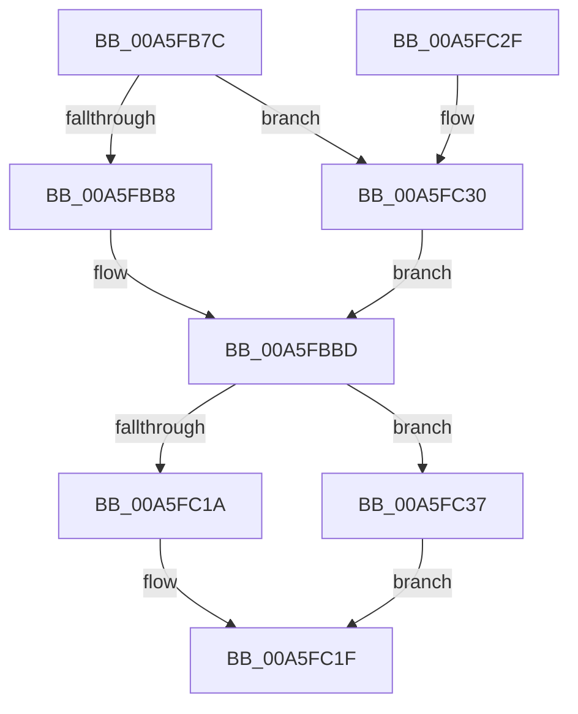

# CmpLightWeightCommitSetUserFlagsUoW

- RVA: `0x00A5FB7C`–`0x00A5FC3E` (길이 `194` bytes)
- VA: `0x0000000140A5FB7C`
- 실행 섹션: `PAGE`
- PDB 이름 있음: `예`; PDB Function 태그: `아니요`
- unwind 정보 RVA: `0x000B2DBC`
- 디코드: `52`개 명령, `194/194` bytes 표시
- 미해석 바이트: `0` (있으면 어셈블리에 `.byte`로 보존)

> 이 문서는 커널 이미지의 기계어와 PDB 기호를 분석해 생성했습니다. 4번과 5번은 함수 원형과 자료형을 바이너리 사용 방식에서 추정한 C 해석이며 원본 소스 복구 결과는 아닙니다.

## 1. Dependencies

- 직접 호출 지점: **4**; 고유 호출 대상: **4**
- 직접 호출자로 확인된 함수: **1**
- RIP 상대 이미지 참조: **0**

### Outgoing calls
- `0x00A5FBB8` → [HvpGetCellFlat](../85/HvpGetCellFlat_function_00854C60.md) (function, `0x00854C60`)
- `0x00A5FC1A` → [HvpReleaseCellPaged](../85/HvpReleaseCellPaged_function_00855F40.md) (function, `0x00855F40`)
- `0x00A5FC30` → [HvpGetCellPaged](../85/HvpGetCellPaged_function_00854CB0.md) (function, `0x00854CB0`)
- `0x00A5FC37` → [HvpReleaseCellFlat](../85/HvpReleaseCellFlat_function_0085CC20.md) (function, `0x0085CC20`)

### Direct callers
- [CmpProcessLightWeightUOW](../9B/CmpProcessLightWeightUOW_function_009B0EAC.md) at `0x009B10EB`

### Static image references
- 디코드된 RIP-relative 메모리 참조가 없습니다.

## 2. Other-region calls and transfers

- 다른 실행 섹션으로 향하는 call: **0**
- 별도 외부 분기/꼬리 이동을 확인하지 못했습니다.

## 3. Assembly (complete function range)

```asm
00A5FB7C  48 89 5C 24 10                  mov qword ptr [rsp + 0x10], rbx
00A5FB81  48 89 74 24 18                  mov qword ptr [rsp + 0x18], rsi
00A5FB86  57                              push rdi
00A5FB87  48 83 EC 20                     sub rsp, 0x20
00A5FB8B  83 4C 24 30 FF                  or dword ptr [rsp + 0x30], 0xffffffff
00A5FB90  4C 8D 44 24 30                  lea r8, [rsp + 0x30]
00A5FB95  33 C0                           xor eax, eax
00A5FB97  48 8B F2                        mov rsi, rdx
00A5FB9A  89 44 24 34                     mov dword ptr [rsp + 0x34], eax
00A5FB9E  48 8B F9                        mov rdi, rcx
00A5FBA1  48 8B 41 30                     mov rax, qword ptr [rcx + 0x30]
00A5FBA5  48 8B 58 20                     mov rbx, qword ptr [rax + 0x20]
00A5FBA9  8B 50 28                        mov edx, dword ptr [rax + 0x28]
00A5FBAC  48 8B CB                        mov rcx, rbx
00A5FBAF  F6 83 8C 00 00 00 01            test byte ptr [rbx + 0x8c], 1
00A5FBB6  74 78                           je 0x140a5fc30
00A5FBB8  E8 A3 50 DF FF                  call 0x140854c60
00A5FBBD  44 8B 4F 58                     mov r9d, dword ptr [rdi + 0x58]
00A5FBC1  4C 8B D0                        mov r10, rax
00A5FBC4  8B 40 34                        mov eax, dword ptr [rax + 0x34]
00A5FBC7  41 8B C9                        mov ecx, r9d
00A5FBCA  C1 E1 10                        shl ecx, 0x10
00A5FBCD  33 C8                           xor ecx, eax
00A5FBCF  81 E1 00 00 0F 00               and ecx, 0xf0000
00A5FBD5  33 C8                           xor ecx, eax
00A5FBD7  41 89 4A 34                     mov dword ptr [r10 + 0x34], ecx
00A5FBDB  48 8B CB                        mov rcx, rbx
00A5FBDE  4C 8B 47 30                     mov r8, qword ptr [rdi + 0x30]
00A5FBE2  41 8B 80 B8 00 00 00            mov eax, dword ptr [r8 + 0xb8]
00A5FBE9  8B D0                           mov edx, eax
00A5FBEB  41 33 D1                        xor edx, r9d
00A5FBEE  83 E2 0F                        and edx, 0xf
00A5FBF1  33 D0                           xor edx, eax
00A5FBF3  41 89 90 B8 00 00 00            mov dword ptr [r8 + 0xb8], edx
00A5FBFA  48 8D 54 24 30                  lea rdx, [rsp + 0x30]
00A5FBFF  48 8B 06                        mov rax, qword ptr [rsi]
00A5FC02  49 89 42 04                     mov qword ptr [r10 + 4], rax
00A5FC06  48 8B 47 30                     mov rax, qword ptr [rdi + 0x30]
00A5FC0A  48 FF 80 30 01 00 00            inc qword ptr [rax + 0x130]
00A5FC11  F6 83 8C 00 00 00 01            test byte ptr [rbx + 0x8c], 1
00A5FC18  75 1D                           jne 0x140a5fc37
00A5FC1A  E8 21 63 DF FF                  call 0x140855f40
00A5FC1F  48 8B 5C 24 38                  mov rbx, qword ptr [rsp + 0x38]
00A5FC24  48 8B 74 24 40                  mov rsi, qword ptr [rsp + 0x40]
00A5FC29  48 83 C4 20                     add rsp, 0x20
00A5FC2D  5F                              pop rdi
00A5FC2E  C3                              ret
00A5FC2F  CC                              int3
00A5FC30  E8 7B 50 DF FF                  call 0x140854cb0
00A5FC35  EB 86                           jmp 0x140a5fbbd
00A5FC37  E8 E4 CF DF FF                  call 0x14085cc20
00A5FC3C  EB E1                           jmp 0x140a5fc1f
```

## 4. C-style interpretation (structured pseudocode)

```c
__int64 __fastcall CmpLightWeightCommitSetUserFlagsUoW(__int64 a1, __int64 a2)
{
    __int64 result;
    __int64 v_rsp;
    unsigned __int64 v_stack_p10;
    unsigned __int64 v_stack_p18;
    unsigned int v_stack_p8;
    unsigned int v_stack_pC;

    v_stack_p10 = v_rbx;
    v_stack_p18 = v_rsi;
    v_rsp = (v_rsp) - (32);
    result = 0;
    v_stack_pC = 0;
    if (((*(unsigned __int8 *)(*(unsigned __int64 *)(*(unsigned __int64 *)(a1 + 48) + 32) + 140)) & (1)) == 0) goto loc_00A5FC30;
    result = HvpGetCellFlat(*(unsigned __int64 *)(*(unsigned __int64 *)(a1 + 48) + 32), (unsigned int)(*(unsigned int *)(*(unsigned __int64 *)(a1 + 48) + 40)), v_stack_p8, a4);
loc_00A5FBBD:
    a1 = (unsigned int)(((unsigned int)((unsigned int)((unsigned int)(*(unsigned int *)(a1 + 88))))) << (16));
    a1 = (unsigned int)((a1) ^ ((unsigned int)((unsigned int)(*(unsigned int *)(result + 52)))));
    a1 = (unsigned int)((a1) & (0xF0000ULL));
    a1 = (unsigned int)((a1) ^ ((unsigned int)((unsigned int)(*(unsigned int *)(result + 52)))));
    *(unsigned int *)(result + 52) = (unsigned int)(a1);
    a2 = (unsigned int)(((unsigned int)((unsigned int)((unsigned int)(*(unsigned int *)(*(unsigned __int64 *)(a1 + 48) + 184))))) ^ ((unsigned int)((unsigned int)(*(unsigned int *)(a1 + 88)))));
    a2 = (unsigned int)((a2) & (15));
    a2 = (unsigned int)((a2) ^ ((unsigned int)((unsigned int)(*(unsigned int *)(*(unsigned __int64 *)(a1 + 48) + 184)))));
    *(unsigned int *)(*(unsigned __int64 *)(a1 + 48) + 184) = (unsigned int)(a2);
    *(unsigned __int64 *)(result + 4) = *(unsigned __int64 *)(a2);
    if (((*(unsigned __int8 *)(*(unsigned __int64 *)(*(unsigned __int64 *)(a1 + 48) + 32) + 140)) & (1)) != 0) goto loc_00A5FC37;
    result = HvpReleaseCellPaged(*(unsigned __int64 *)(*(unsigned __int64 *)(a1 + 48) + 32), v_stack_p8, *(unsigned __int64 *)(a1 + 48), (unsigned int)(*(unsigned int *)(a1 + 88)));
loc_00A5FC1F:
    v_rsp = (v_rsp) + (32);
    return result;
loc_00A5FC30:
    result = HvpGetCellPaged(*(unsigned __int64 *)(*(unsigned __int64 *)(a1 + 48) + 32), v_stack_p8, *(unsigned __int64 *)(a1 + 48), (unsigned int)(*(unsigned int *)(a1 + 88)));
    goto loc_00A5FBBD;
loc_00A5FC37:
    result = HvpReleaseCellFlat(*(unsigned __int64 *)(*(unsigned __int64 *)(a1 + 48) + 32), v_stack_p8, *(unsigned __int64 *)(a1 + 48), (unsigned int)(*(unsigned int *)(a1 + 88)));
    goto loc_00A5FC1F;
}
```

## 5. (Beta) C Style

```c
int64_t CmpLightWeightCommitSetUserFlagsUoW(void *Arg1, void *Arg2)
{
    uint8_t *arg1 = (uint8_t *)Arg1;
    uint8_t *arg2 = (uint8_t *)Arg2;

    int64_t result;
    int64_t local_rsp;
    uint64_t v_stack_p10;
    uint64_t v_stack_p18;
    uint32_t v_stack_p8;
    uint32_t v_stack_pC;

    v_stack_p10 = local_rbx;
    v_stack_p18 = local_rsi;
    local_rsp = (local_rsp) - (32);
    result = 0;
    v_stack_pC = 0;
    if (((*(uint8_t *)(*(uint64_t *)(*(uint64_t *)(arg1 + 0x30) + 0x20) + 0x8C)) & (1)) == 0) goto loc_00A5FC30;
    result = HvpGetCellFlat(*(uint64_t *)(*(uint64_t *)(arg1 + 0x30) + 0x20), (uint32_t)(*(uint32_t *)(*(uint64_t *)(arg1 + 0x30) + 0x28)), v_stack_p8, a4);
loc_00A5FBBD:
    Arg1 = (uint32_t)(((uint32_t)((uint32_t)((uint32_t)(*(uint32_t *)(arg1 + 0x58))))) << (16));
    Arg1 = (uint32_t)((Arg1) ^ ((uint32_t)((uint32_t)(*(uint32_t *)(result + 0x34)))));
    Arg1 = (uint32_t)((Arg1) & (0xF0000ULL));
    Arg1 = (uint32_t)((Arg1) ^ ((uint32_t)((uint32_t)(*(uint32_t *)(result + 0x34)))));
    *(uint32_t *)(result + 0x34) = (uint32_t)(Arg1);
    Arg2 = (uint32_t)(((uint32_t)((uint32_t)((uint32_t)(*(uint32_t *)(*(uint64_t *)(arg1 + 0x30) + 0xB8))))) ^ ((uint32_t)((uint32_t)(*(uint32_t *)(arg1 + 0x58)))));
    Arg2 = (uint32_t)((Arg2) & (15));
    Arg2 = (uint32_t)((Arg2) ^ ((uint32_t)((uint32_t)(*(uint32_t *)(*(uint64_t *)(arg1 + 0x30) + 0xB8)))));
    *(uint32_t *)(*(uint64_t *)(arg1 + 0x30) + 0xB8) = (uint32_t)(Arg2);
    *(uint64_t *)(result + 0x4) = *(uint64_t *)(arg2);
    if (((*(uint8_t *)(*(uint64_t *)(*(uint64_t *)(arg1 + 0x30) + 0x20) + 0x8C)) & (1)) != 0) goto loc_00A5FC37;
    result = HvpReleaseCellPaged(*(uint64_t *)(*(uint64_t *)(arg1 + 0x30) + 0x20), v_stack_p8, *(uint64_t *)(arg1 + 0x30), (uint32_t)(*(uint32_t *)(arg1 + 0x58)));
loc_00A5FC1F:
    local_rsp = (local_rsp) + (32);
    return result;
loc_00A5FC30:
    result = HvpGetCellPaged(*(uint64_t *)(*(uint64_t *)(arg1 + 0x30) + 0x20), v_stack_p8, *(uint64_t *)(arg1 + 0x30), (uint32_t)(*(uint32_t *)(arg1 + 0x58)));
    goto loc_00A5FBBD;
loc_00A5FC37:
    result = HvpReleaseCellFlat(*(uint64_t *)(*(uint64_t *)(arg1 + 0x30) + 0x20), v_stack_p8, *(uint64_t *)(arg1 + 0x30), (uint32_t)(*(uint32_t *)(arg1 + 0x58)));
    goto loc_00A5FC1F;
}
```

### 관측된 메모리 오프셋

구조체 형식이 확인되지 않은 접근은 인자 기준의 오프셋으로만 기록했습니다.

| 기준 인자 | 오프셋 표현 | 폭 (bit) | 접근 |
|---|---:|---:|---|
| `Arg1` | `+ 0x30` | `64` | `R` |
| `Arg1` | `+ 0x58` | `32` | `R` |
| `Arg2` | `+ 0x0` | `64` | `R` |

## 6. Execution-region graph

[열기: 2D/3D 그래프와 함수 탐색 컨트롤 패널](../../../control-panel.html?section=page&rva=0x00A5FB7C&view=graph)

- 2D 그래프는 위에서 아래로 흐르고, 3D 그래프는 빈 공간을 드래그해 회전합니다. Shift+드래그는 이동, 휠은 확대·축소, 함수 노드 선택은 대상 보고서 이동입니다.

### Static fallback


