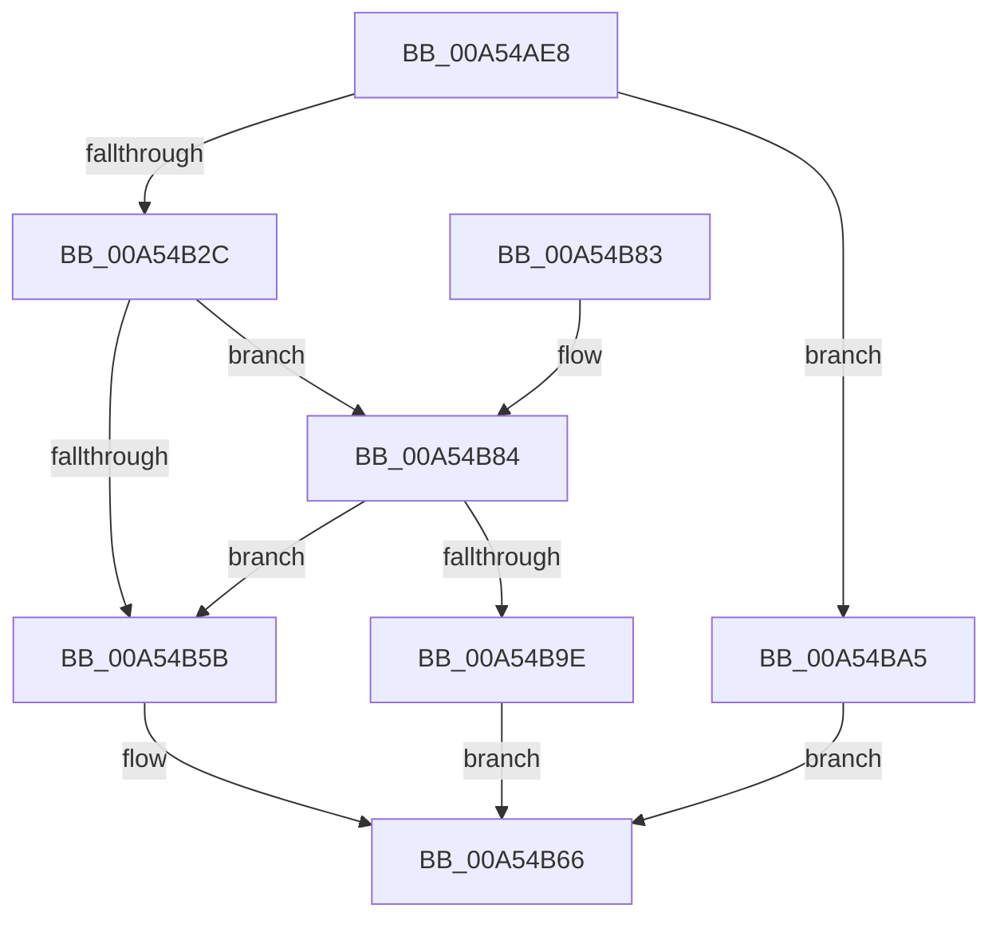

# CmpLightWeightCreateModificationData

- RVA: `0x00A54AE8`–`0x00A54BAC` (길이 `196` bytes)
- VA: `0x0000000140A54AE8`
- 실행 섹션: `PAGE`
- PDB 이름 있음: `예`; PDB Function 태그: `아니요`
- unwind 정보 RVA: `0x000B1148`
- 디코드: `58`개 명령, `196/196` bytes 표시
- 미해석 바이트: `0` (있으면 어셈블리에 `.byte`로 보존)

> 이 문서는 커널 이미지의 기계어와 PDB 기호를 분석해 생성했습니다. 4번과 5번은 함수 원형과 자료형을 바이너리 사용 방식에서 추정한 C 해석이며 원본 소스 복구 결과는 아닙니다.

## 1. Dependencies

- 직접 호출 지점: **4**; 고유 호출 대상: **4**
- 직접 호출자로 확인된 함수: **2**
- RIP 상대 이미지 참조: **0**

### Outgoing calls
- `0x00A54B1F` → [CmpAllocatePool](../../text/3C/CmpAllocatePool_function_003CD504.md) (function, `0x003CD504`)
- `0x00A54B50` → [CmpLightWeightDuplicateParentLists](CmpLightWeightDuplicateParentLists_function_00A54BB4.md) (function, `0x00A54BB4`)
- `0x00A54B61` → [CmpLightWeightCleanupModifyKeyDataUoW](CmpLightWeightCleanupModifyKeyDataUoW_function_00A54EE4.md) (function, `0x00A54EE4`)
- `0x00A54B93` → [CmpLightWeightUpdateModificationActions](CmpLightWeightUpdateModificationActions_function_00A551DC.md) (function, `0x00A551DC`)

### Direct callers
- [CmpLightWeightPrepareDeleteKeyUoW](CmpLightWeightPrepareDeleteKeyUoW_function_00A54494.md) at `0x00A545BA`
- [CmpLightWeightPrepareAddKeyUoW](CmpLightWeightPrepareAddKeyUoW_function_00A547FC.md) at `0x00A54867`

### Static image references
- 디코드된 RIP-relative 메모리 참조가 없습니다.

## 2. Other-region calls and transfers

- 다른 실행 섹션으로 향하는 call: **1**
  - `0x00A54B1F` → [CmpAllocatePool](../../text/3C/CmpAllocatePool_function_003CD504.md) (`PAGE` → `.text`)
- 별도 외부 분기/꼬리 이동을 확인하지 못했습니다.

## 3. Assembly (complete function range)

```asm
00A54AE8  48 8B C4                        mov rax, rsp
00A54AEB  48 89 58 08                     mov qword ptr [rax + 8], rbx
00A54AEF  48 89 68 10                     mov qword ptr [rax + 0x10], rbp
00A54AF3  48 89 70 18                     mov qword ptr [rax + 0x18], rsi
00A54AF7  48 89 78 20                     mov qword ptr [rax + 0x20], rdi
00A54AFB  41 56                           push r14
00A54AFD  48 83 EC 20                     sub rsp, 0x20
00A54B01  48 8B 41 30                     mov rax, qword ptr [rcx + 0x30]
00A54B05  4C 8B F2                        mov r14, rdx
00A54B08  48 8B F1                        mov rsi, rcx
00A54B0B  BA 14 00 00 00                  mov edx, 0x14
00A54B10  B9 00 01 00 00                  mov ecx, 0x100
00A54B15  41 B8 43 4D 55 77               mov r8d, 0x77554d43
00A54B1B  48 8B 68 20                     mov rbp, qword ptr [rax + 0x20]
00A54B1F  E8 E0 89 97 FF                  call 0x1403cd504
00A54B24  48 8B F8                        mov rdi, rax
00A54B27  48 85 C0                        test rax, rax
00A54B2A  74 79                           je 0x140a54ba5
00A54B2C  48 83 20 00                     and qword ptr [rax], 0
00A54B30  4C 8B C7                        mov r8, rdi
00A54B33  83 60 08 00                     and dword ptr [rax + 8], 0
00A54B37  48 8B CD                        mov rcx, rbp
00A54B3A  FF 07                           inc dword ptr [rdi]
00A54B3C  83 C8 FF                        or eax, 0xffffffff
00A54B3F  89 47 0C                        mov dword ptr [rdi + 0xc], eax
00A54B42  89 47 10                        mov dword ptr [rdi + 0x10], eax
00A54B45  48 8B 46 30                     mov rax, qword ptr [rsi + 0x30]
00A54B49  48 8B 50 48                     mov rdx, qword ptr [rax + 0x48]
00A54B4D  8B 52 28                        mov edx, dword ptr [rdx + 0x28]
00A54B50  E8 5F 00 00 00                  call 0x140a54bb4
00A54B55  8B D8                           mov ebx, eax
00A54B57  85 C0                           test eax, eax
00A54B59  79 29                           jns 0x140a54b84
00A54B5B  48 8B D7                        mov rdx, rdi
00A54B5E  48 8B CD                        mov rcx, rbp
00A54B61  E8 7E 03 00 00                  call 0x140a54ee4
00A54B66  48 8B 6C 24 38                  mov rbp, qword ptr [rsp + 0x38]
00A54B6B  8B C3                           mov eax, ebx
00A54B6D  48 8B 5C 24 30                  mov rbx, qword ptr [rsp + 0x30]
00A54B72  48 8B 74 24 40                  mov rsi, qword ptr [rsp + 0x40]
00A54B77  48 8B 7C 24 48                  mov rdi, qword ptr [rsp + 0x48]
00A54B7C  48 83 C4 20                     add rsp, 0x20
00A54B80  41 5E                           pop r14
00A54B82  C3                              ret
00A54B83  CC                              int3
00A54B84  48 8B 56 30                     mov rdx, qword ptr [rsi + 0x30]
00A54B88  48 8B CF                        mov rcx, rdi
00A54B8B  4C 8B 46 38                     mov r8, qword ptr [rsi + 0x38]
00A54B8F  48 8B 52 48                     mov rdx, qword ptr [rdx + 0x48]
00A54B93  E8 44 06 00 00                  call 0x140a551dc
00A54B98  8B D8                           mov ebx, eax
00A54B9A  85 C0                           test eax, eax
00A54B9C  78 BD                           js 0x140a54b5b
00A54B9E  33 DB                           xor ebx, ebx
00A54BA0  49 89 3E                        mov qword ptr [r14], rdi
00A54BA3  EB C1                           jmp 0x140a54b66
00A54BA5  BB 9A 00 00 C0                  mov ebx, 0xc000009a
00A54BAA  EB BA                           jmp 0x140a54b66
```

## 4. C-style interpretation (structured pseudocode)

```c
__int64 __fastcall CmpLightWeightCreateModificationData(__int64 a1, __int64 a2)
{
    __int64 result;
    __int64 v_rbx;
    __int64 v_rsp;
    unsigned __int64 v_stack_p10;
    unsigned __int64 v_stack_p18;
    unsigned __int64 v_stack_p20;
    unsigned __int64 v_stack_p8;

    *(unsigned __int64 *)(v_rsp + 8) = v_rbx;
    *(unsigned __int64 *)(v_rsp + 16) = v_rbp;
    *(unsigned __int64 *)(v_rsp + 24) = v_rsi;
    *(unsigned __int64 *)(v_rsp + 32) = v_rdi;
    v_rsp = (v_rsp) - (32);
    result = CmpAllocatePool(256, 20, (unsigned int)(0x77554D43ULL), a4);
    if (result == 0) goto loc_00A54BA5;
    result = (unsigned int)((result) | (0xFFFFFFFFULL));
    *(unsigned int *)(result + 12) = (unsigned int)(result);
    *(unsigned int *)(result + 16) = (unsigned int)(result);
    result = CmpLightWeightDuplicateParentLists(*(unsigned __int64 *)(*(unsigned __int64 *)(a1 + 48) + 32), (unsigned int)(*(unsigned int *)(*(unsigned __int64 *)(*(unsigned __int64 *)(a1 + 48) + 72) + 40)), result, a4);
    if (!sign_flag) goto loc_00A54B84;
loc_00A54B5B:
    result = CmpLightWeightCleanupModifyKeyDataUoW(*(unsigned __int64 *)(*(unsigned __int64 *)(a1 + 48) + 32), result, result, a4);
loc_00A54B66:
    v_rsp = (v_rsp) + (32);
    return (unsigned int)((unsigned int)((unsigned int)((unsigned int)(result))));
loc_00A54B84:
    result = CmpLightWeightUpdateModificationActions(v_stack_p20, *(unsigned __int64 *)(*(unsigned __int64 *)(v_stack_p18 + 48) + 72), *(unsigned __int64 *)(v_stack_p18 + 56), a4);
    if (sign_flag) goto loc_00A54B5B;
    v_rbx = 0;
    *(unsigned __int64 *)(a2) = v_stack_p20;
    goto loc_00A54B66;
loc_00A54BA5:
    goto loc_00A54B66;
}
```

## 5. (Beta) C Style

```c
int64_t CmpLightWeightCreateModificationData(void *Arg1, void *Arg2)
{
    uint8_t *arg1 = (uint8_t *)Arg1;
    uint8_t *arg2 = (uint8_t *)Arg2;

    int64_t result;
    int64_t local_rbx;
    int64_t local_rsp;
    uint64_t v_stack_p10;
    uint64_t v_stack_p18;
    uint64_t v_stack_p20;
    uint64_t v_stack_p8;

    *(uint64_t *)(local_rsp + 0x8) = local_rbx;
    *(uint64_t *)(local_rsp + 0x10) = local_rbp;
    *(uint64_t *)(local_rsp + 0x18) = local_rsi;
    *(uint64_t *)(local_rsp + 0x20) = local_rdi;
    local_rsp = (local_rsp) - (32);
    result = CmpAllocatePool(256, 20, (uint32_t)(0x77554D43ULL), a4);
    if (result == 0) goto loc_00A54BA5;
    result = (uint32_t)((result) | (0xFFFFFFFFULL));
    *(uint32_t *)(result + 0xC) = (uint32_t)(result);
    *(uint32_t *)(result + 0x10) = (uint32_t)(result);
    result = CmpLightWeightDuplicateParentLists(*(uint64_t *)(*(uint64_t *)(arg1 + 0x30) + 0x20), (uint32_t)(*(uint32_t *)(*(uint64_t *)(*(uint64_t *)(arg1 + 0x30) + 0x48) + 0x28)), result, a4);
    if (!sign_flag) goto loc_00A54B84;
loc_00A54B5B:
    result = CmpLightWeightCleanupModifyKeyDataUoW(*(uint64_t *)(*(uint64_t *)(arg1 + 0x30) + 0x20), result, result, a4);
loc_00A54B66:
    local_rsp = (local_rsp) + (32);
    return (uint32_t)((uint32_t)((uint32_t)((uint32_t)(result))));
loc_00A54B84:
    result = CmpLightWeightUpdateModificationActions(v_stack_p20, *(uint64_t *)(*(uint64_t *)(v_stack_p18 + 0x30) + 0x48), *(uint64_t *)(v_stack_p18 + 0x38), a4);
    if (sign_flag) goto loc_00A54B5B;
    local_rbx = 0;
    *(uint64_t *)(arg2) = v_stack_p20;
    goto loc_00A54B66;
loc_00A54BA5:
    goto loc_00A54B66;
}
```

### 관측된 메모리 오프셋

구조체 형식이 확인되지 않은 접근은 인자 기준의 오프셋으로만 기록했습니다.

| 기준 인자 | 오프셋 표현 | 폭 (bit) | 접근 |
|---|---:|---:|---|
| `Arg1` | `+ 0x30` | `64` | `R` |
| `Arg1` | `+ 0x38` | `64` | `R` |
| `Arg2` | `+ 0x0` | `64` | `W` |

## 6. Execution-region graph

[열기: 2D/3D 그래프와 함수 탐색 컨트롤 패널](../../../control-panel.html?section=page&rva=0x00A54AE8&view=graph)

- 2D 그래프는 위에서 아래로 흐르고, 3D 그래프는 빈 공간을 드래그해 회전합니다. Shift+드래그는 이동, 휠은 확대·축소, 함수 노드 선택은 대상 보고서 이동입니다.

### Static fallback


