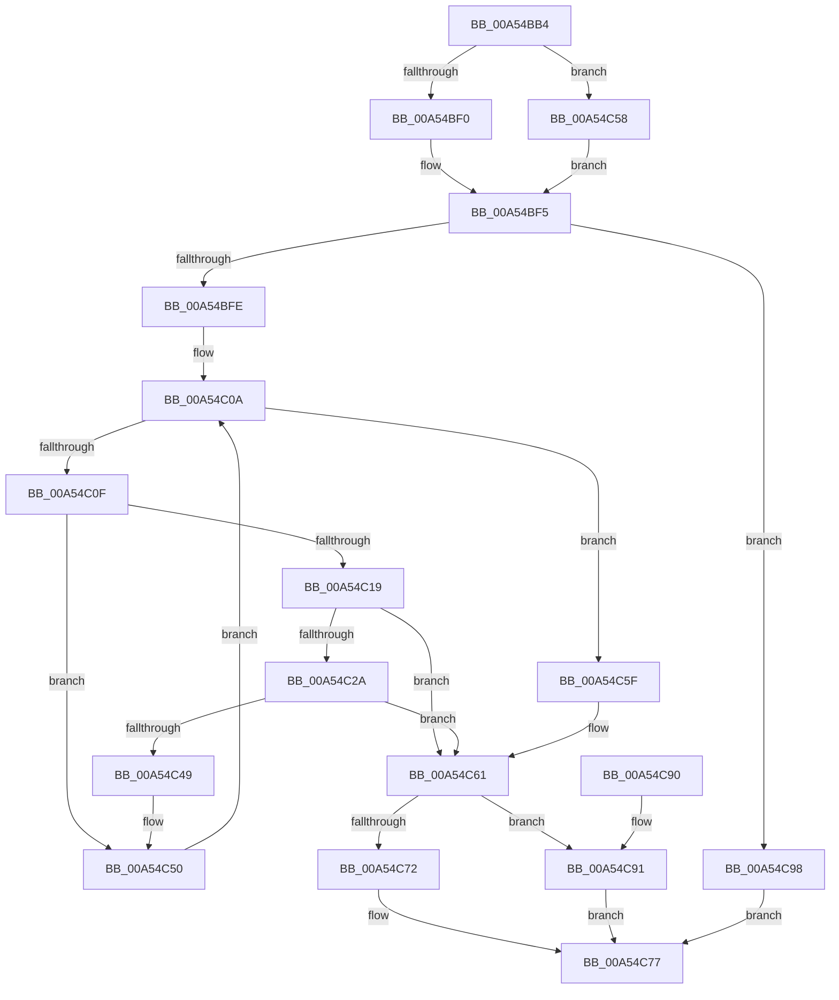

# CmpLightWeightDuplicateParentLists

- RVA: `0x00A54BB4`–`0x00A54C9F` (길이 `235` bytes)
- VA: `0x0000000140A54BB4`
- 실행 섹션: `PAGE`
- PDB 이름 있음: `예`; PDB Function 태그: `아니요`
- unwind 정보 RVA: `0x000B1164`
- 디코드: `74`개 명령, `235/235` bytes 표시
- 미해석 바이트: `0` (있으면 어셈블리에 `.byte`로 보존)

> 이 문서는 커널 이미지의 기계어와 PDB 기호를 분석해 생성했습니다. 4번과 5번은 함수 원형과 자료형을 바이너리 사용 방식에서 추정한 C 해석이며 원본 소스 복구 결과는 아닙니다.

## 1. Dependencies

- 직접 호출 지점: **7**; 고유 호출 대상: **7**
- 직접 호출자로 확인된 함수: **1**
- RIP 상대 이미지 참조: **0**

### Outgoing calls
- `0x00A54BDA` → [HvpGetCellContextInitialize](../85/HvpGetCellContextInitialize_function_00855F10.md) (function, `0x00855F10`)
- `0x00A54BF0` → [HvpGetCellFlat](../85/HvpGetCellFlat_function_00854C60.md) (function, `0x00854C60`)
- `0x00A54C1F` → [CmpMarkEntireIndexDirty](../AA/CmpMarkEntireIndexDirty_function_00AA24B4.md) (function, `0x00AA24B4`)
- `0x00A54C3E` → [CmpDuplicateIndex](../84/CmpDuplicateIndex_function_008420C0.md) (function, `0x008420C0`)
- `0x00A54C58` → [HvpGetCellPaged](../85/HvpGetCellPaged_function_00854CB0.md) (function, `0x00854CB0`)
- `0x00A54C72` → [HvpReleaseCellPaged](../85/HvpReleaseCellPaged_function_00855F40.md) (function, `0x00855F40`)
- `0x00A54C91` → [HvpReleaseCellFlat](../85/HvpReleaseCellFlat_function_0085CC20.md) (function, `0x0085CC20`)

### Direct callers
- [CmpLightWeightCreateModificationData](CmpLightWeightCreateModificationData_function_00A54AE8.md) at `0x00A54B50`

### Static image references
- 디코드된 RIP-relative 메모리 참조가 없습니다.

## 2. Other-region calls and transfers

- 다른 실행 섹션으로 향하는 call: **0**
- 별도 외부 분기/꼬리 이동을 확인하지 못했습니다.

## 3. Assembly (complete function range)

```asm
00A54BB4  48 8B C4                        mov rax, rsp
00A54BB7  48 89 58 10                     mov qword ptr [rax + 0x10], rbx
00A54BBB  48 89 68 18                     mov qword ptr [rax + 0x18], rbp
00A54BBF  56                              push rsi
00A54BC0  57                              push rdi
00A54BC1  41 54                           push r12
00A54BC3  41 56                           push r14
00A54BC5  41 57                           push r15
00A54BC7  48 83 EC 20                     sub rsp, 0x20
00A54BCB  48 83 60 08 00                  and qword ptr [rax + 8], 0
00A54BD0  48 8B D9                        mov rbx, rcx
00A54BD3  48 8D 48 08                     lea rcx, [rax + 8]
00A54BD7  4D 8B E0                        mov r12, r8
00A54BDA  E8 31 13 E0 FF                  call 0x140855f10
00A54BDF  F6 83 8C 00 00 00 01            test byte ptr [rbx + 0x8c], 1
00A54BE6  4C 8D 44 24 50                  lea r8, [rsp + 0x50]
00A54BEB  48 8B CB                        mov rcx, rbx
00A54BEE  74 68                           je 0x140a54c58
00A54BF0  E8 6B 00 E0 FF                  call 0x140854c60
00A54BF5  48 85 C0                        test rax, rax
00A54BF8  0F 84 9A 00 00 00               je 0x140a54c98
00A54BFE  33 ED                           xor ebp, ebp
00A54C00  48 8D 70 14                     lea rsi, [rax + 0x14]
00A54C04  4D 8B F4                        mov r14, r12
00A54C07  4C 2B F0                        sub r14, rax
00A54C0A  83 FD 02                        cmp ebp, 2
00A54C0D  7D 50                           jge 0x140a54c5f
00A54C0F  44 8B 7E 08                     mov r15d, dword ptr [rsi + 8]
00A54C13  41 83 FF FF                     cmp r15d, -1
00A54C17  74 37                           je 0x140a54c50
00A54C19  41 8B D7                        mov edx, r15d
00A54C1C  48 8B CB                        mov rcx, rbx
00A54C1F  E8 90 D8 04 00                  call 0x140aa24b4
00A54C24  8B F8                           mov edi, eax
00A54C26  85 C0                           test eax, eax
00A54C28  78 37                           js 0x140a54c61
00A54C2A  48 63 C5                        movsxd rax, ebp
00A54C2D  44 8B C5                        mov r8d, ebp
00A54C30  48 83 C0 03                     add rax, 3
00A54C34  41 8B D7                        mov edx, r15d
00A54C37  48 8B CB                        mov rcx, rbx
00A54C3A  4D 8D 0C 84                     lea r9, [r12 + rax*4]
00A54C3E  E8 7D D4 DE FF                  call 0x1408420c0
00A54C43  8B F8                           mov edi, eax
00A54C45  85 C0                           test eax, eax
00A54C47  78 18                           js 0x140a54c61
00A54C49  8B 06                           mov eax, dword ptr [rsi]
00A54C4B  41 89 44 36 F0                  mov dword ptr [r14 + rsi - 0x10], eax
00A54C50  FF C5                           inc ebp
00A54C52  48 83 C6 04                     add rsi, 4
00A54C56  EB B2                           jmp 0x140a54c0a
00A54C58  E8 53 00 E0 FF                  call 0x140854cb0
00A54C5D  EB 96                           jmp 0x140a54bf5
00A54C5F  33 FF                           xor edi, edi
00A54C61  F6 83 8C 00 00 00 01            test byte ptr [rbx + 0x8c], 1
00A54C68  48 8D 54 24 50                  lea rdx, [rsp + 0x50]
00A54C6D  48 8B CB                        mov rcx, rbx
00A54C70  75 1F                           jne 0x140a54c91
00A54C72  E8 C9 12 E0 FF                  call 0x140855f40
00A54C77  48 8B 5C 24 58                  mov rbx, qword ptr [rsp + 0x58]
00A54C7C  8B C7                           mov eax, edi
00A54C7E  48 8B 6C 24 60                  mov rbp, qword ptr [rsp + 0x60]
00A54C83  48 83 C4 20                     add rsp, 0x20
00A54C87  41 5F                           pop r15
00A54C89  41 5E                           pop r14
00A54C8B  41 5C                           pop r12
00A54C8D  5F                              pop rdi
00A54C8E  5E                              pop rsi
00A54C8F  C3                              ret
00A54C90  CC                              int3
00A54C91  E8 8A 7F E0 FF                  call 0x14085cc20
00A54C96  EB DF                           jmp 0x140a54c77
00A54C98  BF 9A 00 00 C0                  mov edi, 0xc000009a
00A54C9D  EB D8                           jmp 0x140a54c77
```

## 4. C-style interpretation (structured pseudocode)

```c
__int64 __fastcall CmpLightWeightDuplicateParentLists(__int64 a1, __int64 a2, __int64 a3)
{
    __int64 result;
    __int64 v_r14;
    __int64 v_rbp;
    __int64 v_rdi;
    __int64 v_rsi;
    __int64 v_rsp;
    unsigned __int64 v_stack_p10;
    unsigned __int64 v_stack_p18;
    unsigned __int64 v_stack_p8;

    *(unsigned __int64 *)(v_rsp + 16) = v_rbx;
    *(unsigned __int64 *)(v_rsp + 24) = v_rbp;
    v_rsp = (v_rsp) - (32);
    result = HvpGetCellContextInitialize(v_rsp + 8, a2, a3, a4);
    if (((*(unsigned __int8 *)(a1 + 140)) & (1)) == 0) goto loc_00A54C58;
    result = HvpGetCellFlat(a1, a2, v_stack_p8, a4);
loc_00A54BF5:
    if (result == 0) goto loc_00A54C98;
    v_rbp = 0;
    v_r14 = (a3) - (result);
loc_00A54C0A:
    if (0 >= 2) goto loc_00A54C5F;
    if (((unsigned int)((unsigned int)(*(unsigned int *)(result + 20 + 8)))) == -1) goto loc_00A54C50;
    result = CmpMarkEntireIndexDirty(a1, (unsigned int)((unsigned int)((unsigned int)(*(unsigned int *)(result + 20 + 8)))), v_stack_p8, a4);
    if (sign_flag) goto loc_00A54C61;
    result = ((int)(0)) + (3);
    result = CmpDuplicateIndex(a1, (unsigned int)((unsigned int)((unsigned int)(*(unsigned int *)(result + 20 + 8)))), 0, a3 + result * 4);
    if (sign_flag) goto loc_00A54C61;
    *(unsigned int *)(v_r14 + result + 20 * 1 - 16) = (unsigned int)((unsigned int)(*(unsigned int *)(result + 20)));
loc_00A54C50:
    v_rbp = (unsigned int)((v_rbp) + 1);
    v_rsi = (result + 20) + (4);
    goto loc_00A54C0A;
loc_00A54C58:
    result = HvpGetCellPaged(a1, (unsigned int)((unsigned int)((unsigned int)(*(unsigned int *)(result + 20 + 8)))), 0, a3 + result * 4);
    goto loc_00A54BF5;
loc_00A54C5F:
    v_rdi = 0;
loc_00A54C61:
    if (((*(unsigned __int8 *)(a1 + 140)) & (1)) != 0) goto loc_00A54C91;
    result = HvpReleaseCellPaged(a1, v_stack_p8, 0, a3 + result * 4);
loc_00A54C77:
    v_rsp = (v_rsp) + (32);
    return 0;
loc_00A54C91:
    result = HvpReleaseCellFlat(a1, v_stack_p8, 0, a3 + result * 4);
    goto loc_00A54C77;
loc_00A54C98:
    goto loc_00A54C77;
}
```

## 5. (Beta) C Style

```c
int64_t CmpLightWeightDuplicateParentLists(void *Arg1, int64_t Arg2, void *Arg3)
{
    uint8_t *arg1 = (uint8_t *)Arg1;
    uint8_t *arg3 = (uint8_t *)Arg3;

    int64_t result;
    int64_t local_r14;
    int64_t local_rbp;
    int64_t local_rdi;
    int64_t local_rsi;
    int64_t local_rsp;
    uint64_t v_stack_p10;
    uint64_t v_stack_p18;
    uint64_t v_stack_p8;

    *(uint64_t *)(local_rsp + 0x10) = local_rbx;
    *(uint64_t *)(local_rsp + 0x18) = local_rbp;
    local_rsp = (local_rsp) - (32);
    result = HvpGetCellContextInitialize(local_rsp + 8, Arg2, Arg3, a4);
    if (((*(uint8_t *)(arg1 + 0x8C)) & (1)) == 0) goto loc_00A54C58;
    result = HvpGetCellFlat(Arg1, Arg2, v_stack_p8, a4);
loc_00A54BF5:
    if (result == 0) goto loc_00A54C98;
    local_rbp = 0;
    local_r14 = (Arg3) - (result);
loc_00A54C0A:
    if (0 >= 2) goto loc_00A54C5F;
    if (((uint32_t)((uint32_t)(*(uint32_t *)(result + 0x14 + 0x8)))) == -1) goto loc_00A54C50;
    result = CmpMarkEntireIndexDirty(Arg1, (uint32_t)((uint32_t)((uint32_t)(*(uint32_t *)(result + 0x14 + 0x8)))), v_stack_p8, a4);
    if (sign_flag) goto loc_00A54C61;
    result = ((int32_t)(0)) + (3);
    result = CmpDuplicateIndex(Arg1, (uint32_t)((uint32_t)((uint32_t)(*(uint32_t *)(result + 0x14 + 0x8)))), 0, Arg3 + result * 4);
    if (sign_flag) goto loc_00A54C61;
    *(uint32_t *)(local_r14 + result + 0x14 * 1 - 0x10) = (uint32_t)((uint32_t)(*(uint32_t *)(result + 0x14)));
loc_00A54C50:
    local_rbp = (uint32_t)((local_rbp) + 1);
    local_rsi = (result + 20) + (4);
    goto loc_00A54C0A;
loc_00A54C58:
    result = HvpGetCellPaged(Arg1, (uint32_t)((uint32_t)((uint32_t)(*(uint32_t *)(result + 0x14 + 0x8)))), 0, Arg3 + result * 4);
    goto loc_00A54BF5;
loc_00A54C5F:
    local_rdi = 0;
loc_00A54C61:
    if (((*(uint8_t *)(arg1 + 0x8C)) & (1)) != 0) goto loc_00A54C91;
    result = HvpReleaseCellPaged(Arg1, v_stack_p8, 0, Arg3 + result * 4);
loc_00A54C77:
    local_rsp = (local_rsp) + (32);
    return 0;
loc_00A54C91:
    result = HvpReleaseCellFlat(Arg1, v_stack_p8, 0, Arg3 + result * 4);
    goto loc_00A54C77;
loc_00A54C98:
    goto loc_00A54C77;
}
```

### 관측된 메모리 오프셋

구조체 형식이 확인되지 않은 접근은 인자 기준의 오프셋으로만 기록했습니다.

| 기준 인자 | 오프셋 표현 | 폭 (bit) | 접근 |
|---|---:|---:|---|
| `Arg1` | `+ 0x8C` | `8` | `R` |
| `Arg3` | `- 0x10 + rsi*1` | `32` | `W` |
| `Arg3` | `+ 0x0 + rax*4` | `64` | `R` |

## 6. Execution-region graph

[열기: 2D/3D 그래프와 함수 탐색 컨트롤 패널](../../../control-panel.html?section=page&rva=0x00A54BB4&view=graph)

- 2D 그래프는 위에서 아래로 흐르고, 3D 그래프는 빈 공간을 드래그해 회전합니다. Shift+드래그는 이동, 휠은 확대·축소, 함수 노드 선택은 대상 보고서 이동입니다.

### Static fallback


