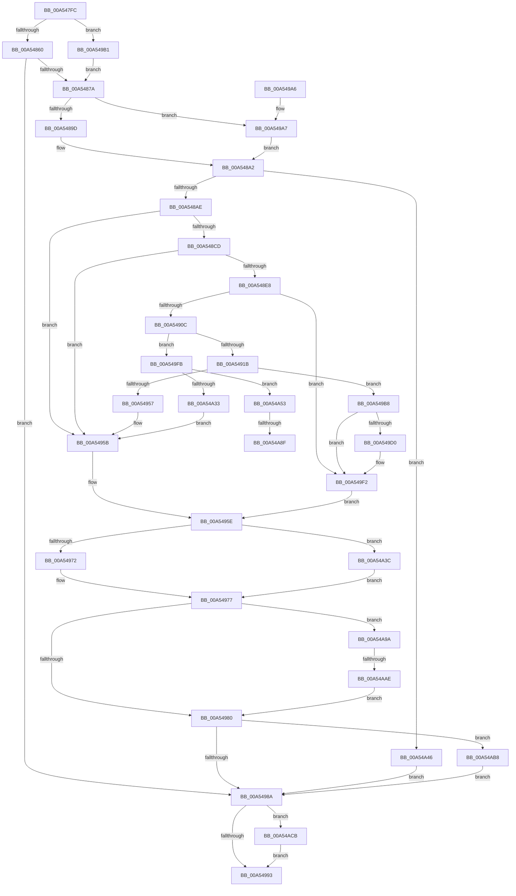

# CmpLightWeightPrepareAddKeyUoW

- RVA: `0x00A547FC`–`0x00A54ADF` (길이 `739` bytes)
- VA: `0x0000000140A547FC`
- 실행 섹션: `PAGE`
- PDB 이름 있음: `예`; PDB Function 태그: `예`
- unwind 정보 RVA: `0x000B111C`
- 디코드: `201`개 명령, `739/739` bytes 표시
- 미해석 바이트: `0` (있으면 어셈블리에 `.byte`로 보존)

> 이 문서는 커널 이미지의 기계어와 PDB 기호를 분석해 생성했습니다. 4번과 5번은 함수 원형과 자료형을 바이너리 사용 방식에서 추정한 C 해석이며 원본 소스 복구 결과는 아닙니다.

## 1. Dependencies

- 직접 호출 지점: **15**; 고유 호출 대상: **11**
- 직접 호출자로 확인된 함수: **1**
- RIP 상대 이미지 참조: **0**

### Outgoing calls
- `0x00A54867` → [CmpLightWeightCreateModificationData](CmpLightWeightCreateModificationData_function_00A54AE8.md) (function, `0x00A54AE8`)
- `0x00A5489D` → [HvpGetCellFlat](../85/HvpGetCellFlat_function_00854C60.md) (function, `0x00854C60`)
- `0x00A548BE` → [HvpMarkCellDirty](../85/HvpMarkCellDirty_function_00858080.md) (function, `0x00858080`)
- `0x00A548DD` → [HvpMarkCellDirty](../85/HvpMarkCellDirty_function_00858080.md) (function, `0x00858080`)
- `0x00A548FA` → [HvpMarkCellDirty](../85/HvpMarkCellDirty_function_00858080.md) (function, `0x00858080`)
- `0x00A54948` → [CmpCopyKeyPartial](../85/CmpCopyKeyPartial_function_0085AFF4.md) (function, `0x0085AFF4`)
- `0x00A54972` → [HvpReleaseCellPaged](../85/HvpReleaseCellPaged_function_00855F40.md) (function, `0x00855F40`)
- `0x00A549A7` → [HvpGetCellPaged](../85/HvpGetCellPaged_function_00854CB0.md) (function, `0x00854CB0`)
- `0x00A549C2` → [CmpAddSubKeyToList](../84/CmpAddSubKeyToList_function_0084D644.md) (function, `0x0084D644`)
- `0x00A54A26` → [HvAllocateCell](../85/HvAllocateCell_function_00859C94.md) (function, `0x00859C94`)
- `0x00A54A3C` → [HvpReleaseCellFlat](../85/HvpReleaseCellFlat_function_0085CC20.md) (function, `0x0085CC20`)
- `0x00A54A8F` → [HvpReleaseCellFlat](../85/HvpReleaseCellFlat_function_0085CC20.md) (function, `0x0085CC20`)
- `0x00A54AAE` → [HvpReleaseCellFlat](../85/HvpReleaseCellFlat_function_0085CC20.md) (function, `0x0085CC20`)
- `0x00A54AC1` → [CmpFreeKeyByCell](../84/CmpFreeKeyByCell_function_0084AD70.md) (function, `0x0084AD70`)
- `0x00A54AD1` → [CmpLightWeightCleanupModifyKeyDataUoW](CmpLightWeightCleanupModifyKeyDataUoW_function_00A54EE4.md) (function, `0x00A54EE4`)

### Direct callers
- [CmpProcessLightWeightUOW](../9B/CmpProcessLightWeightUOW_function_009B0EAC.md) at `0x009B108E`

### Static image references
- 디코드된 RIP-relative 메모리 참조가 없습니다.

## 2. Other-region calls and transfers

- 다른 실행 섹션으로 향하는 call: **0**
- call이 아닌 외부 분기/꼬리 이동: **3**
  - `0x00A54A89` → [sub_00B3D6B6](../B3/Unknown_function_00B3D6B6.md) (`tail-transfer`)
  - `0x00A54A95` → [sub_00B3D6B6 + 0x5](../B3/Unknown_function_00B3D6B6.md) (`tail-transfer`)
  - `0x00A54AA8` → [sub_00B3D6B6 + 0x10](../B3/Unknown_function_00B3D6B6.md) (`tail-transfer`)

## 3. Assembly (complete function range)

```asm
00A547FC  40 55                           push rbp
00A547FE  53                              push rbx
00A547FF  56                              push rsi
00A54800  57                              push rdi
00A54801  41 54                           push r12
00A54803  41 55                           push r13
00A54805  41 56                           push r14
00A54807  41 57                           push r15
00A54809  48 8B EC                        mov rbp, rsp
00A5480C  48 83 EC 68                     sub rsp, 0x68
00A54810  45 33 ED                        xor r13d, r13d
00A54813  4C 8B F9                        mov r15, rcx
00A54816  83 C9 FF                        or ecx, 0xffffffff
00A54819  44 89 6D E4                     mov dword ptr [rbp - 0x1c], r13d
00A5481D  89 4D E0                        mov dword ptr [rbp - 0x20], ecx
00A54820  44 8B F1                        mov r14d, ecx
00A54823  44 89 6D 58                     mov dword ptr [rbp + 0x58], r13d
00A54827  45 8B E5                        mov r12d, r13d
00A5482A  49 8B 47 30                     mov rax, qword ptr [r15 + 0x30]
00A5482E  89 4D D8                        mov dword ptr [rbp - 0x28], ecx
00A54831  44 89 6D DC                     mov dword ptr [rbp - 0x24], r13d
00A54835  89 4D 50                        mov dword ptr [rbp + 0x50], ecx
00A54838  48 8B 58 20                     mov rbx, qword ptr [rax + 0x20]
00A5483C  41 8B 47 48                     mov eax, dword ptr [r15 + 0x48]
00A54840  89 45 48                        mov dword ptr [rbp + 0x48], eax
00A54843  49 8B 47 50                     mov rax, qword ptr [r15 + 0x50]
00A54847  4C 89 6D 60                     mov qword ptr [rbp + 0x60], r13
00A5484B  4C 89 6D F0                     mov qword ptr [rbp - 0x10], r13
00A5484F  48 8B 78 68                     mov rdi, qword ptr [rax + 0x68]
00A54853  48 89 7D E8                     mov qword ptr [rbp - 0x18], rdi
00A54857  48 85 FF                        test rdi, rdi
00A5485A  0F 85 51 01 00 00               jne 0x140a549b1
00A54860  48 8D 55 E8                     lea rdx, [rbp - 0x18]
00A54864  49 8B CF                        mov rcx, r15
00A54867  E8 7C 02 00 00                  call 0x140a54ae8
00A5486C  48 8B 7D E8                     mov rdi, qword ptr [rbp - 0x18]
00A54870  8B F0                           mov esi, eax
00A54872  85 C0                           test eax, eax
00A54874  0F 88 10 01 00 00               js 0x140a5498a
00A5487A  F6 83 8C 00 00 00 01            test byte ptr [rbx + 0x8c], 1
00A54881  4C 8D 45 E0                     lea r8, [rbp - 0x20]
00A54885  49 8B 47 30                     mov rax, qword ptr [r15 + 0x30]
00A54889  48 8B CB                        mov rcx, rbx
00A5488C  48 8B 40 48                     mov rax, qword ptr [rax + 0x48]
00A54890  48 89 45 E8                     mov qword ptr [rbp - 0x18], rax
00A54894  8B 50 28                        mov edx, dword ptr [rax + 0x28]
00A54897  0F 84 0A 01 00 00               je 0x140a549a7
00A5489D  E8 BE 03 E0 FF                  call 0x140854c60
00A548A2  4C 8B E8                        mov r13, rax
00A548A5  48 85 C0                        test rax, rax
00A548A8  0F 84 98 01 00 00               je 0x140a54a46
00A548AE  49 8B 47 30                     mov rax, qword ptr [r15 + 0x30]
00A548B2  45 33 C9                        xor r9d, r9d
00A548B5  41 B0 01                        mov r8b, 1
00A548B8  48 8B CB                        mov rcx, rbx
00A548BB  8B 50 28                        mov edx, dword ptr [rax + 0x28]
00A548BE  E8 BD 37 E0 FF                  call 0x140858080
00A548C3  8B F0                           mov esi, eax
00A548C5  85 C0                           test eax, eax
00A548C7  0F 88 8E 00 00 00               js 0x140a5495b
00A548CD  48 8B 55 E8                     mov rdx, qword ptr [rbp - 0x18]
00A548D1  45 33 C9                        xor r9d, r9d
00A548D4  41 B0 01                        mov r8b, 1
00A548D7  48 8B CB                        mov rcx, rbx
00A548DA  8B 52 28                        mov edx, dword ptr [rdx + 0x28]
00A548DD  E8 9E 37 E0 FF                  call 0x140858080
00A548E2  8B F0                           mov esi, eax
00A548E4  85 C0                           test eax, eax
00A548E6  78 73                           js 0x140a5495b
00A548E8  4C 63 65 48                     movsxd r12, dword ptr [rbp + 0x48]
00A548EC  45 33 C9                        xor r9d, r9d
00A548EF  41 B0 01                        mov r8b, 1
00A548F2  48 8B CB                        mov rcx, rbx
00A548F5  43 8B 54 A5 1C                  mov edx, dword ptr [r13 + r12*4 + 0x1c]
00A548FA  E8 81 37 E0 FF                  call 0x140858080
00A548FF  45 33 ED                        xor r13d, r13d
00A54902  8B F0                           mov esi, eax
00A54904  85 C0                           test eax, eax
00A54906  0F 88 E6 00 00 00               js 0x140a549f2
00A5490C  4E 8D 2C A7                     lea r13, [rdi + r12*4]
00A54910  41 83 7D 0C FF                  cmp dword ptr [r13 + 0xc], -1
00A54915  0F 84 E0 00 00 00               je 0x140a549fb
00A5491B  49 8B 57 30                     mov rdx, qword ptr [r15 + 0x30]
00A5491F  48 8D 45 50                     lea rax, [rbp + 0x50]
00A54923  48 89 44 24 38                  mov qword ptr [rsp + 0x38], rax
00A54928  4C 8B C3                        mov r8, rbx
00A5492B  8B 45 48                        mov eax, dword ptr [rbp + 0x48]
00A5492E  48 8B CB                        mov rcx, rbx
00A54931  89 44 24 30                     mov dword ptr [rsp + 0x30], eax
00A54935  48 8B 45 E8                     mov rax, qword ptr [rbp - 0x18]
00A54939  8B 52 28                        mov edx, dword ptr [rdx + 0x28]
00A5493C  C7 44 24 20 26 00 00 00         mov dword ptr [rsp + 0x20], 0x26
00A54944  44 8B 48 28                     mov r9d, dword ptr [rax + 0x28]
00A54948  E8 A7 66 E0 FF                  call 0x14085aff4
00A5494D  44 8B 75 50                     mov r14d, dword ptr [rbp + 0x50]
00A54951  8B F0                           mov esi, eax
00A54953  85 C0                           test eax, eax
00A54955  79 61                           jns 0x140a549b8
00A54957  4C 8B 65 60                     mov r12, qword ptr [rbp + 0x60]
00A5495B  45 33 ED                        xor r13d, r13d
00A5495E  F6 83 8C 00 00 00 01            test byte ptr [rbx + 0x8c], 1
00A54965  48 8D 55 E0                     lea rdx, [rbp - 0x20]
00A54969  48 8B CB                        mov rcx, rbx
00A5496C  0F 85 CA 00 00 00               jne 0x140a54a3c
00A54972  E8 C9 15 E0 FF                  call 0x140855f40
00A54977  4D 85 E4                        test r12, r12
00A5497A  0F 85 1A 01 00 00               jne 0x140a54a9a
00A54980  41 83 FE FF                     cmp r14d, -1
00A54984  0F 85 2E 01 00 00               jne 0x140a54ab8
00A5498A  48 85 FF                        test rdi, rdi
00A5498D  0F 85 38 01 00 00               jne 0x140a54acb
00A54993  8B C6                           mov eax, esi
00A54995  48 83 C4 68                     add rsp, 0x68
00A54999  41 5F                           pop r15
00A5499B  41 5E                           pop r14
00A5499D  41 5D                           pop r13
00A5499F  41 5C                           pop r12
00A549A1  5F                              pop rdi
00A549A2  5E                              pop rsi
00A549A3  5B                              pop rbx
00A549A4  5D                              pop rbp
00A549A5  C3                              ret
00A549A6  CC                              int3
00A549A7  E8 04 03 E0 FF                  call 0x140854cb0
00A549AC  E9 F1 FE FF FF                  jmp 0x140a548a2
00A549B1  FF 07                           inc dword ptr [rdi]
00A549B3  E9 C2 FE FF FF                  jmp 0x140a5487a
00A549B8  45 8B C6                        mov r8d, r14d
00A549BB  49 8D 55 0C                     lea rdx, [r13 + 0xc]
00A549BF  48 8B CB                        mov rcx, rbx
00A549C2  E8 7D 8C DF FF                  call 0x14084d644
00A549C7  45 33 ED                        xor r13d, r13d
00A549CA  8B F0                           mov esi, eax
00A549CC  85 C0                           test eax, eax
00A549CE  78 22                           js 0x140a549f2
00A549D0  42 FF 44 A7 04                  inc dword ptr [rdi + r12*4 + 4]
00A549D5  41 8B F5                        mov esi, r13d
00A549D8  49 8B 4F 30                     mov rcx, qword ptr [r15 + 0x30]
00A549DC  8B 41 28                        mov eax, dword ptr [rcx + 0x28]
00A549DF  41 89 47 58                     mov dword ptr [r15 + 0x58], eax
00A549E3  44 89 71 28                     mov dword ptr [rcx + 0x28], r14d
00A549E7  41 83 CE FF                     or r14d, 0xffffffff
00A549EB  49 89 7F 68                     mov qword ptr [r15 + 0x68], rdi
00A549EF  41 8B FD                        mov edi, r13d
00A549F2  4C 8B 65 60                     mov r12, qword ptr [rbp + 0x60]
00A549F6  E9 63 FF FF FF                  jmp 0x140a5495e
00A549FB  8B 83 DC 00 00 00               mov eax, dword ptr [rbx + 0xdc]
00A54A01  48 8D 4D D8                     lea rcx, [rbp - 0x28]
00A54A05  44 8B 45 48                     mov r8d, dword ptr [rbp + 0x48]
00A54A09  4C 8D 4D 58                     lea r9, [rbp + 0x58]
00A54A0D  48 89 4C 24 28                  mov qword ptr [rsp + 0x28], rcx
00A54A12  BA 0C 00 00 00                  mov edx, 0xc
00A54A17  89 45 60                        mov dword ptr [rbp + 0x60], eax
00A54A1A  48 8B CB                        mov rcx, rbx
00A54A1D  48 8D 45 F0                     lea rax, [rbp - 0x10]
00A54A21  48 89 44 24 20                  mov qword ptr [rsp + 0x20], rax
00A54A26  E8 69 52 E0 FF                  call 0x140859c94
00A54A2B  33 D2                           xor edx, edx
00A54A2D  8B F0                           mov esi, eax
00A54A2F  85 C0                           test eax, eax
00A54A31  79 20                           jns 0x140a54a53
00A54A33  4C 8B 65 F0                     mov r12, qword ptr [rbp - 0x10]
00A54A37  E9 1F FF FF FF                  jmp 0x140a5495b
00A54A3C  E8 DF 81 E0 FF                  call 0x14085cc20
00A54A41  E9 31 FF FF FF                  jmp 0x140a54977
00A54A46  BE 9A 00 00 C0                  mov esi, 0xc000009a
00A54A4B  45 33 ED                        xor r13d, r13d
00A54A4E  E9 37 FF FF FF                  jmp 0x140a5498a
00A54A53  48 8B 45 F0                     mov rax, qword ptr [rbp - 0x10]
00A54A57  83 7D 60 05                     cmp dword ptr [rbp + 0x60], 5
00A54A5B  66 1B C9                        sbb cx, cx
00A54A5E  66 81 E1 00 FE                  and cx, 0xfe00
00A54A63  66 81 C1 6C 68                  add cx, 0x686c
00A54A68  66 89 08                        mov word ptr [rax], cx
00A54A6B  48 8B CB                        mov rcx, rbx
00A54A6E  66 89 50 02                     mov word ptr [rax + 2], dx
00A54A72  8B 45 58                        mov eax, dword ptr [rbp + 0x58]
00A54A75  41 89 45 0C                     mov dword ptr [r13 + 0xc], eax
00A54A79  42 89 54 A7 04                  mov dword ptr [rdi + r12*4 + 4], edx
00A54A7E  48 8D 55 D8                     lea rdx, [rbp - 0x28]
00A54A82  F6 83 8C 00 00 00 01            test byte ptr [rbx + 0x8c], 1
00A54A89  0F 84 27 8C 0E 00               je 0x140b3d6b6
00A54A8F  E8 8C 81 E0 FF                  call 0x14085cc20
00A54A94  90                              nop
00A54A95  E9 21 8C 0E 00                  jmp 0x140b3d6bb
00A54A9A  F6 83 8C 00 00 00 01            test byte ptr [rbx + 0x8c], 1
00A54AA1  48 8D 55 D8                     lea rdx, [rbp - 0x28]
00A54AA5  48 8B CB                        mov rcx, rbx
00A54AA8  0F 84 18 8C 0E 00               je 0x140b3d6c6
00A54AAE  E8 6D 81 E0 FF                  call 0x14085cc20
00A54AB3  E9 C8 FE FF FF                  jmp 0x140a54980
00A54AB8  45 33 C0                        xor r8d, r8d
00A54ABB  41 8B D6                        mov edx, r14d
00A54ABE  48 8B CB                        mov rcx, rbx
00A54AC1  E8 AA 62 DF FF                  call 0x14084ad70
00A54AC6  E9 BF FE FF FF                  jmp 0x140a5498a
00A54ACB  48 8B D7                        mov rdx, rdi
00A54ACE  48 8B CB                        mov rcx, rbx
00A54AD1  E8 0E 04 00 00                  call 0x140a54ee4
00A54AD6  4D 89 6F 68                     mov qword ptr [r15 + 0x68], r13
00A54ADA  E9 B4 FE FF FF                  jmp 0x140a54993
```

## 4. C-style interpretation (structured pseudocode)

```c
__int64 __fastcall CmpLightWeightPrepareAddKeyUoW(__int64 a1, __int64 a2, __int64 a3, int a4)
{
    __int64 result;
    __int64 v_r13;
    __int64 v_r14;
    __int64 v_rdi;
    __int64 v_rsi;
    __int64 v_rsp;
    unsigned __int64 v_stack_m50;
    unsigned __int64 v_stack_m58;
    unsigned int v_stack_m5C;
    unsigned int v_stack_m60;
    unsigned int v_stack_m64;
    unsigned int v_stack_m68;
    unsigned __int64 v_stack_m70;
    unsigned int v_stack_m78;
    unsigned int v_stack_m88;
    unsigned int v_stack_p10;
    unsigned int v_stack_p18;
    unsigned __int64 v_stack_p20;
    unsigned __int64 v_stack_p28;
    unsigned int v_stack_p8;

    v_rsp = (v_rsp) - (104);
    v_r13 = 0;
    a1 = (unsigned int)((a1) | (0xFFFFFFFFULL));
    v_stack_m5C = 0;
    v_stack_m60 = (unsigned int)(a1);
    v_stack_p18 = 0;
    v_stack_m68 = (unsigned int)(a1);
    v_stack_m64 = 0;
    v_stack_p10 = (unsigned int)(a1);
    v_stack_p8 = (unsigned int)((unsigned int)(*(unsigned int *)(a1 + 72)));
    v_stack_p20 = 0;
    v_stack_m50 = 0;
    v_stack_m58 = *(unsigned __int64 *)(*(unsigned __int64 *)(a1 + 80) + 104);
    if (*(unsigned __int64 *)(*(unsigned __int64 *)(a1 + 80) + 104) != 0) goto loc_00A549B1;
    result = CmpLightWeightCreateModificationData(a1, v_stack_m58, a3, a4);
    if (sign_flag) goto loc_00A5498A;
loc_00A5487A:
    v_stack_m58 = *(unsigned __int64 *)(*(unsigned __int64 *)(a1 + 48) + 72);
    if (((*(unsigned __int8 *)(*(unsigned __int64 *)(*(unsigned __int64 *)(a1 + 48) + 32) + 140)) & (1)) == 0) goto loc_00A549A7;
    result = HvpGetCellFlat(*(unsigned __int64 *)(*(unsigned __int64 *)(a1 + 48) + 32), (unsigned int)(*(unsigned int *)(*(unsigned __int64 *)(*(unsigned __int64 *)(a1 + 48) + 72) + 40)), v_stack_m60, a4);
loc_00A548A2:
    if (result == 0) goto loc_00A54A46;
    a4 = 0;
    result = HvpMarkCellDirty(*(unsigned __int64 *)(*(unsigned __int64 *)(a1 + 48) + 32), (unsigned int)(*(unsigned int *)(*(unsigned __int64 *)(a1 + 48) + 40)), 1, a4);
    if (sign_flag) goto loc_00A5495B;
    a4 = 0;
    result = HvpMarkCellDirty(*(unsigned __int64 *)(*(unsigned __int64 *)(a1 + 48) + 32), (unsigned int)(*(unsigned int *)(v_stack_m58 + 40)), 1, a4);
    if (sign_flag) goto loc_00A5495B;
    a4 = 0;
    result = HvpMarkCellDirty(*(unsigned __int64 *)(*(unsigned __int64 *)(a1 + 48) + 32), (unsigned int)(*(unsigned int *)(result + (int)(v_stack_p8) * 4 + 28)), 1, a4);
    v_r13 = 0;
    if (sign_flag) goto loc_00A549F2;
    if ((*(unsigned int *)(v_stack_m58 + (int)(v_stack_p8) * 4 + 12)) == -1) goto loc_00A549FB;
    v_stack_m70 = v_stack_p10;
    v_stack_m78 = (unsigned int)((unsigned int)(v_stack_p8));
    v_stack_m88 = 38;
    result = CmpCopyKeyPartial(*(unsigned __int64 *)(*(unsigned __int64 *)(a1 + 48) + 32), (unsigned int)(*(unsigned int *)(*(unsigned __int64 *)(a1 + 48) + 40)), *(unsigned __int64 *)(*(unsigned __int64 *)(a1 + 48) + 32), (unsigned int)(*(unsigned int *)(v_stack_m58 + 40)));
    if (!sign_flag) goto loc_00A549B8;
loc_00A5495B:
    v_r13 = 0;
loc_00A5495E:
    if (((*(unsigned __int8 *)(*(unsigned __int64 *)(*(unsigned __int64 *)(a1 + 48) + 32) + 140)) & (1)) != 0) goto loc_00A54A3C;
    result = HvpReleaseCellPaged(*(unsigned __int64 *)(*(unsigned __int64 *)(a1 + 48) + 32), v_stack_m60, *(unsigned __int64 *)(*(unsigned __int64 *)(a1 + 48) + 32), (unsigned int)(*(unsigned int *)(v_stack_m58 + 40)));
loc_00A54977:
    if (v_stack_p20 != 0) goto loc_00A54A9A;
loc_00A54980:
    if (((unsigned int)((unsigned int)(v_stack_p10))) != -1) goto loc_00A54AB8;
loc_00A5498A:
    if (v_stack_m58 != 0) goto loc_00A54ACB;
loc_00A54993:
    v_rsp = (v_rsp) + (104);
    return (unsigned int)((unsigned int)((unsigned int)((unsigned int)(result))));
loc_00A549A7:
    result = HvpGetCellPaged(*(unsigned __int64 *)(*(unsigned __int64 *)(a1 + 48) + 32), v_stack_m60, *(unsigned __int64 *)(*(unsigned __int64 *)(a1 + 48) + 32), (unsigned int)(*(unsigned int *)(v_stack_m58 + 40)));
    goto loc_00A548A2;
loc_00A549B1:
    goto loc_00A5487A;
loc_00A549B8:
    result = CmpAddSubKeyToList(*(unsigned __int64 *)(*(unsigned __int64 *)(a1 + 48) + 32), v_r13 + 12, (unsigned int)((unsigned int)((unsigned int)(v_stack_p10))), (unsigned int)(*(unsigned int *)(v_stack_m58 + 40)));
    v_r13 = 0;
    v_rsi = (unsigned int)((unsigned int)(result));
    v_rdi = v_stack_m58;
    v_r14 = (unsigned int)(v_stack_p10);
    if (!(sign_flag)) {
        v_rsi = 0;
        a1 = *(unsigned __int64 *)(a1 + 48);
        result = *(unsigned int *)(a1 + 40);
        *(unsigned int *)(a1 + 88) = (unsigned int)(result);
        *(unsigned int *)(a1 + 40) = (unsigned int)((unsigned int)(v_stack_p10));
        v_r14 = (unsigned int)(((unsigned int)(v_stack_p10)) | (0xFFFFFFFFULL));
        *(unsigned __int64 *)(a1 + 104) = v_stack_m58;
        v_rdi = 0;
    }
    goto loc_00A5495E;
loc_00A549FB:
    v_stack_p28 = v_stack_m68;
    v_stack_p20 = (unsigned int)((unsigned int)(*(unsigned int *)(*(unsigned __int64 *)(*(unsigned __int64 *)(a1 + 48) + 32) + 220)));
    v_stack_p20 = v_stack_m50;
    result = HvAllocateCell(*(unsigned __int64 *)(*(unsigned __int64 *)(a1 + 48) + 32), 12, (unsigned int)(v_stack_p8), v_stack_p18);
    a2 = 0;
    if (!sign_flag) goto loc_00A54A53;
    goto loc_00A5495B;
loc_00A54A3C:
    result = HvpReleaseCellFlat(*(unsigned __int64 *)(*(unsigned __int64 *)(a1 + 48) + 32), a2, (unsigned int)(v_stack_p8), v_stack_p18);
    goto loc_00A54977;
loc_00A54A46:
    v_r13 = 0;
    goto loc_00A5498A;
loc_00A54A53:
    a1 = (unsigned __int16)((*(unsigned __int64 *)(*(unsigned __int64 *)(a1 + 48) + 32)) & (0xFE00ULL));
    a1 = (unsigned __int16)((a1) + (0x686CULL));
    *(unsigned __int16 *)(v_stack_m50) = (unsigned __int16)(a1);
    *(unsigned __int16 *)(v_stack_m50 + 2) = 0;
    *(unsigned int *)(v_r13 + 12) = (unsigned int)((unsigned int)(v_stack_p18));
    *(unsigned int *)(v_rdi + v_stack_m50 * 4 + 4) = 0;
    result = HvpReleaseCellFlat(*(unsigned __int64 *)(*(unsigned __int64 *)(a1 + 48) + 32), v_stack_m68, (unsigned int)(v_stack_p8), v_stack_p18);
loc_00A54A9A:
    result = HvpReleaseCellFlat(*(unsigned __int64 *)(*(unsigned __int64 *)(a1 + 48) + 32), v_stack_m68, (unsigned int)(v_stack_p8), v_stack_p18);
    goto loc_00A54980;
loc_00A54AB8:
    a3 = 0;
    result = CmpFreeKeyByCell(*(unsigned __int64 *)(*(unsigned __int64 *)(a1 + 48) + 32), (unsigned int)((unsigned int)(v_r14)), a3, v_stack_p18);
    goto loc_00A5498A;
loc_00A54ACB:
    result = CmpLightWeightCleanupModifyKeyDataUoW(*(unsigned __int64 *)(*(unsigned __int64 *)(a1 + 48) + 32), v_rdi, a3, v_stack_p18);
    *(unsigned __int64 *)(a1 + 104) = 0;
    goto loc_00A54993;
}
```

## 5. (Beta) C Style

```c
int64_t CmpLightWeightPrepareAddKeyUoW(void *Arg1, int64_t Arg2, int64_t Arg3, int32_t Arg4)
{
    uint8_t *arg1 = (uint8_t *)Arg1;

    int64_t result;
    int64_t local_r13;
    int64_t local_r14;
    int64_t local_rdi;
    int64_t local_rsi;
    int64_t local_rsp;
    uint64_t v_stack_m50;
    uint64_t v_stack_m58;
    uint32_t v_stack_m5C;
    uint32_t v_stack_m60;
    uint32_t v_stack_m64;
    uint32_t v_stack_m68;
    uint64_t v_stack_m70;
    uint32_t v_stack_m78;
    uint32_t v_stack_m88;
    uint32_t v_stack_p10;
    uint32_t v_stack_p18;
    uint64_t v_stack_p20;
    uint64_t v_stack_p28;
    uint32_t v_stack_p8;

    local_rsp = (local_rsp) - (104);
    local_r13 = 0;
    Arg1 = (uint32_t)((Arg1) | (0xFFFFFFFFULL));
    v_stack_m5C = 0;
    v_stack_m60 = (uint32_t)(Arg1);
    v_stack_p18 = 0;
    v_stack_m68 = (uint32_t)(Arg1);
    v_stack_m64 = 0;
    v_stack_p10 = (uint32_t)(Arg1);
    v_stack_p8 = (uint32_t)((uint32_t)(*(uint32_t *)(arg1 + 0x48)));
    v_stack_p20 = 0;
    v_stack_m50 = 0;
    v_stack_m58 = *(uint64_t *)(*(uint64_t *)(arg1 + 0x50) + 0x68);
    if (*(uint64_t *)(*(uint64_t *)(arg1 + 0x50) + 0x68) != 0) goto loc_00A549B1;
    result = CmpLightWeightCreateModificationData(Arg1, v_stack_m58, Arg3, Arg4);
    if (sign_flag) goto loc_00A5498A;
loc_00A5487A:
    v_stack_m58 = *(uint64_t *)(*(uint64_t *)(arg1 + 0x30) + 0x48);
    if (((*(uint8_t *)(*(uint64_t *)(*(uint64_t *)(arg1 + 0x30) + 0x20) + 0x8C)) & (1)) == 0) goto loc_00A549A7;
    result = HvpGetCellFlat(*(uint64_t *)(*(uint64_t *)(arg1 + 0x30) + 0x20), (uint32_t)(*(uint32_t *)(*(uint64_t *)(*(uint64_t *)(arg1 + 0x30) + 0x48) + 0x28)), v_stack_m60, Arg4);
loc_00A548A2:
    if (result == 0) goto loc_00A54A46;
    Arg4 = 0;
    result = HvpMarkCellDirty(*(uint64_t *)(*(uint64_t *)(arg1 + 0x30) + 0x20), (uint32_t)(*(uint32_t *)(*(uint64_t *)(arg1 + 0x30) + 0x28)), 1, Arg4);
    if (sign_flag) goto loc_00A5495B;
    Arg4 = 0;
    result = HvpMarkCellDirty(*(uint64_t *)(*(uint64_t *)(arg1 + 0x30) + 0x20), (uint32_t)(*(uint32_t *)(v_stack_m58 + 0x28)), 1, Arg4);
    if (sign_flag) goto loc_00A5495B;
    Arg4 = 0;
    result = HvpMarkCellDirty(*(uint64_t *)(*(uint64_t *)(arg1 + 0x30) + 0x20), (uint32_t)(*(uint32_t *)(result + (int32_t)(v_stack_p8) * 4 + 0x1C)), 1, Arg4);
    local_r13 = 0;
    if (sign_flag) goto loc_00A549F2;
    if ((*(uint32_t *)(v_stack_m58 + (int32_t)(v_stack_p8) * 4 + 0xC)) == -1) goto loc_00A549FB;
    v_stack_m70 = v_stack_p10;
    v_stack_m78 = (uint32_t)((uint32_t)(v_stack_p8));
    v_stack_m88 = 38;
    result = CmpCopyKeyPartial(*(uint64_t *)(*(uint64_t *)(arg1 + 0x30) + 0x20), (uint32_t)(*(uint32_t *)(*(uint64_t *)(arg1 + 0x30) + 0x28)), *(uint64_t *)(*(uint64_t *)(arg1 + 0x30) + 0x20), (uint32_t)(*(uint32_t *)(v_stack_m58 + 0x28)));
    if (!sign_flag) goto loc_00A549B8;
loc_00A5495B:
    local_r13 = 0;
loc_00A5495E:
    if (((*(uint8_t *)(*(uint64_t *)(*(uint64_t *)(arg1 + 0x30) + 0x20) + 0x8C)) & (1)) != 0) goto loc_00A54A3C;
    result = HvpReleaseCellPaged(*(uint64_t *)(*(uint64_t *)(arg1 + 0x30) + 0x20), v_stack_m60, *(uint64_t *)(*(uint64_t *)(arg1 + 0x30) + 0x20), (uint32_t)(*(uint32_t *)(v_stack_m58 + 0x28)));
loc_00A54977:
    if (v_stack_p20 != 0) goto loc_00A54A9A;
loc_00A54980:
    if (((uint32_t)((uint32_t)(v_stack_p10))) != -1) goto loc_00A54AB8;
loc_00A5498A:
    if (v_stack_m58 != 0) goto loc_00A54ACB;
loc_00A54993:
    local_rsp = (local_rsp) + (104);
    return (uint32_t)((uint32_t)((uint32_t)((uint32_t)(result))));
loc_00A549A7:
    result = HvpGetCellPaged(*(uint64_t *)(*(uint64_t *)(arg1 + 0x30) + 0x20), v_stack_m60, *(uint64_t *)(*(uint64_t *)(arg1 + 0x30) + 0x20), (uint32_t)(*(uint32_t *)(v_stack_m58 + 0x28)));
    goto loc_00A548A2;
loc_00A549B1:
    goto loc_00A5487A;
loc_00A549B8:
    result = CmpAddSubKeyToList(*(uint64_t *)(*(uint64_t *)(arg1 + 0x30) + 0x20), local_r13 + 12, (uint32_t)((uint32_t)((uint32_t)(v_stack_p10))), (uint32_t)(*(uint32_t *)(v_stack_m58 + 0x28)));
    local_r13 = 0;
    local_rsi = (uint32_t)((uint32_t)(result));
    local_rdi = v_stack_m58;
    local_r14 = (uint32_t)(v_stack_p10);
    if (!(sign_flag)) {
        local_rsi = 0;
        Arg1 = *(uint64_t *)(arg1 + 0x30);
        result = *(uint32_t *)(arg1 + 0x28);
        *(uint32_t *)(arg1 + 0x58) = (uint32_t)(result);
        *(uint32_t *)(arg1 + 0x28) = (uint32_t)((uint32_t)(v_stack_p10));
        local_r14 = (uint32_t)(((uint32_t)(v_stack_p10)) | (0xFFFFFFFFULL));
        *(uint64_t *)(arg1 + 0x68) = v_stack_m58;
        local_rdi = 0;
    }
    goto loc_00A5495E;
loc_00A549FB:
    v_stack_p28 = v_stack_m68;
    v_stack_p20 = (uint32_t)((uint32_t)(*(uint32_t *)(*(uint64_t *)(*(uint64_t *)(arg1 + 0x30) + 0x20) + 0xDC)));
    v_stack_p20 = v_stack_m50;
    result = HvAllocateCell(*(uint64_t *)(*(uint64_t *)(arg1 + 0x30) + 0x20), 12, (uint32_t)(v_stack_p8), v_stack_p18);
    Arg2 = 0;
    if (!sign_flag) goto loc_00A54A53;
    goto loc_00A5495B;
loc_00A54A3C:
    result = HvpReleaseCellFlat(*(uint64_t *)(*(uint64_t *)(arg1 + 0x30) + 0x20), Arg2, (uint32_t)(v_stack_p8), v_stack_p18);
    goto loc_00A54977;
loc_00A54A46:
    local_r13 = 0;
    goto loc_00A5498A;
loc_00A54A53:
    Arg1 = (uint16_t)((*(uint64_t *)(*(uint64_t *)(arg1 + 0x30) + 0x20)) & (0xFE00ULL));
    Arg1 = (uint16_t)((Arg1) + (0x686CULL));
    *(uint16_t *)(v_stack_m50) = (uint16_t)(Arg1);
    *(uint16_t *)(v_stack_m50 + 0x2) = 0;
    *(uint32_t *)(local_r13 + 0xC) = (uint32_t)((uint32_t)(v_stack_p18));
    *(uint32_t *)(local_rdi + v_stack_m50 * 4 + 0x4) = 0;
    result = HvpReleaseCellFlat(*(uint64_t *)(*(uint64_t *)(arg1 + 0x30) + 0x20), v_stack_m68, (uint32_t)(v_stack_p8), v_stack_p18);
loc_00A54A9A:
    result = HvpReleaseCellFlat(*(uint64_t *)(*(uint64_t *)(arg1 + 0x30) + 0x20), v_stack_m68, (uint32_t)(v_stack_p8), v_stack_p18);
    goto loc_00A54980;
loc_00A54AB8:
    Arg3 = 0;
    result = CmpFreeKeyByCell(*(uint64_t *)(*(uint64_t *)(arg1 + 0x30) + 0x20), (uint32_t)((uint32_t)(local_r14)), Arg3, v_stack_p18);
    goto loc_00A5498A;
loc_00A54ACB:
    result = CmpLightWeightCleanupModifyKeyDataUoW(*(uint64_t *)(*(uint64_t *)(arg1 + 0x30) + 0x20), local_rdi, Arg3, v_stack_p18);
    *(uint64_t *)(arg1 + 0x68) = 0;
    goto loc_00A54993;
}
```

### 관측된 메모리 오프셋

구조체 형식이 확인되지 않은 접근은 인자 기준의 오프셋으로만 기록했습니다.

| 기준 인자 | 오프셋 표현 | 폭 (bit) | 접근 |
|---|---:|---:|---|
| `Arg1` | `+ 0x30` | `64` | `R` |
| `Arg1` | `+ 0x48` | `32` | `R` |
| `Arg1` | `+ 0x50` | `64` | `R` |
| `Arg1` | `+ 0x58` | `32` | `W` |
| `Arg1` | `+ 0x68` | `64` | `W` |

## 6. Execution-region graph

[열기: 2D/3D 그래프와 함수 탐색 컨트롤 패널](../../../control-panel.html?section=page&rva=0x00A547FC&view=graph)

- 2D 그래프는 위에서 아래로 흐르고, 3D 그래프는 빈 공간을 드래그해 회전합니다. Shift+드래그는 이동, 휠은 확대·축소, 함수 노드 선택은 대상 보고서 이동입니다.

### Static fallback


