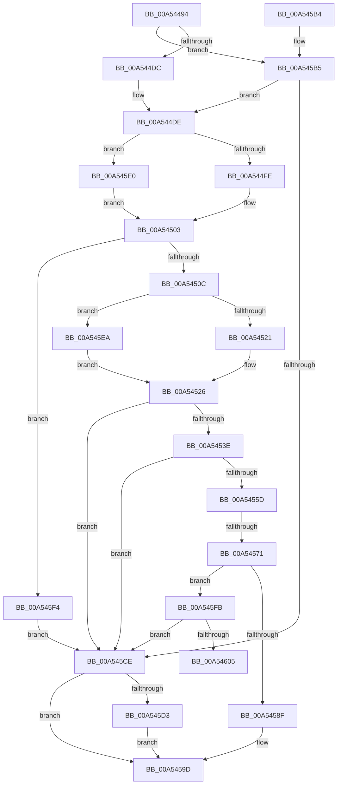

# CmpLightWeightPrepareDeleteKeyUoW

- RVA: `0x00A54494`–`0x00A5460A` (길이 `374` bytes)
- VA: `0x0000000140A54494`
- 실행 섹션: `PAGE`
- PDB 이름 있음: `예`; PDB Function 태그: `예`
- unwind 정보 RVA: `0x000B10B8`
- 디코드: `106`개 명령, `374/374` bytes 표시
- 미해석 바이트: `0` (있으면 어셈블리에 `.byte`로 보존)

> 이 문서는 커널 이미지의 기계어와 PDB 기호를 분석해 생성했습니다. 4번과 5번은 함수 원형과 자료형을 바이너리 사용 방식에서 추정한 C 해석이며 원본 소스 복구 결과는 아닙니다.

## 1. Dependencies

- 직접 호출 지점: **9**; 고유 호출 대상: **9**
- 직접 호출자로 확인된 함수: **1**
- RIP 상대 이미지 참조: **0**

### Outgoing calls
- `0x00A544FE` → [HvpGetCellFlat](../85/HvpGetCellFlat_function_00854C60.md) (function, `0x00854C60`)
- `0x00A54521` → [HvpReleaseCellPaged](../85/HvpReleaseCellPaged_function_00855F40.md) (function, `0x00855F40`)
- `0x00A5452F` → [CmpMarkKeyDirty](../84/CmpMarkKeyDirty_function_0084B1FC.md) (function, `0x0084B1FC`)
- `0x00A54552` → [HvpMarkCellDirty](../85/HvpMarkCellDirty_function_00858080.md) (function, `0x00858080`)
- `0x00A54586` → [CmpRemoveSubKeyFromList](../84/CmpRemoveSubKeyFromList_function_0084A030.md) (function, `0x0084A030`)
- `0x00A545BA` → [CmpLightWeightCreateModificationData](CmpLightWeightCreateModificationData_function_00A54AE8.md) (function, `0x00A54AE8`)
- `0x00A545D9` → [CmpLightWeightCleanupModifyKeyDataUoW](CmpLightWeightCleanupModifyKeyDataUoW_function_00A54EE4.md) (function, `0x00A54EE4`)
- `0x00A545E0` → [HvpGetCellPaged](../85/HvpGetCellPaged_function_00854CB0.md) (function, `0x00854CB0`)
- `0x00A545EA` → [HvpReleaseCellFlat](../85/HvpReleaseCellFlat_function_0085CC20.md) (function, `0x0085CC20`)

### Direct callers
- [CmpProcessLightWeightUOW](../9B/CmpProcessLightWeightUOW_function_009B0EAC.md) at `0x009B107F`

### Static image references
- 디코드된 RIP-relative 메모리 참조가 없습니다.

## 2. Other-region calls and transfers

- 다른 실행 섹션으로 향하는 call: **0**
- call이 아닌 외부 분기/꼬리 이동: **2**
  - `0x00A5456B` → [sub_00B3D5B8](../B3/Unknown_function_00B3D5B8.md) (`tail-transfer`)
  - `0x00A54605` → [sub_00B3D5B8 + 0x61](../B3/Unknown_function_00B3D5B8.md) (`tail-transfer`)

## 3. Assembly (complete function range)

```asm
00A54494  48 89 5C 24 10                  mov qword ptr [rsp + 0x10], rbx
00A54499  55                              push rbp
00A5449A  56                              push rsi
00A5449B  57                              push rdi
00A5449C  41 54                           push r12
00A5449E  41 55                           push r13
00A544A0  41 56                           push r14
00A544A2  41 57                           push r15
00A544A4  48 83 EC 20                     sub rsp, 0x20
00A544A8  48 8B 41 30                     mov rax, qword ptr [rcx + 0x30]
00A544AC  45 33 FF                        xor r15d, r15d
00A544AF  83 4C 24 60 FF                  or dword ptr [rsp + 0x60], 0xffffffff
00A544B4  4C 8B EA                        mov r13, rdx
00A544B7  4C 8B F1                        mov r14, rcx
00A544BA  44 89 7C 24 64                  mov dword ptr [rsp + 0x64], r15d
00A544BF  41 8B F7                        mov esi, r15d
00A544C2  48 8B 68 20                     mov rbp, qword ptr [rax + 0x20]
00A544C6  48 8B 41 50                     mov rax, qword ptr [rcx + 0x50]
00A544CA  48 8B 78 68                     mov rdi, qword ptr [rax + 0x68]
00A544CE  48 89 7C 24 70                  mov qword ptr [rsp + 0x70], rdi
00A544D3  48 85 FF                        test rdi, rdi
00A544D6  0F 84 D9 00 00 00               je 0x140a545b5
00A544DC  FF 07                           inc dword ptr [rdi]
00A544DE  F6 85 8C 00 00 00 01            test byte ptr [rbp + 0x8c], 1
00A544E5  4C 8D 44 24 60                  lea r8, [rsp + 0x60]
00A544EA  49 8B 46 30                     mov rax, qword ptr [r14 + 0x30]
00A544EE  48 8B CD                        mov rcx, rbp
00A544F1  44 8B 60 28                     mov r12d, dword ptr [rax + 0x28]
00A544F5  41 8B D4                        mov edx, r12d
00A544F8  0F 84 E2 00 00 00               je 0x140a545e0
00A544FE  E8 5D 07 E0 FF                  call 0x140854c60
00A54503  48 85 C0                        test rax, rax
00A54506  0F 84 E8 00 00 00               je 0x140a545f4
00A5450C  F6 85 8C 00 00 00 01            test byte ptr [rbp + 0x8c], 1
00A54513  48 8D 54 24 60                  lea rdx, [rsp + 0x60]
00A54518  48 8B CD                        mov rcx, rbp
00A5451B  0F 85 C9 00 00 00               jne 0x140a545ea
00A54521  E8 1A 1A E0 FF                  call 0x140855f40
00A54526  45 33 C0                        xor r8d, r8d
00A54529  41 8B D4                        mov edx, r12d
00A5452C  48 8B CD                        mov rcx, rbp
00A5452F  E8 C8 6C DF FF                  call 0x14084b1fc
00A54534  8B D8                           mov ebx, eax
00A54536  85 C0                           test eax, eax
00A54538  0F 88 90 00 00 00               js 0x140a545ce
00A5453E  49 8B 46 30                     mov rax, qword ptr [r14 + 0x30]
00A54542  45 33 C9                        xor r9d, r9d
00A54545  45 33 C0                        xor r8d, r8d
00A54548  48 8B 48 48                     mov rcx, qword ptr [rax + 0x48]
00A5454C  8B 51 28                        mov edx, dword ptr [rcx + 0x28]
00A5454F  48 8B CD                        mov rcx, rbp
00A54552  E8 29 3B E0 FF                  call 0x140858080
00A54557  8B D8                           mov ebx, eax
00A54559  85 C0                           test eax, eax
00A5455B  78 71                           js 0x140a545ce
00A5455D  49 8B 46 30                     mov rax, qword ptr [r14 + 0x30]
00A54561  48 8B 80 C0 00 00 00            mov rax, qword ptr [rax + 0xc0]
00A54568  48 85 C0                        test rax, rax
00A5456B  0F 85 47 90 0E 00               jne 0x140b3d5b8
00A54571  49 8B DC                        mov rbx, r12
00A54574  45 8B C4                        mov r8d, r12d
00A54577  48 C1 EB 1F                     shr rbx, 0x1f
00A5457B  48 8B CD                        mov rcx, rbp
00A5457E  48 8D 53 03                     lea rdx, [rbx + 3]
00A54582  48 8D 14 97                     lea rdx, [rdi + rdx*4]
00A54586  E8 A5 5A DF FF                  call 0x14084a030
00A5458B  84 C0                           test al, al
00A5458D  74 6C                           je 0x140a545fb
00A5458F  FF 4C 9F 04                     dec dword ptr [rdi + rbx*4 + 4]
00A54593  33 DB                           xor ebx, ebx
00A54595  49 89 7E 68                     mov qword ptr [r14 + 0x68], rdi
00A54599  49 89 76 70                     mov qword ptr [r14 + 0x70], rsi
00A5459D  8B C3                           mov eax, ebx
00A5459F  48 8B 5C 24 68                  mov rbx, qword ptr [rsp + 0x68]
00A545A4  48 83 C4 20                     add rsp, 0x20
00A545A8  41 5F                           pop r15
00A545AA  41 5E                           pop r14
00A545AC  41 5D                           pop r13
00A545AE  41 5C                           pop r12
00A545B0  5F                              pop rdi
00A545B1  5E                              pop rsi
00A545B2  5D                              pop rbp
00A545B3  C3                              ret
00A545B4  CC                              int3
00A545B5  48 8D 54 24 70                  lea rdx, [rsp + 0x70]
00A545BA  E8 29 05 00 00                  call 0x140a54ae8
00A545BF  48 8B 7C 24 70                  mov rdi, qword ptr [rsp + 0x70]
00A545C4  8B D8                           mov ebx, eax
00A545C6  85 C0                           test eax, eax
00A545C8  0F 89 10 FF FF FF               jns 0x140a544de
00A545CE  48 85 FF                        test rdi, rdi
00A545D1  74 CA                           je 0x140a5459d
00A545D3  48 8B D7                        mov rdx, rdi
00A545D6  48 8B CD                        mov rcx, rbp
00A545D9  E8 06 09 00 00                  call 0x140a54ee4
00A545DE  EB BD                           jmp 0x140a5459d
00A545E0  E8 CB 06 E0 FF                  call 0x140854cb0
00A545E5  E9 19 FF FF FF                  jmp 0x140a54503
00A545EA  E8 31 86 E0 FF                  call 0x14085cc20
00A545EF  E9 32 FF FF FF                  jmp 0x140a54526
00A545F4  BB 9A 00 00 C0                  mov ebx, 0xc000009a
00A545F9  EB D3                           jmp 0x140a545ce
00A545FB  BB 9A 00 00 C0                  mov ebx, 0xc000009a
00A54600  48 85 F6                        test rsi, rsi
00A54603  74 C9                           je 0x140a545ce
00A54605  E9 0F 90 0E 00                  jmp 0x140b3d619
```

## 4. C-style interpretation (structured pseudocode)

```c
__int64 __fastcall CmpLightWeightPrepareDeleteKeyUoW(__int64 a1, __int64 a2, __int64 a3, int a4)
{
    __int64 result;
    __int64 v_r15;
    __int64 v_rbx;
    __int64 v_rsp;
    unsigned __int64 v_stack_p10;
    unsigned __int64 v_stack_p18;
    unsigned __int64 v_stack_p70;
    unsigned int v_stack_p8;
    unsigned int v_stack_pC;

    v_stack_p10 = v_rbx;
    v_rsp = (v_rsp) - (32);
    v_r15 = 0;
    v_stack_pC = 0;
    v_stack_p18 = *(unsigned __int64 *)(*(unsigned __int64 *)(a1 + 80) + 104);
    if (*(unsigned __int64 *)(*(unsigned __int64 *)(a1 + 80) + 104) == 0) goto loc_00A545B5;
loc_00A544DE:
    if (((*(unsigned __int8 *)(*(unsigned __int64 *)(*(unsigned __int64 *)(a1 + 48) + 32) + 140)) & (1)) == 0) goto loc_00A545E0;
    result = HvpGetCellFlat(*(unsigned __int64 *)(*(unsigned __int64 *)(a1 + 48) + 32), (unsigned int)((unsigned int)((unsigned int)(*(unsigned int *)(*(unsigned __int64 *)(a1 + 48) + 40)))), v_stack_p8, a4);
loc_00A54503:
    if (result == 0) goto loc_00A545F4;
    if (((*(unsigned __int8 *)(*(unsigned __int64 *)(*(unsigned __int64 *)(a1 + 48) + 32) + 140)) & (1)) != 0) goto loc_00A545EA;
    result = HvpReleaseCellPaged(*(unsigned __int64 *)(*(unsigned __int64 *)(a1 + 48) + 32), v_stack_p8, v_stack_p8, a4);
loc_00A54526:
    a3 = 0;
    result = CmpMarkKeyDirty(*(unsigned __int64 *)(*(unsigned __int64 *)(a1 + 48) + 32), (unsigned int)((unsigned int)((unsigned int)(*(unsigned int *)(*(unsigned __int64 *)(a1 + 48) + 40)))), a3, a4);
    if (sign_flag) goto loc_00A545CE;
    a4 = 0;
    a3 = 0;
    result = HvpMarkCellDirty(*(unsigned __int64 *)(*(unsigned __int64 *)(a1 + 48) + 32), (unsigned int)(*(unsigned int *)(*(unsigned __int64 *)(*(unsigned __int64 *)(a1 + 48) + 72) + 40)), a3, a4);
    if (sign_flag) goto loc_00A545CE;
    v_rbx = ((unsigned int)(*(unsigned int *)(*(unsigned __int64 *)(a1 + 48) + 40))) >> (31);
    result = CmpRemoveSubKeyFromList(*(unsigned __int64 *)(*(unsigned __int64 *)(a1 + 48) + 32), *(unsigned __int64 *)(*(unsigned __int64 *)(a1 + 80) + 104) + v_rbx + 3 * 4, (unsigned int)((unsigned int)((unsigned int)(*(unsigned int *)(*(unsigned __int64 *)(a1 + 48) + 40)))), a4);
    if ((unsigned __int8)(result) == 0) goto loc_00A545FB;
    v_rbx = 0;
    *(unsigned __int64 *)(a1 + 104) = *(unsigned __int64 *)(*(unsigned __int64 *)(a1 + 80) + 104);
    *(unsigned __int64 *)(a1 + 112) = 0;
loc_00A5459D:
    v_rsp = (v_rsp) + (32);
    return 0;
loc_00A545B5:
    result = CmpLightWeightCreateModificationData(*(unsigned __int64 *)(*(unsigned __int64 *)(a1 + 48) + 32), v_stack_p70, (unsigned int)((unsigned int)((unsigned int)(*(unsigned int *)(*(unsigned __int64 *)(a1 + 48) + 40)))), a4);
    if (!sign_flag) goto loc_00A544DE;
loc_00A545CE:
    if (v_stack_p70 == 0) goto loc_00A5459D;
    result = CmpLightWeightCleanupModifyKeyDataUoW(*(unsigned __int64 *)(*(unsigned __int64 *)(a1 + 48) + 32), v_stack_p70, (unsigned int)((unsigned int)((unsigned int)(*(unsigned int *)(*(unsigned __int64 *)(a1 + 48) + 40)))), a4);
    goto loc_00A5459D;
loc_00A545E0:
    result = HvpGetCellPaged(*(unsigned __int64 *)(*(unsigned __int64 *)(a1 + 48) + 32), v_stack_p70, (unsigned int)((unsigned int)((unsigned int)(*(unsigned int *)(*(unsigned __int64 *)(a1 + 48) + 40)))), a4);
    goto loc_00A54503;
loc_00A545EA:
    result = HvpReleaseCellFlat(*(unsigned __int64 *)(*(unsigned __int64 *)(a1 + 48) + 32), v_stack_p70, (unsigned int)((unsigned int)((unsigned int)(*(unsigned int *)(*(unsigned __int64 *)(a1 + 48) + 40)))), a4);
    goto loc_00A54526;
loc_00A545F4:
    goto loc_00A545CE;
loc_00A545FB:
    if (0 == 0) goto loc_00A545CE;
}
```

## 5. (Beta) C Style

```c
int64_t CmpLightWeightPrepareDeleteKeyUoW(void *Arg1, int64_t Arg2, int64_t Arg3, int32_t Arg4)
{
    uint8_t *arg1 = (uint8_t *)Arg1;

    int64_t result;
    int64_t local_r15;
    int64_t local_rbx;
    int64_t local_rsp;
    uint64_t v_stack_p10;
    uint64_t v_stack_p18;
    uint64_t v_stack_p70;
    uint32_t v_stack_p8;
    uint32_t v_stack_pC;

    v_stack_p10 = local_rbx;
    local_rsp = (local_rsp) - (32);
    local_r15 = 0;
    v_stack_pC = 0;
    v_stack_p18 = *(uint64_t *)(*(uint64_t *)(arg1 + 0x50) + 0x68);
    if (*(uint64_t *)(*(uint64_t *)(arg1 + 0x50) + 0x68) == 0) goto loc_00A545B5;
loc_00A544DE:
    if (((*(uint8_t *)(*(uint64_t *)(*(uint64_t *)(arg1 + 0x30) + 0x20) + 0x8C)) & (1)) == 0) goto loc_00A545E0;
    result = HvpGetCellFlat(*(uint64_t *)(*(uint64_t *)(arg1 + 0x30) + 0x20), (uint32_t)((uint32_t)((uint32_t)(*(uint32_t *)(*(uint64_t *)(arg1 + 0x30) + 0x28)))), v_stack_p8, Arg4);
loc_00A54503:
    if (result == 0) goto loc_00A545F4;
    if (((*(uint8_t *)(*(uint64_t *)(*(uint64_t *)(arg1 + 0x30) + 0x20) + 0x8C)) & (1)) != 0) goto loc_00A545EA;
    result = HvpReleaseCellPaged(*(uint64_t *)(*(uint64_t *)(arg1 + 0x30) + 0x20), v_stack_p8, v_stack_p8, Arg4);
loc_00A54526:
    Arg3 = 0;
    result = CmpMarkKeyDirty(*(uint64_t *)(*(uint64_t *)(arg1 + 0x30) + 0x20), (uint32_t)((uint32_t)((uint32_t)(*(uint32_t *)(*(uint64_t *)(arg1 + 0x30) + 0x28)))), Arg3, Arg4);
    if (sign_flag) goto loc_00A545CE;
    Arg4 = 0;
    Arg3 = 0;
    result = HvpMarkCellDirty(*(uint64_t *)(*(uint64_t *)(arg1 + 0x30) + 0x20), (uint32_t)(*(uint32_t *)(*(uint64_t *)(*(uint64_t *)(arg1 + 0x30) + 0x48) + 0x28)), Arg3, Arg4);
    if (sign_flag) goto loc_00A545CE;
    local_rbx = ((uint32_t)(*(uint32_t *)(*(uint64_t *)(arg1 + 0x30) + 0x28))) >> (31);
    result = CmpRemoveSubKeyFromList(*(uint64_t *)(*(uint64_t *)(arg1 + 0x30) + 0x20), *(uint64_t *)(*(uint64_t *)(arg1 + 0x50) + 0x68) + local_rbx + 3 * 4, (uint32_t)((uint32_t)((uint32_t)(*(uint32_t *)(*(uint64_t *)(arg1 + 0x30) + 0x28)))), Arg4);
    if ((uint8_t)(result) == 0) goto loc_00A545FB;
    local_rbx = 0;
    *(uint64_t *)(arg1 + 0x68) = *(uint64_t *)(*(uint64_t *)(arg1 + 0x50) + 0x68);
    *(uint64_t *)(arg1 + 0x70) = 0;
loc_00A5459D:
    local_rsp = (local_rsp) + (32);
    return 0;
loc_00A545B5:
    result = CmpLightWeightCreateModificationData(*(uint64_t *)(*(uint64_t *)(arg1 + 0x30) + 0x20), v_stack_p70, (uint32_t)((uint32_t)((uint32_t)(*(uint32_t *)(*(uint64_t *)(arg1 + 0x30) + 0x28)))), Arg4);
    if (!sign_flag) goto loc_00A544DE;
loc_00A545CE:
    if (v_stack_p70 == 0) goto loc_00A5459D;
    result = CmpLightWeightCleanupModifyKeyDataUoW(*(uint64_t *)(*(uint64_t *)(arg1 + 0x30) + 0x20), v_stack_p70, (uint32_t)((uint32_t)((uint32_t)(*(uint32_t *)(*(uint64_t *)(arg1 + 0x30) + 0x28)))), Arg4);
    goto loc_00A5459D;
loc_00A545E0:
    result = HvpGetCellPaged(*(uint64_t *)(*(uint64_t *)(arg1 + 0x30) + 0x20), v_stack_p70, (uint32_t)((uint32_t)((uint32_t)(*(uint32_t *)(*(uint64_t *)(arg1 + 0x30) + 0x28)))), Arg4);
    goto loc_00A54503;
loc_00A545EA:
    result = HvpReleaseCellFlat(*(uint64_t *)(*(uint64_t *)(arg1 + 0x30) + 0x20), v_stack_p70, (uint32_t)((uint32_t)((uint32_t)(*(uint32_t *)(*(uint64_t *)(arg1 + 0x30) + 0x28)))), Arg4);
    goto loc_00A54526;
loc_00A545F4:
    goto loc_00A545CE;
loc_00A545FB:
    if (0 == 0) goto loc_00A545CE;
}
```

### 관측된 메모리 오프셋

구조체 형식이 확인되지 않은 접근은 인자 기준의 오프셋으로만 기록했습니다.

| 기준 인자 | 오프셋 표현 | 폭 (bit) | 접근 |
|---|---:|---:|---|
| `Arg1` | `+ 0x30` | `64` | `R` |
| `Arg1` | `+ 0x50` | `64` | `R` |
| `Arg1` | `+ 0x68` | `64` | `W` |
| `Arg1` | `+ 0x70` | `64` | `W` |

## 6. Execution-region graph

[열기: 2D/3D 그래프와 함수 탐색 컨트롤 패널](../../../control-panel.html?section=page&rva=0x00A54494&view=graph)

- 2D 그래프는 위에서 아래로 흐르고, 3D 그래프는 빈 공간을 드래그해 회전합니다. Shift+드래그는 이동, 휠은 확대·축소, 함수 노드 선택은 대상 보고서 이동입니다.

### Static fallback


