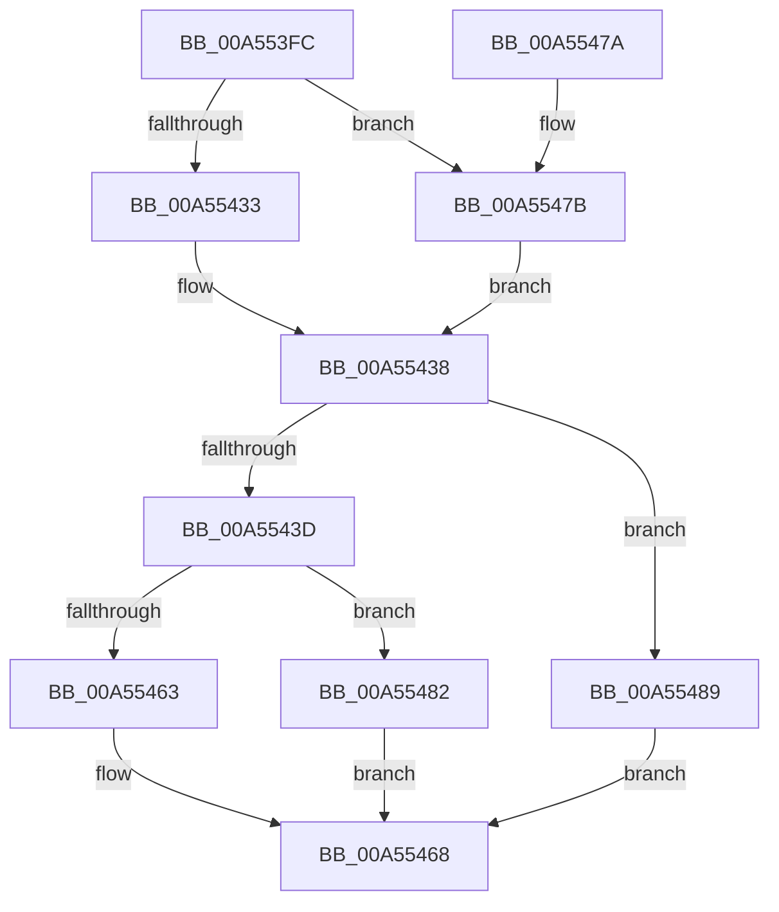

# CmpLightWeightPrepareSetKeyUserFlags

- RVA: `0x00A553FC`–`0x00A55490` (길이 `148` bytes)
- VA: `0x0000000140A553FC`
- 실행 섹션: `PAGE`
- PDB 이름 있음: `예`; PDB Function 태그: `아니요`
- unwind 정보 RVA: `0x00090A68`
- 디코드: `44`개 명령, `148/148` bytes 표시
- 미해석 바이트: `0` (있으면 어셈블리에 `.byte`로 보존)

> 이 문서는 커널 이미지의 기계어와 PDB 기호를 분석해 생성했습니다. 4번과 5번은 함수 원형과 자료형을 바이너리 사용 방식에서 추정한 C 해석이며 원본 소스 복구 결과는 아닙니다.

## 1. Dependencies

- 직접 호출 지점: **5**; 고유 호출 대상: **5**
- 직접 호출자로 확인된 함수: **1**
- RIP 상대 이미지 참조: **0**

### Outgoing calls
- `0x00A55433` → [HvpGetCellFlat](../85/HvpGetCellFlat_function_00854C60.md) (function, `0x00854C60`)
- `0x00A55448` → [HvpMarkCellDirty](../85/HvpMarkCellDirty_function_00858080.md) (function, `0x00858080`)
- `0x00A55463` → [HvpReleaseCellPaged](../85/HvpReleaseCellPaged_function_00855F40.md) (function, `0x00855F40`)
- `0x00A5547B` → [HvpGetCellPaged](../85/HvpGetCellPaged_function_00854CB0.md) (function, `0x00854CB0`)
- `0x00A55482` → [HvpReleaseCellFlat](../85/HvpReleaseCellFlat_function_0085CC20.md) (function, `0x0085CC20`)

### Direct callers
- [CmpProcessLightWeightUOW](../9B/CmpProcessLightWeightUOW_function_009B0EAC.md) at `0x009B10C2`

### Static image references
- 디코드된 RIP-relative 메모리 참조가 없습니다.

## 2. Other-region calls and transfers

- 다른 실행 섹션으로 향하는 call: **0**
- 별도 외부 분기/꼬리 이동을 확인하지 못했습니다.

## 3. Assembly (complete function range)

```asm
00A553FC  48 8B C4                        mov rax, rsp
00A553FF  48 89 58 10                     mov qword ptr [rax + 0x10], rbx
00A55403  48 89 70 18                     mov qword ptr [rax + 0x18], rsi
00A55407  57                              push rdi
00A55408  48 83 EC 20                     sub rsp, 0x20
00A5540C  83 48 08 FF                     or dword ptr [rax + 8], 0xffffffff
00A55410  4C 8D 44 24 30                  lea r8, [rsp + 0x30]
00A55415  33 DB                           xor ebx, ebx
00A55417  89 58 0C                        mov dword ptr [rax + 0xc], ebx
00A5541A  48 8B 41 30                     mov rax, qword ptr [rcx + 0x30]
00A5541E  48 8B 78 20                     mov rdi, qword ptr [rax + 0x20]
00A55422  8B 70 28                        mov esi, dword ptr [rax + 0x28]
00A55425  48 8B CF                        mov rcx, rdi
00A55428  8B D6                           mov edx, esi
00A5542A  F6 87 8C 00 00 00 01            test byte ptr [rdi + 0x8c], 1
00A55431  74 48                           je 0x140a5547b
00A55433  E8 28 F8 DF FF                  call 0x140854c60
00A55438  48 85 C0                        test rax, rax
00A5543B  74 4C                           je 0x140a55489
00A5543D  45 33 C9                        xor r9d, r9d
00A55440  45 33 C0                        xor r8d, r8d
00A55443  8B D6                           mov edx, esi
00A55445  48 8B CF                        mov rcx, rdi
00A55448  E8 33 2C E0 FF                  call 0x140858080
00A5544D  85 C0                           test eax, eax
00A5544F  48 8D 54 24 30                  lea rdx, [rsp + 0x30]
00A55454  48 8B CF                        mov rcx, rdi
00A55457  0F 48 D8                        cmovs ebx, eax
00A5545A  F6 87 8C 00 00 00 01            test byte ptr [rdi + 0x8c], 1
00A55461  75 1F                           jne 0x140a55482
00A55463  E8 D8 0A E0 FF                  call 0x140855f40
00A55468  48 8B 74 24 40                  mov rsi, qword ptr [rsp + 0x40]
00A5546D  8B C3                           mov eax, ebx
00A5546F  48 8B 5C 24 38                  mov rbx, qword ptr [rsp + 0x38]
00A55474  48 83 C4 20                     add rsp, 0x20
00A55478  5F                              pop rdi
00A55479  C3                              ret
00A5547A  CC                              int3
00A5547B  E8 30 F8 DF FF                  call 0x140854cb0
00A55480  EB B6                           jmp 0x140a55438
00A55482  E8 99 77 E0 FF                  call 0x14085cc20
00A55487  EB DF                           jmp 0x140a55468
00A55489  BB 9A 00 00 C0                  mov ebx, 0xc000009a
00A5548E  EB D8                           jmp 0x140a55468
```

## 4. C-style interpretation (structured pseudocode)

```c
__int64 __fastcall CmpLightWeightPrepareSetKeyUserFlags(__int64 a1, __int64 a2, __int64 a3, int a4)
{
    __int64 result;
    __int64 v_rbx;
    __int64 v_rsp;
    unsigned __int64 v_stack_p10;
    unsigned __int64 v_stack_p18;
    unsigned __int64 v_stack_p8;

    *(unsigned __int64 *)(v_rsp + 16) = v_rbx;
    *(unsigned __int64 *)(v_rsp + 24) = v_rsi;
    v_rsp = (v_rsp) - (32);
    v_rbx = 0;
    *(unsigned int *)(v_rsp + 12) = 0;
    if (((*(unsigned __int8 *)(*(unsigned __int64 *)(*(unsigned __int64 *)(a1 + 48) + 32) + 140)) & (1)) == 0) goto loc_00A5547B;
    result = HvpGetCellFlat(*(unsigned __int64 *)(*(unsigned __int64 *)(a1 + 48) + 32), (unsigned int)((unsigned int)((unsigned int)(*(unsigned int *)(*(unsigned __int64 *)(a1 + 48) + 40)))), v_stack_p8, a4);
loc_00A55438:
    if (result == 0) goto loc_00A55489;
    a4 = 0;
    a3 = 0;
    result = HvpMarkCellDirty(*(unsigned __int64 *)(*(unsigned __int64 *)(a1 + 48) + 32), (unsigned int)((unsigned int)((unsigned int)(*(unsigned int *)(*(unsigned __int64 *)(a1 + 48) + 40)))), a3, a4);
    if (sign_flag) { v_rbx = (unsigned int)(result); }
    if (((*(unsigned __int8 *)(*(unsigned __int64 *)(*(unsigned __int64 *)(a1 + 48) + 32) + 140)) & (1)) != 0) goto loc_00A55482;
    result = HvpReleaseCellPaged(*(unsigned __int64 *)(*(unsigned __int64 *)(a1 + 48) + 32), v_stack_p8, a3, a4);
loc_00A55468:
    v_rsp = (v_rsp) + (32);
    return (unsigned int)((unsigned int)(v_rbx));
loc_00A5547B:
    result = HvpGetCellPaged(*(unsigned __int64 *)(*(unsigned __int64 *)(a1 + 48) + 32), v_stack_p8, a3, a4);
    goto loc_00A55438;
loc_00A55482:
    result = HvpReleaseCellFlat(*(unsigned __int64 *)(*(unsigned __int64 *)(a1 + 48) + 32), v_stack_p8, a3, a4);
    goto loc_00A55468;
loc_00A55489:
    goto loc_00A55468;
}
```

## 5. (Beta) C Style

```c
int64_t CmpLightWeightPrepareSetKeyUserFlags(void *Arg1, int64_t Arg2, int64_t Arg3, int32_t Arg4)
{
    uint8_t *arg1 = (uint8_t *)Arg1;

    int64_t result;
    int64_t local_rbx;
    int64_t local_rsp;
    uint64_t v_stack_p10;
    uint64_t v_stack_p18;
    uint64_t v_stack_p8;

    *(uint64_t *)(local_rsp + 0x10) = local_rbx;
    *(uint64_t *)(local_rsp + 0x18) = local_rsi;
    local_rsp = (local_rsp) - (32);
    local_rbx = 0;
    *(uint32_t *)(local_rsp + 0xC) = 0;
    if (((*(uint8_t *)(*(uint64_t *)(*(uint64_t *)(arg1 + 0x30) + 0x20) + 0x8C)) & (1)) == 0) goto loc_00A5547B;
    result = HvpGetCellFlat(*(uint64_t *)(*(uint64_t *)(arg1 + 0x30) + 0x20), (uint32_t)((uint32_t)((uint32_t)(*(uint32_t *)(*(uint64_t *)(arg1 + 0x30) + 0x28)))), v_stack_p8, Arg4);
loc_00A55438:
    if (result == 0) goto loc_00A55489;
    Arg4 = 0;
    Arg3 = 0;
    result = HvpMarkCellDirty(*(uint64_t *)(*(uint64_t *)(arg1 + 0x30) + 0x20), (uint32_t)((uint32_t)((uint32_t)(*(uint32_t *)(*(uint64_t *)(arg1 + 0x30) + 0x28)))), Arg3, Arg4);
    if (sign_flag) { local_rbx = (uint32_t)(result); }
    if (((*(uint8_t *)(*(uint64_t *)(*(uint64_t *)(arg1 + 0x30) + 0x20) + 0x8C)) & (1)) != 0) goto loc_00A55482;
    result = HvpReleaseCellPaged(*(uint64_t *)(*(uint64_t *)(arg1 + 0x30) + 0x20), v_stack_p8, Arg3, Arg4);
loc_00A55468:
    local_rsp = (local_rsp) + (32);
    return (uint32_t)((uint32_t)(local_rbx));
loc_00A5547B:
    result = HvpGetCellPaged(*(uint64_t *)(*(uint64_t *)(arg1 + 0x30) + 0x20), v_stack_p8, Arg3, Arg4);
    goto loc_00A55438;
loc_00A55482:
    result = HvpReleaseCellFlat(*(uint64_t *)(*(uint64_t *)(arg1 + 0x30) + 0x20), v_stack_p8, Arg3, Arg4);
    goto loc_00A55468;
loc_00A55489:
    goto loc_00A55468;
}
```

### 관측된 메모리 오프셋

구조체 형식이 확인되지 않은 접근은 인자 기준의 오프셋으로만 기록했습니다.

| 기준 인자 | 오프셋 표현 | 폭 (bit) | 접근 |
|---|---:|---:|---|
| `Arg1` | `+ 0x30` | `64` | `R` |

## 6. Execution-region graph

[열기: 2D/3D 그래프와 함수 탐색 컨트롤 패널](../../../control-panel.html?section=page&rva=0x00A553FC&view=graph)

- 2D 그래프는 위에서 아래로 흐르고, 3D 그래프는 빈 공간을 드래그해 회전합니다. Shift+드래그는 이동, 휠은 확대·축소, 함수 노드 선택은 대상 보고서 이동입니다.

### Static fallback


