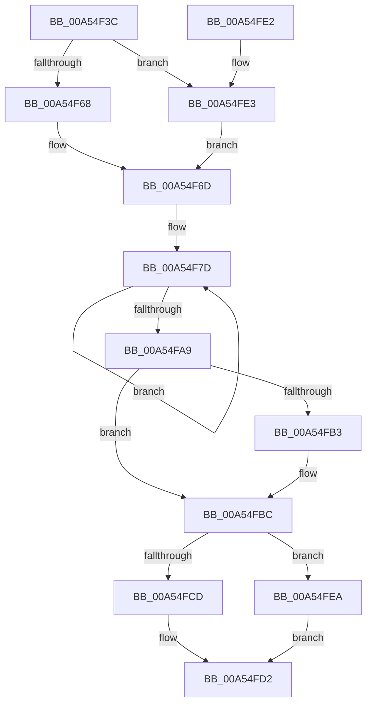

# CmpLightWeightSwapParentSubKeyList

- RVA: `0x00A54F3C`–`0x00A54FF1` (길이 `181` bytes)
- VA: `0x0000000140A54F3C`
- 실행 섹션: `PAGE`
- PDB 이름 있음: `예`; PDB Function 태그: `아니요`
- unwind 정보 RVA: `0x000B119C`
- 디코드: `49`개 명령, `181/181` bytes 표시
- 미해석 바이트: `0` (있으면 어셈블리에 `.byte`로 보존)

> 이 문서는 커널 이미지의 기계어와 PDB 기호를 분석해 생성했습니다. 4번과 5번은 함수 원형과 자료형을 바이너리 사용 방식에서 추정한 C 해석이며 원본 소스 복구 결과는 아닙니다.

## 1. Dependencies

- 직접 호출 지점: **4**; 고유 호출 대상: **4**
- 직접 호출자로 확인된 함수: **2**
- RIP 상대 이미지 참조: **0**

### Outgoing calls
- `0x00A54F68` → [HvpGetCellFlat](../85/HvpGetCellFlat_function_00854C60.md) (function, `0x00854C60`)
- `0x00A54FCD` → [HvpReleaseCellPaged](../85/HvpReleaseCellPaged_function_00855F40.md) (function, `0x00855F40`)
- `0x00A54FE3` → [HvpGetCellPaged](../85/HvpGetCellPaged_function_00854CB0.md) (function, `0x00854CB0`)
- `0x00A54FEA` → [HvpReleaseCellFlat](../85/HvpReleaseCellFlat_function_0085CC20.md) (function, `0x0085CC20`)

### Direct callers
- [CmpLightWeightCommitDeleteKeyUoW](CmpLightWeightCommitDeleteKeyUoW_function_00A54610.md) at `0x00A54689`
- [CmpLightWeightCommitAddKeyUoW](CmpLightWeightCommitAddKeyUoW_function_00A54CA8.md) at `0x00A54E13`

### Static image references
- 디코드된 RIP-relative 메모리 참조가 없습니다.

## 2. Other-region calls and transfers

- 다른 실행 섹션으로 향하는 call: **0**
- 별도 외부 분기/꼬리 이동을 확인하지 못했습니다.

## 3. Assembly (complete function range)

```asm
00A54F3C  48 8B C4                        mov rax, rsp
00A54F3F  48 89 58 10                     mov qword ptr [rax + 0x10], rbx
00A54F43  48 89 70 18                     mov qword ptr [rax + 0x18], rsi
00A54F47  57                              push rdi
00A54F48  48 83 EC 20                     sub rsp, 0x20
00A54F4C  83 48 08 FF                     or dword ptr [rax + 8], 0xffffffff
00A54F50  33 F6                           xor esi, esi
00A54F52  F6 81 8C 00 00 00 01            test byte ptr [rcx + 0x8c], 1
00A54F59  49 8B F8                        mov rdi, r8
00A54F5C  48 8B D9                        mov rbx, rcx
00A54F5F  89 70 0C                        mov dword ptr [rax + 0xc], esi
00A54F62  4C 8D 40 08                     lea r8, [rax + 8]
00A54F66  74 7B                           je 0x140a54fe3
00A54F68  E8 F3 FC DF FF                  call 0x140854c60
00A54F6D  4C 8B C0                        mov r8, rax
00A54F70  4C 8D 48 14                     lea r9, [rax + 0x14]
00A54F74  48 2B F8                        sub rdi, rax
00A54F77  41 BB 02 00 00 00               mov r11d, 2
00A54F7D  42 8B 44 0F F8                  mov eax, dword ptr [rdi + r9 - 8]
00A54F82  41 8B 49 08                     mov ecx, dword ptr [r9 + 8]
00A54F86  41 8B 11                        mov edx, dword ptr [r9]
00A54F89  41 89 41 08                     mov dword ptr [r9 + 8], eax
00A54F8D  42 8B 44 0F F0                  mov eax, dword ptr [rdi + r9 - 0x10]
00A54F92  41 89 01                        mov dword ptr [r9], eax
00A54F95  42 89 4C 0F F8                  mov dword ptr [rdi + r9 - 8], ecx
00A54F9A  42 89 54 0F F0                  mov dword ptr [rdi + r9 - 0x10], edx
00A54F9F  4D 8D 49 04                     lea r9, [r9 + 4]
00A54FA3  49 83 EB 01                     sub r11, 1
00A54FA7  75 D4                           jne 0x140a54f7d
00A54FA9  41 8B 40 18                     mov eax, dword ptr [r8 + 0x18]
00A54FAD  41 03 40 14                     add eax, dword ptr [r8 + 0x14]
00A54FB1  75 09                           jne 0x140a54fbc
00A54FB3  66 41 89 70 34                  mov word ptr [r8 + 0x34], si
00A54FB8  41 89 70 38                     mov dword ptr [r8 + 0x38], esi
00A54FBC  F6 83 8C 00 00 00 01            test byte ptr [rbx + 0x8c], 1
00A54FC3  48 8D 54 24 30                  lea rdx, [rsp + 0x30]
00A54FC8  48 8B CB                        mov rcx, rbx
00A54FCB  75 1D                           jne 0x140a54fea
00A54FCD  E8 6E 0F E0 FF                  call 0x140855f40
00A54FD2  48 8B 5C 24 38                  mov rbx, qword ptr [rsp + 0x38]
00A54FD7  48 8B 74 24 40                  mov rsi, qword ptr [rsp + 0x40]
00A54FDC  48 83 C4 20                     add rsp, 0x20
00A54FE0  5F                              pop rdi
00A54FE1  C3                              ret
00A54FE2  CC                              int3
00A54FE3  E8 C8 FC DF FF                  call 0x140854cb0
00A54FE8  EB 83                           jmp 0x140a54f6d
00A54FEA  E8 31 7C E0 FF                  call 0x14085cc20
00A54FEF  EB E1                           jmp 0x140a54fd2
```

## 4. C-style interpretation (structured pseudocode)

```c
__int64 __fastcall CmpLightWeightSwapParentSubKeyList(__int64 a1, __int64 a2, __int64 a3)
{
    __int64 result;
    __int64 v_r11;
    __int64 v_rdi;
    __int64 v_rsi;
    __int64 v_rsp;
    unsigned __int64 v_stack_p10;
    unsigned __int64 v_stack_p18;
    unsigned __int64 v_stack_p8;

    *(unsigned __int64 *)(v_rsp + 16) = v_rbx;
    *(unsigned __int64 *)(v_rsp + 24) = v_rsi;
    v_rsp = (v_rsp) - (32);
    v_rsi = 0;
    *(unsigned int *)(v_rsp + 12) = 0;
    if (((*(unsigned __int8 *)(a1 + 140)) & (1)) == 0) goto loc_00A54FE3;
    result = HvpGetCellFlat(a1, a2, v_rsp + 8, a4);
loc_00A54F6D:
    v_rdi = (a3) - (result);
loc_00A54F7D:
    *(unsigned int *)(result + 20 + 8) = (unsigned int)((unsigned int)(*(unsigned int *)(v_rdi + result + 20 * 1 - 8)));
    *(unsigned int *)(result + 20) = (unsigned int)((unsigned int)(*(unsigned int *)(v_rdi + result + 20 * 1 - 16)));
    *(unsigned int *)(v_rdi + result + 20 * 1 - 8) = (unsigned int)((unsigned int)(*(unsigned int *)(result + 20 + 8)));
    *(unsigned int *)(v_rdi + result + 20 * 1 - 16) = (unsigned int)((unsigned int)(*(unsigned int *)(result + 20)));
    v_r11 = (2) - (1);
    if (condition_is_not_equal) goto loc_00A54F7D;
    result = (unsigned int)(((unsigned int)(*(unsigned int *)(result + 24))) + (*(unsigned int *)(result + 20)));
    if (!(condition_is_not_equal)) {
        *(unsigned __int16 *)(result + 52) = 0;
        *(unsigned int *)(result + 56) = 0;
    }
    if (((*(unsigned __int8 *)(a1 + 140)) & (1)) != 0) goto loc_00A54FEA;
    result = HvpReleaseCellPaged(a1, v_stack_p8, result, result + 20 + 4);
loc_00A54FD2:
    v_rsp = (v_rsp) + (32);
    return result;
loc_00A54FE3:
    result = HvpGetCellPaged(a1, v_stack_p8, result, result + 20 + 4);
    goto loc_00A54F6D;
loc_00A54FEA:
    result = HvpReleaseCellFlat(a1, v_stack_p8, result, result + 20 + 4);
    goto loc_00A54FD2;
}
```

## 5. (Beta) C Style

```c
int64_t CmpLightWeightSwapParentSubKeyList(void *Arg1, int64_t Arg2, void *Arg3)
{
    uint8_t *arg1 = (uint8_t *)Arg1;
    uint8_t *arg3 = (uint8_t *)Arg3;

    int64_t result;
    int64_t local_r11;
    int64_t local_rdi;
    int64_t local_rsi;
    int64_t local_rsp;
    uint64_t v_stack_p10;
    uint64_t v_stack_p18;
    uint64_t v_stack_p8;

    *(uint64_t *)(local_rsp + 0x10) = local_rbx;
    *(uint64_t *)(local_rsp + 0x18) = local_rsi;
    local_rsp = (local_rsp) - (32);
    local_rsi = 0;
    *(uint32_t *)(local_rsp + 0xC) = 0;
    if (((*(uint8_t *)(arg1 + 0x8C)) & (1)) == 0) goto loc_00A54FE3;
    result = HvpGetCellFlat(Arg1, Arg2, local_rsp + 8, a4);
loc_00A54F6D:
    local_rdi = (Arg3) - (result);
loc_00A54F7D:
    *(uint32_t *)(result + 0x14 + 0x8) = (uint32_t)((uint32_t)(*(uint32_t *)(local_rdi + result + 0x14 * 1 - 0x8)));
    *(uint32_t *)(result + 0x14) = (uint32_t)((uint32_t)(*(uint32_t *)(local_rdi + result + 0x14 * 1 - 0x10)));
    *(uint32_t *)(local_rdi + result + 0x14 * 1 - 0x8) = (uint32_t)((uint32_t)(*(uint32_t *)(result + 0x14 + 0x8)));
    *(uint32_t *)(local_rdi + result + 0x14 * 1 - 0x10) = (uint32_t)((uint32_t)(*(uint32_t *)(result + 0x14)));
    local_r11 = (2) - (1);
    if (condition_is_not_equal) goto loc_00A54F7D;
    result = (uint32_t)(((uint32_t)(*(uint32_t *)(result + 0x18))) + (*(uint32_t *)(result + 0x14)));
    if (!(condition_is_not_equal)) {
        *(uint16_t *)(result + 0x34) = 0;
        *(uint32_t *)(result + 0x38) = 0;
    }
    if (((*(uint8_t *)(arg1 + 0x8C)) & (1)) != 0) goto loc_00A54FEA;
    result = HvpReleaseCellPaged(Arg1, v_stack_p8, result, result + 20 + 4);
loc_00A54FD2:
    local_rsp = (local_rsp) + (32);
    return result;
loc_00A54FE3:
    result = HvpGetCellPaged(Arg1, v_stack_p8, result, result + 20 + 4);
    goto loc_00A54F6D;
loc_00A54FEA:
    result = HvpReleaseCellFlat(Arg1, v_stack_p8, result, result + 20 + 4);
    goto loc_00A54FD2;
}
```

### 관측된 메모리 오프셋

구조체 형식이 확인되지 않은 접근은 인자 기준의 오프셋으로만 기록했습니다.

| 기준 인자 | 오프셋 표현 | 폭 (bit) | 접근 |
|---|---:|---:|---|
| `Arg1` | `+ 0x8C` | `8` | `R` |
| `Arg3` | `- 0x10 + r9*1` | `32` | `R` |
| `Arg3` | `- 0x10 + r9*1` | `32` | `W` |
| `Arg3` | `- 0x8 + r9*1` | `32` | `R` |
| `Arg3` | `- 0x8 + r9*1` | `32` | `W` |

## 6. Execution-region graph

[열기: 2D/3D 그래프와 함수 탐색 컨트롤 패널](../../../control-panel.html?section=page&rva=0x00A54F3C&view=graph)

- 2D 그래프는 위에서 아래로 흐르고, 3D 그래프는 빈 공간을 드래그해 회전합니다. Shift+드래그는 이동, 휠은 확대·축소, 함수 노드 선택은 대상 보고서 이동입니다.

### Static fallback


