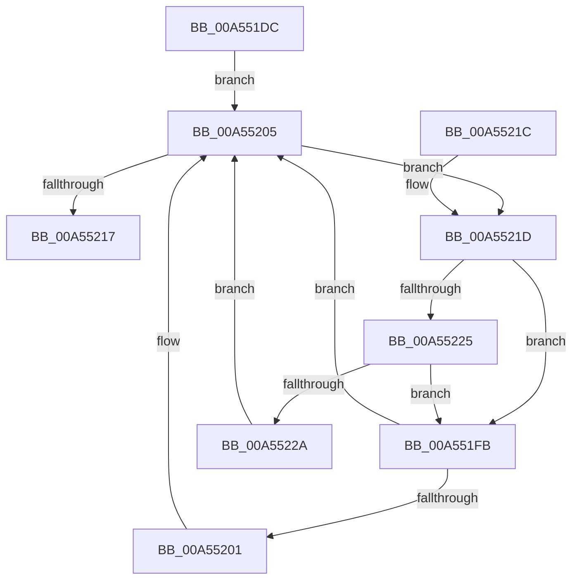

# CmpLightWeightUpdateModificationActions

- RVA: `0x00A551DC`–`0x00A5522C` (길이 `80` bytes)
- VA: `0x0000000140A551DC`
- 실행 섹션: `PAGE`
- PDB 이름 있음: `예`; PDB Function 태그: `아니요`
- unwind 정보 RVA: `0x0005D35C`
- 디코드: `24`개 명령, `80/80` bytes 표시
- 미해석 바이트: `0` (있으면 어셈블리에 `.byte`로 보존)

> 이 문서는 커널 이미지의 기계어와 PDB 기호를 분석해 생성했습니다. 4번과 5번은 함수 원형과 자료형을 바이너리 사용 방식에서 추정한 C 해석이며 원본 소스 복구 결과는 아닙니다.

## 1. Dependencies

- 직접 호출 지점: **1**; 고유 호출 대상: **1**
- 직접 호출자로 확인된 함수: **1**
- RIP 상대 이미지 참조: **0**

### Outgoing calls
- `0x00A5520D` → [CmListGetNextElement](../../pagecmrc/BC/CmListGetNextElement_function_00BC9940.md) (function, `0x00BC9940`)

### Direct callers
- [CmpLightWeightCreateModificationData](CmpLightWeightCreateModificationData_function_00A54AE8.md) at `0x00A54B93`

### Static image references
- 디코드된 RIP-relative 메모리 참조가 없습니다.

## 2. Other-region calls and transfers

- 다른 실행 섹션으로 향하는 call: **1**
  - `0x00A5520D` → [CmListGetNextElement](../../pagecmrc/BC/CmListGetNextElement_function_00BC9940.md) (`PAGE` → `PAGECMRC`)
- 별도 외부 분기/꼬리 이동을 확인하지 못했습니다.

## 3. Assembly (complete function range)

```asm
00A551DC  48 83 EC 28                     sub rsp, 0x28
00A551E0  48 83 64 24 38 00               and qword ptr [rsp + 0x38], 0
00A551E6  4C 8D 8A D0 00 00 00            lea r9, [rdx + 0xd0]
00A551ED  4D 8B D0                        mov r10, r8
00A551F0  4C 8B D9                        mov r11, rcx
00A551F3  41 B8 20 00 00 00               mov r8d, 0x20
00A551F9  EB 0A                           jmp 0x140a55205
00A551FB  4C 39 50 38                     cmp qword ptr [rax + 0x38], r10
00A551FF  75 04                           jne 0x140a55205
00A55201  4C 89 58 68                     mov qword ptr [rax + 0x68], r11
00A55205  48 8D 54 24 38                  lea rdx, [rsp + 0x38]
00A5520A  49 8B C9                        mov rcx, r9
00A5520D  E8 2E 47 17 00                  call 0x140bc9940
00A55212  48 85 C0                        test rax, rax
00A55215  75 06                           jne 0x140a5521d
00A55217  48 83 C4 28                     add rsp, 0x28
00A5521B  C3                              ret
00A5521C  CC                              int3
00A5521D  8B 50 44                        mov edx, dword ptr [rax + 0x44]
00A55220  83 EA 01                        sub edx, 1
00A55223  74 D6                           je 0x140a551fb
00A55225  83 FA 02                        cmp edx, 2
00A55228  74 D1                           je 0x140a551fb
00A5522A  EB D9                           jmp 0x140a55205
```

## 4. C-style interpretation (structured pseudocode)

```c
__int64 __fastcall CmpLightWeightUpdateModificationActions(__int64 a1, __int64 a2, __int64 a3)
{
    __int64 result;
    __int64 v_rsp;
    unsigned __int64 v_stack_p10;

    v_rsp = (v_rsp) - (40);
    goto loc_00A55205;
loc_00A551FB:
    if ((*(unsigned __int64 *)(result + 56)) == a3) {
        *(unsigned __int64 *)(result + 104) = a1;
    }
    result = CmListGetNextElement(a2 + 208, v_stack_p10, 32, a2 + 208);
    if (result != 0) goto loc_00A5521D;
    v_rsp = (v_rsp) + (40);
    return result;
loc_00A5521D:
    a2 = (unsigned int)(((unsigned int)(*(unsigned int *)(result + 68))) - (1));
    if (condition_is_equal) goto loc_00A551FB;
    if (((unsigned int)(a2)) == 2) goto loc_00A551FB;
    goto loc_00A55205;
}
```

## 5. (Beta) C Style

```c
int64_t CmpLightWeightUpdateModificationActions(int64_t Arg1, void *Arg2, int64_t Arg3)
{
    uint8_t *arg2 = (uint8_t *)Arg2;

    int64_t result;
    int64_t local_rsp;
    uint64_t v_stack_p10;

    local_rsp = (local_rsp) - (40);
    goto loc_00A55205;
loc_00A551FB:
    if ((*(uint64_t *)(result + 0x38)) == Arg3) {
        *(uint64_t *)(result + 0x68) = Arg1;
    }
    result = CmListGetNextElement(Arg2 + 208, v_stack_p10, 32, Arg2 + 208);
    if (result != 0) goto loc_00A5521D;
    local_rsp = (local_rsp) + (40);
    return result;
loc_00A5521D:
    Arg2 = (uint32_t)(((uint32_t)(*(uint32_t *)(result + 0x44))) - (1));
    if (condition_is_equal) goto loc_00A551FB;
    if (((uint32_t)(Arg2)) == 2) goto loc_00A551FB;
    goto loc_00A55205;
}
```

### 관측된 메모리 오프셋

구조체 형식이 확인되지 않은 접근은 인자 기준의 오프셋으로만 기록했습니다.

| 기준 인자 | 오프셋 표현 | 폭 (bit) | 접근 |
|---|---:|---:|---|
| `Arg2` | `+ 0xD0` | `64` | `R` |

## 6. Execution-region graph

[열기: 2D/3D 그래프와 함수 탐색 컨트롤 패널](../../../control-panel.html?section=page&rva=0x00A551DC&view=graph)

- 2D 그래프는 위에서 아래로 흐르고, 3D 그래프는 빈 공간을 드래그해 회전합니다. Shift+드래그는 이동, 휠은 확대·축소, 함수 노드 선택은 대상 보고서 이동입니다.

### Static fallback


