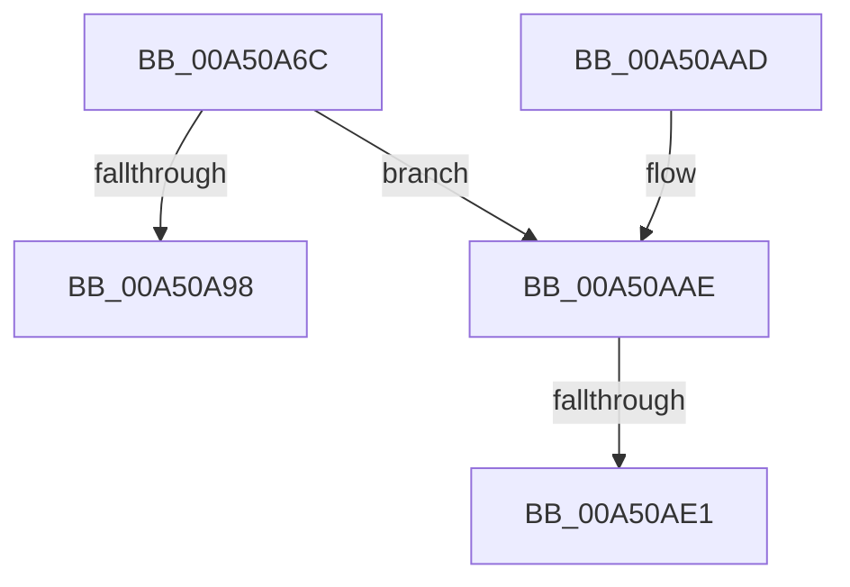

# CmpLogHiveDirtyEvent

- RVA: `0x00A50A6C`–`0x00A50AFB` (길이 `143` bytes)
- VA: `0x0000000140A50A6C`
- 실행 섹션: `PAGE`
- PDB 이름 있음: `예`; PDB Function 태그: `예`
- unwind 정보 RVA: `0x000B0AD8`
- 디코드: `33`개 명령, `143/143` bytes 표시
- 미해석 바이트: `0` (있으면 어셈블리에 `.byte`로 보존)

> 이 문서는 커널 이미지의 기계어와 PDB 기호를 분석해 생성했습니다. 4번과 5번은 함수 원형과 자료형을 바이너리 사용 방식에서 추정한 C 해석이며 원본 소스 복구 결과는 아닙니다.

## 1. Dependencies

- 직접 호출 지점: **1**; 고유 호출 대상: **1**
- 직접 호출자로 확인된 함수: **1**
- RIP 상대 이미지 참조: **2**

### Outgoing calls
- `0x00A50A9F` → [_security_check_cookie](../../text/6A/_security_check_cookie_function_006AC640.md) (function, `0x006AC640`)

### Direct callers
- [sub_00859517](../85/Unknown_function_00859517.md) at `0x0085957E`

### Static image references
- `0x00A50A7E` → RVA `0x00E0A740` (`.data`; read)
- `0x00A50A8C` → RVA `0x00FC6B08` (`ALMOSTRO`; read)

## 2. Other-region calls and transfers

- 다른 실행 섹션으로 향하는 call: **1**
  - `0x00A50A9F` → [_security_check_cookie](../../text/6A/_security_check_cookie_function_006AC640.md) (`PAGE` → `.text`)
- call이 아닌 외부 분기/꼬리 이동: **2**
  - `0x00A50ADB` → [sub_00B3C70E](../B3/Unknown_function_00B3C70E.md) (`tail-transfer`)
  - `0x00A50AF6` → [sub_00B3C70E](../B3/Unknown_function_00B3C70E.md) (`tail-transfer`)

## 3. Assembly (complete function range)

```asm
00A50A6C  48 89 4C 24 08                  mov qword ptr [rsp + 8], rcx
00A50A71  55                              push rbp
00A50A72  48 8D 6C 24 A9                  lea rbp, [rsp - 0x57]
00A50A77  48 81 EC 90 00 00 00            sub rsp, 0x90
00A50A7E  48 8B 05 BB 9C 3B 00            mov rax, qword ptr [rip + 0x3b9cbb]
00A50A85  48 33 C4                        xor rax, rsp
00A50A88  48 89 45 47                     mov qword ptr [rbp + 0x47], rax
00A50A8C  F7 05 72 60 57 00 00 00 00 01   test dword ptr [rip + 0x576072], 0x1000000
00A50A96  75 16                           jne 0x140a50aae
00A50A98  48 8B 4D 47                     mov rcx, qword ptr [rbp + 0x47]
00A50A9C  48 33 CC                        xor rcx, rsp
00A50A9F  E8 9C BB C5 FF                  call 0x1406ac640
00A50AA4  48 81 C4 90 00 00 00            add rsp, 0x90
00A50AAB  5D                              pop rbp
00A50AAC  C3                              ret
00A50AAD  CC                              int3
00A50AAE  45 33 C9                        xor r9d, r9d
00A50AB1  89 55 FB                        mov dword ptr [rbp - 5], edx
00A50AB4  48 8D 45 67                     lea rax, [rbp + 0x67]
00A50AB8  66 44 89 4D F7                  mov word ptr [rbp - 9], r9w
00A50ABD  48 89 45 07                     mov qword ptr [rbp + 7], rax
00A50AC1  48 C7 45 0F 08 00 00 00         mov qword ptr [rbp + 0xf], 8
00A50AC9  4C 8B 81 48 07 00 00            mov r8, qword ptr [rcx + 0x748]
00A50AD0  41 8D 51 01                     lea edx, [r9 + 1]
00A50AD4  45 8D 51 02                     lea r10d, [r9 + 2]
00A50AD8  4D 85 C0                        test r8, r8
00A50ADB  0F 84 2D BC 0E 00               je 0x140b3c70e
00A50AE1  0F B7 81 40 07 00 00            movzx eax, word ptr [rcx + 0x740]
00A50AE8  41 8B D2                        mov edx, r10d
00A50AEB  89 45 1F                        mov dword ptr [rbp + 0x1f], eax
00A50AEE  4C 89 45 17                     mov qword ptr [rbp + 0x17], r8
00A50AF2  44 89 4D 23                     mov dword ptr [rbp + 0x23], r9d
00A50AF6  E9 13 BC 0E 00                  jmp 0x140b3c70e
```

## 4. C-style interpretation (structured pseudocode)

```c
__int64 __fastcall CmpLogHiveDirtyEvent(__int64 a1, int a2, __int64 a3, int a4)
{
    __int64 result;
    __int64 v_rsp;
    unsigned __int64 v_stack_m18;
    unsigned int v_stack_m3C;
    unsigned int v_stack_m40;
    unsigned __int64 v_stack_m48;
    unsigned __int64 v_stack_m50;
    unsigned __int64 v_stack_m58;
    unsigned __int64 v_stack_m5F;
    unsigned int v_stack_m64;
    unsigned __int16 v_stack_m68;
    unsigned __int64 v_stack_p8;

    v_stack_p8 = a1;
    v_rsp = (v_rsp) - (144);
    result = (*(unsigned __int64 *)(v_rip + 3906747)) ^ (v_rsp);
    v_stack_m18 = result;
    if (((*(unsigned int *)(v_rip + 5726322)) & (0x1000000ULL)) != 0) goto loc_00A50AAE;
    a1 = (v_stack_m18) ^ (v_rsp);
    result = _security_check_cookie(a1, a2, a3, a4);
    v_rsp = (v_rsp) + (144);
    return result;
loc_00A50AAE:
    a4 = 0;
    v_stack_m64 = a2;
    v_stack_m68 = 0;
    v_stack_m58 = v_stack_p8;
    v_stack_m50 = 8;
    v_stack_m40 = (unsigned int)(*(unsigned __int16 *)(a1 + 1856));
    v_stack_m48 = *(unsigned __int64 *)(a1 + 1864);
    v_stack_m3C = 0;
}
```

## 5. (Beta) C Style

```c
int64_t CmpLogHiveDirtyEvent(void *Arg1, int32_t Arg2, int64_t Arg3, int32_t Arg4)
{
    uint8_t *arg1 = (uint8_t *)Arg1;

    int64_t result;
    int64_t local_rsp;
    uint64_t v_stack_m18;
    uint32_t v_stack_m3C;
    uint32_t v_stack_m40;
    uint64_t v_stack_m48;
    uint64_t v_stack_m50;
    uint64_t v_stack_m58;
    uint64_t v_stack_m5F;
    uint32_t v_stack_m64;
    uint16_t v_stack_m68;
    uint64_t v_stack_p8;

    v_stack_p8 = Arg1;
    local_rsp = (local_rsp) - (144);
    result = (*(uint64_t *)(v_rip + 0x3B9CBB)) ^ (local_rsp);
    v_stack_m18 = result;
    if (((*(uint32_t *)(v_rip + 0x576072)) & (0x1000000ULL)) != 0) goto loc_00A50AAE;
    Arg1 = (v_stack_m18) ^ (local_rsp);
    result = _security_check_cookie(Arg1, Arg2, Arg3, Arg4);
    local_rsp = (local_rsp) + (144);
    return result;
loc_00A50AAE:
    Arg4 = 0;
    v_stack_m64 = Arg2;
    v_stack_m68 = 0;
    v_stack_m58 = v_stack_p8;
    v_stack_m50 = 8;
    v_stack_m40 = (uint32_t)(*(uint16_t *)(arg1 + 0x740));
    v_stack_m48 = *(uint64_t *)(arg1 + 0x748);
    v_stack_m3C = 0;
}
```

### 관측된 메모리 오프셋

구조체 형식이 확인되지 않은 접근은 인자 기준의 오프셋으로만 기록했습니다.

| 기준 인자 | 오프셋 표현 | 폭 (bit) | 접근 |
|---|---:|---:|---|
| `Arg1` | `+ 0x740` | `16` | `R` |
| `Arg1` | `+ 0x748` | `64` | `R` |

## 6. Execution-region graph

[열기: 2D/3D 그래프와 함수 탐색 컨트롤 패널](../../../control-panel.html?section=page&rva=0x00A50A6C&view=graph)

- 2D 그래프는 위에서 아래로 흐르고, 3D 그래프는 빈 공간을 드래그해 회전합니다. Shift+드래그는 이동, 휠은 확대·축소, 함수 노드 선택은 대상 보고서 이동입니다.

### Static fallback


