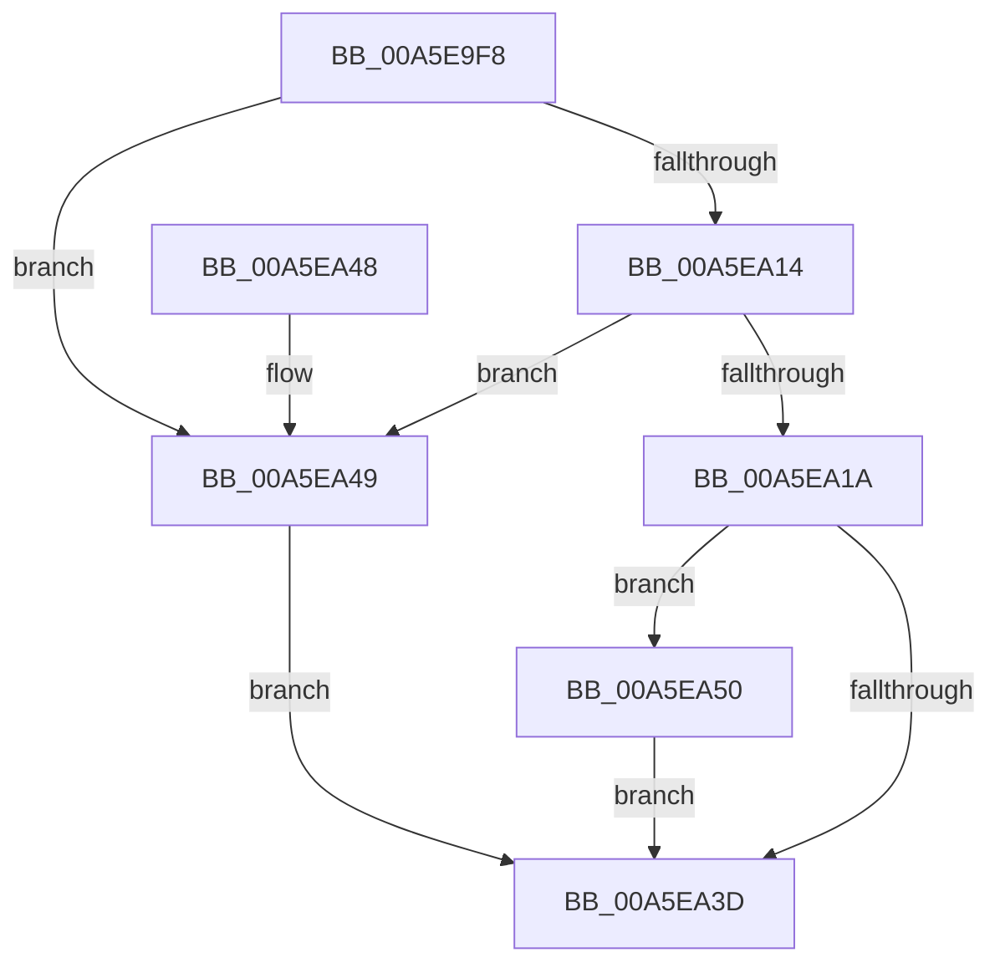

# CmpQueryDowncastString

- RVA: `0x00A5E9F8`–`0x00A5EA55` (길이 `93` bytes)
- VA: `0x0000000140A5E9F8`
- 실행 섹션: `PAGE`
- PDB 이름 있음: `예`; PDB Function 태그: `아니요`
- unwind 정보 RVA: `0x0009EE40`
- 디코드: `30`개 명령, `93/93` bytes 표시
- 미해석 바이트: `0` (있으면 어셈블리에 `.byte`로 보존)

> 이 문서는 커널 이미지의 기계어와 PDB 기호를 분석해 생성했습니다. 4번과 5번은 함수 원형과 자료형을 바이너리 사용 방식에서 추정한 C 해석이며 원본 소스 복구 결과는 아닙니다.

## 1. Dependencies

- 직접 호출 지점: **1**; 고유 호출 대상: **1**
- 직접 호출자로 확인된 함수: **1**
- RIP 상대 이미지 참조: **0**

### Outgoing calls
- `0x00A5EA34` → [RtlUnicodeStringToAnsiString](../90/RtlUnicodeStringToAnsiString_function_0090D1F0.md) (function, `0x0090D1F0`)

### Direct callers
- [CmQueryBuildVersionInformation](CmQueryBuildVersionInformation_function_00A5E884.md) at `0x00A5E93E`
- [CmQueryBuildVersionInformation](CmQueryBuildVersionInformation_function_00A5E884.md) at `0x00A5E950`
- [CmQueryBuildVersionInformation](CmQueryBuildVersionInformation_function_00A5E884.md) at `0x00A5E962`
- [CmQueryBuildVersionInformation](CmQueryBuildVersionInformation_function_00A5E884.md) at `0x00A5E974`
- [CmQueryBuildVersionInformation](CmQueryBuildVersionInformation_function_00A5E884.md) at `0x00A5E987`
- [CmQueryBuildVersionInformation](CmQueryBuildVersionInformation_function_00A5E884.md) at `0x00A5E99A`

### Static image references
- 디코드된 RIP-relative 메모리 참조가 없습니다.

## 2. Other-region calls and transfers

- 다른 실행 섹션으로 향하는 call: **0**
- 별도 외부 분기/꼬리 이동을 확인하지 못했습니다.

## 3. Assembly (complete function range)

```asm
00A5E9F8  48 89 5C 24 08                  mov qword ptr [rsp + 8], rbx
00A5E9FD  57                              push rdi
00A5E9FE  48 83 EC 30                     sub rsp, 0x30
00A5EA02  33 FF                           xor edi, edi
00A5EA04  49 8B C0                        mov rax, r8
00A5EA07  48 8B D9                        mov rbx, rcx
00A5EA0A  89 7C 24 24                     mov dword ptr [rsp + 0x24], edi
00A5EA0E  49 39 78 08                     cmp qword ptr [r8 + 8], rdi
00A5EA12  74 35                           je 0x140a5ea49
00A5EA14  66 41 39 38                     cmp word ptr [r8], di
00A5EA18  74 2F                           je 0x140a5ea49
00A5EA1A  48 89 4C 24 28                  mov qword ptr [rsp + 0x28], rcx
00A5EA1F  45 33 C0                        xor r8d, r8d
00A5EA22  66 89 54 24 22                  mov word ptr [rsp + 0x22], dx
00A5EA27  48 8D 4C 24 20                  lea rcx, [rsp + 0x20]
00A5EA2C  48 8B D0                        mov rdx, rax
00A5EA2F  66 89 7C 24 20                  mov word ptr [rsp + 0x20], di
00A5EA34  E8 B7 E7 EA FF                  call 0x14090d1f0
00A5EA39  85 C0                           test eax, eax
00A5EA3B  78 13                           js 0x140a5ea50
00A5EA3D  48 8B 5C 24 40                  mov rbx, qword ptr [rsp + 0x40]
00A5EA42  48 83 C4 30                     add rsp, 0x30
00A5EA46  5F                              pop rdi
00A5EA47  C3                              ret
00A5EA48  CC                              int3
00A5EA49  40 88 39                        mov byte ptr [rcx], dil
00A5EA4C  33 C0                           xor eax, eax
00A5EA4E  EB ED                           jmp 0x140a5ea3d
00A5EA50  40 88 3B                        mov byte ptr [rbx], dil
00A5EA53  EB E8                           jmp 0x140a5ea3d
```

## 4. C-style interpretation (structured pseudocode)

```c
__int64 __fastcall CmpQueryDowncastString(__int64 a1, unsigned __int16 a2, __int64 a3)
{
    __int64 result;
    __int64 v_rdi;
    __int64 v_rsp;
    unsigned __int64 v_stack_m10;
    unsigned int v_stack_m14;
    unsigned __int16 v_stack_m16;
    unsigned __int64 v_stack_m18;
    unsigned __int64 v_stack_p8;

    v_stack_p8 = v_rbx;
    v_rsp = (v_rsp) - (48);
    v_rdi = 0;
    v_stack_m14 = 0;
    if ((*(unsigned __int64 *)(a3 + 8)) == 0) goto loc_00A5EA49;
    if ((*(unsigned __int16 *)(a3)) == 0) goto loc_00A5EA49;
    v_stack_m10 = a1;
    a3 = 0;
    v_stack_m16 = a2;
    v_stack_m18 = 0;
    result = RtlUnicodeStringToAnsiString(v_stack_m18, 0, a3, a4);
    if (sign_flag) goto loc_00A5EA50;
loc_00A5EA3D:
    v_rsp = (v_rsp) + (48);
    return result;
loc_00A5EA49:
    *(unsigned __int8 *)(v_stack_m18) = 0;
    result = 0;
    goto loc_00A5EA3D;
loc_00A5EA50:
    *(unsigned __int8 *)(v_stack_p8) = 0;
    goto loc_00A5EA3D;
}
```

## 5. (Beta) C Style

```c
int64_t CmpQueryDowncastString(void *Arg1, uint16_t Arg2, void *Arg3)
{
    uint8_t *arg1 = (uint8_t *)Arg1;
    uint8_t *arg3 = (uint8_t *)Arg3;

    int64_t result;
    int64_t local_rdi;
    int64_t local_rsp;
    uint64_t v_stack_m10;
    uint32_t v_stack_m14;
    uint16_t v_stack_m16;
    uint64_t v_stack_m18;
    uint64_t v_stack_p8;

    v_stack_p8 = local_rbx;
    local_rsp = (local_rsp) - (48);
    local_rdi = 0;
    v_stack_m14 = 0;
    if ((*(uint64_t *)(arg3 + 0x8)) == 0) goto loc_00A5EA49;
    if ((*(uint16_t *)(arg3)) == 0) goto loc_00A5EA49;
    v_stack_m10 = Arg1;
    Arg3 = 0;
    v_stack_m16 = Arg2;
    v_stack_m18 = 0;
    result = RtlUnicodeStringToAnsiString(v_stack_m18, 0, Arg3, a4);
    if (sign_flag) goto loc_00A5EA50;
loc_00A5EA3D:
    local_rsp = (local_rsp) + (48);
    return result;
loc_00A5EA49:
    *(uint8_t *)(v_stack_m18) = 0;
    result = 0;
    goto loc_00A5EA3D;
loc_00A5EA50:
    *(uint8_t *)(v_stack_p8) = 0;
    goto loc_00A5EA3D;
}
```

### 관측된 메모리 오프셋

구조체 형식이 확인되지 않은 접근은 인자 기준의 오프셋으로만 기록했습니다.

| 기준 인자 | 오프셋 표현 | 폭 (bit) | 접근 |
|---|---:|---:|---|
| `Arg1` | `+ 0x0` | `8` | `W` |
| `Arg3` | `+ 0x0` | `16` | `R` |
| `Arg3` | `+ 0x8` | `64` | `R` |

## 6. Execution-region graph

[열기: 2D/3D 그래프와 함수 탐색 컨트롤 패널](../../../control-panel.html?section=page&rva=0x00A5E9F8&view=graph)

- 2D 그래프는 위에서 아래로 흐르고, 3D 그래프는 빈 공간을 드래그해 회전합니다. Shift+드래그는 이동, 휠은 확대·축소, 함수 노드 선택은 대상 보고서 이동입니다.

### Static fallback


