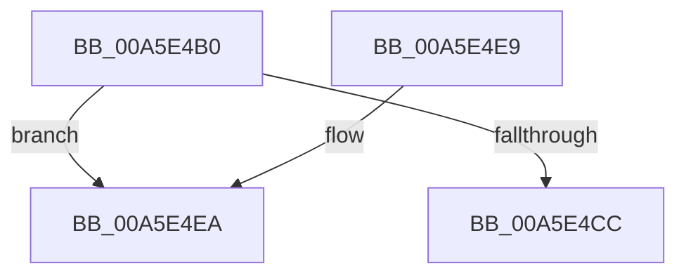

# CmpUnblockHiveWrites

- RVA: `0x00A5E4B0`–`0x00A5E4EF` (길이 `63` bytes)
- VA: `0x0000000140A5E4B0`
- 실행 섹션: `PAGE`
- PDB 이름 있음: `예`; PDB Function 태그: `예`
- unwind 정보 RVA: `0x00095A44`
- 디코드: `19`개 명령, `63/63` bytes 표시
- 미해석 바이트: `0` (있으면 어셈블리에 `.byte`로 보존)

> 이 문서는 커널 이미지의 기계어와 PDB 기호를 분석해 생성했습니다. 4번과 5번은 함수 원형과 자료형을 바이너리 사용 방식에서 추정한 C 해석이며 원본 소스 복구 결과는 아닙니다.

## 1. Dependencies

- 직접 호출 지점: **2**; 고유 호출 대상: **2**
- 직접 호출자로 확인된 함수: **3**
- RIP 상대 이미지 참조: **0**

### Outgoing calls
- `0x00A5E4CC` → [HvUnlockHiveFlusherExclusive](../../pagecmrc/BC/HvUnlockHiveFlusherExclusive_function_00BC9C34.md) (function, `0x00BC9C34`)
- `0x00A5E4D4` → [CmpDereferenceHive](../86/CmpDereferenceHive_function_008632B0.md) (function, `0x008632B0`)

### Direct callers
- [CmpVEExecuteVirtualStoreParseLogic](../A7/CmpVEExecuteVirtualStoreParseLogic_function_00A76A20.md) at `0x00A76BD2`
- [sub_00B169F2](../B1/Unknown_function_00B169F2.md) at `0x00B16ABF`
- [sub_00B169F2](../B1/Unknown_function_00B169F2.md) at `0x00B16BDC`
- [sub_00B4160E](../B4/Unknown_function_00B4160E.md) at `0x00B4165A`

### Static image references
- 디코드된 RIP-relative 메모리 참조가 없습니다.

## 2. Other-region calls and transfers

- 다른 실행 섹션으로 향하는 call: **1**
  - `0x00A5E4CC` → [HvUnlockHiveFlusherExclusive](../../pagecmrc/BC/HvUnlockHiveFlusherExclusive_function_00BC9C34.md) (`PAGE` → `PAGECMRC`)
- call이 아닌 외부 분기/꼬리 이동: **1**
  - `0x00A5E4EA` → [sub_00B3DFC6](../B3/Unknown_function_00B3DFC6.md) (`tail-transfer`)

## 3. Assembly (complete function range)

```asm
00A5E4B0  48 89 5C 24 08                  mov qword ptr [rsp + 8], rbx
00A5E4B5  48 89 74 24 10                  mov qword ptr [rsp + 0x10], rsi
00A5E4BA  57                              push rdi
00A5E4BB  48 83 EC 20                     sub rsp, 0x20
00A5E4BF  49 8B F0                        mov rsi, r8
00A5E4C2  8B FA                           mov edi, edx
00A5E4C4  48 8B D9                        mov rbx, rcx
00A5E4C7  48 85 C9                        test rcx, rcx
00A5E4CA  74 1E                           je 0x140a5e4ea
00A5E4CC  E8 63 B7 16 00                  call 0x140bc9c34
00A5E4D1  48 8B CB                        mov rcx, rbx
00A5E4D4  E8 D7 4D E0 FF                  call 0x1408632b0
00A5E4D9  48 8B 5C 24 30                  mov rbx, qword ptr [rsp + 0x30]
00A5E4DE  48 8B 74 24 38                  mov rsi, qword ptr [rsp + 0x38]
00A5E4E3  48 83 C4 20                     add rsp, 0x20
00A5E4E7  5F                              pop rdi
00A5E4E8  C3                              ret
00A5E4E9  CC                              int3
00A5E4EA  E9 D7 FA 0D 00                  jmp 0x140b3dfc6
```

## 4. C-style interpretation (structured pseudocode)

```c
__int64 __fastcall CmpUnblockHiveWrites(__int64 a1, int a2, __int64 a3)
{
    __int64 result;
    __int64 v_rsp;
    unsigned __int64 v_stack_p10;
    unsigned __int64 v_stack_p8;

    v_stack_p8 = v_rbx;
    v_stack_p10 = v_rsi;
    v_rsp = (v_rsp) - (32);
    if (a1 == 0) goto loc_00A5E4EA;
    result = HvUnlockHiveFlusherExclusive(a1, a2, a3, a4);
    result = CmpDereferenceHive(a1, a2, a3, a4);
    v_rsp = (v_rsp) + (32);
    return result;
loc_00A5E4EA:
}
```

## 5. (Beta) C Style

```c
int64_t CmpUnblockHiveWrites(int64_t Arg1, int32_t Arg2, int64_t Arg3)
{
    int64_t result;
    int64_t local_rsp;
    uint64_t v_stack_p10;
    uint64_t v_stack_p8;

    v_stack_p8 = local_rbx;
    v_stack_p10 = local_rsi;
    local_rsp = (local_rsp) - (32);
    if (Arg1 == 0) goto loc_00A5E4EA;
    result = HvUnlockHiveFlusherExclusive(Arg1, Arg2, Arg3, a4);
    result = CmpDereferenceHive(Arg1, Arg2, Arg3, a4);
    local_rsp = (local_rsp) + (32);
    return result;
loc_00A5E4EA:
}
```

## 6. Execution-region graph

[열기: 2D/3D 그래프와 함수 탐색 컨트롤 패널](../../../control-panel.html?section=page&rva=0x00A5E4B0&view=graph)

- 2D 그래프는 위에서 아래로 흐르고, 3D 그래프는 빈 공간을 드래그해 회전합니다. Shift+드래그는 이동, 휠은 확대·축소, 함수 노드 선택은 대상 보고서 이동입니다.

### Static fallback


