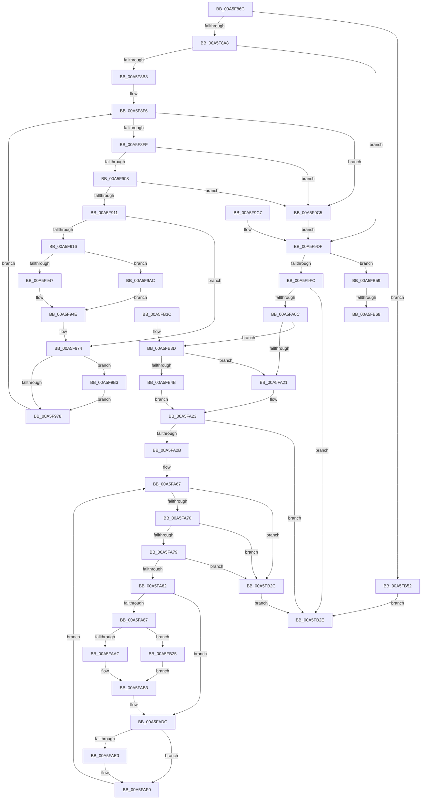

# DbgkpPostModuleMessages

- RVA: `0x00A5F86C`–`0x00A5FB75` (길이 `777` bytes)
- VA: `0x0000000140A5F86C`
- 실행 섹션: `PAGE`
- PDB 이름 있음: `예`; PDB Function 태그: `예`
- unwind 정보 RVA: `0x000B2D6C`
- 디코드: `203`개 명령, `777/777` bytes 표시
- 미해석 바이트: `0` (있으면 어셈블리에 `.byte`로 보존)

> 이 문서는 커널 이미지의 기계어와 PDB 기호를 분석해 생성했습니다. 4번과 5번은 함수 원형과 자료형을 바이너리 사용 방식에서 추정한 C 해석이며 원본 소스 복구 결과는 아닙니다.

## 1. Dependencies

- 직접 호출 지점: **6**; 고유 호출 대상: **4**
- 직접 호출자로 확인된 함수: **2**
- RIP 상대 이미지 참조: **0**

### Outgoing calls
- `0x00A5F93D` → [RtlImageNtHeader](../../text/44/RtlImageNtHeader_function_00443B60.md) (function, `0x00443B60`)
- `0x00A5F962` → [DbgkPostModuleMessage](../../text/49/DbgkPostModuleMessage_function_004913C4.md) (function, `0x004913C4`)
- `0x00A5F9EF` → [PsGetProcessEnclaveModuleInfo](../../text/4C/PsGetProcessEnclaveModuleInfo_function_004CA2E0.md) (function, `0x004CA2E0`)
- `0x00A5FAA2` → [RtlImageNtHeader](../../text/44/RtlImageNtHeader_function_00443B60.md) (function, `0x00443B60`)
- `0x00A5FAC7` → [DbgkPostModuleMessage](../../text/49/DbgkPostModuleMessage_function_004913C4.md) (function, `0x004913C4`)
- `0x00A5FB52` → [VslSendDebugAttachNotifications](../71/VslSendDebugAttachNotifications_function_00719680.md) (function, `0x00719680`)

### Direct callers
- [DbgkCreateThread](../8D/DbgkCreateThread_function_008D5E34.md) at `0x008D616C`
- [DbgkpPostFakeProcessCreateMessages](../A1/DbgkpPostFakeProcessCreateMessages_function_00A10780.md) at `0x00A107F7`

### Static image references
- 디코드된 RIP-relative 메모리 참조가 없습니다.

## 2. Other-region calls and transfers

- 다른 실행 섹션으로 향하는 call: **5**
  - `0x00A5F93D` → [RtlImageNtHeader](../../text/44/RtlImageNtHeader_function_00443B60.md) (`PAGE` → `.text`)
  - `0x00A5F962` → [DbgkPostModuleMessage](../../text/49/DbgkPostModuleMessage_function_004913C4.md) (`PAGE` → `.text`)
  - `0x00A5F9EF` → [PsGetProcessEnclaveModuleInfo](../../text/4C/PsGetProcessEnclaveModuleInfo_function_004CA2E0.md) (`PAGE` → `.text`)
  - `0x00A5FAA2` → [RtlImageNtHeader](../../text/44/RtlImageNtHeader_function_00443B60.md) (`PAGE` → `.text`)
  - `0x00A5FAC7` → [DbgkPostModuleMessage](../../text/49/DbgkPostModuleMessage_function_004913C4.md) (`PAGE` → `.text`)
- call이 아닌 외부 분기/꼬리 이동: **2**
  - `0x00A5FB62` → [sub_00B3E1FA + 0x22](../B3/Unknown_function_00B3E1FA.md) (`tail-transfer`)
  - `0x00A5FB70` → [sub_00B3E1FA](../B3/Unknown_function_00B3E1FA.md) (`tail-transfer`)

## 3. Assembly (complete function range)

```asm
00A5F86C  4C 8B DC                        mov r11, rsp
00A5F86F  4D 89 43 18                     mov qword ptr [r11 + 0x18], r8
00A5F873  49 89 53 10                     mov qword ptr [r11 + 0x10], rdx
00A5F877  49 89 4B 08                     mov qword ptr [r11 + 8], rcx
00A5F87B  53                              push rbx
00A5F87C  56                              push rsi
00A5F87D  57                              push rdi
00A5F87E  41 54                           push r12
00A5F880  41 56                           push r14
00A5F882  41 57                           push r15
00A5F884  48 83 EC 78                     sub rsp, 0x78
00A5F888  4D 8B F0                        mov r14, r8
00A5F88B  4C 8B FA                        mov r15, rdx
00A5F88E  48 8B D9                        mov rbx, rcx
00A5F891  49 83 63 A0 00                  and qword ptr [r11 - 0x60], 0
00A5F896  41 83 63 20 00                  and dword ptr [r11 + 0x20], 0
00A5F89B  F6 81 70 01 00 00 01            test byte ptr [rcx + 0x170], 1
00A5F8A2  0F 85 AA 02 00 00               jne 0x140a5fb52
00A5F8A8  48 8B 81 E0 02 00 00            mov rax, qword ptr [rcx + 0x2e0]
00A5F8AF  48 85 C0                        test rax, rax
00A5F8B2  0F 84 27 01 00 00               je 0x140a5f9df
00A5F8B8  48 8B 40 18                     mov rax, qword ptr [rax + 0x18]
00A5F8BC  48 83 C0 10                     add rax, 0x10
00A5F8C0  49 89 43 A8                     mov qword ptr [r11 - 0x58], rax
00A5F8C4  48 BF 00 00 FF FF FF 7F 00 00   movabs rdi, 0x7fffffff0000
00A5F8CE  48 3B C7                        cmp rax, rdi
00A5F8D1  48 0F 43 C7                     cmovae rax, rdi
00A5F8D5  90                              nop
00A5F8D6  8A 00                           mov al, byte ptr [rax]
00A5F8D8  4D 8B 43 A8                     mov r8, qword ptr [r11 - 0x58]
00A5F8DC  49 8B 08                        mov rcx, qword ptr [r8]
00A5F8DF  49 89 4B 98                     mov qword ptr [r11 - 0x68], rcx
00A5F8E3  4D 8B C8                        mov r9, r8
00A5F8E6  4D 89 43 B0                     mov qword ptr [r11 - 0x50], r8
00A5F8EA  33 C0                           xor eax, eax
00A5F8EC  89 44 24 30                     mov dword ptr [rsp + 0x30], eax
00A5F8F0  33 D2                           xor edx, edx
00A5F8F2  89 54 24 34                     mov dword ptr [rsp + 0x34], edx
00A5F8F6  49 3B C8                        cmp rcx, r8
00A5F8F9  0F 84 C6 00 00 00               je 0x140a5f9c5
00A5F8FF  49 3B C9                        cmp rcx, r9
00A5F902  0F 84 BD 00 00 00               je 0x140a5f9c5
00A5F908  83 F8 FF                        cmp eax, -1
00A5F90B  0F 84 B4 00 00 00               je 0x140a5f9c5
00A5F911  83 F8 01                        cmp eax, 1
00A5F914  76 5E                           jbe 0x140a5f974
00A5F916  48 3B CF                        cmp rcx, rdi
00A5F919  48 0F 43 CF                     cmovae rcx, rdi
00A5F91D  90                              nop
00A5F91E  8A 01                           mov al, byte ptr [rcx]
00A5F920  48 8B 44 24 40                  mov rax, qword ptr [rsp + 0x40]
00A5F925  48 8B 40 30                     mov rax, qword ptr [rax + 0x30]
00A5F929  48 89 44 24 38                  mov qword ptr [rsp + 0x38], rax
00A5F92E  48 3B C7                        cmp rax, rdi
00A5F931  48 0F 43 C7                     cmovae rax, rdi
00A5F935  90                              nop
00A5F936  8A 00                           mov al, byte ptr [rax]
00A5F938  48 8B 4C 24 38                  mov rcx, qword ptr [rsp + 0x38]
00A5F93D  E8 1E 42 9E FF                  call 0x140443b60
00A5F942  48 85 C0                        test rax, rax
00A5F945  74 65                           je 0x140a5f9ac
00A5F947  44 8B 48 0C                     mov r9d, dword ptr [rax + 0xc]
00A5F94B  8B 40 10                        mov eax, dword ptr [rax + 0x10]
00A5F94E  4C 89 74 24 28                  mov qword ptr [rsp + 0x28], r14
00A5F953  89 44 24 20                     mov dword ptr [rsp + 0x20], eax
00A5F957  4C 8B 44 24 38                  mov r8, qword ptr [rsp + 0x38]
00A5F95C  49 8B D7                        mov rdx, r15
00A5F95F  48 8B CB                        mov rcx, rbx
00A5F962  E8 5D 1A A3 FF                  call 0x1404913c4
00A5F967  48 8B 4C 24 40                  mov rcx, qword ptr [rsp + 0x40]
00A5F96C  8B 44 24 30                     mov eax, dword ptr [rsp + 0x30]
00A5F970  8B 54 24 34                     mov edx, dword ptr [rsp + 0x34]
00A5F974  3B C2                           cmp eax, edx
00A5F976  74 3B                           je 0x140a5f9b3
00A5F978  48 3B CF                        cmp rcx, rdi
00A5F97B  48 0F 43 CF                     cmovae rcx, rdi
00A5F97F  90                              nop
00A5F980  8A 01                           mov al, byte ptr [rcx]
00A5F982  48 8B 44 24 40                  mov rax, qword ptr [rsp + 0x40]
00A5F987  48 8B 08                        mov rcx, qword ptr [rax]
00A5F98A  48 89 4C 24 40                  mov qword ptr [rsp + 0x40], rcx
00A5F98F  8B 44 24 30                     mov eax, dword ptr [rsp + 0x30]
00A5F993  FF C0                           inc eax
00A5F995  89 44 24 30                     mov dword ptr [rsp + 0x30], eax
00A5F999  4C 8B 44 24 50                  mov r8, qword ptr [rsp + 0x50]
00A5F99E  4C 8B 4C 24 58                  mov r9, qword ptr [rsp + 0x58]
00A5F9A3  8B 54 24 34                     mov edx, dword ptr [rsp + 0x34]
00A5F9A7  E9 4A FF FF FF                  jmp 0x140a5f8f6
00A5F9AC  45 33 C9                        xor r9d, r9d
00A5F9AF  33 C0                           xor eax, eax
00A5F9B1  EB 9B                           jmp 0x140a5f94e
00A5F9B3  48 89 4C 24 58                  mov qword ptr [rsp + 0x58], rcx
00A5F9B8  8D 04 55 02 00 00 00            lea eax, [rdx*2 + 2]
00A5F9BF  89 44 24 34                     mov dword ptr [rsp + 0x34], eax
00A5F9C3  EB B3                           jmp 0x140a5f978
00A5F9C5  EB 18                           jmp 0x140a5f9df
00A5F9C7  4C 8B B4 24 C0 00 00 00         mov r14, qword ptr [rsp + 0xc0]
00A5F9CF  4C 8B BC 24 B8 00 00 00         mov r15, qword ptr [rsp + 0xb8]
00A5F9D7  48 8B 9C 24 B0 00 00 00         mov rbx, qword ptr [rsp + 0xb0]
00A5F9DF  4C 8D 84 24 C8 00 00 00         lea r8, [rsp + 0xc8]
00A5F9E7  48 8D 54 24 48                  lea rdx, [rsp + 0x48]
00A5F9EC  48 8B CB                        mov rcx, rbx
00A5F9EF  E8 EC A8 A6 FF                  call 0x1404ca2e0
00A5F9F4  85 C0                           test eax, eax
00A5F9F6  0F 89 5D 01 00 00               jns 0x140a5fb59
00A5F9FC  48 8B 8B 10 03 00 00            mov rcx, qword ptr [rbx + 0x310]
00A5FA03  48 85 C9                        test rcx, rcx
00A5FA06  0F 84 22 01 00 00               je 0x140a5fb2e
00A5FA0C  0F B7 83 EC 06 00 00            movzx eax, word ptr [rbx + 0x6ec]
00A5FA13  BA 4C 01 00 00                  mov edx, 0x14c
00A5FA18  66 3B C2                        cmp ax, dx
00A5FA1B  0F 85 1C 01 00 00               jne 0x140a5fb3d
00A5FA21  B0 01                           mov al, 1
00A5FA23  84 C0                           test al, al
00A5FA25  0F 84 03 01 00 00               je 0x140a5fb2e
00A5FA2B  48 8B 01                        mov rax, qword ptr [rcx]
00A5FA2E  8B 40 0C                        mov eax, dword ptr [rax + 0xc]
00A5FA31  48 83 C0 0C                     add rax, 0xc
00A5FA35  48 89 84 24 C8 00 00 00         mov qword ptr [rsp + 0xc8], rax
00A5FA3D  90                              nop
00A5FA3E  8A 00                           mov al, byte ptr [rax]
00A5FA40  4C 8B 84 24 C8 00 00 00         mov r8, qword ptr [rsp + 0xc8]
00A5FA48  41 8B 08                        mov ecx, dword ptr [r8]
00A5FA4B  48 89 8C 24 B0 00 00 00         mov qword ptr [rsp + 0xb0], rcx
00A5FA53  4D 8B C8                        mov r9, r8
00A5FA56  4C 89 44 24 60                  mov qword ptr [rsp + 0x60], r8
00A5FA5B  33 C0                           xor eax, eax
00A5FA5D  89 44 24 30                     mov dword ptr [rsp + 0x30], eax
00A5FA61  33 D2                           xor edx, edx
00A5FA63  89 54 24 34                     mov dword ptr [rsp + 0x34], edx
00A5FA67  49 3B C8                        cmp rcx, r8
00A5FA6A  0F 84 BC 00 00 00               je 0x140a5fb2c
00A5FA70  49 3B C9                        cmp rcx, r9
00A5FA73  0F 84 B3 00 00 00               je 0x140a5fb2c
00A5FA79  83 F8 FF                        cmp eax, -1
00A5FA7C  0F 84 AA 00 00 00               je 0x140a5fb2c
00A5FA82  83 F8 01                        cmp eax, 1
00A5FA85  76 55                           jbe 0x140a5fadc
00A5FA87  90                              nop
00A5FA88  8A 01                           mov al, byte ptr [rcx]
00A5FA8A  48 8B 84 24 B0 00 00 00         mov rax, qword ptr [rsp + 0xb0]
00A5FA92  8B 40 18                        mov eax, dword ptr [rax + 0x18]
00A5FA95  48 89 44 24 38                  mov qword ptr [rsp + 0x38], rax
00A5FA9A  90                              nop
00A5FA9B  8A 00                           mov al, byte ptr [rax]
00A5FA9D  48 8B 4C 24 38                  mov rcx, qword ptr [rsp + 0x38]
00A5FAA2  E8 B9 40 9E FF                  call 0x140443b60
00A5FAA7  48 85 C0                        test rax, rax
00A5FAAA  74 79                           je 0x140a5fb25
00A5FAAC  44 8B 48 0C                     mov r9d, dword ptr [rax + 0xc]
00A5FAB0  8B 48 10                        mov ecx, dword ptr [rax + 0x10]
00A5FAB3  4C 89 74 24 28                  mov qword ptr [rsp + 0x28], r14
00A5FAB8  89 4C 24 20                     mov dword ptr [rsp + 0x20], ecx
00A5FABC  4C 8B 44 24 38                  mov r8, qword ptr [rsp + 0x38]
00A5FAC1  49 8B D7                        mov rdx, r15
00A5FAC4  48 8B CB                        mov rcx, rbx
00A5FAC7  E8 F8 18 A3 FF                  call 0x1404913c4
00A5FACC  8B 44 24 30                     mov eax, dword ptr [rsp + 0x30]
00A5FAD0  8B 54 24 34                     mov edx, dword ptr [rsp + 0x34]
00A5FAD4  48 8B 8C 24 B0 00 00 00         mov rcx, qword ptr [rsp + 0xb0]
00A5FADC  3B C2                           cmp eax, edx
00A5FADE  75 10                           jne 0x140a5faf0
00A5FAE0  48 89 4C 24 60                  mov qword ptr [rsp + 0x60], rcx
00A5FAE5  8D 04 55 02 00 00 00            lea eax, [rdx*2 + 2]
00A5FAEC  89 44 24 34                     mov dword ptr [rsp + 0x34], eax
00A5FAF0  90                              nop
00A5FAF1  8A 01                           mov al, byte ptr [rcx]
00A5FAF3  48 8B 84 24 B0 00 00 00         mov rax, qword ptr [rsp + 0xb0]
00A5FAFB  8B 08                           mov ecx, dword ptr [rax]
00A5FAFD  48 89 8C 24 B0 00 00 00         mov qword ptr [rsp + 0xb0], rcx
00A5FB05  8B 44 24 30                     mov eax, dword ptr [rsp + 0x30]
00A5FB09  FF C0                           inc eax
00A5FB0B  89 44 24 30                     mov dword ptr [rsp + 0x30], eax
00A5FB0F  8B 54 24 34                     mov edx, dword ptr [rsp + 0x34]
00A5FB13  4C 8B 84 24 C8 00 00 00         mov r8, qword ptr [rsp + 0xc8]
00A5FB1B  4C 8B 4C 24 60                  mov r9, qword ptr [rsp + 0x60]
00A5FB20  E9 42 FF FF FF                  jmp 0x140a5fa67
00A5FB25  45 33 C9                        xor r9d, r9d
00A5FB28  33 C9                           xor ecx, ecx
00A5FB2A  EB 87                           jmp 0x140a5fab3
00A5FB2C  EB 00                           jmp 0x140a5fb2e
00A5FB2E  48 83 C4 78                     add rsp, 0x78
00A5FB32  41 5F                           pop r15
00A5FB34  41 5E                           pop r14
00A5FB36  41 5C                           pop r12
00A5FB38  5F                              pop rdi
00A5FB39  5E                              pop rsi
00A5FB3A  5B                              pop rbx
00A5FB3B  C3                              ret
00A5FB3C  CC                              int3
00A5FB3D  BA C4 01 00 00                  mov edx, 0x1c4
00A5FB42  66 3B C2                        cmp ax, dx
00A5FB45  0F 84 D6 FE FF FF               je 0x140a5fa21
00A5FB4B  32 C0                           xor al, al
00A5FB4D  E9 D1 FE FF FF                  jmp 0x140a5fa23
00A5FB52  E8 29 9B CB FF                  call 0x140719680
00A5FB57  EB D5                           jmp 0x140a5fb2e
00A5FB59  8B BC 24 C8 00 00 00            mov edi, dword ptr [rsp + 0xc8]
00A5FB60  85 FF                           test edi, edi
00A5FB62  0F 84 B4 E6 0D 00               je 0x140b3e21c
00A5FB68  48 8B 74 24 48                  mov rsi, qword ptr [rsp + 0x48]
00A5FB6D  44 8B E7                        mov r12d, edi
00A5FB70  E9 85 E6 0D 00                  jmp 0x140b3e1fa
```

## 4. C-style interpretation (structured pseudocode)

```c
__int64 __fastcall DbgkpPostModuleMessages(__int64 a1, __int64 a2, __int64 a3)
{
    __int64 result;
    __int64 v_rsp;
    unsigned __int64 v_stack_m48;
    unsigned __int64 v_stack_m50;
    unsigned __int64 v_stack_m58;
    unsigned __int64 v_stack_m60;
    unsigned __int64 v_stack_m68;
    unsigned __int64 v_stack_m70;
    unsigned int v_stack_m74;
    unsigned int v_stack_m78;
    unsigned __int64 v_stack_m80;
    unsigned int v_stack_m88;
    unsigned __int64 v_stack_p10;
    unsigned __int64 v_stack_p18;
    unsigned __int64 v_stack_p20;
    unsigned __int64 v_stack_p48;
    unsigned __int64 v_stack_p8;
    unsigned int v_stack_pC8;

    *(unsigned __int64 *)(v_rsp + 24) = a3;
    *(unsigned __int64 *)(v_rsp + 16) = a2;
    *(unsigned __int64 *)(v_rsp + 8) = a1;
    v_rsp = (v_rsp) - (120);
    if (((*(unsigned __int8 *)(a1 + 368)) & (1)) != 0) goto loc_00A5FB52;
    if (*(unsigned __int64 *)(a1 + 736) == 0) goto loc_00A5F9DF;
    result = (*(unsigned __int64 *)(*(unsigned __int64 *)(a1 + 736) + 24)) + (16);
    *(unsigned __int64 *)(v_rsp - 88) = result;
    if (result >= v_rdi) { result = v_rdi; }
    *(unsigned __int64 *)(v_rsp - 104) = *(unsigned __int64 *)(*(unsigned __int64 *)(v_rsp - 88));
    *(unsigned __int64 *)(v_rsp - 80) = *(unsigned __int64 *)(v_rsp - 88);
    result = 0;
    v_stack_m78 = 0;
    a2 = 0;
    v_stack_m74 = 0;
loc_00A5F8F6:
    if ((*(unsigned __int64 *)(*(unsigned __int64 *)(v_rsp - 88))) == (*(unsigned __int64 *)(v_rsp - 88))) goto loc_00A5F9C5;
    if ((*(unsigned __int64 *)(*(unsigned __int64 *)(v_rsp - 88))) == (*(unsigned __int64 *)(v_rsp - 88))) goto loc_00A5F9C5;
    if (0 == -1) goto loc_00A5F9C5;
    if (0 <= 1) goto loc_00A5F974;
    a1 = *(unsigned __int64 *)(*(unsigned __int64 *)(v_rsp - 88));
    if ((*(unsigned __int64 *)(*(unsigned __int64 *)(v_rsp - 88))) >= v_rdi) { a1 = v_rdi; }
    v_stack_m70 = *(unsigned __int64 *)(v_stack_m68 + 48);
    result = *(unsigned __int64 *)(v_stack_m68 + 48);
    if ((*(unsigned __int64 *)(v_stack_m68 + 48)) >= v_rdi) { result = v_rdi; }
    result = RtlImageNtHeader(v_stack_m70, a2, *(unsigned __int64 *)(v_rsp - 88), *(unsigned __int64 *)(v_rsp - 88));
    if (result == 0) goto loc_00A5F9AC;
loc_00A5F94E:
    v_stack_m80 = a3;
    v_stack_m88 = (unsigned int)((unsigned int)(*(unsigned int *)(result + 16)));
    result = DbgkPostModuleMessage(a1, 0, v_stack_m70, (unsigned int)(*(unsigned int *)(result + 12)));
loc_00A5F974:
    if (((unsigned int)((unsigned int)(v_stack_m78))) == ((unsigned int)((unsigned int)(v_stack_m74)))) goto loc_00A5F9B3;
loc_00A5F978:
    a1 = v_stack_m68;
    if (v_stack_m68 >= v_rdi) { a1 = v_rdi; }
    v_stack_m68 = *(unsigned __int64 *)(v_stack_m68);
    result = (unsigned int)(((unsigned int)(v_stack_m78)) + 1);
    v_stack_m78 = (unsigned int)(result);
    goto loc_00A5F8F6;
loc_00A5F9AC:
    a4 = 0;
    result = 0;
    goto loc_00A5F94E;
loc_00A5F9B3:
    v_stack_m50 = *(unsigned __int64 *)(v_stack_m68);
    v_stack_m74 = (unsigned int)((unsigned int)(v_stack_m74) * 2 + 2);
    goto loc_00A5F978;
loc_00A5F9C5:
    goto loc_00A5F9DF;
loc_00A5F9DF:
    result = PsGetProcessEnclaveModuleInfo(a1, v_stack_m60, v_stack_p20, a4);
    if (!sign_flag) goto loc_00A5FB59;
    if (*(unsigned __int64 *)(a1 + 784) == 0) goto loc_00A5FB2E;
    if (((unsigned __int16)(*(unsigned __int16 *)(a1 + 1772))) != 332) goto loc_00A5FB3D;
loc_00A5FA21:
loc_00A5FA23:
    if (1 == 0) goto loc_00A5FB2E;
    result = ((unsigned int)(*(unsigned int *)(*(unsigned __int64 *)(*(unsigned __int64 *)(a1 + 784)) + 12))) + (12);
    v_stack_p20 = result;
    v_stack_p8 = (unsigned int)(*(unsigned int *)(v_stack_p20));
    v_stack_m48 = v_stack_p20;
    result = 0;
    v_stack_m78 = 0;
    a2 = 0;
    v_stack_m74 = 0;
loc_00A5FA67:
    if (((unsigned int)(*(unsigned int *)(v_stack_p20))) == v_stack_p20) goto loc_00A5FB2C;
    if (((unsigned int)(*(unsigned int *)(v_stack_p20))) == v_stack_p20) goto loc_00A5FB2C;
    if (0 == -1) goto loc_00A5FB2C;
    if (0 <= 1) goto loc_00A5FADC;
    v_stack_m70 = (unsigned int)(*(unsigned int *)(v_stack_p8 + 24));
    result = RtlImageNtHeader(v_stack_m70, a2, v_stack_p20, v_stack_p20);
    if (result == 0) goto loc_00A5FB25;
loc_00A5FAB3:
    v_stack_m80 = a3;
    v_stack_m88 = (unsigned int)((unsigned int)(*(unsigned int *)(result + 16)));
    result = DbgkPostModuleMessage(a1, 0, v_stack_m70, (unsigned int)(*(unsigned int *)(result + 12)));
loc_00A5FADC:
    result = (unsigned int)(v_stack_m78);
    if (((unsigned int)((unsigned int)(v_stack_m78))) == ((unsigned int)((unsigned int)(v_stack_m74)))) {
        v_stack_m48 = v_stack_p8;
        result = (unsigned int)(v_stack_m74) * 2 + 2;
        v_stack_m74 = (unsigned int)(result);
    }
    v_stack_p8 = (unsigned int)(*(unsigned int *)(v_stack_p8));
    result = (unsigned int)(((unsigned int)(v_stack_m78)) + 1);
    v_stack_m78 = (unsigned int)(result);
    goto loc_00A5FA67;
loc_00A5FB25:
    a4 = 0;
    a1 = 0;
    goto loc_00A5FAB3;
loc_00A5FB2C:
    goto loc_00A5FB2E;
loc_00A5FB2E:
    v_rsp = (v_rsp) + (120);
    return result;
loc_00A5FB3D:
    if (((unsigned __int16)(result)) == 452) goto loc_00A5FA21;
    result = 0;
    goto loc_00A5FA23;
loc_00A5FB52:
    result = VslSendDebugAttachNotifications(a1, 452, v_stack_p20, a4);
    goto loc_00A5FB2E;
loc_00A5FB59:
}
```

## 5. (Beta) C Style

```c
int64_t DbgkpPostModuleMessages(void *Arg1, int64_t Arg2, int64_t Arg3)
{
    uint8_t *arg1 = (uint8_t *)Arg1;

    int64_t result;
    int64_t local_rsp;
    uint64_t v_stack_m48;
    uint64_t v_stack_m50;
    uint64_t v_stack_m58;
    uint64_t v_stack_m60;
    uint64_t v_stack_m68;
    uint64_t v_stack_m70;
    uint32_t v_stack_m74;
    uint32_t v_stack_m78;
    uint64_t v_stack_m80;
    uint32_t v_stack_m88;
    uint64_t v_stack_p10;
    uint64_t v_stack_p18;
    uint64_t v_stack_p20;
    uint64_t v_stack_p48;
    uint64_t v_stack_p8;
    uint32_t v_stack_pC8;

    *(uint64_t *)(local_rsp + 0x18) = Arg3;
    *(uint64_t *)(local_rsp + 0x10) = Arg2;
    *(void **)(local_rsp + 0x8) = Arg1;
    local_rsp = (local_rsp) - (120);
    if (((*(uint8_t *)(arg1 + 0x170)) & (1)) != 0) goto loc_00A5FB52;
    if (*(uint64_t *)(arg1 + 0x2E0) == 0) goto loc_00A5F9DF;
    result = (*(uint64_t *)(*(uint64_t *)(arg1 + 0x2E0) + 0x18)) + (16);
    *(uint64_t *)(local_rsp - 0x58) = result;
    if (result >= local_rdi) { result = local_rdi; }
    *(uint64_t *)(local_rsp - 0x68) = *(uint64_t *)(*(uint64_t *)(local_rsp - 0x58));
    *(uint64_t *)(local_rsp - 0x50) = *(uint64_t *)(local_rsp - 0x58);
    result = 0;
    v_stack_m78 = 0;
    Arg2 = 0;
    v_stack_m74 = 0;
loc_00A5F8F6:
    if ((*(uint64_t *)(*(uint64_t *)(local_rsp - 0x58))) == (*(uint64_t *)(local_rsp - 0x58))) goto loc_00A5F9C5;
    if ((*(uint64_t *)(*(uint64_t *)(local_rsp - 0x58))) == (*(uint64_t *)(local_rsp - 0x58))) goto loc_00A5F9C5;
    if (0 == -1) goto loc_00A5F9C5;
    if (0 <= 1) goto loc_00A5F974;
    Arg1 = *(uint64_t *)(*(uint64_t *)(local_rsp - 0x58));
    if ((*(uint64_t *)(*(uint64_t *)(local_rsp - 0x58))) >= local_rdi) { Arg1 = local_rdi; }
    v_stack_m70 = *(uint64_t *)(v_stack_m68 + 0x30);
    result = *(uint64_t *)(v_stack_m68 + 0x30);
    if ((*(uint64_t *)(v_stack_m68 + 0x30)) >= local_rdi) { result = local_rdi; }
    result = RtlImageNtHeader(v_stack_m70, Arg2, *(uint64_t *)(local_rsp - 0x58), *(uint64_t *)(local_rsp - 0x58));
    if (result == 0) goto loc_00A5F9AC;
loc_00A5F94E:
    v_stack_m80 = Arg3;
    v_stack_m88 = (uint32_t)((uint32_t)(*(uint32_t *)(result + 0x10)));
    result = DbgkPostModuleMessage(Arg1, 0, v_stack_m70, (uint32_t)(*(uint32_t *)(result + 0xC)));
loc_00A5F974:
    if (((uint32_t)((uint32_t)(v_stack_m78))) == ((uint32_t)((uint32_t)(v_stack_m74)))) goto loc_00A5F9B3;
loc_00A5F978:
    Arg1 = v_stack_m68;
    if (v_stack_m68 >= local_rdi) { Arg1 = local_rdi; }
    v_stack_m68 = *(uint64_t *)(v_stack_m68);
    result = (uint32_t)(((uint32_t)(v_stack_m78)) + 1);
    v_stack_m78 = (uint32_t)(result);
    goto loc_00A5F8F6;
loc_00A5F9AC:
    a4 = 0;
    result = 0;
    goto loc_00A5F94E;
loc_00A5F9B3:
    v_stack_m50 = *(uint64_t *)(v_stack_m68);
    v_stack_m74 = (uint32_t)((uint32_t)(v_stack_m74) * 2 + 2);
    goto loc_00A5F978;
loc_00A5F9C5:
    goto loc_00A5F9DF;
loc_00A5F9DF:
    result = PsGetProcessEnclaveModuleInfo(Arg1, v_stack_m60, v_stack_p20, a4);
    if (!sign_flag) goto loc_00A5FB59;
    if (*(uint64_t *)(arg1 + 0x310) == 0) goto loc_00A5FB2E;
    if (((uint16_t)(*(uint16_t *)(arg1 + 0x6EC))) != 332) goto loc_00A5FB3D;
loc_00A5FA21:
loc_00A5FA23:
    if (1 == 0) goto loc_00A5FB2E;
    result = ((uint32_t)(*(uint32_t *)(*(uint64_t *)(*(uint64_t *)(arg1 + 0x310)) + 0xC))) + (12);
    v_stack_p20 = result;
    v_stack_p8 = (uint32_t)(*(uint32_t *)(v_stack_p20));
    v_stack_m48 = v_stack_p20;
    result = 0;
    v_stack_m78 = 0;
    Arg2 = 0;
    v_stack_m74 = 0;
loc_00A5FA67:
    if (((uint32_t)(*(uint32_t *)(v_stack_p20))) == v_stack_p20) goto loc_00A5FB2C;
    if (((uint32_t)(*(uint32_t *)(v_stack_p20))) == v_stack_p20) goto loc_00A5FB2C;
    if (0 == -1) goto loc_00A5FB2C;
    if (0 <= 1) goto loc_00A5FADC;
    v_stack_m70 = (uint32_t)(*(uint32_t *)(v_stack_p8 + 0x18));
    result = RtlImageNtHeader(v_stack_m70, Arg2, v_stack_p20, v_stack_p20);
    if (result == 0) goto loc_00A5FB25;
loc_00A5FAB3:
    v_stack_m80 = Arg3;
    v_stack_m88 = (uint32_t)((uint32_t)(*(uint32_t *)(result + 0x10)));
    result = DbgkPostModuleMessage(Arg1, 0, v_stack_m70, (uint32_t)(*(uint32_t *)(result + 0xC)));
loc_00A5FADC:
    result = (uint32_t)(v_stack_m78);
    if (((uint32_t)((uint32_t)(v_stack_m78))) == ((uint32_t)((uint32_t)(v_stack_m74)))) {
        v_stack_m48 = v_stack_p8;
        result = (uint32_t)(v_stack_m74) * 2 + 2;
        v_stack_m74 = (uint32_t)(result);
    }
    v_stack_p8 = (uint32_t)(*(uint32_t *)(v_stack_p8));
    result = (uint32_t)(((uint32_t)(v_stack_m78)) + 1);
    v_stack_m78 = (uint32_t)(result);
    goto loc_00A5FA67;
loc_00A5FB25:
    a4 = 0;
    Arg1 = 0;
    goto loc_00A5FAB3;
loc_00A5FB2C:
    goto loc_00A5FB2E;
loc_00A5FB2E:
    local_rsp = (local_rsp) + (120);
    return result;
loc_00A5FB3D:
    if (((uint16_t)(result)) == 452) goto loc_00A5FA21;
    result = 0;
    goto loc_00A5FA23;
loc_00A5FB52:
    result = VslSendDebugAttachNotifications(Arg1, 452, v_stack_p20, a4);
    goto loc_00A5FB2E;
loc_00A5FB59:
}
```

### 관측된 메모리 오프셋

구조체 형식이 확인되지 않은 접근은 인자 기준의 오프셋으로만 기록했습니다.

| 기준 인자 | 오프셋 표현 | 폭 (bit) | 접근 |
|---|---:|---:|---|
| `Arg1` | `+ 0x170` | `8` | `R` |
| `Arg1` | `+ 0x2E0` | `64` | `R` |
| `Arg1` | `+ 0x310` | `64` | `R` |
| `Arg1` | `+ 0x6EC` | `16` | `R` |

## 6. Execution-region graph

[열기: 2D/3D 그래프와 함수 탐색 컨트롤 패널](../../../control-panel.html?section=page&rva=0x00A5F86C&view=graph)

- 2D 그래프는 위에서 아래로 흐르고, 3D 그래프는 빈 공간을 드래그해 회전합니다. Shift+드래그는 이동, 휠은 확대·축소, 함수 노드 선택은 대상 보고서 이동입니다.

### Static fallback


