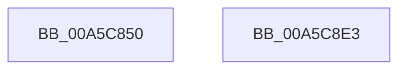

# EtwEnableTrace

- RVA: `0x00A5C850`–`0x00A5C8E4` (길이 `148` bytes)
- VA: `0x0000000140A5C850`
- 실행 섹션: `PAGE`
- PDB 이름 있음: `예`; PDB Function 태그: `아니요`
- unwind 정보 RVA: `0x0005FAF4`
- 디코드: `30`개 명령, `148/148` bytes 표시
- 미해석 바이트: `0` (있으면 어셈블리에 `.byte`로 보존)

> 이 문서는 커널 이미지의 기계어와 PDB 기호를 분석해 생성했습니다. 4번과 5번은 함수 원형과 자료형을 바이너리 사용 방식에서 추정한 C 해석이며 원본 소스 복구 결과는 아닙니다.

## 1. Dependencies

- 직접 호출 지점: **2**; 고유 호출 대상: **2**
- 직접 호출자로 확인된 함수: **2**
- RIP 상대 이미지 참조: **0**

### Outgoing calls
- `0x00A5C85A` → [PsGetCurrentServerSiloGlobals](../../text/2F/PsGetCurrentServerSiloGlobals_function_002FE1F0.md) (function, `0x002FE1F0`)
- `0x00A5C8D6` → [EtwpEnableTrace](EtwpEnableTrace_function_00A5C8EC.md) (function, `0x00A5C8EC`)

### Direct callers
- [EtwWmitraceWorker](../7B/EtwWmitraceWorker_function_007BBD3C.md) at `0x007BBE94`
- [WdipSemEnableDisableTrace](WdipSemEnableDisableTrace_function_00A5C7F8.md) at `0x00A5C831`

### Static image references
- 디코드된 RIP-relative 메모리 참조가 없습니다.

## 2. Other-region calls and transfers

- 다른 실행 섹션으로 향하는 call: **1**
  - `0x00A5C85A` → [PsGetCurrentServerSiloGlobals](../../text/2F/PsGetCurrentServerSiloGlobals_function_002FE1F0.md) (`PAGE` → `.text`)
- 별도 외부 분기/꼬리 이동을 확인하지 못했습니다.

## 3. Assembly (complete function range)

```asm
00A5C850  48 81 EC 98 00 00 00            sub rsp, 0x98
00A5C857  4C 8B D1                        mov r10, rcx
00A5C85A  E8 91 19 8A FF                  call 0x1402fe1f0
00A5C85F  48 8B 88 40 03 00 00            mov rcx, qword ptr [rax + 0x340]
00A5C866  33 C0                           xor eax, eax
00A5C868  48 89 84 24 88 00 00 00         mov qword ptr [rsp + 0x88], rax
00A5C870  89 84 24 80 00 00 00            mov dword ptr [rsp + 0x80], eax
00A5C877  48 89 44 24 78                  mov qword ptr [rsp + 0x78], rax
00A5C87C  89 44 24 70                     mov dword ptr [rsp + 0x70], eax
00A5C880  48 89 44 24 68                  mov qword ptr [rsp + 0x68], rax
00A5C885  89 44 24 60                     mov dword ptr [rsp + 0x60], eax
00A5C889  48 89 44 24 58                  mov qword ptr [rsp + 0x58], rax
00A5C88E  48 89 44 24 50                  mov qword ptr [rsp + 0x50], rax
00A5C893  48 89 44 24 48                  mov qword ptr [rsp + 0x48], rax
00A5C898  8B 84 24 D8 00 00 00            mov eax, dword ptr [rsp + 0xd8]
00A5C89F  89 44 24 40                     mov dword ptr [rsp + 0x40], eax
00A5C8A3  48 8B 84 24 D0 00 00 00         mov rax, qword ptr [rsp + 0xd0]
00A5C8AB  48 89 44 24 38                  mov qword ptr [rsp + 0x38], rax
00A5C8B0  48 8B 84 24 C8 00 00 00         mov rax, qword ptr [rsp + 0xc8]
00A5C8B8  48 89 44 24 30                  mov qword ptr [rsp + 0x30], rax
00A5C8BD  8A 84 24 C0 00 00 00            mov al, byte ptr [rsp + 0xc0]
00A5C8C4  88 44 24 28                     mov byte ptr [rsp + 0x28], al
00A5C8C8  44 89 4C 24 20                  mov dword ptr [rsp + 0x20], r9d
00A5C8CD  4D 8B C8                        mov r9, r8
00A5C8D0  4C 8B C2                        mov r8, rdx
00A5C8D3  49 8B D2                        mov rdx, r10
00A5C8D6  E8 11 00 00 00                  call 0x140a5c8ec
00A5C8DB  48 81 C4 98 00 00 00            add rsp, 0x98
00A5C8E2  C3                              ret
00A5C8E3  CC                              int3
```

## 4. C-style interpretation (structured pseudocode)

```c
__int64 __fastcall EtwEnableTrace(__int64 a1, __int64 a2, __int64 a3, int a4, unsigned __int8 a5, __int64 a6, __int64 a7, unsigned int a8)
{
    __int64 result;
    __int64 v_rsp;
    unsigned __int64 v_stack_m10;
    unsigned int v_stack_m18;
    unsigned __int64 v_stack_m20;
    unsigned int v_stack_m28;
    unsigned __int64 v_stack_m30;
    unsigned int v_stack_m38;
    unsigned __int64 v_stack_m40;
    unsigned __int64 v_stack_m48;
    unsigned __int64 v_stack_m50;
    unsigned int v_stack_m58;
    unsigned __int64 v_stack_m60;
    unsigned __int64 v_stack_m68;
    unsigned __int8 v_stack_m70;
    unsigned int v_stack_m78;

    v_rsp = (v_rsp) - (152);
    result = PsGetCurrentServerSiloGlobals(a1, a2, a3, a4);
    result = 0;
    v_stack_m10 = 0;
    v_stack_m18 = 0;
    v_stack_m20 = 0;
    v_stack_m28 = 0;
    v_stack_m30 = 0;
    v_stack_m38 = 0;
    v_stack_m40 = 0;
    v_stack_m48 = 0;
    v_stack_m50 = 0;
    v_stack_m58 = (unsigned int)((unsigned int)(a8));
    v_stack_m60 = a7;
    v_stack_m68 = a6;
    v_stack_m70 = a5;
    v_stack_m78 = a4;
    result = EtwpEnableTrace(*(unsigned __int64 *)(result + 832), a1, a2, a3);
    v_rsp = (v_rsp) + (152);
    return result;
}
```

## 5. (Beta) C Style

```c
int64_t EtwEnableTrace(int64_t Arg1, int64_t Arg2, int64_t Arg3, int32_t Arg4, uint8_t Arg5, int64_t Arg6, int64_t Arg7, uint32_t Arg8)
{
    int64_t result;
    int64_t local_rsp;
    uint64_t v_stack_m10;
    uint32_t v_stack_m18;
    uint64_t v_stack_m20;
    uint32_t v_stack_m28;
    uint64_t v_stack_m30;
    uint32_t v_stack_m38;
    uint64_t v_stack_m40;
    uint64_t v_stack_m48;
    uint64_t v_stack_m50;
    uint32_t v_stack_m58;
    uint64_t v_stack_m60;
    uint64_t v_stack_m68;
    uint8_t v_stack_m70;
    uint32_t v_stack_m78;

    local_rsp = (local_rsp) - (152);
    result = PsGetCurrentServerSiloGlobals(Arg1, Arg2, Arg3, Arg4);
    result = 0;
    v_stack_m10 = 0;
    v_stack_m18 = 0;
    v_stack_m20 = 0;
    v_stack_m28 = 0;
    v_stack_m30 = 0;
    v_stack_m38 = 0;
    v_stack_m40 = 0;
    v_stack_m48 = 0;
    v_stack_m50 = 0;
    v_stack_m58 = (uint32_t)((uint32_t)(Arg8));
    v_stack_m60 = Arg7;
    v_stack_m68 = Arg6;
    v_stack_m70 = Arg5;
    v_stack_m78 = Arg4;
    result = EtwpEnableTrace(*(uint64_t *)(result + 0x340), Arg1, Arg2, Arg3);
    local_rsp = (local_rsp) + (152);
    return result;
}
```

## 6. Execution-region graph

[열기: 2D/3D 그래프와 함수 탐색 컨트롤 패널](../../../control-panel.html?section=page&rva=0x00A5C850&view=graph)

- 2D 그래프는 위에서 아래로 흐르고, 3D 그래프는 빈 공간을 드래그해 회전합니다. Shift+드래그는 이동, 휠은 확대·축소, 함수 노드 선택은 대상 보고서 이동입니다.

### Static fallback


