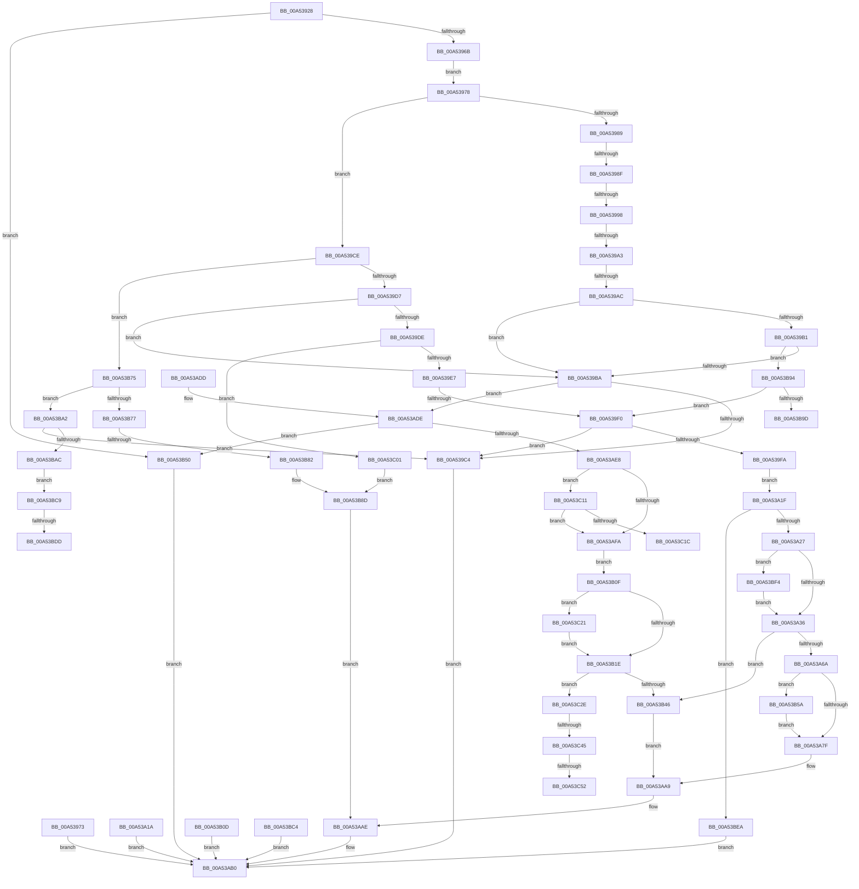

# EtwSetPerformanceTraceInformation

- RVA: `0x00A53928`–`0x00A53C66` (길이 `830` bytes)
- VA: `0x0000000140A53928`
- 실행 섹션: `PAGE`
- PDB 이름 있음: `예`; PDB Function 태그: `예`
- unwind 정보 RVA: `0x000B0EA4`
- 디코드: `201`개 명령, `830/830` bytes 표시
- 미해석 바이트: `0` (있으면 어셈블리에 `.byte`로 보존)

> 이 문서는 커널 이미지의 기계어와 PDB 기호를 분석해 생성했습니다. 4번과 5번은 함수 원형과 자료형을 바이너리 사용 방식에서 추정한 C 해석이며 원본 소스 복구 결과는 아닙니다.

## 1. Dependencies

- 직접 호출 지점: **14**; 고유 호출 대상: **12**
- 직접 호출자로 확인된 함수: **1**
- RIP 상대 이미지 참조: **1**

### Outgoing calls
- `0x00A53978` → [PsGetCurrentServerSiloGlobals](../../text/2F/PsGetCurrentServerSiloGlobals_function_002FE1F0.md) (function, `0x002FE1F0`)
- `0x00A53A59` → [EtwpAcquireLoggerContextByLoggerId](../93/EtwpAcquireLoggerContextByLoggerId_function_00932920.md) (function, `0x00932920`)
- `0x00A53A70` → [EtwpCheckLoggerControlAccess](../8C/EtwpCheckLoggerControlAccess_function_008C0AE0.md) (function, `0x008C0AE0`)
- `0x00A53A88` → [KeReleaseMutex](../../text/39/KeReleaseMutex_function_00396810.md) (function, `0x00396810`)
- `0x00A53AA4` → [ExReleaseRundownProtectionCacheAwareEx](../../text/25/ExReleaseRundownProtectionCacheAwareEx_function_0025F050.md) (function, `0x0025F050`)
- `0x00A53AA9` → [KeLeaveCriticalRegion](../../text/25/KeLeaveCriticalRegion_function_0025D8B0.md) (function, `0x0025D8B0`)
- `0x00A53ABB` → [_security_check_cookie](../../text/6A/_security_check_cookie_function_006AC640.md) (function, `0x006AC640`)
- `0x00A53AE8` → [PsIsCurrentThreadInServerSilo](../../text/43/PsIsCurrentThreadInServerSilo_function_004362E0.md) (function, `0x004362E0`)
- `0x00A53B35` → [EtwpAcquireLoggerContextByLoggerId](../93/EtwpAcquireLoggerContextByLoggerId_function_00932920.md) (function, `0x00932920`)
- `0x00A53B69` → [EtwpEnableStackCaching](EtwpEnableStackCaching_function_00A53C6C.md) (function, `0x00A53C6C`)
- `0x00A53B88` → [EtwpSetSoftRestartInformation](EtwpSetSoftRestartInformation_function_00A53DB8.md) (function, `0x00A53DB8`)
- `0x00A53C07` → [EtwpSetCoverageSamplerInformation](../7C/EtwpSetCoverageSamplerInformation_function_007C288C.md) (function, `0x007C288C`)
- `0x00A53C36` → [EtwpCheckLoggerControlAccess](../8C/EtwpCheckLoggerControlAccess_function_008C0AE0.md) (function, `0x008C0AE0`)
- `0x00A53C5B` → [EtwpUpdateStackTracing](../A6/EtwpUpdateStackTracing_function_00A6778C.md) (function, `0x00A6778C`)

### Direct callers
- [NtSetSystemInformation](../AF/NtSetSystemInformation_function_00AF4A60.md) at `0x00AF5124`

### Static image references
- `0x00A53942` → RVA `0x00E0A740` (`.data`; read)

## 2. Other-region calls and transfers

- 다른 실행 섹션으로 향하는 call: **6**
  - `0x00A53978` → [PsGetCurrentServerSiloGlobals](../../text/2F/PsGetCurrentServerSiloGlobals_function_002FE1F0.md) (`PAGE` → `.text`)
  - `0x00A53A88` → [KeReleaseMutex](../../text/39/KeReleaseMutex_function_00396810.md) (`PAGE` → `.text`)
  - `0x00A53AA4` → [ExReleaseRundownProtectionCacheAwareEx](../../text/25/ExReleaseRundownProtectionCacheAwareEx_function_0025F050.md) (`PAGE` → `.text`)
  - `0x00A53AA9` → [KeLeaveCriticalRegion](../../text/25/KeLeaveCriticalRegion_function_0025D8B0.md) (`PAGE` → `.text`)
  - `0x00A53ABB` → [_security_check_cookie](../../text/6A/_security_check_cookie_function_006AC640.md) (`PAGE` → `.text`)
  - `0x00A53AE8` → [PsIsCurrentThreadInServerSilo](../../text/43/PsIsCurrentThreadInServerSilo_function_004362E0.md) (`PAGE` → `.text`)
- call이 아닌 외부 분기/꼬리 이동: **13**
  - `0x00A53989` → [sub_00B3C988 + 0x489](../B3/Unknown_function_00B3C988.md) (`tail-transfer`)
  - `0x00A53992` → [sub_00B3C988](../B3/Unknown_function_00B3C988.md) (`tail-transfer`)
  - `0x00A5399D` → [sub_00B3C988 + 0x38C](../B3/Unknown_function_00B3C988.md) (`tail-transfer`)
  - `0x00A539A6` → [sub_00B3C988 + 0x2C5](../B3/Unknown_function_00B3C988.md) (`tail-transfer`)
  - `0x00A539EA` → [sub_00B3C988 + 0x9D8](../B3/Unknown_function_00B3C988.md) (`tail-transfer`)
  - `0x00A53B7C` → [sub_00B3C988 + 0x586](../B3/Unknown_function_00B3C988.md) (`tail-transfer`)
  - `0x00A53B9D` → [sub_00B3C988 + 0xA97](../B3/Unknown_function_00B3C988.md) (`tail-transfer`)
  - `0x00A53BD7` → [sub_00B3C988 + 0x984](../B3/Unknown_function_00B3C988.md) (`tail-transfer`)
  - `0x00A53BE5` → [sub_00B3C988 + 0x984](../B3/Unknown_function_00B3C988.md) (`tail-transfer`)
  - `0x00A53C1C` → [sub_00B3C988 + 0xAAB](../B3/Unknown_function_00B3C988.md) (`tail-transfer`)
  - `0x00A53C3F` → [sub_00B3C988 + 0xB09](../B3/Unknown_function_00B3C988.md) (`tail-transfer`)
  - `0x00A53C4C` → [sub_00B3C988 + 0xAB5](../B3/Unknown_function_00B3C988.md) (`tail-transfer`)
  - `0x00A53C61` → [sub_00B3C988 + 0xB07](../B3/Unknown_function_00B3C988.md) (`tail-transfer`)

## 3. Assembly (complete function range)

```asm
00A53928  48 89 5C 24 18                  mov qword ptr [rsp + 0x18], rbx
00A5392D  48 89 74 24 20                  mov qword ptr [rsp + 0x20], rsi
00A53932  57                              push rdi
00A53933  41 54                           push r12
00A53935  41 55                           push r13
00A53937  41 56                           push r14
00A53939  41 57                           push r15
00A5393B  48 81 EC D0 01 00 00            sub rsp, 0x1d0
00A53942  48 8B 05 F7 6D 3B 00            mov rax, qword ptr [rip + 0x3b6df7]
00A53949  48 33 C4                        xor rax, rsp
00A5394C  48 89 84 24 C0 01 00 00         mov qword ptr [rsp + 0x1c0], rax
00A53954  45 8A E0                        mov r12b, r8b
00A53957  44 8B F2                        mov r14d, edx
00A5395A  48 8B F9                        mov rdi, rcx
00A5395D  BA 04 00 00 00                  mov edx, 4
00A53962  44 3B F2                        cmp r14d, edx
00A53965  0F 82 E5 01 00 00               jb 0x140a53b50
00A5396B  8B 19                           mov ebx, dword ptr [rcx]
00A5396D  89 5C 24 44                     mov dword ptr [rsp + 0x44], ebx
00A53971  EB 05                           jmp 0x140a53978
00A53973  E9 38 01 00 00                  jmp 0x140a53ab0
00A53978  E8 73 A8 8A FF                  call 0x1402fe1f0
00A5397D  4C 8B B8 40 03 00 00            mov r15, qword ptr [rax + 0x340]
00A53984  83 FB 11                        cmp ebx, 0x11
00A53987  7F 45                           jg 0x140a539ce
00A53989  0F 84 82 94 0E 00               je 0x140b3ce11
00A5398F  83 FB 0A                        cmp ebx, 0xa
00A53992  0F 8E F0 8F 0E 00               jle 0x140b3c988
00A53998  8B CB                           mov ecx, ebx
00A5399A  83 E9 0B                        sub ecx, 0xb
00A5399D  0F 84 71 93 0E 00               je 0x140b3cd14
00A539A3  83 E9 01                        sub ecx, 1
00A539A6  0F 84 A1 92 0E 00               je 0x140b3cc4d
00A539AC  83 E9 02                        sub ecx, 2
00A539AF  74 09                           je 0x140a539ba
00A539B1  83 E9 01                        sub ecx, 1
00A539B4  0F 85 DA 01 00 00               jne 0x140a53b94
00A539BA  41 83 FE 10                     cmp r14d, 0x10
00A539BE  0F 83 1A 01 00 00               jae 0x140a53ade
00A539C4  B8 04 00 00 C0                  mov eax, 0xc0000004
00A539C9  E9 E2 00 00 00                  jmp 0x140a53ab0
00A539CE  83 FB 17                        cmp ebx, 0x17
00A539D1  0F 8E 9E 01 00 00               jle 0x140a53b75
00A539D7  8B CB                           mov ecx, ebx
00A539D9  83 E9 18                        sub ecx, 0x18
00A539DC  74 DC                           je 0x140a539ba
00A539DE  83 E9 01                        sub ecx, 1
00A539E1  0F 84 1A 02 00 00               je 0x140a53c01
00A539E7  83 E9 01                        sub ecx, 1
00A539EA  0F 85 70 99 0E 00               jne 0x140b3d360
00A539F0  B8 20 00 00 00                  mov eax, 0x20
00A539F5  44 3B F0                        cmp r14d, eax
00A539F8  75 CA                           jne 0x140a539c4
00A539FA  48 8B 4F 08                     mov rcx, qword ptr [rdi + 8]
00A539FE  48 89 4C 24 38                  mov qword ptr [rsp + 0x38], rcx
00A53A03  8B 47 14                        mov eax, dword ptr [rdi + 0x14]
00A53A06  89 44 24 54                     mov dword ptr [rsp + 0x54], eax
00A53A0A  8B 47 18                        mov eax, dword ptr [rdi + 0x18]
00A53A0D  89 44 24 50                     mov dword ptr [rsp + 0x50], eax
00A53A11  8A 47 10                        mov al, byte ptr [rdi + 0x10]
00A53A14  88 44 24 41                     mov byte ptr [rsp + 0x41], al
00A53A18  EB 05                           jmp 0x140a53a1f
00A53A1A  E9 91 00 00 00                  jmp 0x140a53ab0
00A53A1F  84 C0                           test al, al
00A53A21  0F 84 C3 01 00 00               je 0x140a53bea
00A53A27  0F B7 D1                        movzx edx, cx
00A53A2A  81 FA FF FF 00 00               cmp edx, 0xffff
00A53A30  0F 84 BE 01 00 00               je 0x140a53bf4
00A53A36  83 FB 1A                        cmp ebx, 0x1a
00A53A39  41 0F 94 C6                     sete r14b
00A53A3D  65 48 8B 04 25 88 01 00 00      mov rax, qword ptr gs:[0x188]
00A53A46  66 FF 88 E4 01 00 00            dec word ptr [rax + 0x1e4]
00A53A4D  90                              nop
00A53A4E  BE 01 00 00 00                  mov esi, 1
00A53A53  44 8A C6                        mov r8b, sil
00A53A56  49 8B CF                        mov rcx, r15
00A53A59  E8 C2 EE ED FF                  call 0x140932920
00A53A5E  48 8B F8                        mov rdi, rax
00A53A61  48 85 C0                        test rax, rax
00A53A64  0F 84 DC 00 00 00               je 0x140a53b46
00A53A6A  48 8B D0                        mov rdx, rax
00A53A6D  8D 4E 7F                        lea ecx, [rsi + 0x7f]
00A53A70  E8 6B D0 E6 FF                  call 0x1408c0ae0
00A53A75  8B D8                           mov ebx, eax
00A53A77  85 C0                           test eax, eax
00A53A79  0F 89 DB 00 00 00               jns 0x140a53b5a
00A53A7F  48 8D 8F 78 02 00 00            lea rcx, [rdi + 0x278]
00A53A86  33 D2                           xor edx, edx
00A53A88  E8 83 2D 94 FF                  call 0x140396810
00A53A8D  44 8B 07                        mov r8d, dword ptr [rdi]
00A53A90  48 8B 87 50 05 00 00            mov rax, qword ptr [rdi + 0x550]
00A53A97  48 8B 88 C0 02 00 00            mov rcx, qword ptr [rax + 0x2c0]
00A53A9E  8B D6                           mov edx, esi
00A53AA0  4A 8B 0C C1                     mov rcx, qword ptr [rcx + r8*8]
00A53AA4  E8 A7 B5 80 FF                  call 0x14025f050
00A53AA9  E8 02 9E 80 FF                  call 0x14025d8b0
00A53AAE  8B C3                           mov eax, ebx
00A53AB0  48 8B 8C 24 C0 01 00 00         mov rcx, qword ptr [rsp + 0x1c0]
00A53AB8  48 33 CC                        xor rcx, rsp
00A53ABB  E8 80 8B C5 FF                  call 0x1406ac640
00A53AC0  4C 8D 9C 24 D0 01 00 00         lea r11, [rsp + 0x1d0]
00A53AC8  49 8B 5B 40                     mov rbx, qword ptr [r11 + 0x40]
00A53ACC  49 8B 73 48                     mov rsi, qword ptr [r11 + 0x48]
00A53AD0  49 8B E3                        mov rsp, r11
00A53AD3  41 5F                           pop r15
00A53AD5  41 5E                           pop r14
00A53AD7  41 5D                           pop r13
00A53AD9  41 5C                           pop r12
00A53ADB  5F                              pop rdi
00A53ADC  C3                              ret
00A53ADD  CC                              int3
00A53ADE  41 83 C6 F0                     add r14d, -0x10
00A53AE2  41 F6 C6 03                     test r14b, 3
00A53AE6  75 68                           jne 0x140a53b50
00A53AE8  E8 F3 27 9E FF                  call 0x1404362e0
00A53AED  BE 01 00 00 00                  mov esi, 1
00A53AF2  84 C0                           test al, al
00A53AF4  0F 85 17 01 00 00               jne 0x140a53c11
00A53AFA  41 C1 EE 02                     shr r14d, 2
00A53AFE  4C 8D 67 10                     lea r12, [rdi + 0x10]
00A53B02  48 8B 47 08                     mov rax, qword ptr [rdi + 8]
00A53B06  48 89 44 24 38                  mov qword ptr [rsp + 0x38], rax
00A53B0B  EB 02                           jmp 0x140a53b0f
00A53B0D  EB A1                           jmp 0x140a53ab0
00A53B0F  0F B7 D0                        movzx edx, ax
00A53B12  81 FA FF FF 00 00               cmp edx, 0xffff
00A53B18  0F 84 03 01 00 00               je 0x140a53c21
00A53B1E  65 48 8B 04 25 88 01 00 00      mov rax, qword ptr gs:[0x188]
00A53B27  66 FF 88 E4 01 00 00            dec word ptr [rax + 0x1e4]
00A53B2E  90                              nop
00A53B2F  44 8A C6                        mov r8b, sil
00A53B32  49 8B CF                        mov rcx, r15
00A53B35  E8 E6 ED ED FF                  call 0x140932920
00A53B3A  48 8B F8                        mov rdi, rax
00A53B3D  48 85 C0                        test rax, rax
00A53B40  0F 85 E8 00 00 00               jne 0x140a53c2e
00A53B46  BB 96 02 00 C0                  mov ebx, 0xc0000296
00A53B4B  E9 59 FF FF FF                  jmp 0x140a53aa9
00A53B50  B8 0D 00 00 C0                  mov eax, 0xc000000d
00A53B55  E9 56 FF FF FF                  jmp 0x140a53ab0
00A53B5A  45 8A CE                        mov r9b, r14b
00A53B5D  44 8B 44 24 50                  mov r8d, dword ptr [rsp + 0x50]
00A53B62  8B 54 24 54                     mov edx, dword ptr [rsp + 0x54]
00A53B66  48 8B CF                        mov rcx, rdi
00A53B69  E8 FE 00 00 00                  call 0x140a53c6c
00A53B6E  8B D8                           mov ebx, eax
00A53B70  E9 0A FF FF FF                  jmp 0x140a53a7f
00A53B75  74 2B                           je 0x140a53ba2
00A53B77  8B CB                           mov ecx, ebx
00A53B79  83 E9 12                        sub ecx, 0x12
00A53B7C  0F 85 8C 93 0E 00               jne 0x140b3cf0e
00A53B82  41 8B D6                        mov edx, r14d
00A53B85  48 8B CF                        mov rcx, rdi
00A53B88  E8 2B 02 00 00                  call 0x140a53db8
00A53B8D  8B D8                           mov ebx, eax
00A53B8F  E9 1A FF FF FF                  jmp 0x140a53aae
00A53B94  83 F9 01                        cmp ecx, 1
00A53B97  0F 84 53 FE FF FF               je 0x140a539f0
00A53B9D  E9 7D 98 0E 00                  jmp 0x140b3d41f
00A53BA2  41 83 FE 18                     cmp r14d, 0x18
00A53BA6  0F 82 18 FE FF FF               jb 0x140a539c4
00A53BAC  0F 10 07                        movups xmm0, xmmword ptr [rdi]
00A53BAF  0F 11 44 24 78                  movups xmmword ptr [rsp + 0x78], xmm0
00A53BB4  F2 0F 10 4F 10                  movsd xmm1, qword ptr [rdi + 0x10]
00A53BB9  F2 0F 11 8C 24 88 00 00 00      movsd qword ptr [rsp + 0x88], xmm1
00A53BC2  EB 05                           jmp 0x140a53bc9
00A53BC4  E9 E7 FE FF FF                  jmp 0x140a53ab0
00A53BC9  0F B7 94 24 80 00 00 00         movzx edx, word ptr [rsp + 0x80]
00A53BD1  81 FA FF FF 00 00               cmp edx, 0xffff
00A53BD7  0F 85 2F 97 0E 00               jne 0x140b3d30c
00A53BDD  41 0F B6 97 98 11 00 00         movzx edx, byte ptr [r15 + 0x1198]
00A53BE5  E9 22 97 0E 00                  jmp 0x140b3d30c
00A53BEA  B8 BB 00 00 C0                  mov eax, 0xc00000bb
00A53BEF  E9 BC FE FF FF                  jmp 0x140a53ab0
00A53BF4  41 0F B6 97 98 11 00 00         movzx edx, byte ptr [r15 + 0x1198]
00A53BFC  E9 35 FE FF FF                  jmp 0x140a53a36
00A53C01  41 8B D6                        mov edx, r14d
00A53C04  48 8B CF                        mov rcx, rdi
00A53C07  E8 80 EC D6 FF                  call 0x1407c288c
00A53C0C  E9 7C FF FF FF                  jmp 0x140a53b8d
00A53C11  8D 43 F2                        lea eax, [rbx - 0xe]
00A53C14  3B C6                           cmp eax, esi
00A53C16  0F 87 DE FE FF FF               ja 0x140a53afa
00A53C1C  E9 12 98 0E 00                  jmp 0x140b3d433
00A53C21  41 0F B6 97 98 11 00 00         movzx edx, byte ptr [r15 + 0x1198]
00A53C29  E9 F0 FE FF FF                  jmp 0x140a53b1e
00A53C2E  48 8B D7                        mov rdx, rdi
00A53C31  B9 80 00 00 00                  mov ecx, 0x80
00A53C36  E8 A5 CE E6 FF                  call 0x1408c0ae0
00A53C3B  8B D8                           mov ebx, eax
00A53C3D  85 C0                           test eax, eax
00A53C3F  0F 88 4C 98 0E 00               js 0x140b3d491
00A53C45  8B 44 24 44                     mov eax, dword ptr [rsp + 0x44]
00A53C49  83 F8 06                        cmp eax, 6
00A53C4C  0F 85 EB 97 0E 00               jne 0x140b3d43d
00A53C52  45 8B C6                        mov r8d, r14d
00A53C55  49 8B D4                        mov rdx, r12
00A53C58  48 8B CF                        mov rcx, rdi
00A53C5B  E8 2C 3B 01 00                  call 0x140a6778c
00A53C60  90                              nop
00A53C61  E9 29 98 0E 00                  jmp 0x140b3d48f
```

## 4. C-style interpretation (structured pseudocode)

```c
__int64 __fastcall EtwSetPerformanceTraceInformation(__int64 a1, int a2, unsigned __int8 a3)
{
    __int64 result;
    __int64 v_r14;
    __int64 v_rsp;
    unsigned __int64 v_stack_m148;
    unsigned __int16 v_stack_m150;
    unsigned __int64 v_stack_m158;
    unsigned int v_stack_m17C;
    unsigned int v_stack_m180;
    unsigned int v_stack_m18C;
    unsigned __int64 v_stack_m198;
    unsigned int v_stack_m1A4;
    unsigned int v_stack_m1A8;
    unsigned int v_stack_m1B4;
    unsigned __int8 v_stack_m1B7;
    unsigned __int64 v_stack_m1C0;
    unsigned __int64 v_stack_m28;
    unsigned __int64 v_stack_m38;
    unsigned __int64 v_stack_p18;
    unsigned __int64 v_stack_p20;

    v_stack_p18 = v_rbx;
    v_stack_p20 = v_rsi;
    v_rsp = (v_rsp) - (464);
    result = (*(unsigned __int64 *)(v_rip + 3894775)) ^ (v_rsp);
    v_stack_m38 = result;
    if (((unsigned int)((unsigned int)(a2))) < 4) goto loc_00A53B50;
    v_stack_m1B4 = (unsigned int)((unsigned int)(*(unsigned int *)(a1)));
    goto loc_00A53978;
loc_00A53978:
    result = PsGetCurrentServerSiloGlobals(a1, 4, a3, a4);
    if (((unsigned int)((unsigned int)(*(unsigned int *)(a1)))) > 17) goto loc_00A539CE;
    a1 = (unsigned int)(((unsigned int)((unsigned int)((unsigned int)(*(unsigned int *)(a1))))) - (11));
    a1 = (unsigned int)((a1) - (1));
    a1 = (unsigned int)((a1) - (2));
    if (condition_is_equal) goto loc_00A539BA;
    a1 = (unsigned int)((a1) - (1));
    if (condition_is_not_equal) goto loc_00A53B94;
loc_00A539BA:
    if (((unsigned int)((unsigned int)(a2))) >= 16) goto loc_00A53ADE;
loc_00A539C4:
    goto loc_00A53AB0;
loc_00A539CE:
    if (((unsigned int)((unsigned int)(*(unsigned int *)(a1)))) <= 23) goto loc_00A53B75;
    a1 = (unsigned int)(((unsigned int)((unsigned int)((unsigned int)(*(unsigned int *)(a1))))) - (24));
    if (condition_is_equal) goto loc_00A539BA;
    a1 = (unsigned int)((a1) - (1));
    if (condition_is_equal) goto loc_00A53C01;
    a1 = (unsigned int)((a1) - (1));
loc_00A539F0:
    if (((unsigned int)((unsigned int)(a2))) != 32) goto loc_00A539C4;
    v_stack_m1C0 = *(unsigned __int64 *)(a1 + 8);
    v_stack_m1A4 = (unsigned int)((unsigned int)(*(unsigned int *)(a1 + 20)));
    v_stack_m1A8 = (unsigned int)((unsigned int)(*(unsigned int *)(a1 + 24)));
    v_stack_m1B7 = (unsigned __int8)(*(unsigned __int8 *)(a1 + 16));
    goto loc_00A53A1F;
loc_00A53A1F:
    if ((unsigned __int8)(*(unsigned __int8 *)(a1 + 16)) == 0) goto loc_00A53BEA;
    if (((unsigned int)((unsigned __int16)(*(unsigned __int64 *)(a1 + 8)))) == 0xFFFFULL) goto loc_00A53BF4;
loc_00A53A36:
    v_r14 = (((unsigned int)((unsigned int)(*(unsigned int *)(a1)))) == 26) ? 1 : 0;
    result = EtwpAcquireLoggerContextByLoggerId(*(unsigned __int64 *)(result + 832), (unsigned __int16)(*(unsigned __int64 *)(a1 + 8)), 1, a4);
    if (result == 0) goto loc_00A53B46;
    result = EtwpCheckLoggerControlAccess(1 + 127, result, 1, a4);
    if (!sign_flag) goto loc_00A53B5A;
loc_00A53A7F:
    a2 = 0;
    result = KeReleaseMutex(result + 632, a2, 1, a4);
    result = ExReleaseRundownProtectionCacheAwareEx(*(unsigned __int64 *)(*(unsigned __int64 *)(*(unsigned __int64 *)(result + 1360) + 704) + (unsigned int)(*(unsigned int *)(result)) * 8), 1, (unsigned int)(*(unsigned int *)(result)), a4);
loc_00A53AA9:
    result = KeLeaveCriticalRegion(*(unsigned __int64 *)(*(unsigned __int64 *)(*(unsigned __int64 *)(result + 1360) + 704) + (unsigned int)(*(unsigned int *)(result)) * 8), 1, (unsigned int)(*(unsigned int *)(result)), a4);
loc_00A53AAE:
loc_00A53AB0:
    a1 = (v_stack_m38) ^ (v_rsp);
    result = _security_check_cookie(a1, 1, (unsigned int)(*(unsigned int *)(result)), a4);
    return result;
loc_00A53ADE:
    v_r14 = (unsigned int)((v_r14) + (-16));
    if ((((unsigned __int8)(v_r14)) & (3)) != 0) goto loc_00A53B50;
    result = PsIsCurrentThreadInServerSilo(a1, 1, (unsigned int)(*(unsigned int *)(result)), a4);
    if ((unsigned __int8)(result) != 0) goto loc_00A53C11;
loc_00A53AFA:
    v_r14 = (unsigned int)((v_r14) >> (2));
    v_stack_m198 = *(unsigned __int64 *)(result + 8);
    goto loc_00A53B0F;
loc_00A53B0F:
    if (((unsigned int)((unsigned __int16)(*(unsigned __int64 *)(result + 8)))) == 0xFFFFULL) goto loc_00A53C21;
loc_00A53B1E:
    result = EtwpAcquireLoggerContextByLoggerId(*(unsigned __int64 *)(result + 832), (unsigned __int16)(*(unsigned __int64 *)(result + 8)), 1, a4);
    if (result != 0) goto loc_00A53C2E;
loc_00A53B46:
    goto loc_00A53AA9;
loc_00A53B50:
    goto loc_00A53AB0;
loc_00A53B5A:
    result = EtwpEnableStackCaching(result, (unsigned int)(v_stack_m17C), (unsigned int)(v_stack_m180), (unsigned __int8)(v_r14));
    goto loc_00A53A7F;
loc_00A53B75:
    if (result == 0) goto loc_00A53BA2;
    a1 = (unsigned int)(((unsigned int)((unsigned int)((unsigned int)((unsigned int)(result))))) - (18));
    result = EtwpSetSoftRestartInformation(result, (unsigned int)((unsigned int)(v_r14)), (unsigned int)(v_stack_m180), (unsigned __int8)(v_r14));
loc_00A53B8D:
    goto loc_00A53AAE;
loc_00A53B94:
    if (((unsigned int)(result)) == 1) goto loc_00A539F0;
loc_00A53BA2:
    if (((unsigned int)(v_r14)) < 24) goto loc_00A539C4;
    v_stack_m158 = v_xmm0;
    v_stack_m148 = v_xmm1;
    goto loc_00A53BC9;
loc_00A53BC9:
loc_00A53BEA:
    goto loc_00A53AB0;
loc_00A53BF4:
    goto loc_00A53A36;
loc_00A53C01:
    result = EtwpSetCoverageSamplerInformation(result, (unsigned int)((unsigned int)(v_r14)), (unsigned int)(v_stack_m180), (unsigned __int8)(v_r14));
    goto loc_00A53B8D;
loc_00A53C11:
    if (((unsigned int)((unsigned int)((unsigned int)(result)) - 14)) > 1) goto loc_00A53AFA;
loc_00A53C21:
    goto loc_00A53B1E;
loc_00A53C2E:
    result = EtwpCheckLoggerControlAccess(128, result, (unsigned int)(v_stack_m180), (unsigned __int8)(v_r14));
    result = EtwpUpdateStackTracing(result, result + 16, (unsigned int)((unsigned int)(v_r14)), (unsigned __int8)(v_r14));
}
```

## 5. (Beta) C Style

```c
int64_t EtwSetPerformanceTraceInformation(void *Arg1, int32_t Arg2, uint8_t Arg3)
{
    uint8_t *arg1 = (uint8_t *)Arg1;

    int64_t result;
    int64_t local_r14;
    int64_t local_rsp;
    uint64_t v_stack_m148;
    uint16_t v_stack_m150;
    uint64_t v_stack_m158;
    uint32_t v_stack_m17C;
    uint32_t v_stack_m180;
    uint32_t v_stack_m18C;
    uint64_t v_stack_m198;
    uint32_t v_stack_m1A4;
    uint32_t v_stack_m1A8;
    uint32_t v_stack_m1B4;
    uint8_t v_stack_m1B7;
    uint64_t v_stack_m1C0;
    uint64_t v_stack_m28;
    uint64_t v_stack_m38;
    uint64_t v_stack_p18;
    uint64_t v_stack_p20;

    v_stack_p18 = local_rbx;
    v_stack_p20 = local_rsi;
    local_rsp = (local_rsp) - (464);
    result = (*(uint64_t *)(v_rip + 0x3B6DF7)) ^ (local_rsp);
    v_stack_m38 = result;
    if (((uint32_t)((uint32_t)(Arg2))) < 4) goto loc_00A53B50;
    v_stack_m1B4 = (uint32_t)((uint32_t)(*(uint32_t *)(arg1)));
    goto loc_00A53978;
loc_00A53978:
    result = PsGetCurrentServerSiloGlobals(Arg1, 4, Arg3, a4);
    if (((uint32_t)((uint32_t)(*(uint32_t *)(arg1)))) > 17) goto loc_00A539CE;
    Arg1 = (uint32_t)(((uint32_t)((uint32_t)((uint32_t)(*(uint32_t *)(arg1))))) - (11));
    Arg1 = (uint32_t)((Arg1) - (1));
    Arg1 = (uint32_t)((Arg1) - (2));
    if (condition_is_equal) goto loc_00A539BA;
    Arg1 = (uint32_t)((Arg1) - (1));
    if (condition_is_not_equal) goto loc_00A53B94;
loc_00A539BA:
    if (((uint32_t)((uint32_t)(Arg2))) >= 16) goto loc_00A53ADE;
loc_00A539C4:
    goto loc_00A53AB0;
loc_00A539CE:
    if (((uint32_t)((uint32_t)(*(uint32_t *)(arg1)))) <= 23) goto loc_00A53B75;
    Arg1 = (uint32_t)(((uint32_t)((uint32_t)((uint32_t)(*(uint32_t *)(arg1))))) - (24));
    if (condition_is_equal) goto loc_00A539BA;
    Arg1 = (uint32_t)((Arg1) - (1));
    if (condition_is_equal) goto loc_00A53C01;
    Arg1 = (uint32_t)((Arg1) - (1));
loc_00A539F0:
    if (((uint32_t)((uint32_t)(Arg2))) != 32) goto loc_00A539C4;
    v_stack_m1C0 = *(uint64_t *)(arg1 + 0x8);
    v_stack_m1A4 = (uint32_t)((uint32_t)(*(uint32_t *)(arg1 + 0x14)));
    v_stack_m1A8 = (uint32_t)((uint32_t)(*(uint32_t *)(arg1 + 0x18)));
    v_stack_m1B7 = (uint8_t)(*(uint8_t *)(arg1 + 0x10));
    goto loc_00A53A1F;
loc_00A53A1F:
    if ((uint8_t)(*(uint8_t *)(arg1 + 0x10)) == 0) goto loc_00A53BEA;
    if (((uint32_t)((uint16_t)(*(uint64_t *)(arg1 + 0x8)))) == 0xFFFFULL) goto loc_00A53BF4;
loc_00A53A36:
    local_r14 = (((uint32_t)((uint32_t)(*(uint32_t *)(arg1)))) == 26) ? 1 : 0;
    result = EtwpAcquireLoggerContextByLoggerId(*(uint64_t *)(result + 0x340), (uint16_t)(*(uint64_t *)(arg1 + 0x8)), 1, a4);
    if (result == 0) goto loc_00A53B46;
    result = EtwpCheckLoggerControlAccess(1 + 127, result, 1, a4);
    if (!sign_flag) goto loc_00A53B5A;
loc_00A53A7F:
    Arg2 = 0;
    result = KeReleaseMutex(result + 632, Arg2, 1, a4);
    result = ExReleaseRundownProtectionCacheAwareEx(*(uint64_t *)(*(uint64_t *)(*(uint64_t *)(result + 0x550) + 0x2C0) + (uint32_t)(*(uint32_t *)(result)) * 8), 1, (uint32_t)(*(uint32_t *)(result)), a4);
loc_00A53AA9:
    result = KeLeaveCriticalRegion(*(uint64_t *)(*(uint64_t *)(*(uint64_t *)(result + 0x550) + 0x2C0) + (uint32_t)(*(uint32_t *)(result)) * 8), 1, (uint32_t)(*(uint32_t *)(result)), a4);
loc_00A53AAE:
loc_00A53AB0:
    Arg1 = (v_stack_m38) ^ (local_rsp);
    result = _security_check_cookie(Arg1, 1, (uint32_t)(*(uint32_t *)(result)), a4);
    return result;
loc_00A53ADE:
    local_r14 = (uint32_t)((local_r14) + (-16));
    if ((((uint8_t)(local_r14)) & (3)) != 0) goto loc_00A53B50;
    result = PsIsCurrentThreadInServerSilo(Arg1, 1, (uint32_t)(*(uint32_t *)(result)), a4);
    if ((uint8_t)(result) != 0) goto loc_00A53C11;
loc_00A53AFA:
    local_r14 = (uint32_t)((local_r14) >> (2));
    v_stack_m198 = *(uint64_t *)(result + 0x8);
    goto loc_00A53B0F;
loc_00A53B0F:
    if (((uint32_t)((uint16_t)(*(uint64_t *)(result + 0x8)))) == 0xFFFFULL) goto loc_00A53C21;
loc_00A53B1E:
    result = EtwpAcquireLoggerContextByLoggerId(*(uint64_t *)(result + 0x340), (uint16_t)(*(uint64_t *)(result + 0x8)), 1, a4);
    if (result != 0) goto loc_00A53C2E;
loc_00A53B46:
    goto loc_00A53AA9;
loc_00A53B50:
    goto loc_00A53AB0;
loc_00A53B5A:
    result = EtwpEnableStackCaching(result, (uint32_t)(v_stack_m17C), (uint32_t)(v_stack_m180), (uint8_t)(local_r14));
    goto loc_00A53A7F;
loc_00A53B75:
    if (result == 0) goto loc_00A53BA2;
    Arg1 = (uint32_t)(((uint32_t)((uint32_t)((uint32_t)((uint32_t)(result))))) - (18));
    result = EtwpSetSoftRestartInformation(result, (uint32_t)((uint32_t)(local_r14)), (uint32_t)(v_stack_m180), (uint8_t)(local_r14));
loc_00A53B8D:
    goto loc_00A53AAE;
loc_00A53B94:
    if (((uint32_t)(result)) == 1) goto loc_00A539F0;
loc_00A53BA2:
    if (((uint32_t)(local_r14)) < 24) goto loc_00A539C4;
    v_stack_m158 = v_xmm0;
    v_stack_m148 = v_xmm1;
    goto loc_00A53BC9;
loc_00A53BC9:
loc_00A53BEA:
    goto loc_00A53AB0;
loc_00A53BF4:
    goto loc_00A53A36;
loc_00A53C01:
    result = EtwpSetCoverageSamplerInformation(result, (uint32_t)((uint32_t)(local_r14)), (uint32_t)(v_stack_m180), (uint8_t)(local_r14));
    goto loc_00A53B8D;
loc_00A53C11:
    if (((uint32_t)((uint32_t)((uint32_t)(result)) - 14)) > 1) goto loc_00A53AFA;
loc_00A53C21:
    goto loc_00A53B1E;
loc_00A53C2E:
    result = EtwpCheckLoggerControlAccess(128, result, (uint32_t)(v_stack_m180), (uint8_t)(local_r14));
    result = EtwpUpdateStackTracing(result, result + 16, (uint32_t)((uint32_t)(local_r14)), (uint8_t)(local_r14));
}
```

### 관측된 메모리 오프셋

구조체 형식이 확인되지 않은 접근은 인자 기준의 오프셋으로만 기록했습니다.

| 기준 인자 | 오프셋 표현 | 폭 (bit) | 접근 |
|---|---:|---:|---|
| `Arg1` | `+ 0x0` | `32` | `R` |
| `Arg1` | `+ 0x0` | `128` | `R` |
| `Arg1` | `+ 0x8` | `64` | `R` |
| `Arg1` | `+ 0x10` | `8` | `R` |
| `Arg1` | `+ 0x10` | `64` | `R` |
| `Arg1` | `+ 0x14` | `32` | `R` |
| `Arg1` | `+ 0x18` | `32` | `R` |

## 6. Execution-region graph

[열기: 2D/3D 그래프와 함수 탐색 컨트롤 패널](../../../control-panel.html?section=page&rva=0x00A53928&view=graph)

- 2D 그래프는 위에서 아래로 흐르고, 3D 그래프는 빈 공간을 드래그해 회전합니다. Shift+드래그는 이동, 휠은 확대·축소, 함수 노드 선택은 대상 보고서 이동입니다.

### Static fallback


