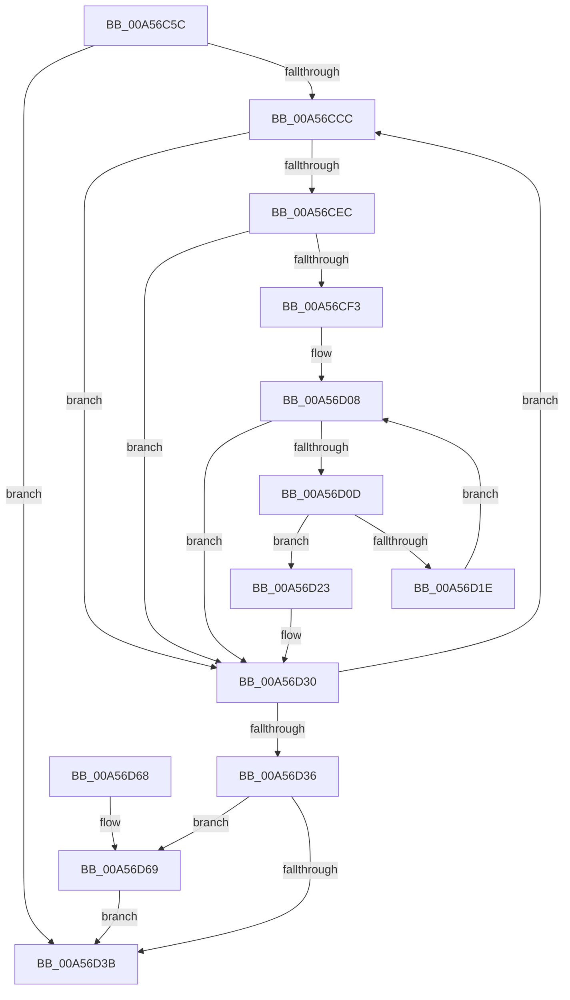

# EtwTraceDuplicateHandle

- RVA: `0x00A56C5C`–`0x00A56DC1` (길이 `357` bytes)
- VA: `0x0000000140A56C5C`
- 실행 섹션: `PAGE`
- PDB 이름 있음: `예`; PDB Function 태그: `아니요`
- unwind 정보 RVA: `0x000B15AC`
- 디코드: `97`개 명령, `357/357` bytes 표시
- 미해석 바이트: `0` (있으면 어셈블리에 `.byte`로 보존)

> 이 문서는 커널 이미지의 기계어와 PDB 기호를 분석해 생성했습니다. 4번과 5번은 함수 원형과 자료형을 바이너리 사용 방식에서 추정한 C 해석이며 원본 소스 복구 결과는 아닙니다.

## 1. Dependencies

- 직접 호출 지점: **3**; 고유 호출 대상: **3**
- 직접 호출자로 확인된 함수: **3**
- RIP 상대 이미지 참조: **3**

### Outgoing calls
- `0x00A56D15` → [ExCheckSingleFilter](../../text/40/ExCheckSingleFilter_function_0040014C.md) (function, `0x0040014C`)
- `0x00A56D42` → [_security_check_cookie](../../text/6A/_security_check_cookie_function_006AC640.md) (function, `0x006AC640`)
- `0x00A56DB7` → [EtwpTraceKernelEventWithFilter](../../text/49/EtwpTraceKernelEventWithFilter_function_00498540.md) (function, `0x00498540`)

### Direct callers
- [ObCompleteObjectDuplication](../89/ObCompleteObjectDuplication_function_0089387C.md) at `0x00893B2A`
- [ObDuplicateObject](../8C/ObDuplicateObject_function_008C4FA0.md) at `0x008C5DDE`
- [ObInheritObjectHandle](../94/ObInheritObjectHandle_function_0094D1C4.md) at `0x0094D2B9`

### Static image references
- `0x00A56C7E` → RVA `0x00E0A740` (`.data`; read)
- `0x00A56CA0` → RVA `0x00FC6AA8` (`ALMOSTRO`; read)
- `0x00A56CFA` → RVA `0x00EFF880` (`.data`; read)

## 2. Other-region calls and transfers

- 다른 실행 섹션으로 향하는 call: **3**
  - `0x00A56D15` → [ExCheckSingleFilter](../../text/40/ExCheckSingleFilter_function_0040014C.md) (`PAGE` → `.text`)
  - `0x00A56D42` → [_security_check_cookie](../../text/6A/_security_check_cookie_function_006AC640.md) (`PAGE` → `.text`)
  - `0x00A56DB7` → [EtwpTraceKernelEventWithFilter](../../text/49/EtwpTraceKernelEventWithFilter_function_00498540.md) (`PAGE` → `.text`)
- 별도 외부 분기/꼬리 이동을 확인하지 못했습니다.

## 3. Assembly (complete function range)

```asm
00A56C5C  48 89 5C 24 08                  mov qword ptr [rsp + 8], rbx
00A56C61  48 89 74 24 10                  mov qword ptr [rsp + 0x10], rsi
00A56C66  48 89 7C 24 18                  mov qword ptr [rsp + 0x18], rdi
00A56C6B  55                              push rbp
00A56C6C  41 54                           push r12
00A56C6E  41 55                           push r13
00A56C70  41 56                           push r14
00A56C72  41 57                           push r15
00A56C74  48 8B EC                        mov rbp, rsp
00A56C77  48 81 EC 80 00 00 00            sub rsp, 0x80
00A56C7E  48 8B 05 BB 3A 3B 00            mov rax, qword ptr [rip + 0x3b3abb]
00A56C85  48 33 C4                        xor rax, rsp
00A56C88  48 89 45 F0                     mov qword ptr [rbp - 0x10], rax
00A56C8C  48 8B 75 58                     mov rsi, qword ptr [rbp + 0x58]
00A56C90  33 C0                           xor eax, eax
00A56C92  48 89 45 C0                     mov qword ptr [rbp - 0x40], rax
00A56C96  45 8B F9                        mov r15d, r9d
00A56C99  66 89 45 C8                     mov word ptr [rbp - 0x38], ax
00A56C9D  45 33 D2                        xor r10d, r10d
00A56CA0  48 8B 05 01 FE 56 00            mov rax, qword ptr [rip + 0x56fe01]
00A56CA7  0F 57 C0                        xorps xmm0, xmm0
00A56CAA  44 8B B6 C0 00 00 00            mov r14d, dword ptr [rsi + 0xc0]
00A56CB1  4D 8B E0                        mov r12, r8
00A56CB4  4C 8B EA                        mov r13, rdx
00A56CB7  48 89 4D D8                     mov qword ptr [rbp - 0x28], rcx
00A56CBB  0F 11 45 B0                     movups xmmword ptr [rbp - 0x50], xmm0
00A56CBF  44 8B 88 A8 11 00 00            mov r9d, dword ptr [rax + 0x11a8]
00A56CC6  45 0F BC D9                     bsf r11d, r9d
00A56CCA  74 6F                           je 0x140a56d3b
00A56CCC  41 8D 41 FF                     lea eax, [r9 - 1]
00A56CD0  41 8B CB                        mov ecx, r11d
00A56CD3  44 23 C8                        and r9d, eax
00A56CD6  48 C1 E1 05                     shl rcx, 5
00A56CDA  48 8B 05 C7 FD 56 00            mov rax, qword ptr [rip + 0x56fdc7]
00A56CE1  48 05 CC 11 00 00               add rax, 0x11cc
00A56CE7  48 03 C1                        add rax, rcx
00A56CEA  74 44                           je 0x140a56d30
00A56CEC  8B 40 10                        mov eax, dword ptr [rax + 0x10]
00A56CEF  A8 40                           test al, 0x40
00A56CF1  74 3D                           je 0x140a56d30
00A56CF3  4B 8D 04 9B                     lea rax, [r11 + r11*4]
00A56CF7  45 33 C0                        xor r8d, r8d
00A56CFA  48 8D 0D 7F 8B 4A 00            lea rcx, [rip + 0x4a8b7f]
00A56D01  48 8D 1C 81                     lea rbx, [rcx + rax*4]
00A56D05  0F B7 3B                        movzx edi, word ptr [rbx]
00A56D08  44 3B C7                        cmp r8d, edi
00A56D0B  73 23                           jae 0x140a56d30
00A56D0D  42 8B 54 83 04                  mov edx, dword ptr [rbx + r8*4 + 4]
00A56D12  41 8B CE                        mov ecx, r14d
00A56D15  E8 32 94 9A FF                  call 0x14040014c
00A56D1A  85 C0                           test eax, eax
00A56D1C  75 05                           jne 0x140a56d23
00A56D1E  41 FF C0                        inc r8d
00A56D21  EB E5                           jmp 0x140a56d08
00A56D23  41 8B CB                        mov ecx, r11d
00A56D26  B8 01 00 00 00                  mov eax, 1
00A56D2B  D3 E0                           shl eax, cl
00A56D2D  44 0B D0                        or r10d, eax
00A56D30  45 0F BC D9                     bsf r11d, r9d
00A56D34  75 96                           jne 0x140a56ccc
00A56D36  45 85 D2                        test r10d, r10d
00A56D39  75 2E                           jne 0x140a56d69
00A56D3B  48 8B 4D F0                     mov rcx, qword ptr [rbp - 0x10]
00A56D3F  48 33 CC                        xor rcx, rsp
00A56D42  E8 F9 58 C5 FF                  call 0x1406ac640
00A56D47  4C 8D 9C 24 80 00 00 00         lea r11, [rsp + 0x80]
00A56D4F  49 8B 5B 30                     mov rbx, qword ptr [r11 + 0x30]
00A56D53  49 8B 73 38                     mov rsi, qword ptr [r11 + 0x38]
00A56D57  49 8B 7B 40                     mov rdi, qword ptr [r11 + 0x40]
00A56D5B  49 8B E3                        mov rsp, r11
00A56D5E  41 5F                           pop r15
00A56D60  41 5E                           pop r14
00A56D62  41 5D                           pop r13
00A56D64  41 5C                           pop r12
00A56D66  5D                              pop rbp
00A56D67  C3                              ret
00A56D68  CC                              int3
00A56D69  48 8B 45 D8                     mov rax, qword ptr [rbp - 0x28]
00A56D6D  48 8D 4D E0                     lea rcx, [rbp - 0x20]
00A56D71  83 65 EC 00                     and dword ptr [rbp - 0x14], 0
00A56D75  41 B9 22 11 00 00               mov r9d, 0x1122
00A56D7B  89 45 B8                        mov dword ptr [rbp - 0x48], eax
00A56D7E  45 8B C2                        mov r8d, r10d
00A56D81  8B 45 50                        mov eax, dword ptr [rbp + 0x50]
00A56D84  BA 01 00 00 00                  mov edx, 1
00A56D89  89 45 C0                        mov dword ptr [rbp - 0x40], eax
00A56D8C  0F B6 46 28                     movzx eax, byte ptr [rsi + 0x28]
00A56D90  66 89 45 C4                     mov word ptr [rbp - 0x3c], ax
00A56D94  48 8D 45 B0                     lea rax, [rbp - 0x50]
00A56D98  48 89 45 E0                     mov qword ptr [rbp - 0x20], rax
00A56D9C  4C 89 65 B0                     mov qword ptr [rbp - 0x50], r12
00A56DA0  44 89 6D BC                     mov dword ptr [rbp - 0x44], r13d
00A56DA4  44 89 7D C6                     mov dword ptr [rbp - 0x3a], r15d
00A56DA8  C7 45 E8 1A 00 00 00            mov dword ptr [rbp - 0x18], 0x1a
00A56DAF  C7 44 24 20 03 19 60 10         mov dword ptr [rsp + 0x20], 0x10601903
00A56DB7  E8 84 17 A4 FF                  call 0x140498540
00A56DBC  E9 7A FF FF FF                  jmp 0x140a56d3b
```

## 4. C-style interpretation (structured pseudocode)

```c
__int64 __fastcall EtwTraceDuplicateHandle(__int64 a1, __int64 a2, __int64 a3, int a4, unsigned int a5, __int64 a6)
{
    __int64 result;
    __int64 v_r10;
    __int64 v_rsp;
    unsigned __int64 v_stack_m28;
    unsigned __int64 v_stack_m38;
    unsigned int v_stack_m3C;
    unsigned int v_stack_m40;
    unsigned __int64 v_stack_m48;
    unsigned __int64 v_stack_m50;
    unsigned __int16 v_stack_m60;
    unsigned int v_stack_m62;
    unsigned __int16 v_stack_m64;
    unsigned __int64 v_stack_m68;
    unsigned int v_stack_m6C;
    unsigned int v_stack_m70;
    unsigned __int64 v_stack_m78;
    unsigned __int64 v_stack_p10;
    unsigned __int64 v_stack_p18;
    unsigned __int64 v_stack_p8;

    v_stack_p8 = v_rbx;
    v_stack_p10 = v_rsi;
    v_stack_p18 = v_rdi;
    v_rsp = (v_rsp) - (128);
    result = (*(unsigned __int64 *)(v_rip + 3881659)) ^ (v_rsp);
    v_stack_m38 = result;
    result = 0;
    v_stack_m68 = 0;
    v_stack_m60 = 0;
    v_r10 = 0;
    v_stack_m50 = a1;
    v_stack_m78 = v_xmm0;
    if (condition_is_equal) goto loc_00A56D3B;
loc_00A56CCC:
    a4 = (unsigned int)(((unsigned int)(*(unsigned int *)(*(unsigned __int64 *)(v_rip + 5701121) + 4520))) & ((unsigned int)((unsigned int)(*(unsigned int *)(*(unsigned __int64 *)(v_rip + 5701121) + 4520)) - 1)));
    a1 = ((unsigned int)((unsigned int)(v_r11))) << (5);
    result = (*(unsigned __int64 *)(v_rip + 5701063)) + (0x11CCULL);
    result = (result) + (a1);
    if (condition_is_equal) goto loc_00A56D30;
    if ((((unsigned __int8)((unsigned int)(*(unsigned int *)(result + 16)))) & (64)) == 0) goto loc_00A56D30;
    a3 = 0;
loc_00A56D08:
    if (0 >= ((unsigned int)(*(unsigned __int16 *)(v_rip + 4885375 + v_r11 + v_r11 * 4 * 4)))) goto loc_00A56D30;
    result = ExCheckSingleFilter((unsigned int)((unsigned int)((unsigned int)(*(unsigned int *)(a6 + 192)))), (unsigned int)(*(unsigned int *)(v_rip + 4885375 + v_r11 + v_r11 * 4 * 4 + a3 * 4 + 4)), a3, a4);
    if ((unsigned int)(result) != 0) goto loc_00A56D23;
    a3 = (unsigned int)((a3) + 1);
    goto loc_00A56D08;
loc_00A56D23:
    result = (unsigned int)((1) << ((unsigned __int8)((unsigned int)((unsigned int)(v_r11)))));
    v_r10 = (unsigned int)((v_r10) | ((unsigned int)(result)));
loc_00A56D30:
    if (condition_is_not_equal) goto loc_00A56CCC;
    if ((unsigned int)(v_r10) != 0) goto loc_00A56D69;
loc_00A56D3B:
    a1 = (v_stack_m38) ^ (v_rsp);
    result = _security_check_cookie(a1, (unsigned int)(*(unsigned int *)(v_rip + 4885375 + v_r11 + v_r11 * 4 * 4 + a3 * 4 + 4)), a3, a4);
    return result;
loc_00A56D69:
    v_stack_m70 = (unsigned int)(v_stack_m50);
    v_stack_m68 = (unsigned int)((unsigned int)(a5));
    v_stack_m64 = (unsigned __int16)(*(unsigned __int8 *)(*(unsigned __int64 *)(v_stack_m28 + 56) + 40));
    v_stack_m48 = v_stack_m78;
    v_stack_m78 = a3;
    v_stack_m6C = (unsigned int)(a2);
    v_stack_m62 = (unsigned int)((unsigned int)(a4));
    v_stack_m40 = 26;
    v_stack_m60 = 0x10601903ULL;
    result = EtwpTraceKernelEventWithFilter(v_stack_m48, 1, (unsigned int)((unsigned int)(v_r10)), (unsigned int)(0x1122ULL));
    goto loc_00A56D3B;
}
```

## 5. (Beta) C Style

```c
int64_t EtwTraceDuplicateHandle(int64_t Arg1, int64_t Arg2, int64_t Arg3, int32_t Arg4, uint32_t Arg5, void *Arg6)
{
    uint8_t *arg6 = (uint8_t *)Arg6;

    int64_t result;
    int64_t local_r10;
    int64_t local_rsp;
    uint64_t v_stack_m28;
    uint64_t v_stack_m38;
    uint32_t v_stack_m3C;
    uint32_t v_stack_m40;
    uint64_t v_stack_m48;
    uint64_t v_stack_m50;
    uint16_t v_stack_m60;
    uint32_t v_stack_m62;
    uint16_t v_stack_m64;
    uint64_t v_stack_m68;
    uint32_t v_stack_m6C;
    uint32_t v_stack_m70;
    uint64_t v_stack_m78;
    uint64_t v_stack_p10;
    uint64_t v_stack_p18;
    uint64_t v_stack_p8;

    v_stack_p8 = local_rbx;
    v_stack_p10 = local_rsi;
    v_stack_p18 = local_rdi;
    local_rsp = (local_rsp) - (128);
    result = (*(uint64_t *)(v_rip + 0x3B3ABB)) ^ (local_rsp);
    v_stack_m38 = result;
    result = 0;
    v_stack_m68 = 0;
    v_stack_m60 = 0;
    local_r10 = 0;
    v_stack_m50 = Arg1;
    v_stack_m78 = v_xmm0;
    if (condition_is_equal) goto loc_00A56D3B;
loc_00A56CCC:
    Arg4 = (uint32_t)(((uint32_t)(*(uint32_t *)(*(uint64_t *)(v_rip + 0x56FE01) + 0x11A8))) & ((uint32_t)((uint32_t)(*(uint32_t *)(*(uint64_t *)(v_rip + 0x56FE01) + 0x11A8)) - 1)));
    Arg1 = ((uint32_t)((uint32_t)(local_r11))) << (5);
    result = (*(uint64_t *)(v_rip + 0x56FDC7)) + (0x11CCULL);
    result = (result) + (Arg1);
    if (condition_is_equal) goto loc_00A56D30;
    if ((((uint8_t)((uint32_t)(*(uint32_t *)(result + 0x10)))) & (64)) == 0) goto loc_00A56D30;
    Arg3 = 0;
loc_00A56D08:
    if (0 >= ((uint32_t)(*(uint16_t *)(v_rip + 0x4A8B7F + local_r11 + local_r11 * 4 * 4)))) goto loc_00A56D30;
    result = ExCheckSingleFilter((uint32_t)((uint32_t)((uint32_t)(*(uint32_t *)(arg6 + 0xC0)))), (uint32_t)(*(uint32_t *)(v_rip + 0x4A8B7F + local_r11 + local_r11 * 4 * 4 + Arg3 * 4 + 0x4)), Arg3, Arg4);
    if ((uint32_t)(result) != 0) goto loc_00A56D23;
    Arg3 = (uint32_t)((Arg3) + 1);
    goto loc_00A56D08;
loc_00A56D23:
    result = (uint32_t)((1) << ((uint8_t)((uint32_t)((uint32_t)(local_r11)))));
    local_r10 = (uint32_t)((local_r10) | ((uint32_t)(result)));
loc_00A56D30:
    if (condition_is_not_equal) goto loc_00A56CCC;
    if ((uint32_t)(local_r10) != 0) goto loc_00A56D69;
loc_00A56D3B:
    Arg1 = (v_stack_m38) ^ (local_rsp);
    result = _security_check_cookie(Arg1, (uint32_t)(*(uint32_t *)(v_rip + 0x4A8B7F + local_r11 + local_r11 * 4 * 4 + Arg3 * 4 + 0x4)), Arg3, Arg4);
    return result;
loc_00A56D69:
    v_stack_m70 = (uint32_t)(v_stack_m50);
    v_stack_m68 = (uint32_t)((uint32_t)(Arg5));
    v_stack_m64 = (uint16_t)(*(uint8_t *)(*(uint64_t *)(v_stack_m28 + 0x38) + 0x28));
    v_stack_m48 = v_stack_m78;
    v_stack_m78 = Arg3;
    v_stack_m6C = (uint32_t)(Arg2);
    v_stack_m62 = (uint32_t)((uint32_t)(Arg4));
    v_stack_m40 = 26;
    v_stack_m60 = 0x10601903ULL;
    result = EtwpTraceKernelEventWithFilter(v_stack_m48, 1, (uint32_t)((uint32_t)(local_r10)), (uint32_t)(0x1122ULL));
    goto loc_00A56D3B;
}
```

### 관측된 메모리 오프셋

구조체 형식이 확인되지 않은 접근은 인자 기준의 오프셋으로만 기록했습니다.

| 기준 인자 | 오프셋 표현 | 폭 (bit) | 접근 |
|---|---:|---:|---|
| `Arg6` | `+ 0x28` | `8` | `R` |
| `Arg6` | `+ 0xC0` | `32` | `R` |

## 6. Execution-region graph

[열기: 2D/3D 그래프와 함수 탐색 컨트롤 패널](../../../control-panel.html?section=page&rva=0x00A56C5C&view=graph)

- 2D 그래프는 위에서 아래로 흐르고, 3D 그래프는 빈 공간을 드래그해 회전합니다. Shift+드래그는 이동, 휠은 확대·축소, 함수 노드 선택은 대상 보고서 이동입니다.

### Static fallback


