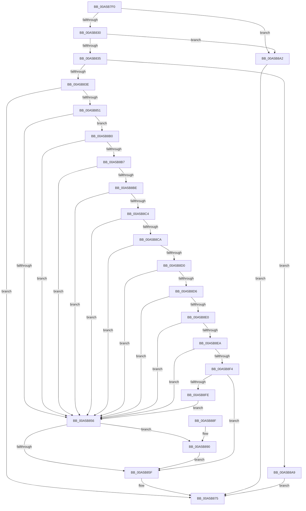

# EtwWriteEndScenario

- RVA: `0x00A5B7F0`–`0x00A5B903` (길이 `275` bytes)
- VA: `0x0000000140A5B7F0`
- 실행 섹션: `PAGE`
- PDB 이름 있음: `예`; PDB Function 태그: `아니요`
- unwind 정보 RVA: `0x000B261C`
- 디코드: `83`개 명령, `275/275` bytes 표시
- 미해석 바이트: `0` (있으면 어셈블리에 `.byte`로 보존)

> 이 문서는 커널 이미지의 기계어와 PDB 기호를 분석해 생성했습니다. 4번과 5번은 함수 원형과 자료형을 바이너리 사용 방식에서 추정한 C 해석이며 원본 소스 복구 결과는 아닙니다.

## 1. Dependencies

- 직접 호출 지점: **5**; 고유 호출 대상: **5**
- 직접 호출자로 확인된 함수: **3**
- RIP 상대 이미지 참조: **2**

### Outgoing calls
- `0x00A5B835` → [EtwEventEnabled](../../text/39/EtwEventEnabled_function_00392450.md) (function, `0x00392450`)
- `0x00A5B848` → [EtwGetProviderIdFromHandle](../../text/4B/EtwGetProviderIdFromHandle_function_004B8850.md) (function, `0x004B8850`)
- `0x00A5B870` → [EtwWrite](../../text/41/EtwWrite_function_0041C720.md) (function, `0x0041C720`)
- `0x00A5B87D` → [_security_check_cookie](../../text/6A/_security_check_cookie_function_006AC640.md) (function, `0x006AC640`)
- `0x00A5B89B` → [WdipSemDisableScenario](WdipSemDisableScenario_function_00A5BC00.md) (function, `0x00A5BC00`)

### Direct callers
- [PnpCompleteSystemStartProcess](../../text/5A/PnpCompleteSystemStartProcess_function_005A6F2C.md) at `0x005A6FC5`
- [PopDiagTracePowerTransitionEnd](../AD/PopDiagTracePowerTransitionEnd_function_00AD24DC.md) at `0x00AD26A3`
- [PopGracefulShutdown](../../pagelk/B6/PopGracefulShutdown_function_00B6BEC8.md) at `0x00B6C0C2`

### Static image references
- `0x00A5B7FD` → RVA `0x00E0A740` (`.data`; read)
- `0x00A5B856` → RVA `0x00F01E18` (`.data`; read)

## 2. Other-region calls and transfers

- 다른 실행 섹션으로 향하는 call: **4**
  - `0x00A5B835` → [EtwEventEnabled](../../text/39/EtwEventEnabled_function_00392450.md) (`PAGE` → `.text`)
  - `0x00A5B848` → [EtwGetProviderIdFromHandle](../../text/4B/EtwGetProviderIdFromHandle_function_004B8850.md) (`PAGE` → `.text`)
  - `0x00A5B870` → [EtwWrite](../../text/41/EtwWrite_function_0041C720.md) (`PAGE` → `.text`)
  - `0x00A5B87D` → [_security_check_cookie](../../text/6A/_security_check_cookie_function_006AC640.md) (`PAGE` → `.text`)
- 별도 외부 분기/꼬리 이동을 확인하지 못했습니다.

## 3. Assembly (complete function range)

```asm
00A5B7F0  40 53                           push rbx
00A5B7F2  55                              push rbp
00A5B7F3  56                              push rsi
00A5B7F4  57                              push rdi
00A5B7F5  41 56                           push r14
00A5B7F7  41 57                           push r15
00A5B7F9  48 83 EC 58                     sub rsp, 0x58
00A5B7FD  48 8B 05 3C EF 3A 00            mov rax, qword ptr [rip + 0x3aef3c]
00A5B804  48 33 C4                        xor rax, rsp
00A5B807  48 89 44 24 40                  mov qword ptr [rsp + 0x40], rax
00A5B80C  4C 8B B4 24 B0 00 00 00         mov r14, qword ptr [rsp + 0xb0]
00A5B814  45 33 FF                        xor r15d, r15d
00A5B817  0F 57 C0                        xorps xmm0, xmm0
00A5B81A  41 8B E9                        mov ebp, r9d
00A5B81D  49 8B D8                        mov rbx, r8
00A5B820  48 8B FA                        mov rdi, rdx
00A5B823  48 8B F1                        mov rsi, rcx
00A5B826  0F 11 44 24 30                  movups xmmword ptr [rsp + 0x30], xmm0
00A5B82B  48 85 D2                        test rdx, rdx
00A5B82E  74 72                           je 0x140a5b8a2
00A5B830  48 85 DB                        test rbx, rbx
00A5B833  74 6D                           je 0x140a5b8a2
00A5B835  E8 16 6C 93 FF                  call 0x140392450
00A5B83A  84 C0                           test al, al
00A5B83C  74 6B                           je 0x140a5b8a9
00A5B83E  4C 8D 44 24 30                  lea r8, [rsp + 0x30]
00A5B843  33 D2                           xor edx, edx
00A5B845  48 8B CE                        mov rcx, rsi
00A5B848  E8 03 D0 A5 FF                  call 0x1404b8850
00A5B84D  85 C0                           test eax, eax
00A5B84F  78 24                           js 0x140a5b875
00A5B851  44 39 3B                        cmp dword ptr [rbx], r15d
00A5B854  74 5A                           je 0x140a5b8b0
00A5B856  44 38 3D BB 65 4A 00            cmp byte ptr [rip + 0x4a65bb], r15b
00A5B85D  75 31                           jne 0x140a5b890
00A5B85F  44 8B CD                        mov r9d, ebp
00A5B862  4C 89 74 24 20                  mov qword ptr [rsp + 0x20], r14
00A5B867  4C 8B C3                        mov r8, rbx
00A5B86A  48 8B D7                        mov rdx, rdi
00A5B86D  48 8B CE                        mov rcx, rsi
00A5B870  E8 AB 0E 9C FF                  call 0x14041c720
00A5B875  48 8B 4C 24 40                  mov rcx, qword ptr [rsp + 0x40]
00A5B87A  48 33 CC                        xor rcx, rsp
00A5B87D  E8 BE 0D C5 FF                  call 0x1406ac640
00A5B882  48 83 C4 58                     add rsp, 0x58
00A5B886  41 5F                           pop r15
00A5B888  41 5E                           pop r14
00A5B88A  5F                              pop rdi
00A5B88B  5E                              pop rsi
00A5B88C  5D                              pop rbp
00A5B88D  5B                              pop rbx
00A5B88E  C3                              ret
00A5B88F  CC                              int3
00A5B890  0F B7 17                        movzx edx, word ptr [rdi]
00A5B893  48 8D 4C 24 30                  lea rcx, [rsp + 0x30]
00A5B898  4C 8B C3                        mov r8, rbx
00A5B89B  E8 60 03 00 00                  call 0x140a5bc00
00A5B8A0  EB BD                           jmp 0x140a5b85f
00A5B8A2  B8 0D 00 00 C0                  mov eax, 0xc000000d
00A5B8A7  EB CC                           jmp 0x140a5b875
00A5B8A9  B8 08 00 00 C0                  mov eax, 0xc0000008
00A5B8AE  EB C5                           jmp 0x140a5b875
00A5B8B0  66 44 39 7B 04                  cmp word ptr [rbx + 4], r15w
00A5B8B5  75 9F                           jne 0x140a5b856
00A5B8B7  66 44 39 7B 06                  cmp word ptr [rbx + 6], r15w
00A5B8BC  75 98                           jne 0x140a5b856
00A5B8BE  44 38 7B 08                     cmp byte ptr [rbx + 8], r15b
00A5B8C2  75 92                           jne 0x140a5b856
00A5B8C4  44 38 7B 09                     cmp byte ptr [rbx + 9], r15b
00A5B8C8  75 8C                           jne 0x140a5b856
00A5B8CA  44 38 7B 0A                     cmp byte ptr [rbx + 0xa], r15b
00A5B8CE  75 86                           jne 0x140a5b856
00A5B8D0  44 38 7B 0B                     cmp byte ptr [rbx + 0xb], r15b
00A5B8D4  75 80                           jne 0x140a5b856
00A5B8D6  44 38 7B 0C                     cmp byte ptr [rbx + 0xc], r15b
00A5B8DA  0F 85 76 FF FF FF               jne 0x140a5b856
00A5B8E0  44 38 7B 0D                     cmp byte ptr [rbx + 0xd], r15b
00A5B8E4  0F 85 6C FF FF FF               jne 0x140a5b856
00A5B8EA  44 38 7B 0E                     cmp byte ptr [rbx + 0xe], r15b
00A5B8EE  0F 85 62 FF FF FF               jne 0x140a5b856
00A5B8F4  44 38 7B 0F                     cmp byte ptr [rbx + 0xf], r15b
00A5B8F8  0F 84 61 FF FF FF               je 0x140a5b85f
00A5B8FE  E9 53 FF FF FF                  jmp 0x140a5b856
```

## 4. C-style interpretation (structured pseudocode)

```c
__int64 __fastcall EtwWriteEndScenario(__int64 a1, __int64 a2, __int64 a3, int a4, __int64 a5)
{
    __int64 result;
    __int64 v_r15;
    __int64 v_rsp;
    unsigned __int64 v_stack_m48;
    unsigned __int64 v_stack_m58;
    unsigned __int64 v_stack_m68;
    unsigned __int64 v_stack_p30;

    v_rsp = (v_rsp) - (88);
    result = (*(unsigned __int64 *)(v_rip + 3862332)) ^ (v_rsp);
    v_stack_m48 = result;
    v_r15 = 0;
    v_stack_m58 = v_xmm0;
    if (a2 == 0) goto loc_00A5B8A2;
    if (a3 == 0) goto loc_00A5B8A2;
    result = EtwEventEnabled(a1, a2, a3, a4);
    if ((unsigned __int8)(result) == 0) goto loc_00A5B8A9;
    a2 = 0;
    result = EtwGetProviderIdFromHandle(a1, a2, v_stack_m58, a4);
    if (sign_flag) goto loc_00A5B875;
    if ((*(unsigned int *)(a3)) == 0) goto loc_00A5B8B0;
loc_00A5B856:
    if ((*(unsigned __int8 *)(v_rip + 4875707)) != 0) goto loc_00A5B890;
loc_00A5B85F:
    v_stack_m68 = a5;
    result = EtwWrite(a1, 0, a3, (unsigned int)((unsigned int)((unsigned int)(a4))));
loc_00A5B875:
    a1 = (v_stack_m48) ^ (v_rsp);
    result = _security_check_cookie(a1, 0, a3, (unsigned int)((unsigned int)((unsigned int)(a4))));
    v_rsp = (v_rsp) + (88);
    return result;
loc_00A5B890:
    result = WdipSemDisableScenario(v_stack_p30, *(unsigned __int16 *)(a2), a3, (unsigned int)((unsigned int)((unsigned int)(a4))));
    goto loc_00A5B85F;
loc_00A5B8A2:
    goto loc_00A5B875;
loc_00A5B8A9:
    goto loc_00A5B875;
loc_00A5B8B0:
    if ((*(unsigned __int16 *)(a3 + 4)) != 0) goto loc_00A5B856;
    if ((*(unsigned __int16 *)(a3 + 6)) != 0) goto loc_00A5B856;
    if ((*(unsigned __int8 *)(a3 + 8)) != 0) goto loc_00A5B856;
    if ((*(unsigned __int8 *)(a3 + 9)) != 0) goto loc_00A5B856;
    if ((*(unsigned __int8 *)(a3 + 10)) != 0) goto loc_00A5B856;
    if ((*(unsigned __int8 *)(a3 + 11)) != 0) goto loc_00A5B856;
    if ((*(unsigned __int8 *)(a3 + 12)) != 0) goto loc_00A5B856;
    if ((*(unsigned __int8 *)(a3 + 13)) != 0) goto loc_00A5B856;
    if ((*(unsigned __int8 *)(a3 + 14)) != 0) goto loc_00A5B856;
    if ((*(unsigned __int8 *)(a3 + 15)) == 0) goto loc_00A5B85F;
    goto loc_00A5B856;
}
```

## 5. (Beta) C Style

```c
int64_t EtwWriteEndScenario(int64_t Arg1, void *Arg2, int64_t Arg3, int32_t Arg4, int64_t Arg5)
{
    uint8_t *arg2 = (uint8_t *)Arg2;

    int64_t result;
    int64_t local_r15;
    int64_t local_rsp;
    uint64_t v_stack_m48;
    uint64_t v_stack_m58;
    uint64_t v_stack_m68;
    uint64_t v_stack_p30;

    local_rsp = (local_rsp) - (88);
    result = (*(uint64_t *)(v_rip + 0x3AEF3C)) ^ (local_rsp);
    v_stack_m48 = result;
    local_r15 = 0;
    v_stack_m58 = v_xmm0;
    if (Arg2 == NULL) goto loc_00A5B8A2;
    if (Arg3 == 0) goto loc_00A5B8A2;
    result = EtwEventEnabled(Arg1, Arg2, Arg3, Arg4);
    if ((uint8_t)(result) == 0) goto loc_00A5B8A9;
    Arg2 = 0;
    result = EtwGetProviderIdFromHandle(Arg1, Arg2, v_stack_m58, Arg4);
    if (sign_flag) goto loc_00A5B875;
    if ((*(uint32_t *)(Arg3)) == 0) goto loc_00A5B8B0;
loc_00A5B856:
    if ((*(uint8_t *)(v_rip + 0x4A65BB)) != 0) goto loc_00A5B890;
loc_00A5B85F:
    v_stack_m68 = Arg5;
    result = EtwWrite(Arg1, 0, Arg3, (uint32_t)((uint32_t)((uint32_t)(Arg4))));
loc_00A5B875:
    Arg1 = (v_stack_m48) ^ (local_rsp);
    result = _security_check_cookie(Arg1, 0, Arg3, (uint32_t)((uint32_t)((uint32_t)(Arg4))));
    local_rsp = (local_rsp) + (88);
    return result;
loc_00A5B890:
    result = WdipSemDisableScenario(v_stack_p30, *(uint16_t *)(arg2), Arg3, (uint32_t)((uint32_t)((uint32_t)(Arg4))));
    goto loc_00A5B85F;
loc_00A5B8A2:
    goto loc_00A5B875;
loc_00A5B8A9:
    goto loc_00A5B875;
loc_00A5B8B0:
    if ((*(uint16_t *)(Arg3 + 0x4)) != 0) goto loc_00A5B856;
    if ((*(uint16_t *)(Arg3 + 0x6)) != 0) goto loc_00A5B856;
    if ((*(uint8_t *)(Arg3 + 0x8)) != 0) goto loc_00A5B856;
    if ((*(uint8_t *)(Arg3 + 0x9)) != 0) goto loc_00A5B856;
    if ((*(uint8_t *)(Arg3 + 0xA)) != 0) goto loc_00A5B856;
    if ((*(uint8_t *)(Arg3 + 0xB)) != 0) goto loc_00A5B856;
    if ((*(uint8_t *)(Arg3 + 0xC)) != 0) goto loc_00A5B856;
    if ((*(uint8_t *)(Arg3 + 0xD)) != 0) goto loc_00A5B856;
    if ((*(uint8_t *)(Arg3 + 0xE)) != 0) goto loc_00A5B856;
    if ((*(uint8_t *)(Arg3 + 0xF)) == 0) goto loc_00A5B85F;
    goto loc_00A5B856;
}
```

### 관측된 메모리 오프셋

구조체 형식이 확인되지 않은 접근은 인자 기준의 오프셋으로만 기록했습니다.

| 기준 인자 | 오프셋 표현 | 폭 (bit) | 접근 |
|---|---:|---:|---|
| `Arg2` | `+ 0x0` | `16` | `R` |

## 6. Execution-region graph

[열기: 2D/3D 그래프와 함수 탐색 컨트롤 패널](../../../control-panel.html?section=page&rva=0x00A5B7F0&view=graph)

- 2D 그래프는 위에서 아래로 흐르고, 3D 그래프는 빈 공간을 드래그해 회전합니다. Shift+드래그는 이동, 휠은 확대·축소, 함수 노드 선택은 대상 보고서 이동입니다.

### Static fallback


