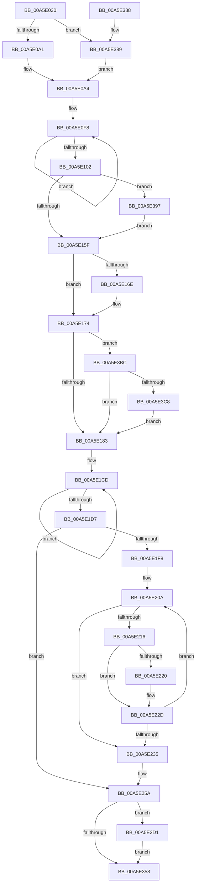

# EtwWriteErrorLogEntry

- RVA: `0x00A5E030`–`0x00A5E3D8` (길이 `936` bytes)
- VA: `0x0000000140A5E030`
- 실행 섹션: `PAGE`
- PDB 이름 있음: `예`; PDB Function 태그: `아니요`
- unwind 정보 RVA: `0x000B287C`
- 디코드: `207`개 명령, `936/936` bytes 표시
- 미해석 바이트: `0` (있으면 어셈블리에 `.byte`로 보존)

> 이 문서는 커널 이미지의 기계어와 PDB 기호를 분석해 생성했습니다. 4번과 5번은 함수 원형과 자료형을 바이너리 사용 방식에서 추정한 C 해석이며 원본 소스 복구 결과는 아닙니다.

## 1. Dependencies

- 직접 호출 지점: **3**; 고유 호출 대상: **3**
- 직접 호출자로 확인된 함수: **1**
- RIP 상대 이미지 참조: **5**

### Outgoing calls
- `0x00A5E2AC` → [memset](../../text/6C/memset_function_006C6C40.md) (function, `0x006C6C40`)
- `0x00A5E34F` → [EtwpEventWriteFull](../../text/22/EtwpEventWriteFull_function_00225C10.md) (function, `0x00225C10`)
- `0x00A5E362` → [_security_check_cookie](../../text/6A/_security_check_cookie_function_006AC640.md) (function, `0x006AC640`)

### Direct callers
- [IopErrorLogThread](IopErrorLogThread_function_00A5DC80.md) at `0x00A5DE4A`

### Static image references
- `0x00A5E056` → RVA `0x00E0A740` (`.data`; read)
- `0x00A5E067` → RVA `0x00E66210` (`.data`; read)
- `0x00A5E2B1` → RVA `0x00FC6AA8` (`ALMOSTRO`; read)
- `0x00A5E2BF` → RVA `0x0001A788` (`.rdata`; read)
- `0x00A5E323` → RVA `0x00010980` (`.rdata`; read)

## 2. Other-region calls and transfers

- 다른 실행 섹션으로 향하는 call: **3**
  - `0x00A5E2AC` → [memset](../../text/6C/memset_function_006C6C40.md) (`PAGE` → `.text`)
  - `0x00A5E34F` → [EtwpEventWriteFull](../../text/22/EtwpEventWriteFull_function_00225C10.md) (`PAGE` → `.text`)
  - `0x00A5E362` → [_security_check_cookie](../../text/6A/_security_check_cookie_function_006AC640.md) (`PAGE` → `.text`)
- 별도 외부 분기/꼬리 이동을 확인하지 못했습니다.

## 3. Assembly (complete function range)

```asm
00A5E030  48 8B C4                        mov rax, rsp
00A5E033  48 89 58 08                     mov qword ptr [rax + 8], rbx
00A5E037  48 89 70 18                     mov qword ptr [rax + 0x18], rsi
00A5E03B  48 89 78 20                     mov qword ptr [rax + 0x20], rdi
00A5E03F  55                              push rbp
00A5E040  41 54                           push r12
00A5E042  41 55                           push r13
00A5E044  41 56                           push r14
00A5E046  41 57                           push r15
00A5E048  48 8D A8 B8 FC FF FF            lea rbp, [rax - 0x348]
00A5E04F  48 81 EC 30 04 00 00            sub rsp, 0x430
00A5E056  48 8B 05 E3 C6 3A 00            mov rax, qword ptr [rip + 0x3ac6e3]
00A5E05D  48 33 C4                        xor rax, rsp
00A5E060  48 89 85 10 03 00 00            mov qword ptr [rbp + 0x310], rax
00A5E067  44 0F B7 3D A1 81 40 00         movzx r15d, word ptr [rip + 0x4081a1]
00A5E06F  45 33 E4                        xor r12d, r12d
00A5E072  48 8B DA                        mov rbx, rdx
00A5E075  45 8B D8                        mov r11d, r8d
00A5E078  48 83 C2 0C                     add rdx, 0xc
00A5E07C  45 0F B7 F4                     movzx r14d, r12w
00A5E080  41 0F B7 CC                     movzx ecx, r12w
00A5E084  45 8D 6C 24 01                  lea r13d, [r12 + 1]
00A5E089  45 8D 54 24 02                  lea r10d, [r12 + 2]
00A5E08E  8B 02                           mov eax, dword ptr [rdx]
00A5E090  45 8D 44 24 04                  lea r8d, [r12 + 4]
00A5E095  C1 E8 1E                        shr eax, 0x1e
00A5E098  41 3B C5                        cmp eax, r13d
00A5E09B  0F 85 E8 02 00 00               jne 0x140a5e389
00A5E0A1  41 8A C0                        mov al, r8b
00A5E0A4  88 85 44 02 00 00               mov byte ptr [rbp + 0x244], al
00A5E0AA  0F B7 43 08                     movzx eax, word ptr [rbx + 8]
00A5E0AE  4C 89 85 68 02 00 00            mov qword ptr [rbp + 0x268], r8
00A5E0B5  49 83 C8 FF                     or r8, 0xffffffffffffffff
00A5E0B9  66 89 85 46 02 00 00            mov word ptr [rbp + 0x246], ax
00A5E0C0  49 8B C0                        mov rax, r8
00A5E0C3  48 89 95 60 02 00 00            mov qword ptr [rbp + 0x260], rdx
00A5E0CA  48 8B 95 70 03 00 00            mov rdx, qword ptr [rbp + 0x370]
00A5E0D1  44 89 A5 40 02 00 00            mov dword ptr [rbp + 0x240], r12d
00A5E0D8  44 88 A5 45 02 00 00            mov byte ptr [rbp + 0x245], r12b
00A5E0DF  4C 89 A5 48 02 00 00            mov qword ptr [rbp + 0x248], r12
00A5E0E6  4C 89 8D 50 02 00 00            mov qword ptr [rbp + 0x250], r9
00A5E0ED  48 C7 85 58 02 00 00 08 00 00 00  mov qword ptr [rbp + 0x258], 8
00A5E0F8  48 FF C0                        inc rax
00A5E0FB  66 44 39 24 42                  cmp word ptr [rdx + rax*2], r12w
00A5E100  75 F6                           jne 0x140a5e0f8
00A5E102  66 41 03 C5                     add ax, r13w
00A5E106  48 89 95 80 02 00 00            mov qword ptr [rbp + 0x280], rdx
00A5E10D  0F B7 95 80 03 00 00            movzx edx, word ptr [rbp + 0x380]
00A5E114  4C 8D 4D 84                     lea r9, [rbp - 0x7c]
00A5E118  0F B7 C0                        movzx eax, ax
00A5E11B  BF 05 00 00 00                  mov edi, 5
00A5E120  66 89 45 84                     mov word ptr [rbp - 0x7c], ax
00A5E124  03 C0                           add eax, eax
00A5E126  89 85 88 02 00 00               mov dword ptr [rbp + 0x288], eax
00A5E12C  48 8D 85 80 03 00 00            lea rax, [rbp + 0x380]
00A5E133  48 89 85 90 02 00 00            mov qword ptr [rbp + 0x290], rax
00A5E13A  4C 89 8D 70 02 00 00            mov qword ptr [rbp + 0x270], r9
00A5E141  4C 89 95 78 02 00 00            mov qword ptr [rbp + 0x278], r10
00A5E148  44 89 A5 8C 02 00 00            mov dword ptr [rbp + 0x28c], r12d
00A5E14F  4C 89 95 98 02 00 00            mov qword ptr [rbp + 0x298], r10
00A5E156  66 85 D2                        test dx, dx
00A5E159  0F 85 38 02 00 00               jne 0x140a5e397
00A5E15F  0F B7 53 02                     movzx edx, word ptr [rbx + 2]
00A5E163  83 C2 28                        add edx, 0x28
00A5E166  89 55 88                        mov dword ptr [rbp - 0x78], edx
00A5E169  41 3B D3                        cmp edx, r11d
00A5E16C  76 06                           jbe 0x140a5e174
00A5E16E  41 8B D3                        mov edx, r11d
00A5E171  89 55 88                        mov dword ptr [rbp - 0x78], edx
00A5E174  44 0F B7 4B 04                  movzx r9d, word ptr [rbx + 4]
00A5E179  66 45 85 C9                     test r9w, r9w
00A5E17D  0F 85 39 02 00 00               jne 0x140a5e3bc
00A5E183  8B C7                           mov eax, edi
00A5E185  4C 8D 55 80                     lea r10, [rbp - 0x80]
00A5E189  48 03 C0                        add rax, rax
00A5E18C  66 44 89 65 80                  mov word ptr [rbp - 0x80], r12w
00A5E191  41 03 FD                        add edi, r13d
00A5E194  41 8B F1                        mov esi, r9d
00A5E197  66 45 03 CD                     add r9w, r13w
00A5E19B  66 44 89 4B 04                  mov word ptr [rbx + 4], r9w
00A5E1A0  45 0F B7 CC                     movzx r9d, r12w
00A5E1A4  4C 89 94 C5 50 02 00 00         mov qword ptr [rbp + rax*8 + 0x250], r10
00A5E1AC  48 C7 84 C5 58 02 00 00 02 00 00 00  mov qword ptr [rbp + rax*8 + 0x258], 2
00A5E1B8  48 8B 85 78 03 00 00            mov rax, qword ptr [rbp + 0x378]
00A5E1BF  44 8B D7                        mov r10d, edi
00A5E1C2  4D 03 D2                        add r10, r10
00A5E1C5  4A 89 84 D5 50 02 00 00         mov qword ptr [rbp + r10*8 + 0x250], rax
00A5E1CD  49 FF C0                        inc r8
00A5E1D0  66 46 39 24 40                  cmp word ptr [rax + r8*2], r12w
00A5E1D5  75 F6                           jne 0x140a5e1cd
00A5E1D7  66 45 03 C5                     add r8w, r13w
00A5E1DB  46 89 A4 D5 5C 02 00 00         mov dword ptr [rbp + r10*8 + 0x25c], r12d
00A5E1E3  41 0F B7 C0                     movzx eax, r8w
00A5E1E7  41 03 FD                        add edi, r13d
00A5E1EA  03 C0                           add eax, eax
00A5E1EC  42 89 84 D5 58 02 00 00         mov dword ptr [rbp + r10*8 + 0x258], eax
00A5E1F4  85 F6                           test esi, esi
00A5E1F6  74 62                           je 0x140a5e25a
00A5E1F8  44 0F B7 43 06                  movzx r8d, word ptr [rbx + 6]
00A5E1FD  49 FF C0                        inc r8
00A5E200  4C 03 C3                        add r8, rbx
00A5E203  49 83 E0 FE                     and r8, 0xfffffffffffffffe
00A5E207  4C 03 DB                        add r11, rbx
00A5E20A  0F B7 C1                        movzx eax, cx
00A5E20D  4D 8D 14 40                     lea r10, [r8 + rax*2]
00A5E211  4D 3B D3                        cmp r10, r11
00A5E214  73 1F                           jae 0x140a5e235
00A5E216  66 41 03 CD                     add cx, r13w
00A5E21A  66 45 39 22                     cmp word ptr [r10], r12w
00A5E21E  75 0D                           jne 0x140a5e22d
00A5E220  66 45 03 CD                     add r9w, r13w
00A5E224  44 0F B7 F1                     movzx r14d, cx
00A5E228  66 44 89 4D 80                  mov word ptr [rbp - 0x80], r9w
00A5E22D  41 0F B7 C1                     movzx eax, r9w
00A5E231  3B C6                           cmp eax, esi
00A5E233  72 D5                           jb 0x140a5e20a
00A5E235  8B CF                           mov ecx, edi
00A5E237  48 03 C9                        add rcx, rcx
00A5E23A  41 0F B7 C6                     movzx eax, r14w
00A5E23E  03 C0                           add eax, eax
00A5E240  41 03 FD                        add edi, r13d
00A5E243  4C 89 84 CD 50 02 00 00         mov qword ptr [rbp + rcx*8 + 0x250], r8
00A5E24B  89 84 CD 58 02 00 00            mov dword ptr [rbp + rcx*8 + 0x258], eax
00A5E252  44 89 A4 CD 5C 02 00 00         mov dword ptr [rbp + rcx*8 + 0x25c], r12d
00A5E25A  8B C7                           mov eax, edi
00A5E25C  48 8D 4D 88                     lea rcx, [rbp - 0x78]
00A5E260  48 03 C0                        add rax, rax
00A5E263  66 45 03 CD                     add r9w, r13w
00A5E267  BE 04 00 00 00                  mov esi, 4
00A5E26C  66 44 89 4D 80                  mov word ptr [rbp - 0x80], r9w
00A5E271  41 03 FD                        add edi, r13d
00A5E274  41 B8 A8 02 00 00               mov r8d, 0x2a8
00A5E27A  48 89 8C C5 50 02 00 00         mov qword ptr [rbp + rax*8 + 0x250], rcx
00A5E282  48 8D 4D 90                     lea rcx, [rbp - 0x70]
00A5E286  48 89 B4 C5 58 02 00 00         mov qword ptr [rbp + rax*8 + 0x258], rsi
00A5E28E  8B C7                           mov eax, edi
00A5E290  48 03 C0                        add rax, rax
00A5E293  89 94 C5 58 02 00 00            mov dword ptr [rbp + rax*8 + 0x258], edx
00A5E29A  33 D2                           xor edx, edx
00A5E29C  48 89 9C C5 50 02 00 00         mov qword ptr [rbp + rax*8 + 0x250], rbx
00A5E2A4  44 89 A4 C5 5C 02 00 00         mov dword ptr [rbp + rax*8 + 0x25c], r12d
00A5E2AC  E8 8F 89 C6 FF                  call 0x1406c6c40
00A5E2B1  48 8B 05 F0 87 56 00            mov rax, qword ptr [rip + 0x5687f0]
00A5E2B8  48 8D 8D 50 02 00 00            lea rcx, [rbp + 0x250]
00A5E2BF  0F 10 05 C2 C4 5B FF            movups xmm0, xmmword ptr [rip - 0xa43b3e]
00A5E2C6  4C 89 A4 24 80 00 00 00         mov qword ptr [rsp + 0x80], r12
00A5E2CE  41 8B D5                        mov edx, r13d
00A5E2D1  4C 89 64 24 78                  mov qword ptr [rsp + 0x78], r12
00A5E2D6  45 33 C9                        xor r9d, r9d
00A5E2D9  66 44 89 64 24 70               mov word ptr [rsp + 0x70], r12w
00A5E2DF  45 33 C0                        xor r8d, r8d
00A5E2E2  4C 89 64 24 68                  mov qword ptr [rsp + 0x68], r12
00A5E2E7  4C 89 64 24 60                  mov qword ptr [rsp + 0x60], r12
00A5E2EC  4C 89 64 24 58                  mov qword ptr [rsp + 0x58], r12
00A5E2F1  48 89 4C 24 50                  mov qword ptr [rsp + 0x50], rcx
00A5E2F6  48 8D 4D 90                     lea rcx, [rbp - 0x70]
00A5E2FA  48 89 85 18 02 00 00            mov qword ptr [rbp + 0x218], rax
00A5E301  8D 47 01                        lea eax, [rdi + 1]
00A5E304  89 44 24 48                     mov dword ptr [rsp + 0x48], eax
00A5E308  48 8D 85 40 02 00 00            lea rax, [rbp + 0x240]
00A5E30F  4C 89 64 24 40                  mov qword ptr [rsp + 0x40], r12
00A5E314  4C 89 64 24 38                  mov qword ptr [rsp + 0x38], r12
00A5E319  F3 0F 7F 45 B8                  movdqu xmmword ptr [rbp - 0x48], xmm0
00A5E31E  66 89 74 24 30                  mov word ptr [rsp + 0x30], si
00A5E323  66 0F 6F 05 55 26 5B FF         movdqa xmm0, xmmword ptr [rip - 0xa4d9ab]
00A5E32B  66 44 89 64 24 28               mov word ptr [rsp + 0x28], r12w
00A5E331  48 89 44 24 20                  mov qword ptr [rsp + 0x20], rax
00A5E336  66 44 89 7D 16                  mov word ptr [rbp + 0x16], r15w
00A5E33B  44 89 6D 10                     mov dword ptr [rbp + 0x10], r13d
00A5E33F  C6 45 14 FF                     mov byte ptr [rbp + 0x14], 0xff
00A5E343  66 0F 7F 45 20                  movdqa xmmword ptr [rbp + 0x20], xmm0
00A5E348  C7 45 18 40 00 00 00            mov dword ptr [rbp + 0x18], 0x40
00A5E34F  E8 BC 78 7C FF                  call 0x140225c10
00A5E354  85 C0                           test eax, eax
00A5E356  78 79                           js 0x140a5e3d1
00A5E358  48 8B 8D 10 03 00 00            mov rcx, qword ptr [rbp + 0x310]
00A5E35F  48 33 CC                        xor rcx, rsp
00A5E362  E8 D9 E2 C4 FF                  call 0x1406ac640
00A5E367  4C 8D 9C 24 30 04 00 00         lea r11, [rsp + 0x430]
00A5E36F  49 8B 5B 30                     mov rbx, qword ptr [r11 + 0x30]
00A5E373  49 8B 73 40                     mov rsi, qword ptr [r11 + 0x40]
00A5E377  49 8B 7B 48                     mov rdi, qword ptr [r11 + 0x48]
00A5E37B  49 8B E3                        mov rsp, r11
00A5E37E  41 5F                           pop r15
00A5E380  41 5E                           pop r14
00A5E382  41 5D                           pop r13
00A5E384  41 5C                           pop r12
00A5E386  5D                              pop rbp
00A5E387  C3                              ret
00A5E388  CC                              int3
00A5E389  41 3B C2                        cmp eax, r10d
00A5E38C  0F 94 C0                        sete al
00A5E38F  41 02 C2                        add al, r10b
00A5E392  E9 0D FD FF FF                  jmp 0x140a5e0a4
00A5E397  48 8B 85 88 03 00 00            mov rax, qword ptr [rbp + 0x388]
00A5E39E  BF 06 00 00 00                  mov edi, 6
00A5E3A3  48 89 85 A0 02 00 00            mov qword ptr [rbp + 0x2a0], rax
00A5E3AA  89 95 A8 02 00 00               mov dword ptr [rbp + 0x2a8], edx
00A5E3B0  44 89 A5 AC 02 00 00            mov dword ptr [rbp + 0x2ac], r12d
00A5E3B7  E9 A3 FD FF FF                  jmp 0x140a5e15f
00A5E3BC  0F B7 43 06                     movzx eax, word ptr [rbx + 6]
00A5E3C0  3B C2                           cmp eax, edx
00A5E3C2  0F 83 BB FD FF FF               jae 0x140a5e183
00A5E3C8  66 89 53 06                     mov word ptr [rbx + 6], dx
00A5E3CC  E9 B2 FD FF FF                  jmp 0x140a5e183
00A5E3D1  66 44 29 6B 04                  sub word ptr [rbx + 4], r13w
00A5E3D6  EB 80                           jmp 0x140a5e358
```

## 4. C-style interpretation (structured pseudocode)

```c
__int64 __fastcall EtwWriteErrorLogEntry(__int64 a1, __int64 a2, int a3, __int64 a4)
{
    __int64 result;
    __int64 v_r10;
    __int64 v_r11;
    __int64 v_r12;
    __int64 v_r14;
    __int64 v_rdi;
    __int64 v_rsp;
    unsigned __int64 v_stack_m28;
    unsigned __int64 v_stack_m3D8;
    unsigned __int64 v_stack_m3E0;
    unsigned __int16 v_stack_m3E8;
    unsigned __int64 v_stack_m3F0;
    unsigned __int64 v_stack_m3F8;
    unsigned __int64 v_stack_m400;
    unsigned __int64 v_stack_m408;
    unsigned int v_stack_m410;
    unsigned __int64 v_stack_m418;
    unsigned __int64 v_stack_m420;
    unsigned __int16 v_stack_m428;
    unsigned __int16 v_stack_m430;
    unsigned __int64 v_stack_m438;

    *(unsigned __int64 *)(v_rsp + 8) = v_rbx;
    *(unsigned __int64 *)(v_rsp + 24) = v_rsi;
    *(unsigned __int64 *)(v_rsp + 32) = v_rdi;
    v_rsp = (v_rsp) - (0x430ULL);
    result = (*(unsigned __int64 *)(v_rip + 3852003)) ^ (v_rsp);
    *(unsigned __int64 *)(v_rsp - 840 + 784) = result;
    v_r12 = 0;
    a2 = (a2) + (12);
    result = (unsigned int)(((unsigned int)(*(unsigned int *)(a2))) >> (30));
    if (((unsigned int)(result)) != ((unsigned int)(v_r12 + 1))) goto loc_00A5E389;
loc_00A5E0A4:
    *(unsigned __int8 *)(v_rsp - 840 + 580) = (unsigned __int8)((unsigned __int8)(v_r12 + 4));
    *(unsigned __int64 *)(v_rsp - 840 + 616) = v_r12 + 4;
    a3 = (v_r12 + 4) | (-1);
    *(unsigned __int16 *)(v_rsp - 840 + 582) = (unsigned __int16)(*(unsigned __int16 *)(a2 + 8));
    *(unsigned __int64 *)(v_rsp - 840 + 608) = a2;
    *(unsigned int *)(v_rsp - 840 + 576) = 0;
    *(unsigned __int8 *)(v_rsp - 840 + 581) = 0;
    *(unsigned __int64 *)(v_rsp - 840 + 584) = 0;
    *(unsigned __int64 *)(v_rsp - 840 + 592) = a4;
    *(unsigned __int64 *)(v_rsp - 840 + 600) = 8;
loc_00A5E0F8:
    result = (a3) + 1;
    if ((*(unsigned __int16 *)(*(unsigned __int64 *)(v_rsp - 840 + 880) + result * 2)) != 0) goto loc_00A5E0F8;
    result = (unsigned __int16)((result) + ((unsigned __int16)(v_r12 + 1)));
    *(unsigned __int64 *)(v_rsp - 840 + 640) = *(unsigned __int64 *)(v_rsp - 840 + 880);
    *(unsigned __int16 *)(v_rsp - 840 - 124) = (unsigned __int16)((unsigned __int16)(result));
    result = (unsigned int)(((unsigned __int16)(result)) + ((unsigned int)((unsigned __int16)(result))));
    *(unsigned int *)(v_rsp - 840 + 648) = (unsigned int)(result);
    *(unsigned __int64 *)(v_rsp - 840 + 656) = v_rsp - 840 + 896;
    *(unsigned __int64 *)(v_rsp - 840 + 624) = v_rsp - 840 - 124;
    *(unsigned __int64 *)(v_rsp - 840 + 632) = v_r12 + 2;
    *(unsigned int *)(v_rsp - 840 + 652) = 0;
    *(unsigned __int64 *)(v_rsp - 840 + 664) = v_r12 + 2;
    if ((unsigned __int16)(*(unsigned __int16 *)(v_rsp - 840 + 896)) != 0) goto loc_00A5E397;
loc_00A5E15F:
    a2 = (unsigned int)((*(unsigned __int16 *)(a2 + 2)) + (40));
    *(unsigned int *)(v_rsp - 840 - 120) = (unsigned int)(a2);
    if (((unsigned int)(a2)) >= = ((unsigned int)((unsigned int)(a3)))) {
        a2 = (unsigned int)((unsigned int)(a3));
        *(unsigned int *)(v_rsp - 840 - 120) = (unsigned int)(a2);
    }
    if ((unsigned __int16)(*(unsigned __int16 *)(a2 + 4)) != 0) goto loc_00A5E3BC;
loc_00A5E183:
    result = (5) + (5);
    *(unsigned __int16 *)(v_rsp - 840 - 128) = 0;
    v_rdi = (unsigned int)((5) + ((unsigned int)(v_r12 + 1)));
    a4 = (unsigned __int16)((*(unsigned __int16 *)(a2 + 4)) + ((unsigned __int16)(v_r12 + 1)));
    *(unsigned __int16 *)(a2 + 4) = (unsigned __int16)(a4);
    *(unsigned __int64 *)(v_rsp - 840 + result * 8 + 592) = v_rsp - 840 - 128;
    *(unsigned __int64 *)(v_rsp - 840 + result * 8 + 600) = 2;
    v_r10 = ((unsigned int)((unsigned int)(v_rdi))) + ((unsigned int)((unsigned int)(v_rdi)));
    *(unsigned __int64 *)(v_rsp - 840 + v_r10 * 8 + 592) = *(unsigned __int64 *)(v_rsp - 840 + 888);
loc_00A5E1CD:
    a3 = (a3) + 1;
    if ((*(unsigned __int16 *)(*(unsigned __int64 *)(v_rsp - 840 + 888) + a3 * 2)) != 0) goto loc_00A5E1CD;
    a3 = (unsigned __int16)((a3) + ((unsigned __int16)(v_r12 + 1)));
    *(unsigned int *)(v_rsp - 840 + v_r10 * 8 + 604) = 0;
    v_rdi = (unsigned int)((v_rdi) + ((unsigned int)(v_r12 + 1)));
    result = (unsigned int)(((unsigned __int16)(a3)) + ((unsigned int)((unsigned __int16)(a3))));
    *(unsigned int *)(v_rsp - 840 + v_r10 * 8 + 600) = (unsigned int)(result);
    if ((unsigned int)((unsigned int)((unsigned int)(*(unsigned __int16 *)(a2 + 4)))) == 0) goto loc_00A5E25A;
    a3 = (*(unsigned __int16 *)(a2 + 6)) + 1;
    a3 = (a3) + (a2);
    a3 = (a3) & (-2);
    v_r11 = ((unsigned int)(a3)) + (a2);
loc_00A5E20A:
    if ((a3 + 0 * 2) >= v_r11) goto loc_00A5E235;
    a1 = (unsigned __int16)((0) + ((unsigned __int16)(v_r12 + 1)));
    v_r14 = 0;
    if ((*(unsigned __int16 *)(a3 + 0 * 2)) == 0) {
        a4 = (unsigned __int16)((0) + ((unsigned __int16)(v_r12 + 1)));
        v_r14 = (unsigned __int16)(a1);
        *(unsigned __int16 *)(v_rsp - 840 - 128) = (unsigned __int16)(a4);
    }
    if (((unsigned int)((unsigned __int16)(a4))) < ((unsigned int)((unsigned int)((unsigned int)(*(unsigned __int16 *)(a2 + 4)))))) goto loc_00A5E20A;
loc_00A5E235:
    a1 = ((unsigned int)((unsigned int)(v_rdi))) + ((unsigned int)((unsigned int)(v_rdi)));
    result = (unsigned int)(((unsigned __int16)(v_r14)) + ((unsigned int)((unsigned __int16)(v_r14))));
    v_rdi = (unsigned int)((v_rdi) + ((unsigned int)(v_r12 + 1)));
    *(unsigned __int64 *)(v_rsp - 840 + a1 * 8 + 592) = a3;
    *(unsigned int *)(v_rsp - 840 + a1 * 8 + 600) = (unsigned int)(result);
    *(unsigned int *)(v_rsp - 840 + a1 * 8 + 604) = 0;
loc_00A5E25A:
    result = ((unsigned int)((unsigned int)(v_rdi))) + ((unsigned int)((unsigned int)(v_rdi)));
    a4 = (unsigned __int16)((a4) + ((unsigned __int16)(v_r12 + 1)));
    *(unsigned __int16 *)(v_rsp - 840 - 128) = (unsigned __int16)(a4);
    v_rdi = (unsigned int)((v_rdi) + ((unsigned int)(v_r12 + 1)));
    *(unsigned __int64 *)(v_rsp - 840 + result * 8 + 592) = v_rsp - 840 - 120;
    *(unsigned __int64 *)(v_rsp - 840 + result * 8 + 600) = 4;
    result = ((unsigned int)((unsigned int)(v_rdi))) + ((unsigned int)((unsigned int)(v_rdi)));
    *(unsigned int *)(v_rsp - 840 + result * 8 + 600) = (unsigned int)(a2);
    a2 = 0;
    *(unsigned __int64 *)(v_rsp - 840 + result * 8 + 592) = 0;
    *(unsigned int *)(v_rsp - 840 + result * 8 + 604) = 0;
    result = memset(v_rsp - 840 - 112, a2, 680, a4);
    v_stack_m3D8 = 0;
    v_stack_m3E0 = 0;
    a4 = 0;
    v_stack_m3E8 = 0;
    a3 = 0;
    v_stack_m3F0 = 0;
    v_stack_m3F8 = 0;
    v_stack_m400 = 0;
    v_stack_m408 = v_rsp - 840 + 592;
    *(unsigned __int64 *)(v_rsp - 840 + 536) = *(unsigned __int64 *)(v_rip + 5670896);
    v_stack_m410 = (unsigned int)(v_rdi + 1);
    v_stack_m418 = 0;
    v_stack_m420 = 0;
    *(unsigned __int64 *)(v_rsp - 840 - 72) = v_xmm0;
    v_stack_m428 = 4;
    v_stack_m430 = 0;
    v_stack_m438 = v_rsp - 840 + 576;
    *(unsigned __int16 *)(v_rsp - 840 + 22) = (unsigned __int16)(*(unsigned __int16 *)(v_rip + 4227489));
    *(unsigned int *)(v_rsp - 840 + 16) = (unsigned int)(v_r12 + 1);
    *(unsigned __int8 *)(v_rsp - 840 + 20) = 255;
    *(unsigned __int64 *)(v_rsp - 840 + 32) = v_xmm0;
    *(unsigned int *)(v_rsp - 840 + 24) = 64;
    result = EtwpEventWriteFull(v_rsp - 840 - 112, (unsigned int)((unsigned int)(v_r12 + 1)), a3, a4);
    if (sign_flag) goto loc_00A5E3D1;
loc_00A5E358:
    a1 = (*(unsigned __int64 *)(v_rsp - 840 + 784)) ^ (v_rsp);
    result = _security_check_cookie(a1, (unsigned int)((unsigned int)(v_r12 + 1)), a3, a4);
    return result;
loc_00A5E389:
    result = (((unsigned int)(result)) == ((unsigned int)(a3 + 0 * 2))) ? 1 : 0;
    result = (unsigned __int8)((result) + ((unsigned __int8)(a3 + 0 * 2)));
    goto loc_00A5E0A4;
loc_00A5E397:
    *(unsigned __int64 *)(v_rsp - 840 + 672) = *(unsigned __int64 *)(v_rsp - 840 + 904);
    *(unsigned int *)(v_rsp - 840 + 680) = (unsigned int)((unsigned int)((unsigned int)(v_r12 + 1)));
    *(unsigned int *)(v_rsp - 840 + 684) = 0;
    goto loc_00A5E15F;
loc_00A5E3BC:
    if (((unsigned int)(*(unsigned __int16 *)(*(unsigned __int64 *)(v_stack_m28 + 48) + 6))) >= ((unsigned int)((unsigned int)((unsigned int)(v_r12 + 1))))) goto loc_00A5E183;
    *(unsigned __int16 *)(*(unsigned __int64 *)(v_stack_m28 + 48) + 6) = (unsigned __int16)((unsigned int)((unsigned int)(v_r12 + 1)));
    goto loc_00A5E183;
loc_00A5E3D1:
    goto loc_00A5E358;
}
```

## 5. (Beta) C Style

```c
int64_t EtwWriteErrorLogEntry(int64_t Arg1, void *Arg2, int32_t Arg3, int64_t Arg4)
{
    uint8_t *arg2 = (uint8_t *)Arg2;

    int64_t result;
    int64_t local_r10;
    int64_t local_r11;
    int64_t local_r12;
    int64_t local_r14;
    int64_t local_rdi;
    int64_t local_rsp;
    uint64_t v_stack_m28;
    uint64_t v_stack_m3D8;
    uint64_t v_stack_m3E0;
    uint16_t v_stack_m3E8;
    uint64_t v_stack_m3F0;
    uint64_t v_stack_m3F8;
    uint64_t v_stack_m400;
    uint64_t v_stack_m408;
    uint32_t v_stack_m410;
    uint64_t v_stack_m418;
    uint64_t v_stack_m420;
    uint16_t v_stack_m428;
    uint16_t v_stack_m430;
    uint64_t v_stack_m438;

    *(uint64_t *)(local_rsp + 0x8) = local_rbx;
    *(uint64_t *)(local_rsp + 0x18) = local_rsi;
    *(uint64_t *)(local_rsp + 0x20) = local_rdi;
    local_rsp = (local_rsp) - (0x430ULL);
    result = (*(uint64_t *)(v_rip + 0x3AC6E3)) ^ (local_rsp);
    *(uint64_t *)(local_rsp - 0x348 + 0x310) = result;
    local_r12 = 0;
    Arg2 = (Arg2) + (12);
    result = (uint32_t)(((uint32_t)(*(uint32_t *)(arg2))) >> (30));
    if (((uint32_t)(result)) != ((uint32_t)(local_r12 + 1))) goto loc_00A5E389;
loc_00A5E0A4:
    *(uint8_t *)(local_rsp - 0x348 + 0x244) = (uint8_t)((uint8_t)(local_r12 + 4));
    *(uint64_t *)(local_rsp - 0x348 + 0x268) = local_r12 + 4;
    Arg3 = (local_r12 + 4) | (-1);
    *(uint16_t *)(local_rsp - 0x348 + 0x246) = (uint16_t)(*(uint16_t *)(arg2 + 0x8));
    *(void **)(local_rsp - 0x348 + 0x260) = Arg2;
    *(uint32_t *)(local_rsp - 0x348 + 0x240) = 0;
    *(uint8_t *)(local_rsp - 0x348 + 0x245) = 0;
    *(uint64_t *)(local_rsp - 0x348 + 0x248) = 0;
    *(uint64_t *)(local_rsp - 0x348 + 0x250) = Arg4;
    *(uint64_t *)(local_rsp - 0x348 + 0x258) = 8;
loc_00A5E0F8:
    result = (Arg3) + 1;
    if ((*(uint16_t *)(*(uint64_t *)(local_rsp - 0x348 + 0x370) + result * 2)) != 0) goto loc_00A5E0F8;
    result = (uint16_t)((result) + ((uint16_t)(local_r12 + 1)));
    *(uint64_t *)(local_rsp - 0x348 + 0x280) = *(uint64_t *)(local_rsp - 0x348 + 0x370);
    *(uint16_t *)(local_rsp - 0x348 - 0x7C) = (uint16_t)((uint16_t)(result));
    result = (uint32_t)(((uint16_t)(result)) + ((uint32_t)((uint16_t)(result))));
    *(uint32_t *)(local_rsp - 0x348 + 0x288) = (uint32_t)(result);
    *(uint64_t *)(local_rsp - 0x348 + 0x290) = local_rsp - 840 + 896;
    *(uint64_t *)(local_rsp - 0x348 + 0x270) = local_rsp - 840 - 124;
    *(uint64_t *)(local_rsp - 0x348 + 0x278) = local_r12 + 2;
    *(uint32_t *)(local_rsp - 0x348 + 0x28C) = 0;
    *(uint64_t *)(local_rsp - 0x348 + 0x298) = local_r12 + 2;
    if ((uint16_t)(*(uint16_t *)(local_rsp - 0x348 + 0x380)) != 0) goto loc_00A5E397;
loc_00A5E15F:
    Arg2 = (uint32_t)((*(uint16_t *)(arg2 + 0x2)) + (40));
    *(uint32_t *)(local_rsp - 0x348 - 0x78) = (uint32_t)(Arg2);
    if (((uint32_t)(Arg2)) >= = ((uint32_t)((uint32_t)(Arg3)))) {
        Arg2 = (uint32_t)((uint32_t)(Arg3));
        *(uint32_t *)(local_rsp - 0x348 - 0x78) = (uint32_t)(Arg2);
    }
    if ((uint16_t)(*(uint16_t *)(arg2 + 0x4)) != 0) goto loc_00A5E3BC;
loc_00A5E183:
    result = (5) + (5);
    *(uint16_t *)(local_rsp - 0x348 - 0x80) = 0;
    local_rdi = (uint32_t)((5) + ((uint32_t)(local_r12 + 1)));
    Arg4 = (uint16_t)((*(uint16_t *)(arg2 + 0x4)) + ((uint16_t)(local_r12 + 1)));
    *(uint16_t *)(arg2 + 0x4) = (uint16_t)(Arg4);
    *(uint64_t *)(local_rsp - 0x348 + result * 8 + 0x250) = local_rsp - 840 - 128;
    *(uint64_t *)(local_rsp - 0x348 + result * 8 + 0x258) = 2;
    local_r10 = ((uint32_t)((uint32_t)(local_rdi))) + ((uint32_t)((uint32_t)(local_rdi)));
    *(uint64_t *)(local_rsp - 0x348 + local_r10 * 8 + 0x250) = *(uint64_t *)(local_rsp - 0x348 + 0x378);
loc_00A5E1CD:
    Arg3 = (Arg3) + 1;
    if ((*(uint16_t *)(*(uint64_t *)(local_rsp - 0x348 + 0x378) + Arg3 * 2)) != 0) goto loc_00A5E1CD;
    Arg3 = (uint16_t)((Arg3) + ((uint16_t)(local_r12 + 1)));
    *(uint32_t *)(local_rsp - 0x348 + local_r10 * 8 + 0x25C) = 0;
    local_rdi = (uint32_t)((local_rdi) + ((uint32_t)(local_r12 + 1)));
    result = (uint32_t)(((uint16_t)(Arg3)) + ((uint32_t)((uint16_t)(Arg3))));
    *(uint32_t *)(local_rsp - 0x348 + local_r10 * 8 + 0x258) = (uint32_t)(result);
    if ((uint32_t)((uint32_t)((uint32_t)(*(uint16_t *)(arg2 + 0x4)))) == 0) goto loc_00A5E25A;
    Arg3 = (*(uint16_t *)(arg2 + 0x6)) + 1;
    Arg3 = (Arg3) + (Arg2);
    Arg3 = (Arg3) & (-2);
    local_r11 = ((uint32_t)(Arg3)) + (Arg2);
loc_00A5E20A:
    if ((Arg3 + 0 * 2) >= local_r11) goto loc_00A5E235;
    Arg1 = (uint16_t)((0) + ((uint16_t)(local_r12 + 1)));
    local_r14 = 0;
    if ((*(uint16_t *)(Arg3 + 0x0 * 2)) == 0) {
        Arg4 = (uint16_t)((0) + ((uint16_t)(local_r12 + 1)));
        local_r14 = (uint16_t)(Arg1);
        *(uint16_t *)(local_rsp - 0x348 - 0x80) = (uint16_t)(Arg4);
    }
    if (((uint32_t)((uint16_t)(Arg4))) < ((uint32_t)((uint32_t)((uint32_t)(*(uint16_t *)(arg2 + 0x4)))))) goto loc_00A5E20A;
loc_00A5E235:
    Arg1 = ((uint32_t)((uint32_t)(local_rdi))) + ((uint32_t)((uint32_t)(local_rdi)));
    result = (uint32_t)(((uint16_t)(local_r14)) + ((uint32_t)((uint16_t)(local_r14))));
    local_rdi = (uint32_t)((local_rdi) + ((uint32_t)(local_r12 + 1)));
    *(uint64_t *)(local_rsp - 0x348 + Arg1 * 8 + 0x250) = Arg3;
    *(uint32_t *)(local_rsp - 0x348 + Arg1 * 8 + 0x258) = (uint32_t)(result);
    *(uint32_t *)(local_rsp - 0x348 + Arg1 * 8 + 0x25C) = 0;
loc_00A5E25A:
    result = ((uint32_t)((uint32_t)(local_rdi))) + ((uint32_t)((uint32_t)(local_rdi)));
    Arg4 = (uint16_t)((Arg4) + ((uint16_t)(local_r12 + 1)));
    *(uint16_t *)(local_rsp - 0x348 - 0x80) = (uint16_t)(Arg4);
    local_rdi = (uint32_t)((local_rdi) + ((uint32_t)(local_r12 + 1)));
    *(uint64_t *)(local_rsp - 0x348 + result * 8 + 0x250) = local_rsp - 840 - 120;
    *(uint64_t *)(local_rsp - 0x348 + result * 8 + 0x258) = 4;
    result = ((uint32_t)((uint32_t)(local_rdi))) + ((uint32_t)((uint32_t)(local_rdi)));
    *(uint32_t *)(local_rsp - 0x348 + result * 8 + 0x258) = (uint32_t)(Arg2);
    Arg2 = 0;
    *(uint64_t *)(local_rsp - 0x348 + result * 8 + 0x250) = 0;
    *(uint32_t *)(local_rsp - 0x348 + result * 8 + 0x25C) = 0;
    result = memset(local_rsp - 840 - 112, Arg2, 680, Arg4);
    v_stack_m3D8 = 0;
    v_stack_m3E0 = 0;
    Arg4 = 0;
    v_stack_m3E8 = 0;
    Arg3 = 0;
    v_stack_m3F0 = 0;
    v_stack_m3F8 = 0;
    v_stack_m400 = 0;
    v_stack_m408 = local_rsp - 840 + 592;
    *(uint64_t *)(local_rsp - 0x348 + 0x218) = *(uint64_t *)(v_rip + 0x5687F0);
    v_stack_m410 = (uint32_t)(local_rdi + 1);
    v_stack_m418 = 0;
    v_stack_m420 = 0;
    *(uint64_t *)(local_rsp - 0x348 - 0x48) = v_xmm0;
    v_stack_m428 = 4;
    v_stack_m430 = 0;
    v_stack_m438 = local_rsp - 840 + 576;
    *(uint16_t *)(local_rsp - 0x348 + 0x16) = (uint16_t)(*(uint16_t *)(v_rip + 0x4081A1));
    *(uint32_t *)(local_rsp - 0x348 + 0x10) = (uint32_t)(local_r12 + 1);
    *(uint8_t *)(local_rsp - 0x348 + 0x14) = 255;
    *(uint64_t *)(local_rsp - 0x348 + 0x20) = v_xmm0;
    *(uint32_t *)(local_rsp - 0x348 + 0x18) = 64;
    result = EtwpEventWriteFull(local_rsp - 840 - 112, (uint32_t)((uint32_t)(local_r12 + 1)), Arg3, Arg4);
    if (sign_flag) goto loc_00A5E3D1;
loc_00A5E358:
    Arg1 = (*(uint64_t *)(local_rsp - 0x348 + 0x310)) ^ (local_rsp);
    result = _security_check_cookie(Arg1, (uint32_t)((uint32_t)(local_r12 + 1)), Arg3, Arg4);
    return result;
loc_00A5E389:
    result = (((uint32_t)(result)) == ((uint32_t)(Arg3 + 0 * 2))) ? 1 : 0;
    result = (uint8_t)((result) + ((uint8_t)(Arg3 + 0 * 2)));
    goto loc_00A5E0A4;
loc_00A5E397:
    *(uint64_t *)(local_rsp - 0x348 + 0x2A0) = *(uint64_t *)(local_rsp - 0x348 + 0x388);
    *(uint32_t *)(local_rsp - 0x348 + 0x2A8) = (uint32_t)((uint32_t)((uint32_t)(local_r12 + 1)));
    *(uint32_t *)(local_rsp - 0x348 + 0x2AC) = 0;
    goto loc_00A5E15F;
loc_00A5E3BC:
    if (((uint32_t)(*(uint16_t *)(*(uint64_t *)(v_stack_m28 + 0x30) + 0x6))) >= ((uint32_t)((uint32_t)((uint32_t)(local_r12 + 1))))) goto loc_00A5E183;
    *(uint16_t *)(*(uint64_t *)(v_stack_m28 + 0x30) + 0x6) = (uint16_t)((uint32_t)((uint32_t)(local_r12 + 1)));
    goto loc_00A5E183;
loc_00A5E3D1:
    goto loc_00A5E358;
}
```

### 관측된 메모리 오프셋

구조체 형식이 확인되지 않은 접근은 인자 기준의 오프셋으로만 기록했습니다.

| 기준 인자 | 오프셋 표현 | 폭 (bit) | 접근 |
|---|---:|---:|---|
| `Arg2` | `+ 0x0` | `32` | `R` |
| `Arg2` | `+ 0x2` | `16` | `R` |
| `Arg2` | `+ 0x4` | `16` | `R` |
| `Arg2` | `+ 0x4` | `16` | `R/W` |
| `Arg2` | `+ 0x4` | `16` | `W` |
| `Arg2` | `+ 0x6` | `16` | `R` |
| `Arg2` | `+ 0x6` | `16` | `W` |
| `Arg2` | `+ 0x8` | `16` | `R` |

## 6. Execution-region graph

[열기: 2D/3D 그래프와 함수 탐색 컨트롤 패널](../../../control-panel.html?section=page&rva=0x00A5E030&view=graph)

- 2D 그래프는 위에서 아래로 흐르고, 3D 그래프는 빈 공간을 드래그해 회전합니다. Shift+드래그는 이동, 휠은 확대·축소, 함수 노드 선택은 대상 보고서 이동입니다.

### Static fallback


