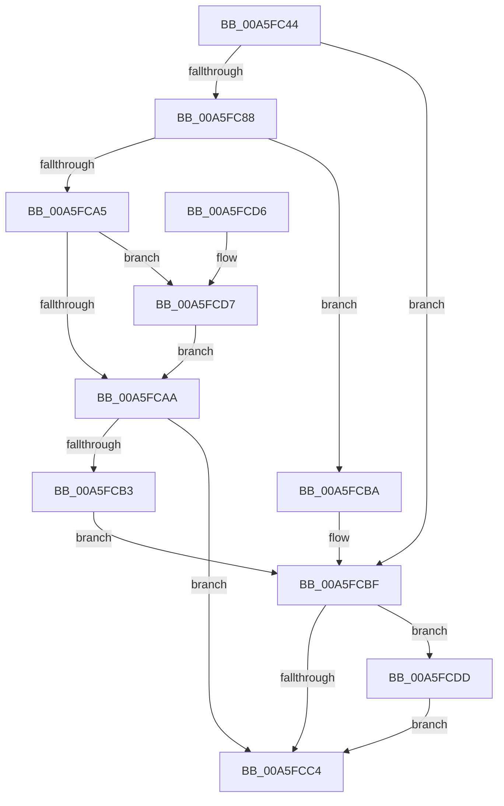

# EtwpAddNotificationEvent

- RVA: `0x00A5FC44`–`0x00A5FCE7` (길이 `163` bytes)
- VA: `0x0000000140A5FC44`
- 실행 섹션: `PAGE`
- PDB 이름 있음: `예`; PDB Function 태그: `아니요`
- unwind 정보 RVA: `0x000B2DEC`
- 디코드: `46`개 명령, `163/163` bytes 표시
- 미해석 바이트: `0` (있으면 어셈블리에 `.byte`로 보존)

> 이 문서는 커널 이미지의 기계어와 PDB 기호를 분석해 생성했습니다. 4번과 5번은 함수 원형과 자료형을 바이너리 사용 방식에서 추정한 C 해석이며 원본 소스 복구 결과는 아닙니다.

## 1. Dependencies

- 직접 호출 지점: **3**; 고유 호출 대상: **3**
- 직접 호출자로 확인된 함수: **1**
- RIP 상대 이미지 참조: **1**

### Outgoing calls
- `0x00A5FC78` → [ObReferenceObjectByHandle](../86/ObReferenceObjectByHandle_function_00868DB0.md) (function, `0x00868DB0`)
- `0x00A5FC98` → [EtwpAddDataSource](../8C/EtwpAddDataSource_function_008C8924.md) (function, `0x008C8924`)
- `0x00A5FCE0` → [ObfDereferenceObject](../../text/2F/ObfDereferenceObject_function_002F9350.md) (function, `0x002F9350`)

### Direct callers
- [NtTraceControl](../A9/NtTraceControl_function_00A9ED40.md) at `0x00A9F4B5`

### Static image references
- `0x00A5FC5D` → RVA `0x00FC6B80` (`ALMOSTRO`; read)

## 2. Other-region calls and transfers

- 다른 실행 섹션으로 향하는 call: **1**
  - `0x00A5FCE0` → [ObfDereferenceObject](../../text/2F/ObfDereferenceObject_function_002F9350.md) (`PAGE` → `.text`)
- 별도 외부 분기/꼬리 이동을 확인하지 못했습니다.

## 3. Assembly (complete function range)

```asm
00A5FC44  4C 8B DC                        mov r11, rsp
00A5FC47  49 89 5B 08                     mov qword ptr [r11 + 8], rbx
00A5FC4B  49 89 73 10                     mov qword ptr [r11 + 0x10], rsi
00A5FC4F  57                              push rdi
00A5FC50  48 83 EC 30                     sub rsp, 0x30
00A5FC54  49 83 63 F0 00                  and qword ptr [r11 - 0x10], 0
00A5FC59  49 8D 43 18                     lea rax, [r11 + 0x18]
00A5FC5D  4C 8B 05 1C 6F 56 00            mov r8, qword ptr [rip + 0x566f1c]
00A5FC64  40 8A F2                        mov sil, dl
00A5FC67  49 83 63 18 00                  and qword ptr [r11 + 0x18], 0
00A5FC6C  BA 02 00 00 00                  mov edx, 2
00A5FC71  41 B1 01                        mov r9b, 1
00A5FC74  49 89 43 E8                     mov qword ptr [r11 - 0x18], rax
00A5FC78  E8 33 91 E0 FF                  call 0x140868db0
00A5FC7D  48 8B 7C 24 50                  mov rdi, qword ptr [rsp + 0x50]
00A5FC82  8B D8                           mov ebx, eax
00A5FC84  85 C0                           test eax, eax
00A5FC86  78 37                           js 0x140a5fcbf
00A5FC88  65 48 8B 04 25 88 01 00 00      mov rax, qword ptr gs:[0x188]
00A5FC91  48 8B 88 B8 00 00 00            mov rcx, qword ptr [rax + 0xb8]
00A5FC98  E8 87 8C E6 FF                  call 0x1408c8924
00A5FC9D  48 8B C8                        mov rcx, rax
00A5FCA0  48 85 C0                        test rax, rax
00A5FCA3  74 15                           je 0x140a5fcba
00A5FCA5  40 84 F6                        test sil, sil
00A5FCA8  75 2D                           jne 0x140a5fcd7
00A5FCAA  33 C0                           xor eax, eax
00A5FCAC  F0 48 0F B1 39                  lock cmpxchg qword ptr [rcx], rdi
00A5FCB1  74 11                           je 0x140a5fcc4
00A5FCB3  BB 18 07 00 C0                  mov ebx, 0xc0000718
00A5FCB8  EB 05                           jmp 0x140a5fcbf
00A5FCBA  BB 17 00 00 C0                  mov ebx, 0xc0000017
00A5FCBF  48 85 FF                        test rdi, rdi
00A5FCC2  75 19                           jne 0x140a5fcdd
00A5FCC4  48 8B 74 24 48                  mov rsi, qword ptr [rsp + 0x48]
00A5FCC9  8B C3                           mov eax, ebx
00A5FCCB  48 8B 5C 24 40                  mov rbx, qword ptr [rsp + 0x40]
00A5FCD0  48 83 C4 30                     add rsp, 0x30
00A5FCD4  5F                              pop rdi
00A5FCD5  C3                              ret
00A5FCD6  CC                              int3
00A5FCD7  48 83 C1 08                     add rcx, 8
00A5FCDB  EB CD                           jmp 0x140a5fcaa
00A5FCDD  48 8B CF                        mov rcx, rdi
00A5FCE0  E8 6B 96 89 FF                  call 0x1402f9350
00A5FCE5  EB DD                           jmp 0x140a5fcc4
```

## 4. C-style interpretation (structured pseudocode)

```c
__int64 __fastcall EtwpAddNotificationEvent(__int64 a1, unsigned __int8 a2)
{
    __int64 result;
    __int64 v_rsp;
    unsigned __int64 v_stack_p10;
    unsigned __int64 v_stack_p18;
    unsigned __int64 v_stack_p8;

    *(unsigned __int64 *)(v_rsp + 8) = v_rbx;
    *(unsigned __int64 *)(v_rsp + 16) = v_rsi;
    v_rsp = (v_rsp) - (48);
    *(unsigned __int64 *)(v_rsp - 24) = v_rsp + 24;
    result = ObReferenceObjectByHandle(a1, 2, *(unsigned __int64 *)(v_rip + 5664540), 1);
    if (sign_flag) goto loc_00A5FCBF;
    result = EtwpAddDataSource(*(unsigned __int64 *)(*(unsigned __int64 *)(gs_base + (0 + 392)) + 184), 2, *(unsigned __int64 *)(v_rip + 5664540), 1);
    if (result == 0) goto loc_00A5FCBA;
    if (a2 != 0) goto loc_00A5FCD7;
loc_00A5FCAA:
    result = 0;
    if (condition_is_equal) goto loc_00A5FCC4;
    goto loc_00A5FCBF;
loc_00A5FCBA:
loc_00A5FCBF:
    if (v_stack_p18 != 0) goto loc_00A5FCDD;
loc_00A5FCC4:
    v_rsp = (v_rsp) + (48);
    return (unsigned int)((unsigned int)((unsigned int)(0xC0000017ULL)));
loc_00A5FCD7:
    a1 = (result) + (8);
    goto loc_00A5FCAA;
loc_00A5FCDD:
    result = ObfDereferenceObject(v_stack_p18, 2, *(unsigned __int64 *)(v_rip + 5664540), 1);
    goto loc_00A5FCC4;
}
```

## 5. (Beta) C Style

```c
int64_t EtwpAddNotificationEvent(int64_t Arg1, uint8_t Arg2)
{
    int64_t result;
    int64_t local_rsp;
    uint64_t v_stack_p10;
    uint64_t v_stack_p18;
    uint64_t v_stack_p8;

    *(uint64_t *)(local_rsp + 0x8) = local_rbx;
    *(uint64_t *)(local_rsp + 0x10) = local_rsi;
    local_rsp = (local_rsp) - (48);
    *(uint64_t *)(local_rsp - 0x18) = local_rsp + 24;
    result = ObReferenceObjectByHandle(Arg1, 2, *(uint64_t *)(v_rip + 0x566F1C), 1);
    if (sign_flag) goto loc_00A5FCBF;
    result = EtwpAddDataSource(*(uint64_t *)(*(uint64_t *)(gs_base + (0 + 0x188)) + 0xB8), 2, *(uint64_t *)(v_rip + 0x566F1C), 1);
    if (result == 0) goto loc_00A5FCBA;
    if (Arg2 != 0) goto loc_00A5FCD7;
loc_00A5FCAA:
    result = 0;
    if (condition_is_equal) goto loc_00A5FCC4;
    goto loc_00A5FCBF;
loc_00A5FCBA:
loc_00A5FCBF:
    if (v_stack_p18 != 0) goto loc_00A5FCDD;
loc_00A5FCC4:
    local_rsp = (local_rsp) + (48);
    return (uint32_t)((uint32_t)((uint32_t)(0xC0000017ULL)));
loc_00A5FCD7:
    Arg1 = (result) + (8);
    goto loc_00A5FCAA;
loc_00A5FCDD:
    result = ObfDereferenceObject(v_stack_p18, 2, *(uint64_t *)(v_rip + 0x566F1C), 1);
    goto loc_00A5FCC4;
}
```

## 6. Execution-region graph

[열기: 2D/3D 그래프와 함수 탐색 컨트롤 패널](../../../control-panel.html?section=page&rva=0x00A5FC44&view=graph)

- 2D 그래프는 위에서 아래로 흐르고, 3D 그래프는 빈 공간을 드래그해 회전합니다. Shift+드래그는 이동, 휠은 확대·축소, 함수 노드 선택은 대상 보고서 이동입니다.

### Static fallback


