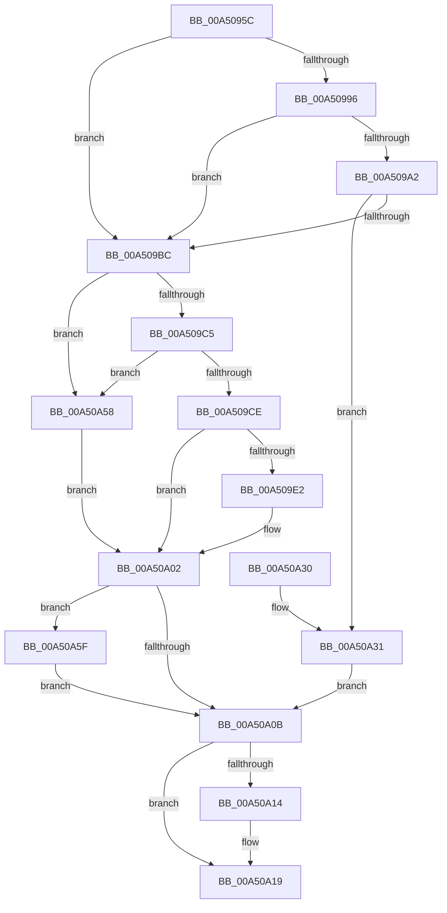

# EtwpCovSampModuleGetName

- RVA: `0x00A5095C`–`0x00A50A66` (길이 `266` bytes)
- VA: `0x0000000140A5095C`
- 실행 섹션: `PAGE`
- PDB 이름 있음: `예`; PDB Function 태그: `아니요`
- unwind 정보 RVA: `0x000B0AC0`
- 디코드: `77`개 명령, `266/266` bytes 표시
- 미해석 바이트: `0` (있으면 어셈블리에 `.byte`로 보존)

> 이 문서는 커널 이미지의 기계어와 PDB 기호를 분석해 생성했습니다. 4번과 5번은 함수 원형과 자료형을 바이너리 사용 방식에서 추정한 C 해석이며 원본 소스 복구 결과는 아닙니다.

## 1. Dependencies

- 직접 호출 지점: **4**; 고유 호출 대상: **4**
- 직접 호출자로 확인된 함수: **1**
- RIP 상대 이미지 참조: **1**

### Outgoing calls
- `0x00A509B3` → [guard_dispatch_icall](../../text/6B/guard_dispatch_icall_function_006BAAD0.md) (function, `0x006BAAD0`)
- `0x00A509D7` → [RtlDuplicateUnicodeString](../93/RtlDuplicateUnicodeString_function_009321F0.md) (function, `0x009321F0`)
- `0x00A50A14` → [ExFreePool](../../poolcode/B8/ExFreePool_function_00B82850.md) (function, `0x00B82850`)
- `0x00A50A5F` → [FsRtlReleaseFileNameInformation](../97/FsRtlReleaseFileNameInformation_function_0097DB90.md) (function, `0x0097DB90`)

### Direct callers
- [EtwpCovSampContextGetModule](../8D/EtwpCovSampContextGetModule_function_008D7FEC.md) at `0x008D834B`

### Static image references
- `0x00A50996` → RVA `0x00E65BF0` (`.data`; read)

## 2. Other-region calls and transfers

- 다른 실행 섹션으로 향하는 call: **2**
  - `0x00A509B3` → [guard_dispatch_icall](../../text/6B/guard_dispatch_icall_function_006BAAD0.md) (`PAGE` → `.text`)
  - `0x00A50A14` → [ExFreePool](../../poolcode/B8/ExFreePool_function_00B82850.md) (`PAGE` → `POOLCODE`)
- 별도 외부 분기/꼬리 이동을 확인하지 못했습니다.

## 3. Assembly (complete function range)

```asm
00A5095C  48 89 5C 24 08                  mov qword ptr [rsp + 8], rbx
00A50961  48 89 74 24 18                  mov qword ptr [rsp + 0x18], rsi
00A50966  48 89 7C 24 20                  mov qword ptr [rsp + 0x20], rdi
00A5096B  55                              push rbp
00A5096C  48 8B EC                        mov rbp, rsp
00A5096F  48 83 EC 50                     sub rsp, 0x50
00A50973  33 F6                           xor esi, esi
00A50975  48 8B D9                        mov rbx, rcx
00A50978  48 8B 4A 30                     mov rcx, qword ptr [rdx + 0x30]
00A5097C  0F 57 C0                        xorps xmm0, xmm0
00A5097F  48 89 75 18                     mov qword ptr [rbp + 0x18], rsi
00A50983  0F 57 C9                        xorps xmm1, xmm1
00A50986  49 8B F8                        mov rdi, r8
00A50989  0F 11 45 F0                     movups xmmword ptr [rbp - 0x10], xmm0
00A5098D  0F 11 4D E0                     movups xmmword ptr [rbp - 0x20], xmm1
00A50991  48 85 C9                        test rcx, rcx
00A50994  74 26                           je 0x140a509bc
00A50996  48 8B 05 53 52 41 00            mov rax, qword ptr [rip + 0x415253]
00A5099D  48 85 C0                        test rax, rax
00A509A0  74 1A                           je 0x140a509bc
00A509A2  48 8B 40 18                     mov rax, qword ptr [rax + 0x18]
00A509A6  4C 8D 4D 18                     lea r9, [rbp + 0x18]
00A509AA  4C 8D 45 F0                     lea r8, [rbp - 0x10]
00A509AE  BA 00 02 00 00                  mov edx, 0x200
00A509B3  E8 18 A1 C6 FF                  call 0x1406baad0
00A509B8  85 C0                           test eax, eax
00A509BA  79 75                           jns 0x140a50a31
00A509BC  48 85 FF                        test rdi, rdi
00A509BF  0F 84 93 00 00 00               je 0x140a50a58
00A509C5  66 39 37                        cmp word ptr [rdi], si
00A509C8  0F 84 8A 00 00 00               je 0x140a50a58
00A509CE  4C 8D 45 E0                     lea r8, [rbp - 0x20]
00A509D2  48 8B D7                        mov rdx, rdi
00A509D5  33 C9                           xor ecx, ecx
00A509D7  E8 14 18 EE FF                  call 0x1409321f0
00A509DC  8B F8                           mov edi, eax
00A509DE  85 C0                           test eax, eax
00A509E0  78 20                           js 0x140a50a02
00A509E2  48 8B 4D E8                     mov rcx, qword ptr [rbp - 0x18]
00A509E6  0F 57 C0                        xorps xmm0, xmm0
00A509E9  0F B7 45 E0                     movzx eax, word ptr [rbp - 0x20]
00A509ED  8B FE                           mov edi, esi
00A509EF  66 D1 E8                        shr ax, 1
00A509F2  66 89 43 78                     mov word ptr [rbx + 0x78], ax
00A509F6  48 89 4B 70                     mov qword ptr [rbx + 0x70], rcx
00A509FA  48 89 4B 68                     mov qword ptr [rbx + 0x68], rcx
00A509FE  0F 11 45 E0                     movups xmmword ptr [rbp - 0x20], xmm0
00A50A02  48 8B 4D 18                     mov rcx, qword ptr [rbp + 0x18]
00A50A06  48 85 C9                        test rcx, rcx
00A50A09  75 54                           jne 0x140a50a5f
00A50A0B  48 8B 4D E8                     mov rcx, qword ptr [rbp - 0x18]
00A50A0F  48 85 C9                        test rcx, rcx
00A50A12  74 05                           je 0x140a50a19
00A50A14  E8 37 1E 13 00                  call 0x140b82850
00A50A19  48 8B 5C 24 60                  mov rbx, qword ptr [rsp + 0x60]
00A50A1E  8B C7                           mov eax, edi
00A50A20  48 8B 7C 24 78                  mov rdi, qword ptr [rsp + 0x78]
00A50A25  48 8B 74 24 70                  mov rsi, qword ptr [rsp + 0x70]
00A50A2A  48 83 C4 50                     add rsp, 0x50
00A50A2E  5D                              pop rbp
00A50A2F  C3                              ret
00A50A30  CC                              int3
00A50A31  48 8B 45 F8                     mov rax, qword ptr [rbp - 8]
00A50A35  8B FE                           mov edi, esi
00A50A37  48 89 43 70                     mov qword ptr [rbx + 0x70], rax
00A50A3B  0F B7 45 F0                     movzx eax, word ptr [rbp - 0x10]
00A50A3F  66 D1 E8                        shr ax, 1
00A50A42  66 89 43 78                     mov word ptr [rbx + 0x78], ax
00A50A46  48 8B 45 18                     mov rax, qword ptr [rbp + 0x18]
00A50A4A  48 83 C8 01                     or rax, 1
00A50A4E  48 89 75 18                     mov qword ptr [rbp + 0x18], rsi
00A50A52  48 89 43 68                     mov qword ptr [rbx + 0x68], rax
00A50A56  EB B3                           jmp 0x140a50a0b
00A50A58  BF 25 02 00 C0                  mov edi, 0xc0000225
00A50A5D  EB A3                           jmp 0x140a50a02
00A50A5F  E8 2C D1 F2 FF                  call 0x14097db90
00A50A64  EB A5                           jmp 0x140a50a0b
```

## 4. C-style interpretation (structured pseudocode)

```c
__int64 __fastcall EtwpCovSampModuleGetName(__int64 a1, __int64 a2, __int64 a3)
{
    __int64 result;
    __int64 v_rdi;
    __int64 v_rsi;
    __int64 v_rsp;
    unsigned __int64 v_stack_m10;
    unsigned __int64 v_stack_m18;
    unsigned __int64 v_stack_m20;
    unsigned __int64 v_stack_m28;
    unsigned __int64 v_stack_p10;
    unsigned __int64 v_stack_p18;
    unsigned __int64 v_stack_p20;
    unsigned __int64 v_stack_p8;

    v_stack_p8 = v_rbx;
    v_stack_p18 = v_rsi;
    v_stack_p20 = v_rdi;
    v_rsp = (v_rsp) - (80);
    v_rsi = 0;
    v_stack_p10 = 0;
    v_stack_m18 = v_xmm0;
    v_stack_m28 = v_xmm1;
    if (*(unsigned __int64 *)(a2 + 48) == 0) goto loc_00A509BC;
    if (*(unsigned __int64 *)(v_rip + 4280915) == 0) goto loc_00A509BC;
    result = guard_dispatch_icall(*(unsigned __int64 *)(a2 + 48), 512, v_stack_m18, v_stack_p10);
    if (!sign_flag) goto loc_00A50A31;
loc_00A509BC:
    if (a3 == 0) goto loc_00A50A58;
    if ((*(unsigned __int16 *)(a3)) == 0) goto loc_00A50A58;
    a1 = 0;
    result = RtlDuplicateUnicodeString(a1, a3, v_stack_m28, v_stack_p10);
    v_rdi = (unsigned int)((unsigned int)(result));
    if (!(sign_flag)) {
        a1 = v_stack_m20;
        result = v_stack_m28;
        v_rdi = 0;
        result = (unsigned __int16)((result) >> (1));
        *(unsigned __int16 *)(a1 + 120) = (unsigned __int16)(result);
        *(unsigned __int64 *)(a1 + 112) = a1;
        *(unsigned __int64 *)(a1 + 104) = a1;
        v_stack_m28 = v_xmm0;
    }
    if (v_stack_p10 != 0) goto loc_00A50A5F;
loc_00A50A0B:
    if (v_stack_m20 != 0) {
        result = ExFreePool(v_stack_m20, a3, v_stack_m28, v_stack_p10);
    }
    v_rsp = (v_rsp) + (80);
    return (unsigned int)((unsigned int)(v_rdi));
loc_00A50A31:
    *(unsigned __int64 *)(v_stack_p8 + 112) = v_stack_m10;
    result = (unsigned __int16)((v_stack_m18) >> (1));
    *(unsigned __int16 *)(v_stack_p8 + 120) = (unsigned __int16)(result);
    result = (v_stack_p10) | (1);
    v_stack_p10 = v_stack_p18;
    *(unsigned __int64 *)(v_stack_p8 + 104) = result;
    goto loc_00A50A0B;
loc_00A50A58:
    goto loc_00A50A02;
loc_00A50A5F:
    result = FsRtlReleaseFileNameInformation(v_stack_m20, a3, v_stack_m28, v_stack_p10);
    goto loc_00A50A0B;
}
```

## 5. (Beta) C Style

```c
int64_t EtwpCovSampModuleGetName(void *Arg1, void *Arg2, int64_t Arg3)
{
    uint8_t *arg1 = (uint8_t *)Arg1;
    uint8_t *arg2 = (uint8_t *)Arg2;

    int64_t result;
    int64_t local_rdi;
    int64_t local_rsi;
    int64_t local_rsp;
    uint64_t v_stack_m10;
    uint64_t v_stack_m18;
    uint64_t v_stack_m20;
    uint64_t v_stack_m28;
    uint64_t v_stack_p10;
    uint64_t v_stack_p18;
    uint64_t v_stack_p20;
    uint64_t v_stack_p8;

    v_stack_p8 = local_rbx;
    v_stack_p18 = local_rsi;
    v_stack_p20 = local_rdi;
    local_rsp = (local_rsp) - (80);
    local_rsi = 0;
    v_stack_p10 = 0;
    v_stack_m18 = v_xmm0;
    v_stack_m28 = v_xmm1;
    if (*(uint64_t *)(arg2 + 0x30) == 0) goto loc_00A509BC;
    if (*(uint64_t *)(v_rip + 0x415253) == 0) goto loc_00A509BC;
    result = guard_dispatch_icall(*(uint64_t *)(arg2 + 0x30), 512, v_stack_m18, v_stack_p10);
    if (!sign_flag) goto loc_00A50A31;
loc_00A509BC:
    if (Arg3 == 0) goto loc_00A50A58;
    if ((*(uint16_t *)(Arg3)) == 0) goto loc_00A50A58;
    Arg1 = 0;
    result = RtlDuplicateUnicodeString(Arg1, Arg3, v_stack_m28, v_stack_p10);
    local_rdi = (uint32_t)((uint32_t)(result));
    if (!(sign_flag)) {
        Arg1 = v_stack_m20;
        result = v_stack_m28;
        local_rdi = 0;
        result = (uint16_t)((result) >> (1));
        *(uint16_t *)(arg1 + 0x78) = (uint16_t)(result);
        *(void **)(arg1 + 0x70) = Arg1;
        *(void **)(arg1 + 0x68) = Arg1;
        v_stack_m28 = v_xmm0;
    }
    if (v_stack_p10 != 0) goto loc_00A50A5F;
loc_00A50A0B:
    if (v_stack_m20 != 0) {
        result = ExFreePool(v_stack_m20, Arg3, v_stack_m28, v_stack_p10);
    }
    local_rsp = (local_rsp) + (80);
    return (uint32_t)((uint32_t)(local_rdi));
loc_00A50A31:
    *(uint64_t *)(v_stack_p8 + 0x70) = v_stack_m10;
    result = (uint16_t)((v_stack_m18) >> (1));
    *(uint16_t *)(v_stack_p8 + 0x78) = (uint16_t)(result);
    result = (v_stack_p10) | (1);
    v_stack_p10 = v_stack_p18;
    *(uint64_t *)(v_stack_p8 + 0x68) = result;
    goto loc_00A50A0B;
loc_00A50A58:
    goto loc_00A50A02;
loc_00A50A5F:
    result = FsRtlReleaseFileNameInformation(v_stack_m20, Arg3, v_stack_m28, v_stack_p10);
    goto loc_00A50A0B;
}
```

### 관측된 메모리 오프셋

구조체 형식이 확인되지 않은 접근은 인자 기준의 오프셋으로만 기록했습니다.

| 기준 인자 | 오프셋 표현 | 폭 (bit) | 접근 |
|---|---:|---:|---|
| `Arg1` | `+ 0x68` | `64` | `W` |
| `Arg1` | `+ 0x70` | `64` | `W` |
| `Arg1` | `+ 0x78` | `16` | `W` |
| `Arg2` | `+ 0x30` | `64` | `R` |

## 6. Execution-region graph

[열기: 2D/3D 그래프와 함수 탐색 컨트롤 패널](../../../control-panel.html?section=page&rva=0x00A5095C&view=graph)

- 2D 그래프는 위에서 아래로 흐르고, 3D 그래프는 빈 공간을 드래그해 회전합니다. Shift+드래그는 이동, 휠은 확대·축소, 함수 노드 선택은 대상 보고서 이동입니다.

### Static fallback


