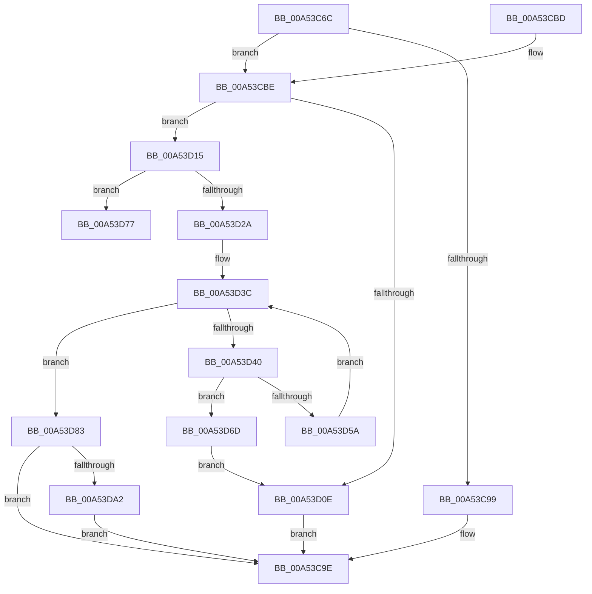

# EtwpEnableStackCaching

- RVA: `0x00A53C6C`–`0x00A53DAF` (길이 `323` bytes)
- VA: `0x0000000140A53C6C`
- 실행 섹션: `PAGE`
- PDB 이름 있음: `예`; PDB Function 태그: `예`
- unwind 정보 RVA: `0x000B0FD0`
- 디코드: `89`개 명령, `323/323` bytes 표시
- 미해석 바이트: `0` (있으면 어셈블리에 `.byte`로 보존)

> 이 문서는 커널 이미지의 기계어와 PDB 기호를 분석해 생성했습니다. 4번과 5번은 함수 원형과 자료형을 바이너리 사용 방식에서 추정한 C 해석이며 원본 소스 복구 결과는 아닙니다.

## 1. Dependencies

- 직접 호출 지점: **5**; 고유 호출 대상: **4**
- 직접 호출자로 확인된 함수: **2**
- RIP 상대 이미지 참조: **0**

### Outgoing calls
- `0x00A53D01` → [ExAllocatePool2](../../poolcode/B8/ExAllocatePool2_function_00B820F0.md) (function, `0x00B820F0`)
- `0x00A53D20` → [InitializeSListHead](../../text/46/InitializeSListHead_function_00468A90.md) (function, `0x00468A90`)
- `0x00A53D50` → [ExAllocatePool2](../../poolcode/B8/ExAllocatePool2_function_00B820F0.md) (function, `0x00B820F0`)
- `0x00A53D64` → [ExpInterlockedPushEntrySList](../../text/6B/ExpInterlockedPushEntrySList_function_006BA5B0.md) (function, `0x006BA5B0`)
- `0x00A53D70` → [EtwpFreeStackCache](EtwpFreeStackCache_function_00A53FF4.md) (function, `0x00A53FF4`)

### Direct callers
- [EtwSetPerformanceTraceInformation](EtwSetPerformanceTraceInformation_function_00A53928.md) at `0x00A53B69`
- [sub_00B3EB10](../B3/Unknown_function_00B3EB10.md) at `0x00B3EB22`

### Static image references
- 디코드된 RIP-relative 메모리 참조가 없습니다.

## 2. Other-region calls and transfers

- 다른 실행 섹션으로 향하는 call: **4**
  - `0x00A53D01` → [ExAllocatePool2](../../poolcode/B8/ExAllocatePool2_function_00B820F0.md) (`PAGE` → `POOLCODE`)
  - `0x00A53D20` → [InitializeSListHead](../../text/46/InitializeSListHead_function_00468A90.md) (`PAGE` → `.text`)
  - `0x00A53D50` → [ExAllocatePool2](../../poolcode/B8/ExAllocatePool2_function_00B820F0.md) (`PAGE` → `POOLCODE`)
  - `0x00A53D64` → [ExpInterlockedPushEntrySList](../../text/6B/ExpInterlockedPushEntrySList_function_006BA5B0.md) (`PAGE` → `.text`)
- call이 아닌 외부 분기/꼬리 이동: **1**
  - `0x00A53D7E` → [sub_00B3D4A2](../B3/Unknown_function_00B3D4A2.md) (`tail-transfer`)

## 3. Assembly (complete function range)

```asm
00A53C6C  48 89 5C 24 08                  mov qword ptr [rsp + 8], rbx
00A53C71  48 89 6C 24 10                  mov qword ptr [rsp + 0x10], rbp
00A53C76  48 89 74 24 18                  mov qword ptr [rsp + 0x18], rsi
00A53C7B  57                              push rdi
00A53C7C  41 54                           push r12
00A53C7E  41 55                           push r13
00A53C80  41 56                           push r14
00A53C82  41 57                           push r15
00A53C84  48 83 EC 20                     sub rsp, 0x20
00A53C88  33 DB                           xor ebx, ebx
00A53C8A  45 8A E9                        mov r13b, r9b
00A53C8D  48 8B F9                        mov rdi, rcx
00A53C90  48 39 99 20 04 00 00            cmp qword ptr [rcx + 0x420], rbx
00A53C97  74 25                           je 0x140a53cbe
00A53C99  BB 03 03 00 C0                  mov ebx, 0xc0000303
00A53C9E  48 8B 6C 24 58                  mov rbp, qword ptr [rsp + 0x58]
00A53CA3  8B C3                           mov eax, ebx
00A53CA5  48 8B 5C 24 50                  mov rbx, qword ptr [rsp + 0x50]
00A53CAA  48 8B 74 24 60                  mov rsi, qword ptr [rsp + 0x60]
00A53CAF  48 83 C4 20                     add rsp, 0x20
00A53CB3  41 5F                           pop r15
00A53CB5  41 5E                           pop r14
00A53CB7  41 5D                           pop r13
00A53CB9  41 5C                           pop r12
00A53CBB  5F                              pop rdi
00A53CBC  C3                              ret
00A53CBD  CC                              int3
00A53CBE  B8 00 00 20 03                  mov eax, 0x3200000
00A53CC3  BE 00 00 30 00                  mov esi, 0x300000
00A53CC8  3B D6                           cmp edx, esi
00A53CCA  41 BF 00 01 00 00               mov r15d, 0x100
00A53CD0  B9 40 00 00 00                  mov ecx, 0x40
00A53CD5  0F 43 F2                        cmovae esi, edx
00A53CD8  3B F0                           cmp esi, eax
00A53CDA  0F 47 F0                        cmova esi, eax
00A53CDD  45 3B C7                        cmp r8d, r15d
00A53CE0  B8 00 10 00 00                  mov eax, 0x1000
00A53CE5  45 0F 43 F8                     cmovae r15d, r8d
00A53CE9  41 B8 45 74 77 73               mov r8d, 0x73777445
00A53CEF  44 3B F8                        cmp r15d, eax
00A53CF2  44 0F 47 F8                     cmova r15d, eax
00A53CF6  43 8D 04 7F                     lea eax, [r15 + r15*2]
00A53CFA  8D 14 C5 20 00 00 00            lea edx, [rax*8 + 0x20]
00A53D01  E8 EA E3 12 00                  call 0x140b820f0
00A53D06  4C 8B F0                        mov r14, rax
00A53D09  48 85 C0                        test rax, rax
00A53D0C  75 07                           jne 0x140a53d15
00A53D0E  BB 17 00 00 C0                  mov ebx, 0xc0000017
00A53D13  EB 89                           jmp 0x140a53c9e
00A53D15  48 8D 48 10                     lea rcx, [rax + 0x10]
00A53D19  44 89 78 08                     mov dword ptr [rax + 8], r15d
00A53D1D  48 89 38                        mov qword ptr [rax], rdi
00A53D20  E8 6B 4D A1 FF                  call 0x140468a90
00A53D25  45 85 FF                        test r15d, r15d
00A53D28  75 4D                           jne 0x140a53d77
00A53D2A  B8 4D 91 CF BA                  mov eax, 0xbacf914d
00A53D2F  8B EB                           mov ebp, ebx
00A53D31  F7 E6                           mul esi
00A53D33  2B F2                           sub esi, edx
00A53D35  D1 EE                           shr esi, 1
00A53D37  03 F2                           add esi, edx
00A53D39  C1 EE 08                        shr esi, 8
00A53D3C  3B EE                           cmp ebp, esi
00A53D3E  73 43                           jae 0x140a53d83
00A53D40  BA 28 01 00 00                  mov edx, 0x128
00A53D45  B9 40 00 00 00                  mov ecx, 0x40
00A53D4A  41 B8 45 74 77 78               mov r8d, 0x78777445
00A53D50  E8 9B E3 12 00                  call 0x140b820f0
00A53D55  48 85 C0                        test rax, rax
00A53D58  74 13                           je 0x140a53d6d
00A53D5A  48 8B D0                        mov rdx, rax
00A53D5D  89 58 18                        mov dword ptr [rax + 0x18], ebx
00A53D60  49 8D 4E 10                     lea rcx, [r14 + 0x10]
00A53D64  E8 47 68 C6 FF                  call 0x1406ba5b0
00A53D69  FF C5                           inc ebp
00A53D6B  EB CF                           jmp 0x140a53d3c
00A53D6D  49 8B CE                        mov rcx, r14
00A53D70  E8 7F 02 00 00                  call 0x140a53ff4
00A53D75  EB 97                           jmp 0x140a53d0e
00A53D77  49 8D 46 20                     lea rax, [r14 + 0x20]
00A53D7B  41 8B CF                        mov ecx, r15d
00A53D7E  E9 1F 97 0E 00                  jmp 0x140b3d4a2
00A53D83  4C 89 B7 20 04 00 00            mov qword ptr [rdi + 0x420], r14
00A53D8A  F0 09 1C 24                     lock or dword ptr [rsp], ebx
00A53D8E  F0 81 8F 30 03 00 00 00 00 00 01  lock or dword ptr [rdi + 0x330], 0x1000000
00A53D99  45 84 ED                        test r13b, r13b
00A53D9C  0F 84 FC FE FF FF               je 0x140a53c9e
00A53DA2  F0 83 8F 34 03 00 00 01         lock or dword ptr [rdi + 0x334], 1
00A53DAA  E9 EF FE FF FF                  jmp 0x140a53c9e
```

## 4. C-style interpretation (structured pseudocode)

```c
__int64 __fastcall EtwpEnableStackCaching(__int64 a1, int a2, int a3, unsigned __int8 a4)
{
    __int64 result;
    __int64 v_r15;
    __int64 v_rbp;
    __int64 v_rbx;
    __int64 v_rsi;
    __int64 v_rsp;
    unsigned int v_stack_p0;
    unsigned __int64 v_stack_p10;
    unsigned __int64 v_stack_p18;
    unsigned __int64 v_stack_p8;

    v_stack_p8 = v_rbx;
    v_stack_p10 = v_rbp;
    v_stack_p18 = v_rsi;
    v_rsp = (v_rsp) - (32);
    v_rbx = 0;
    if ((*(unsigned __int64 *)(a1 + 1056)) == 0) goto loc_00A53CBE;
loc_00A53C9E:
    v_rsp = (v_rsp) + (32);
    return (unsigned int)((unsigned int)((unsigned int)(0xC0000303ULL)));
loc_00A53CBE:
    v_rsi = (unsigned int)(0x300000ULL);
    if (a2 >= ((unsigned int)((unsigned int)(0x300000ULL)))) { v_rsi = a2; }
    if (((unsigned int)(v_rsi)) > ((unsigned int)((unsigned int)(0x3200000ULL)))) { v_rsi = (unsigned int)((unsigned int)(0x3200000ULL)); }
    v_r15 = 256;
    if (a3 >= 256) { v_r15 = a3; }
    if (((unsigned int)(v_r15)) > ((unsigned int)((unsigned int)(0x1000ULL)))) { v_r15 = (unsigned int)((unsigned int)(0x1000ULL)); }
    result = ExAllocatePool2(64, v_r15 + v_r15 * 2 * 8 + 32, (unsigned int)(0x73777445ULL), a4);
    if (result != 0) goto loc_00A53D15;
loc_00A53D0E:
    goto loc_00A53C9E;
loc_00A53D15:
    *(unsigned int *)(result + 8) = (unsigned int)(v_r15);
    *(unsigned __int64 *)(result) = a1;
    result = InitializeSListHead(result + 16, v_r15 + v_r15 * 2 * 8 + 32, (unsigned int)(0x73777445ULL), a4);
    if ((unsigned int)(v_r15) != 0) goto loc_00A53D77;
    v_rsi = (unsigned int)((v_rsi) - ((unsigned int)(v_r15 + v_r15 * 2 * 8 + 32)));
    v_rsi = (unsigned int)((v_rsi) >> (1));
    v_rsi = (unsigned int)((v_rsi) + ((unsigned int)(v_r15 + v_r15 * 2 * 8 + 32)));
    v_rsi = (unsigned int)((v_rsi) >> (8));
loc_00A53D3C:
    if (((unsigned int)((unsigned int)((unsigned int)((unsigned int)(0xC0000017ULL))))) >= ((unsigned int)(v_rsi))) goto loc_00A53D83;
    result = ExAllocatePool2(64, 296, (unsigned int)(0x78777445ULL), a4);
    if (result == 0) goto loc_00A53D6D;
    *(unsigned int *)(result + 24) = (unsigned int)((unsigned int)(0xC0000017ULL));
    result = ExpInterlockedPushEntrySList(result + 16, result, (unsigned int)(0x78777445ULL), a4);
    v_rbp = (unsigned int)(((unsigned int)((unsigned int)((unsigned int)(0xC0000017ULL)))) + 1);
    goto loc_00A53D3C;
loc_00A53D6D:
    result = EtwpFreeStackCache(result, result, (unsigned int)(0x78777445ULL), a4);
    goto loc_00A53D0E;
loc_00A53D77:
loc_00A53D83:
    *(unsigned __int64 *)(a1 + 1056) = result;
    if (a4 == 0) goto loc_00A53C9E;
    goto loc_00A53C9E;
}
```

## 5. (Beta) C Style

```c
int64_t EtwpEnableStackCaching(void *Arg1, int32_t Arg2, int32_t Arg3, uint8_t Arg4)
{
    uint8_t *arg1 = (uint8_t *)Arg1;

    int64_t result;
    int64_t local_r15;
    int64_t local_rbp;
    int64_t local_rbx;
    int64_t local_rsi;
    int64_t local_rsp;
    uint32_t v_stack_p0;
    uint64_t v_stack_p10;
    uint64_t v_stack_p18;
    uint64_t v_stack_p8;

    v_stack_p8 = local_rbx;
    v_stack_p10 = local_rbp;
    v_stack_p18 = local_rsi;
    local_rsp = (local_rsp) - (32);
    local_rbx = 0;
    if ((*(uint64_t *)(arg1 + 0x420)) == 0) goto loc_00A53CBE;
loc_00A53C9E:
    local_rsp = (local_rsp) + (32);
    return (uint32_t)((uint32_t)((uint32_t)(0xC0000303ULL)));
loc_00A53CBE:
    local_rsi = (uint32_t)(0x300000ULL);
    if (Arg2 >= ((uint32_t)((uint32_t)(0x300000ULL)))) { local_rsi = Arg2; }
    if (((uint32_t)(local_rsi)) > ((uint32_t)((uint32_t)(0x3200000ULL)))) { local_rsi = (uint32_t)((uint32_t)(0x3200000ULL)); }
    local_r15 = 256;
    if (Arg3 >= 256) { local_r15 = Arg3; }
    if (((uint32_t)(local_r15)) > ((uint32_t)((uint32_t)(0x1000ULL)))) { local_r15 = (uint32_t)((uint32_t)(0x1000ULL)); }
    result = ExAllocatePool2(64, local_r15 + local_r15 * 2 * 8 + 32, (uint32_t)(0x73777445ULL), Arg4);
    if (result != 0) goto loc_00A53D15;
loc_00A53D0E:
    goto loc_00A53C9E;
loc_00A53D15:
    *(uint32_t *)(result + 0x8) = (uint32_t)(local_r15);
    *(void **)(result) = Arg1;
    result = InitializeSListHead(result + 16, local_r15 + local_r15 * 2 * 8 + 32, (uint32_t)(0x73777445ULL), Arg4);
    if ((uint32_t)(local_r15) != 0) goto loc_00A53D77;
    local_rsi = (uint32_t)((local_rsi) - ((uint32_t)(local_r15 + local_r15 * 2 * 8 + 32)));
    local_rsi = (uint32_t)((local_rsi) >> (1));
    local_rsi = (uint32_t)((local_rsi) + ((uint32_t)(local_r15 + local_r15 * 2 * 8 + 32)));
    local_rsi = (uint32_t)((local_rsi) >> (8));
loc_00A53D3C:
    if (((uint32_t)((uint32_t)((uint32_t)((uint32_t)(0xC0000017ULL))))) >= ((uint32_t)(local_rsi))) goto loc_00A53D83;
    result = ExAllocatePool2(64, 296, (uint32_t)(0x78777445ULL), Arg4);
    if (result == 0) goto loc_00A53D6D;
    *(uint32_t *)(result + 0x18) = (uint32_t)((uint32_t)(0xC0000017ULL));
    result = ExpInterlockedPushEntrySList(result + 16, result, (uint32_t)(0x78777445ULL), Arg4);
    local_rbp = (uint32_t)(((uint32_t)((uint32_t)((uint32_t)(0xC0000017ULL)))) + 1);
    goto loc_00A53D3C;
loc_00A53D6D:
    result = EtwpFreeStackCache(result, result, (uint32_t)(0x78777445ULL), Arg4);
    goto loc_00A53D0E;
loc_00A53D77:
loc_00A53D83:
    *(uint64_t *)(arg1 + 0x420) = result;
    if (Arg4 == 0) goto loc_00A53C9E;
    goto loc_00A53C9E;
}
```

### 관측된 메모리 오프셋

구조체 형식이 확인되지 않은 접근은 인자 기준의 오프셋으로만 기록했습니다.

| 기준 인자 | 오프셋 표현 | 폭 (bit) | 접근 |
|---|---:|---:|---|
| `Arg1` | `+ 0x330` | `32` | `R/W` |
| `Arg1` | `+ 0x334` | `32` | `R/W` |
| `Arg1` | `+ 0x420` | `64` | `R` |
| `Arg1` | `+ 0x420` | `64` | `W` |

## 6. Execution-region graph

[열기: 2D/3D 그래프와 함수 탐색 컨트롤 패널](../../../control-panel.html?section=page&rva=0x00A53C6C&view=graph)

- 2D 그래프는 위에서 아래로 흐르고, 3D 그래프는 빈 공간을 드래그해 회전합니다. Shift+드래그는 이동, 휠은 확대·축소, 함수 노드 선택은 대상 보고서 이동입니다.

### Static fallback


