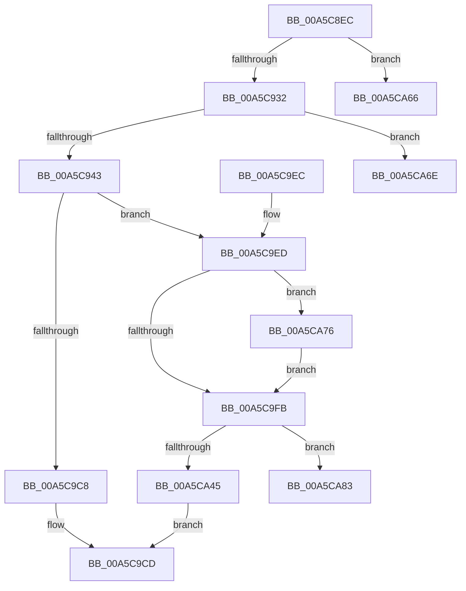

# EtwpEnableTrace

- RVA: `0x00A5C8EC`–`0x00A5CA9A` (길이 `430` bytes)
- VA: `0x0000000140A5C8EC`
- 실행 섹션: `PAGE`
- PDB 이름 있음: `예`; PDB Function 태그: `예`
- unwind 정보 RVA: `0x000B2794`
- 디코드: `114`개 명령, `430/430` bytes 표시
- 미해석 바이트: `0` (있으면 어셈블리에 `.byte`로 보존)

> 이 문서는 커널 이미지의 기계어와 PDB 기호를 분석해 생성했습니다. 4번과 5번은 함수 원형과 자료형을 바이너리 사용 방식에서 추정한 C 해석이며 원본 소스 복구 결과는 아닙니다.

## 1. Dependencies

- 직접 호출 지점: **3**; 고유 호출 대상: **3**
- 직접 호출자로 확인된 함수: **2**
- RIP 상대 이미지 참조: **0**

### Outgoing calls
- `0x00A5C9B9` → [ExAllocatePool2](../../poolcode/B8/ExAllocatePool2_function_00B820F0.md) (function, `0x00B820F0`)
- `0x00A5CA50` → [EtwpEnableGuid](EtwpEnableGuid_function_00A5CD28.md) (function, `0x00A5CD28`)
- `0x00A5CA5C` → [ExFreePoolWithTag](../../poolcode/B8/ExFreePoolWithTag_function_00B82870.md) (function, `0x00B82870`)

### Direct callers
- [EtwEnableTrace](EtwEnableTrace_function_00A5C850.md) at `0x00A5C8D6`
- [EtwpEnableAutoLoggerProvider](../A9/EtwpEnableAutoLoggerProvider_function_00A92B00.md) at `0x00A9312A`

### Static image references
- 디코드된 RIP-relative 메모리 참조가 없습니다.

## 2. Other-region calls and transfers

- 다른 실행 섹션으로 향하는 call: **2**
  - `0x00A5C9B9` → [ExAllocatePool2](../../poolcode/B8/ExAllocatePool2_function_00B820F0.md) (`PAGE` → `POOLCODE`)
  - `0x00A5CA5C` → [ExFreePoolWithTag](../../poolcode/B8/ExFreePoolWithTag_function_00B82870.md) (`PAGE` → `POOLCODE`)
- call이 아닌 외부 분기/꼬리 이동: **3**
  - `0x00A5CA69` → [sub_00B3DCDC](../B3/Unknown_function_00B3DCDC.md) (`tail-transfer`)
  - `0x00A5CA71` → [sub_00B3DCDC + 0x43](../B3/Unknown_function_00B3DCDC.md) (`tail-transfer`)
  - `0x00A5CA95` → [sub_00B3DCDC + 0x73](../B3/Unknown_function_00B3DCDC.md) (`tail-transfer`)

## 3. Assembly (complete function range)

```asm
00A5C8EC  48 8B C4                        mov rax, rsp
00A5C8EF  48 89 58 10                     mov qword ptr [rax + 0x10], rbx
00A5C8F3  48 89 68 18                     mov qword ptr [rax + 0x18], rbp
00A5C8F7  48 89 70 20                     mov qword ptr [rax + 0x20], rsi
00A5C8FB  48 89 48 08                     mov qword ptr [rax + 8], rcx
00A5C8FF  57                              push rdi
00A5C900  41 54                           push r12
00A5C902  41 55                           push r13
00A5C904  41 56                           push r14
00A5C906  41 57                           push r15
00A5C908  48 83 EC 20                     sub rsp, 0x20
00A5C90C  4C 8B BC 24 98 00 00 00         mov r15, qword ptr [rsp + 0x98]
00A5C914  45 33 F6                        xor r14d, r14d
00A5C917  49 8B E9                        mov rbp, r9
00A5C91A  49 8B F8                        mov rdi, r8
00A5C91D  4C 8B EA                        mov r13, rdx
00A5C920  41 BB 78 00 00 00               mov r11d, 0x78
00A5C926  41 8B DE                        mov ebx, r14d
00A5C929  4D 85 FF                        test r15, r15
00A5C92C  0F 85 34 01 00 00               jne 0x140a5ca66
00A5C932  4C 8B A4 24 A0 00 00 00         mov r12, qword ptr [rsp + 0xa0]
00A5C93A  4D 85 E4                        test r12, r12
00A5C93D  0F 85 2B 01 00 00               jne 0x140a5ca6e
00A5C943  8B 94 24 B0 00 00 00            mov edx, dword ptr [rsp + 0xb0]
00A5C94A  8D 4B 01                        lea ecx, [rbx + 1]
00A5C94D  44 8B 8C 24 C0 00 00 00         mov r9d, dword ptr [rsp + 0xc0]
00A5C955  85 D2                           test edx, edx
00A5C957  0F 44 CB                        cmove ecx, ebx
00A5C95A  41 8D 04 13                     lea eax, [r11 + rdx]
00A5C95E  41 0F 44 C3                     cmove eax, r11d
00A5C962  45 85 C9                        test r9d, r9d
00A5C965  44 8D 41 01                     lea r8d, [rcx + 1]
00A5C969  44 0F 44 C1                     cmove r8d, ecx
00A5C96D  42 8D 14 08                     lea edx, [rax + r9]
00A5C971  44 8B 8C 24 D0 00 00 00         mov r9d, dword ptr [rsp + 0xd0]
00A5C979  0F 44 D0                        cmove edx, eax
00A5C97C  45 85 C9                        test r9d, r9d
00A5C97F  41 8D 40 01                     lea eax, [r8 + 1]
00A5C983  41 0F 44 C0                     cmove eax, r8d
00A5C987  41 B8 45 74 77 74               mov r8d, 0x74777445
00A5C98D  42 8D 0C 0A                     lea ecx, [rdx + r9]
00A5C991  0F 44 CA                        cmove ecx, edx
00A5C994  48 8B 94 24 D8 00 00 00         mov rdx, qword ptr [rsp + 0xd8]
00A5C99C  48 85 D2                        test rdx, rdx
00A5C99F  8D 58 01                        lea ebx, [rax + 1]
00A5C9A2  0F 44 D8                        cmove ebx, eax
00A5C9A5  8D 71 18                        lea esi, [rcx + 0x18]
00A5C9A8  8B C3                           mov eax, ebx
00A5C9AA  0F 44 F1                        cmove esi, ecx
00A5C9AD  C1 E0 04                        shl eax, 4
00A5C9B0  03 F0                           add esi, eax
00A5C9B2  B9 00 01 00 00                  mov ecx, 0x100
00A5C9B7  8B D6                           mov edx, esi
00A5C9B9  E8 32 57 12 00                  call 0x140b820f0
00A5C9BE  33 D2                           xor edx, edx
00A5C9C0  4C 8B F0                        mov r14, rax
00A5C9C3  48 85 C0                        test rax, rax
00A5C9C6  75 25                           jne 0x140a5c9ed
00A5C9C8  BB 17 00 00 C0                  mov ebx, 0xc0000017
00A5C9CD  48 8B 6C 24 60                  mov rbp, qword ptr [rsp + 0x60]
00A5C9D2  8B C3                           mov eax, ebx
00A5C9D4  48 8B 5C 24 58                  mov rbx, qword ptr [rsp + 0x58]
00A5C9D9  48 8B 74 24 68                  mov rsi, qword ptr [rsp + 0x68]
00A5C9DE  48 83 C4 20                     add rsp, 0x20
00A5C9E2  41 5F                           pop r15
00A5C9E4  41 5E                           pop r14
00A5C9E6  41 5D                           pop r13
00A5C9E8  41 5C                           pop r12
00A5C9EA  5F                              pop rdi
00A5C9EB  C3                              ret
00A5C9EC  CC                              int3
00A5C9ED  C7 00 03 00 00 00               mov dword ptr [rax], 3
00A5C9F3  89 70 04                        mov dword ptr [rax + 4], esi
00A5C9F6  48 85 FF                        test rdi, rdi
00A5C9F9  75 7B                           jne 0x140a5ca76
00A5C9FB  41 0F 10 45 00                  movups xmm0, xmmword ptr [r13]
00A5CA00  66 41 89 6E 4E                  mov word ptr [r14 + 0x4e], bp
00A5CA05  41 89 5E 74                     mov dword ptr [r14 + 0x74], ebx
00A5CA09  F3 0F 7F 40 28                  movdqu xmmword ptr [rax + 0x28], xmm0
00A5CA0E  8B 44 24 70                     mov eax, dword ptr [rsp + 0x70]
00A5CA12  41 89 46 48                     mov dword ptr [r14 + 0x48], eax
00A5CA16  8A 44 24 78                     mov al, byte ptr [rsp + 0x78]
00A5CA1A  41 88 46 4C                     mov byte ptr [r14 + 0x4c], al
00A5CA1E  48 8B 84 24 88 00 00 00         mov rax, qword ptr [rsp + 0x88]
00A5CA26  49 89 46 60                     mov qword ptr [r14 + 0x60], rax
00A5CA2A  48 8B 84 24 80 00 00 00         mov rax, qword ptr [rsp + 0x80]
00A5CA32  49 89 46 58                     mov qword ptr [r14 + 0x58], rax
00A5CA36  8B 84 24 90 00 00 00            mov eax, dword ptr [rsp + 0x90]
00A5CA3D  41 89 46 50                     mov dword ptr [r14 + 0x50], eax
00A5CA41  85 DB                           test ebx, ebx
00A5CA43  75 3E                           jne 0x140a5ca83
00A5CA45  48 8B 4C 24 50                  mov rcx, qword ptr [rsp + 0x50]
00A5CA4A  45 33 C0                        xor r8d, r8d
00A5CA4D  49 8B D6                        mov rdx, r14
00A5CA50  E8 D3 02 00 00                  call 0x140a5cd28
00A5CA55  33 D2                           xor edx, edx
00A5CA57  49 8B CE                        mov rcx, r14
00A5CA5A  8B D8                           mov ebx, eax
00A5CA5C  E8 0F 5E 12 00                  call 0x140b82870
00A5CA61  E9 67 FF FF FF                  jmp 0x140a5c9cd
00A5CA66  45 8B D6                        mov r10d, r14d
00A5CA69  E9 6E 12 0E 00                  jmp 0x140b3dcdc
00A5CA6E  41 8B CE                        mov ecx, r14d
00A5CA71  E9 A9 12 0E 00                  jmp 0x140b3dd1f
00A5CA76  0F 10 07                        movups xmm0, xmmword ptr [rdi]
00A5CA79  F3 0F 7F 40 38                  movdqu xmmword ptr [rax + 0x38], xmm0
00A5CA7E  E9 78 FF FF FF                  jmp 0x140a5c9fb
00A5CA83  8B F3                           mov esi, ebx
00A5CA85  49 8D 7E 78                     lea rdi, [r14 + 0x78]
00A5CA89  48 C1 E6 04                     shl rsi, 4
00A5CA8D  8B EA                           mov ebp, edx
00A5CA8F  48 03 F7                        add rsi, rdi
00A5CA92  44 8B EA                        mov r13d, edx
00A5CA95  E9 B5 12 0E 00                  jmp 0x140b3dd4f
```

## 4. C-style interpretation (structured pseudocode)

```c
__int64 __fastcall EtwpEnableTrace(__int64 a1, __int64 a2, __int64 a3, __int64 a4, unsigned int a5, unsigned __int8 a6, __int64 a7, __int64 a8, unsigned int a9, __int64 a10, __int64 a11, __int64 a12, unsigned int a13, __int64 a14, unsigned int a15, __int64 a16, unsigned int a17, __int64 a18)
{
    __int64 result;
    __int64 v_r14;
    __int64 v_rbx;
    __int64 v_rsi;
    __int64 v_rsp;
    unsigned __int64 v_stack_p10;
    unsigned __int64 v_stack_p18;
    unsigned __int64 v_stack_p20;
    unsigned __int64 v_stack_p50;

    *(unsigned __int64 *)(v_rsp + 16) = v_rbx;
    *(unsigned __int64 *)(v_rsp + 24) = v_rbp;
    *(unsigned __int64 *)(v_rsp + 32) = v_rsi;
    *(unsigned __int64 *)(v_rsp + 8) = a1;
    v_rsp = (v_rsp) - (32);
    v_r14 = 0;
    if (a10 != 0) goto loc_00A5CA66;
    if (a11 != 0) goto loc_00A5CA6E;
    a1 = 0 + 1;
    if ((unsigned int)((unsigned int)(a13)) == 0) { a1 = 0; }
    result = 120 + (unsigned int)(a13) * 1;
    if ((unsigned int)((unsigned int)(a13)) == 0) { result = 120; }
    a3 = a1 + 1;
    if ((unsigned int)((unsigned int)(a15)) == 0) { a3 = (unsigned int)(a1); }
    a2 = result + (unsigned int)(a15) * 1;
    if ((unsigned int)((unsigned int)(a15)) == 0) { a2 = (unsigned int)(result); }
    result = a3 + 1;
    if ((unsigned int)((unsigned int)(a17)) == 0) { result = (unsigned int)(a3); }
    a1 = a2 + (unsigned int)(a17) * 1;
    if ((unsigned int)((unsigned int)(a17)) == 0) { a1 = (unsigned int)(a2); }
    v_rbx = result + 1;
    if (a18 == 0) { v_rbx = (unsigned int)(result); }
    v_rsi = a1 + 24;
    if (a18 == 0) { v_rsi = (unsigned int)(a1); }
    result = (unsigned int)(((unsigned int)((unsigned int)(v_rbx))) << (4));
    v_rsi = (unsigned int)((v_rsi) + ((unsigned int)(result)));
    result = ExAllocatePool2(256, (unsigned int)((unsigned int)(v_rsi)), (unsigned int)(0x74777445ULL), (unsigned int)(a17));
    a2 = 0;
    if (result != 0) goto loc_00A5C9ED;
loc_00A5C9CD:
    v_rsp = (v_rsp) + (32);
    return (unsigned int)((unsigned int)((unsigned int)(0xC0000017ULL)));
loc_00A5C9ED:
    *(unsigned int *)((unsigned int)((unsigned int)((unsigned int)(0xC0000017ULL)))) = 3;
    *(unsigned int *)((unsigned int)((unsigned int)((unsigned int)(0xC0000017ULL))) + 4) = (unsigned int)(v_stack_p20);
    if (a3 != 0) goto loc_00A5CA76;
loc_00A5C9FB:
    *(unsigned __int16 *)(result + 78) = (unsigned __int16)(v_stack_p18);
    *(unsigned int *)(result + 116) = (unsigned int)(v_stack_p10);
    *(unsigned __int64 *)((unsigned int)((unsigned int)((unsigned int)(0xC0000017ULL))) + 40) = v_xmm0;
    *(unsigned int *)(result + 72) = (unsigned int)((unsigned int)(a5));
    *(unsigned __int8 *)(result + 76) = a6;
    *(unsigned __int64 *)(result + 96) = a8;
    *(unsigned __int64 *)(result + 88) = a7;
    *(unsigned int *)(result + 80) = (unsigned int)((unsigned int)(a9));
    if ((unsigned int)(v_stack_p10) != 0) goto loc_00A5CA83;
    a3 = 0;
    result = EtwpEnableGuid(v_stack_p50, result, a3, (unsigned int)(a17));
    a2 = 0;
    result = ExFreePoolWithTag(result, a2, a3, (unsigned int)(a17));
    goto loc_00A5C9CD;
loc_00A5CA66:
loc_00A5CA6E:
loc_00A5CA76:
    *(unsigned __int64 *)(result + 56) = v_xmm0;
    goto loc_00A5C9FB;
loc_00A5CA83:
    v_rsi = ((unsigned int)((unsigned int)((unsigned int)((unsigned int)(result))))) << (4);
    v_rsi = (v_rsi) + (result + 120);
}
```

## 5. (Beta) C Style

```c
int64_t EtwpEnableTrace(int64_t Arg1, void *Arg2, int64_t Arg3, int64_t Arg4, uint32_t Arg5, uint8_t Arg6, int64_t Arg7, int64_t Arg8, uint32_t Arg9, int64_t Arg10, int64_t Arg11, uint64_t Arg12, uint32_t Arg13, uint64_t Arg14, uint32_t Arg15, uint64_t Arg16, uint32_t Arg17, int64_t Arg18)
{
    uint8_t *arg2 = (uint8_t *)Arg2;

    int64_t result;
    int64_t local_r14;
    int64_t local_rbx;
    int64_t local_rsi;
    int64_t local_rsp;
    uint64_t v_stack_p10;
    uint64_t v_stack_p18;
    uint64_t v_stack_p20;
    uint64_t v_stack_p50;

    *(uint64_t *)(local_rsp + 0x10) = local_rbx;
    *(uint64_t *)(local_rsp + 0x18) = local_rbp;
    *(uint64_t *)(local_rsp + 0x20) = local_rsi;
    *(uint64_t *)(local_rsp + 0x8) = Arg1;
    local_rsp = (local_rsp) - (32);
    local_r14 = 0;
    if (Arg10 != 0) goto loc_00A5CA66;
    if (Arg11 != 0) goto loc_00A5CA6E;
    Arg1 = 0 + 1;
    if ((uint32_t)((uint32_t)(Arg13)) == 0) { Arg1 = 0; }
    result = 120 + (uint32_t)(Arg13) * 1;
    if ((uint32_t)((uint32_t)(Arg13)) == 0) { result = 120; }
    Arg3 = Arg1 + 1;
    if ((uint32_t)((uint32_t)(Arg15)) == 0) { Arg3 = (uint32_t)(Arg1); }
    Arg2 = result + (uint32_t)(Arg15) * 1;
    if ((uint32_t)((uint32_t)(Arg15)) == 0) { Arg2 = (uint32_t)(result); }
    result = Arg3 + 1;
    if ((uint32_t)((uint32_t)(Arg17)) == 0) { result = (uint32_t)(Arg3); }
    Arg1 = Arg2 + (uint32_t)(Arg17) * 1;
    if ((uint32_t)((uint32_t)(Arg17)) == 0) { Arg1 = (uint32_t)(Arg2); }
    local_rbx = result + 1;
    if (Arg18 == 0) { local_rbx = (uint32_t)(result); }
    local_rsi = Arg1 + 24;
    if (Arg18 == 0) { local_rsi = (uint32_t)(Arg1); }
    result = (uint32_t)(((uint32_t)((uint32_t)(local_rbx))) << (4));
    local_rsi = (uint32_t)((local_rsi) + ((uint32_t)(result)));
    result = ExAllocatePool2(256, (uint32_t)((uint32_t)(local_rsi)), (uint32_t)(0x74777445ULL), (uint32_t)(Arg17));
    Arg2 = 0;
    if (result != 0) goto loc_00A5C9ED;
loc_00A5C9CD:
    local_rsp = (local_rsp) + (32);
    return (uint32_t)((uint32_t)((uint32_t)(0xC0000017ULL)));
loc_00A5C9ED:
    *(uint32_t *)((uint32_t)((uint32_t)((uint32_t)(0xC0000017ULL)))) = 3;
    *(uint32_t *)((uint32_t)((uint32_t)((uint32_t)(0xC0000017ULL))) + 0x4) = (uint32_t)(v_stack_p20);
    if (Arg3 != 0) goto loc_00A5CA76;
loc_00A5C9FB:
    *(uint16_t *)(result + 0x4E) = (uint16_t)(v_stack_p18);
    *(uint32_t *)(result + 0x74) = (uint32_t)(v_stack_p10);
    *(uint64_t *)((uint32_t)((uint32_t)((uint32_t)(0xC0000017ULL))) + 0x28) = v_xmm0;
    *(uint32_t *)(result + 0x48) = (uint32_t)((uint32_t)(Arg5));
    *(uint8_t *)(result + 0x4C) = Arg6;
    *(uint64_t *)(result + 0x60) = Arg8;
    *(uint64_t *)(result + 0x58) = Arg7;
    *(uint32_t *)(result + 0x50) = (uint32_t)((uint32_t)(Arg9));
    if ((uint32_t)(v_stack_p10) != 0) goto loc_00A5CA83;
    Arg3 = 0;
    result = EtwpEnableGuid(v_stack_p50, result, Arg3, (uint32_t)(Arg17));
    Arg2 = 0;
    result = ExFreePoolWithTag(result, Arg2, Arg3, (uint32_t)(Arg17));
    goto loc_00A5C9CD;
loc_00A5CA66:
loc_00A5CA6E:
loc_00A5CA76:
    *(uint64_t *)(result + 0x38) = v_xmm0;
    goto loc_00A5C9FB;
loc_00A5CA83:
    local_rsi = ((uint32_t)((uint32_t)((uint32_t)((uint32_t)(result))))) << (4);
    local_rsi = (local_rsi) + (result + 120);
}
```

### 관측된 메모리 오프셋

구조체 형식이 확인되지 않은 접근은 인자 기준의 오프셋으로만 기록했습니다.

| 기준 인자 | 오프셋 표현 | 폭 (bit) | 접근 |
|---|---:|---:|---|
| `Arg2` | `+ 0x0` | `128` | `R` |

## 6. Execution-region graph

[열기: 2D/3D 그래프와 함수 탐색 컨트롤 패널](../../../control-panel.html?section=page&rva=0x00A5C8EC&view=graph)

- 2D 그래프는 위에서 아래로 흐르고, 3D 그래프는 빈 공간을 드래그해 회전합니다. Shift+드래그는 이동, 휠은 확대·축소, 함수 노드 선택은 대상 보고서 이동입니다.

### Static fallback


