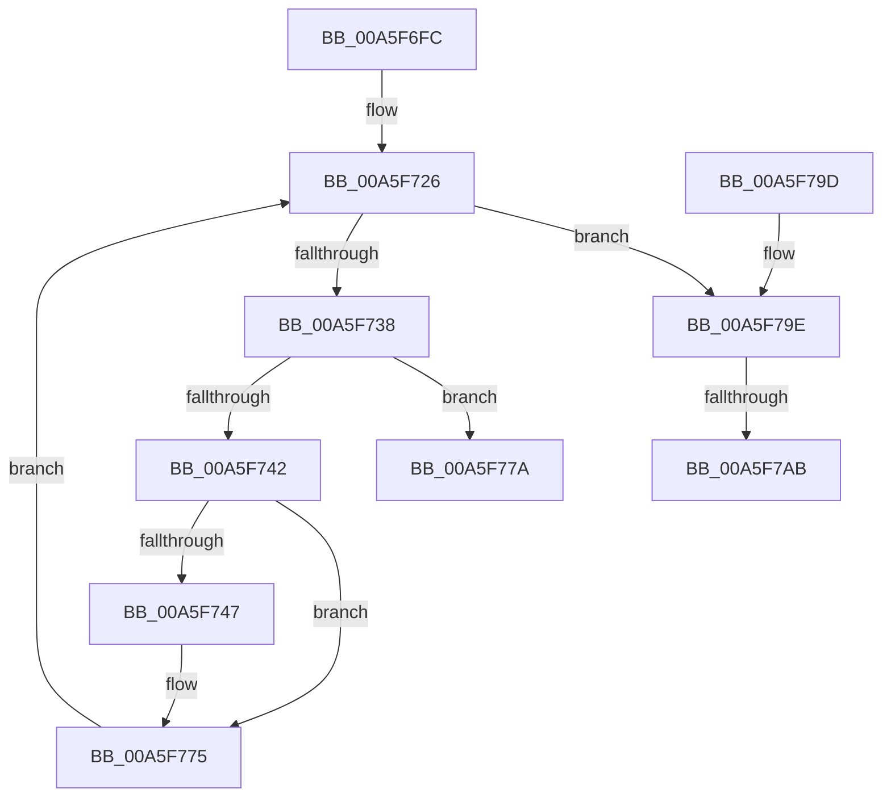

# EtwpEnumerateTraceGuids

- RVA: `0x00A5F6FC`–`0x00A5F7B5` (길이 `185` bytes)
- VA: `0x0000000140A5F6FC`
- 실행 섹션: `PAGE`
- PDB 이름 있음: `예`; PDB Function 태그: `예`
- unwind 정보 RVA: `0x000B2CF8`
- 디코드: `55`개 명령, `185/185` bytes 표시
- 미해석 바이트: `0` (있으면 어셈블리에 `.byte`로 보존)

> 이 문서는 커널 이미지의 기계어와 PDB 기호를 분석해 생성했습니다. 4번과 5번은 함수 원형과 자료형을 바이너리 사용 방식에서 추정한 C 해석이며 원본 소스 복구 결과는 아닙니다.

## 1. Dependencies

- 직접 호출 지점: **1**; 고유 호출 대상: **1**
- 직접 호출자로 확인된 함수: **1**
- RIP 상대 이미지 참조: **1**

### Outgoing calls
- `0x00A5F729` → [EtwpGetNextGuidEntry](../8C/EtwpGetNextGuidEntry_function_008C3170.md) (function, `0x008C3170`)

### Direct callers
- [NtTraceControl](../A9/NtTraceControl_function_00A9ED40.md) at `0x00A9F323`

### Static image references
- `0x00A5F79E` → RVA `0x00FC6AA8` (`ALMOSTRO`; read)

## 2. Other-region calls and transfers

- 다른 실행 섹션으로 향하는 call: **0**
- call이 아닌 외부 분기/꼬리 이동: **2**
  - `0x00A5F7A5` → [sub_00B3E16C](../B3/Unknown_function_00B3E16C.md) (`tail-transfer`)
  - `0x00A5F7B0` → [sub_00B3E16C + 0x12](../B3/Unknown_function_00B3E16C.md) (`tail-transfer`)

## 3. Assembly (complete function range)

```asm
00A5F6FC  48 89 5C 24 08                  mov qword ptr [rsp + 8], rbx
00A5F701  48 89 6C 24 10                  mov qword ptr [rsp + 0x10], rbp
00A5F706  48 89 74 24 18                  mov qword ptr [rsp + 0x18], rsi
00A5F70B  57                              push rdi
00A5F70C  41 56                           push r14
00A5F70E  41 57                           push r15
00A5F710  48 83 EC 20                     sub rsp, 0x20
00A5F714  33 DB                           xor ebx, ebx
00A5F716  48 8B EA                        mov rbp, rdx
00A5F719  8B FB                           mov edi, ebx
00A5F71B  33 D2                           xor edx, edx
00A5F71D  4D 8B F1                        mov r14, r9
00A5F720  45 8B F8                        mov r15d, r8d
00A5F723  48 8B F1                        mov rsi, rcx
00A5F726  45 33 C0                        xor r8d, r8d
00A5F729  E8 42 3A E6 FF                  call 0x1408c3170
00A5F72E  48 8B D0                        mov rdx, rax
00A5F731  8B C7                           mov eax, edi
00A5F733  48 85 D2                        test rdx, rdx
00A5F736  74 66                           je 0x140a5f79e
00A5F738  FF C7                           inc edi
00A5F73A  81 FF C7 71 1C 07               cmp edi, 0x71c71c7
00A5F740  77 38                           ja 0x140a5f77a
00A5F742  41 3B FF                        cmp edi, r15d
00A5F745  77 2E                           ja 0x140a5f775
00A5F747  0F 10 42 28                     movups xmm0, xmmword ptr [rdx + 0x28]
00A5F74B  48 8D 0C C0                     lea rcx, [rax + rax*8]
00A5F74F  F3 0F 7F 44 8D 00               movdqu xmmword ptr [rbp + rcx*4], xmm0
00A5F755  8B 42 50                        mov eax, dword ptr [rdx + 0x50]
00A5F758  89 44 8D 1C                     mov dword ptr [rbp + rcx*4 + 0x1c], eax
00A5F75C  0F B7 42 58                     movzx eax, word ptr [rdx + 0x58]
00A5F760  89 44 8D 14                     mov dword ptr [rbp + rcx*4 + 0x14], eax
00A5F764  0F B6 42 5A                     movzx eax, byte ptr [rdx + 0x5a]
00A5F768  89 44 8D 18                     mov dword ptr [rbp + rcx*4 + 0x18], eax
00A5F76C  8A 42 5B                        mov al, byte ptr [rdx + 0x5b]
00A5F76F  24 01                           and al, 1
00A5F771  88 44 8D 20                     mov byte ptr [rbp + rcx*4 + 0x20], al
00A5F775  48 8B CE                        mov rcx, rsi
00A5F778  EB AC                           jmp 0x140a5f726
00A5F77A  BB 05 00 00 80                  mov ebx, 0x80000005
00A5F77F  41 89 3E                        mov dword ptr [r14], edi
00A5F782  48 8B 6C 24 48                  mov rbp, qword ptr [rsp + 0x48]
00A5F787  8B C3                           mov eax, ebx
00A5F789  48 8B 5C 24 40                  mov rbx, qword ptr [rsp + 0x40]
00A5F78E  48 8B 74 24 50                  mov rsi, qword ptr [rsp + 0x50]
00A5F793  48 83 C4 20                     add rsp, 0x20
00A5F797  41 5F                           pop r15
00A5F799  41 5E                           pop r14
00A5F79B  5F                              pop rdi
00A5F79C  C3                              ret
00A5F79D  CC                              int3
00A5F79E  48 3B 35 03 73 56 00            cmp rsi, qword ptr [rip + 0x567303]
00A5F7A5  0F 85 C1 E9 0D 00               jne 0x140b3e16c
00A5F7AB  BA 80 03 FE 7F                  mov edx, 0x7ffe0380
00A5F7B0  E9 C9 E9 0D 00                  jmp 0x140b3e17e
```

## 4. C-style interpretation (structured pseudocode)

```c
__int64 __fastcall EtwpEnumerateTraceGuids(__int64 a1, __int64 a2, int a3, __int64 a4)
{
    __int64 result;
    __int64 v_rbx;
    __int64 v_rdi;
    __int64 v_rsp;
    unsigned __int64 v_stack_p10;
    unsigned __int64 v_stack_p18;
    unsigned __int64 v_stack_p8;

    v_stack_p8 = v_rbx;
    v_stack_p10 = v_rbp;
    v_stack_p18 = v_rsi;
    v_rsp = (v_rsp) - (32);
    v_rbx = 0;
    a2 = 0;
loc_00A5F726:
    a3 = 0;
    result = EtwpGetNextGuidEntry(a1, a2, a3, a4);
    if (result == 0) goto loc_00A5F79E;
    v_rdi = (unsigned int)((0) + 1);
    if (((unsigned int)(v_rdi)) > 0x71C71C7ULL) goto loc_00A5F77A;
    result = 0;
    if (((unsigned int)(v_rdi)) <= ((unsigned int)((unsigned int)(a3)))) {
        a1 = 0 + 0 * 8;
        *(unsigned __int64 *)(a2 + a1 * 4) = v_xmm0;
        result = *(unsigned int *)(result + 80);
        *(unsigned int *)(a2 + a1 * 4 + 28) = (unsigned int)(result);
        result = *(unsigned __int16 *)(result + 88);
        *(unsigned int *)(a2 + a1 * 4 + 20) = (unsigned int)(result);
        result = *(unsigned __int8 *)(result + 90);
        *(unsigned int *)(a2 + a1 * 4 + 24) = (unsigned int)(result);
        result = *(unsigned __int8 *)(result + 91);
        result = (unsigned __int8)((result) & (1));
        *(unsigned __int8 *)(a2 + a1 * 4 + 32) = (unsigned __int8)(result);
    }
    goto loc_00A5F726;
loc_00A5F77A:
    *(unsigned int *)(a4) = (unsigned int)(v_rdi);
    v_rsp = (v_rsp) + (32);
    return (unsigned int)((unsigned int)((unsigned int)(0x80000005ULL)));
loc_00A5F79E:
}
```

## 5. (Beta) C Style

```c
int64_t EtwpEnumerateTraceGuids(int64_t Arg1, void *Arg2, int32_t Arg3, void *Arg4)
{
    uint8_t *arg2 = (uint8_t *)Arg2;
    uint8_t *arg4 = (uint8_t *)Arg4;

    int64_t result;
    int64_t local_rbx;
    int64_t local_rdi;
    int64_t local_rsp;
    uint64_t v_stack_p10;
    uint64_t v_stack_p18;
    uint64_t v_stack_p8;

    v_stack_p8 = local_rbx;
    v_stack_p10 = local_rbp;
    v_stack_p18 = local_rsi;
    local_rsp = (local_rsp) - (32);
    local_rbx = 0;
    Arg2 = 0;
loc_00A5F726:
    Arg3 = 0;
    result = EtwpGetNextGuidEntry(Arg1, Arg2, Arg3, Arg4);
    if (result == 0) goto loc_00A5F79E;
    local_rdi = (uint32_t)((0) + 1);
    if (((uint32_t)(local_rdi)) > 0x71C71C7ULL) goto loc_00A5F77A;
    result = 0;
    if (((uint32_t)(local_rdi)) <= ((uint32_t)((uint32_t)(Arg3)))) {
        Arg1 = 0 + 0 * 8;
        *(uint64_t *)(arg2 + Arg1 * 4) = v_xmm0;
        result = *(uint32_t *)(result + 0x50);
        *(uint32_t *)(arg2 + Arg1 * 4 + 0x1C) = (uint32_t)(result);
        result = *(uint16_t *)(result + 0x58);
        *(uint32_t *)(arg2 + Arg1 * 4 + 0x14) = (uint32_t)(result);
        result = *(uint8_t *)(result + 0x5A);
        *(uint32_t *)(arg2 + Arg1 * 4 + 0x18) = (uint32_t)(result);
        result = *(uint8_t *)(result + 0x5B);
        result = (uint8_t)((result) & (1));
        *(uint8_t *)(arg2 + Arg1 * 4 + 0x20) = (uint8_t)(result);
    }
    goto loc_00A5F726;
loc_00A5F77A:
    *(uint32_t *)(arg4) = (uint32_t)(local_rdi);
    local_rsp = (local_rsp) + (32);
    return (uint32_t)((uint32_t)((uint32_t)(0x80000005ULL)));
loc_00A5F79E:
}
```

### 관측된 메모리 오프셋

구조체 형식이 확인되지 않은 접근은 인자 기준의 오프셋으로만 기록했습니다.

| 기준 인자 | 오프셋 표현 | 폭 (bit) | 접근 |
|---|---:|---:|---|
| `Arg2` | `+ 0x0 + rcx*4` | `128` | `W` |
| `Arg2` | `+ 0x14 + rcx*4` | `32` | `W` |
| `Arg2` | `+ 0x18 + rcx*4` | `32` | `W` |
| `Arg2` | `+ 0x1C + rcx*4` | `32` | `W` |
| `Arg2` | `+ 0x20 + rcx*4` | `8` | `W` |
| `Arg4` | `+ 0x0` | `32` | `W` |

## 6. Execution-region graph

[열기: 2D/3D 그래프와 함수 탐색 컨트롤 패널](../../../control-panel.html?section=page&rva=0x00A5F6FC&view=graph)

- 2D 그래프는 위에서 아래로 흐르고, 3D 그래프는 빈 공간을 드래그해 회전합니다. Shift+드래그는 이동, 휠은 확대·축소, 함수 노드 선택은 대상 보고서 이동입니다.

### Static fallback


