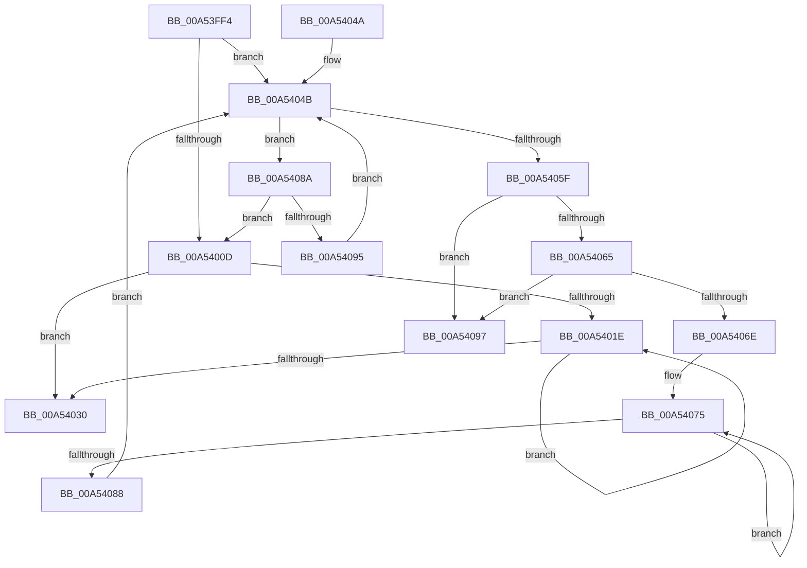

# EtwpFreeStackCache

- RVA: `0x00A53FF4`–`0x00A5409E` (길이 `170` bytes)
- VA: `0x0000000140A53FF4`
- 실행 섹션: `PAGE`
- PDB 이름 있음: `예`; PDB Function 태그: `아니요`
- unwind 정보 RVA: `0x000B1030`
- 디코드: `54`개 명령, `170/170` bytes 표시
- 미해석 바이트: `0` (있으면 어셈블리에 `.byte`로 보존)

> 이 문서는 커널 이미지의 기계어와 PDB 기호를 분석해 생성했습니다. 4번과 5번은 함수 원형과 자료형을 바이너리 사용 방식에서 추정한 C 해석이며 원본 소스 복구 결과는 아닙니다.

## 1. Dependencies

- 직접 호출 지점: **4**; 고유 호출 대상: **2**
- 직접 호출자로 확인된 함수: **2**
- RIP 상대 이미지 참조: **0**

### Outgoing calls
- `0x00A54011` → [ExpInterlockedFlushSList](../../text/6B/ExpInterlockedFlushSList_function_006BA5F0.md) (function, `0x006BA5F0`)
- `0x00A54026` → [ExFreePoolWithTag](../../poolcode/B8/ExFreePoolWithTag_function_00B82870.md) (function, `0x00B82870`)
- `0x00A54035` → [ExFreePoolWithTag](../../poolcode/B8/ExFreePoolWithTag_function_00B82870.md) (function, `0x00B82870`)
- `0x00A5407B` → [ExFreePoolWithTag](../../poolcode/B8/ExFreePoolWithTag_function_00B82870.md) (function, `0x00B82870`)

### Direct callers
- [EtwpFreeLoggerContext](../9C/EtwpFreeLoggerContext_function_009C1688.md) at `0x009C19DB`
- [EtwpEnableStackCaching](EtwpEnableStackCaching_function_00A53C6C.md) at `0x00A53D70`

### Static image references
- 디코드된 RIP-relative 메모리 참조가 없습니다.

## 2. Other-region calls and transfers

- 다른 실행 섹션으로 향하는 call: **4**
  - `0x00A54011` → [ExpInterlockedFlushSList](../../text/6B/ExpInterlockedFlushSList_function_006BA5F0.md) (`PAGE` → `.text`)
  - `0x00A54026` → [ExFreePoolWithTag](../../poolcode/B8/ExFreePoolWithTag_function_00B82870.md) (`PAGE` → `POOLCODE`)
  - `0x00A54035` → [ExFreePoolWithTag](../../poolcode/B8/ExFreePoolWithTag_function_00B82870.md) (`PAGE` → `POOLCODE`)
  - `0x00A5407B` → [ExFreePoolWithTag](../../poolcode/B8/ExFreePoolWithTag_function_00B82870.md) (`PAGE` → `POOLCODE`)
- 별도 외부 분기/꼬리 이동을 확인하지 못했습니다.

## 3. Assembly (complete function range)

```asm
00A53FF4  48 89 5C 24 08                  mov qword ptr [rsp + 8], rbx
00A53FF9  48 89 74 24 10                  mov qword ptr [rsp + 0x10], rsi
00A53FFE  57                              push rdi
00A53FFF  48 83 EC 20                     sub rsp, 0x20
00A54003  33 F6                           xor esi, esi
00A54005  48 8B F9                        mov rdi, rcx
00A54008  39 71 08                        cmp dword ptr [rcx + 8], esi
00A5400B  77 3E                           ja 0x140a5404b
00A5400D  48 8D 4F 10                     lea rcx, [rdi + 0x10]
00A54011  E8 DA 65 C6 FF                  call 0x1406ba5f0
00A54016  48 8B D8                        mov rbx, rax
00A54019  48 85 C0                        test rax, rax
00A5401C  74 12                           je 0x140a54030
00A5401E  48 8B CB                        mov rcx, rbx
00A54021  33 D2                           xor edx, edx
00A54023  48 8B 1B                        mov rbx, qword ptr [rbx]
00A54026  E8 45 E8 12 00                  call 0x140b82870
00A5402B  48 85 DB                        test rbx, rbx
00A5402E  75 EE                           jne 0x140a5401e
00A54030  33 D2                           xor edx, edx
00A54032  48 8B CF                        mov rcx, rdi
00A54035  E8 36 E8 12 00                  call 0x140b82870
00A5403A  48 8B 5C 24 30                  mov rbx, qword ptr [rsp + 0x30]
00A5403F  48 8B 74 24 38                  mov rsi, qword ptr [rsp + 0x38]
00A54044  48 83 C4 20                     add rsp, 0x20
00A54048  5F                              pop rdi
00A54049  C3                              ret
00A5404A  CC                              int3
00A5404B  48 8D 46 02                     lea rax, [rsi + 2]
00A5404F  48 8D 04 46                     lea rax, [rsi + rax*2]
00A54053  48 8D 04 C7                     lea rax, [rdi + rax*8]
00A54057  48 8B 08                        mov rcx, qword ptr [rax]
00A5405A  48 3B C8                        cmp rcx, rax
00A5405D  74 2B                           je 0x140a5408a
00A5405F  48 39 41 08                     cmp qword ptr [rcx + 8], rax
00A54063  75 32                           jne 0x140a54097
00A54065  48 8B 11                        mov rdx, qword ptr [rcx]
00A54068  48 39 4A 08                     cmp qword ptr [rdx + 8], rcx
00A5406C  75 29                           jne 0x140a54097
00A5406E  48 89 10                        mov qword ptr [rax], rdx
00A54071  48 89 42 08                     mov qword ptr [rdx + 8], rax
00A54075  48 8B 59 10                     mov rbx, qword ptr [rcx + 0x10]
00A54079  33 D2                           xor edx, edx
00A5407B  E8 F0 E7 12 00                  call 0x140b82870
00A54080  48 8B CB                        mov rcx, rbx
00A54083  48 85 DB                        test rbx, rbx
00A54086  75 ED                           jne 0x140a54075
00A54088  EB C1                           jmp 0x140a5404b
00A5408A  FF C6                           inc esi
00A5408C  3B 77 08                        cmp esi, dword ptr [rdi + 8]
00A5408F  0F 83 78 FF FF FF               jae 0x140a5400d
00A54095  EB B4                           jmp 0x140a5404b
00A54097  B9 03 00 00 00                  mov ecx, 3
00A5409C  CD 29                           int 0x29
```

## 4. C-style interpretation (structured pseudocode)

```c
__int64 __fastcall EtwpFreeStackCache(__int64 a1, int a2)
{
    __int64 result;
    __int64 v_rsi;
    __int64 v_rsp;
    unsigned __int64 v_stack_p10;
    unsigned __int64 v_stack_p8;

    v_stack_p8 = v_rbx;
    v_stack_p10 = v_rsi;
    v_rsp = (v_rsp) - (32);
    v_rsi = 0;
    if ((*(unsigned int *)(a1 + 8)) > 0) goto loc_00A5404B;
loc_00A5400D:
    result = ExpInterlockedFlushSList(a1 + 16, a2, a3, a4);
    if (result == 0) goto loc_00A54030;
loc_00A5401E:
    a2 = 0;
    result = ExFreePoolWithTag(result, a2, a3, a4);
    if (*(unsigned __int64 *)(result) != 0) goto loc_00A5401E;
loc_00A54030:
    a2 = 0;
    result = ExFreePoolWithTag(a1, a2, a3, a4);
    v_rsp = (v_rsp) + (32);
    return result;
loc_00A5404B:
    if ((*(unsigned __int64 *)(a1 + v_stack_p10 + v_stack_p10 + 2 * 2 * 8)) == (a1 + v_stack_p10 + v_stack_p10 + 2 * 2 * 8)) goto loc_00A5408A;
    if ((*(unsigned __int64 *)(*(unsigned __int64 *)(a1 + v_stack_p10 + v_stack_p10 + 2 * 2 * 8) + 8)) != (a1 + v_stack_p10 + v_stack_p10 + 2 * 2 * 8)) goto loc_00A54097;
    if ((*(unsigned __int64 *)(*(unsigned __int64 *)(*(unsigned __int64 *)(a1 + v_stack_p10 + v_stack_p10 + 2 * 2 * 8)) + 8)) != (*(unsigned __int64 *)(a1 + v_stack_p10 + v_stack_p10 + 2 * 2 * 8))) goto loc_00A54097;
    *(unsigned __int64 *)(a1 + v_stack_p10 + v_stack_p10 + 2 * 2 * 8) = *(unsigned __int64 *)(*(unsigned __int64 *)(a1 + v_stack_p10 + v_stack_p10 + 2 * 2 * 8));
    *(unsigned __int64 *)(*(unsigned __int64 *)(*(unsigned __int64 *)(a1 + v_stack_p10 + v_stack_p10 + 2 * 2 * 8)) + 8) = a1 + v_stack_p10 + v_stack_p10 + 2 * 2 * 8;
loc_00A54075:
    a2 = 0;
    result = ExFreePoolWithTag(*(unsigned __int64 *)(a1 + v_stack_p10 + v_stack_p10 + 2 * 2 * 8), a2, a3, a4);
    if (*(unsigned __int64 *)(*(unsigned __int64 *)(a1 + v_stack_p10 + v_stack_p10 + 2 * 2 * 8) + 16) != 0) goto loc_00A54075;
    goto loc_00A5404B;
loc_00A5408A:
    v_rsi = (unsigned int)((v_stack_p10) + 1);
    if (((unsigned int)(v_rsi)) >= (*(unsigned int *)(a1 + 8))) goto loc_00A5400D;
    goto loc_00A5404B;
loc_00A54097:
    return result;
}
```

## 5. (Beta) C Style

```c
int64_t EtwpFreeStackCache(void *Arg1, int32_t Arg2)
{
    uint8_t *arg1 = (uint8_t *)Arg1;

    int64_t result;
    int64_t local_rsi;
    int64_t local_rsp;
    uint64_t v_stack_p10;
    uint64_t v_stack_p8;

    v_stack_p8 = local_rbx;
    v_stack_p10 = local_rsi;
    local_rsp = (local_rsp) - (32);
    local_rsi = 0;
    if ((*(uint32_t *)(arg1 + 0x8)) > 0) goto loc_00A5404B;
loc_00A5400D:
    result = ExpInterlockedFlushSList(Arg1 + 16, Arg2, a3, a4);
    if (result == 0) goto loc_00A54030;
loc_00A5401E:
    Arg2 = 0;
    result = ExFreePoolWithTag(result, Arg2, a3, a4);
    if (*(uint64_t *)(result) != 0) goto loc_00A5401E;
loc_00A54030:
    Arg2 = 0;
    result = ExFreePoolWithTag(Arg1, Arg2, a3, a4);
    local_rsp = (local_rsp) + (32);
    return result;
loc_00A5404B:
    if ((*(uint64_t *)(arg1 + v_stack_p10 + v_stack_p10 + 0x2 * 2 * 8)) == (Arg1 + v_stack_p10 + v_stack_p10 + 2 * 2 * 8)) goto loc_00A5408A;
    if ((*(uint64_t *)(*(uint64_t *)(arg1 + v_stack_p10 + v_stack_p10 + 0x2 * 2 * 8) + 0x8)) != (Arg1 + v_stack_p10 + v_stack_p10 + 2 * 2 * 8)) goto loc_00A54097;
    if ((*(uint64_t *)(*(uint64_t *)(*(uint64_t *)(arg1 + v_stack_p10 + v_stack_p10 + 0x2 * 2 * 8)) + 0x8)) != (*(uint64_t *)(arg1 + v_stack_p10 + v_stack_p10 + 0x2 * 2 * 8))) goto loc_00A54097;
    *(uint64_t *)(arg1 + v_stack_p10 + v_stack_p10 + 0x2 * 2 * 8) = *(uint64_t *)(*(uint64_t *)(arg1 + v_stack_p10 + v_stack_p10 + 0x2 * 2 * 8));
    *(void **)(*(uint64_t *)(*(uint64_t *)(arg1 + v_stack_p10 + v_stack_p10 + 0x2 * 2 * 8)) + 0x8) = Arg1 + v_stack_p10 + v_stack_p10 + 2 * 2 * 8;
loc_00A54075:
    Arg2 = 0;
    result = ExFreePoolWithTag(*(uint64_t *)(arg1 + v_stack_p10 + v_stack_p10 + 0x2 * 2 * 8), Arg2, a3, a4);
    if (*(uint64_t *)(*(uint64_t *)(arg1 + v_stack_p10 + v_stack_p10 + 0x2 * 2 * 8) + 0x10) != 0) goto loc_00A54075;
    goto loc_00A5404B;
loc_00A5408A:
    local_rsi = (uint32_t)((v_stack_p10) + 1);
    if (((uint32_t)(local_rsi)) >= (*(uint32_t *)(arg1 + 0x8))) goto loc_00A5400D;
    goto loc_00A5404B;
loc_00A54097:
    return result;
}
```

### 관측된 메모리 오프셋

구조체 형식이 확인되지 않은 접근은 인자 기준의 오프셋으로만 기록했습니다.

| 기준 인자 | 오프셋 표현 | 폭 (bit) | 접근 |
|---|---:|---:|---|
| `Arg1` | `+ 0x0` | `64` | `R` |
| `Arg1` | `+ 0x0` | `64` | `W` |
| `Arg1` | `+ 0x0 + rax*8` | `64` | `R` |
| `Arg1` | `+ 0x8` | `32` | `R` |
| `Arg1` | `+ 0x10` | `64` | `R` |

## 6. Execution-region graph

[열기: 2D/3D 그래프와 함수 탐색 컨트롤 패널](../../../control-panel.html?section=page&rva=0x00A53FF4&view=graph)

- 2D 그래프는 위에서 아래로 흐르고, 3D 그래프는 빈 공간을 드래그해 회전합니다. Shift+드래그는 이동, 휠은 확대·축소, 함수 노드 선택은 대상 보고서 이동입니다.

### Static fallback


