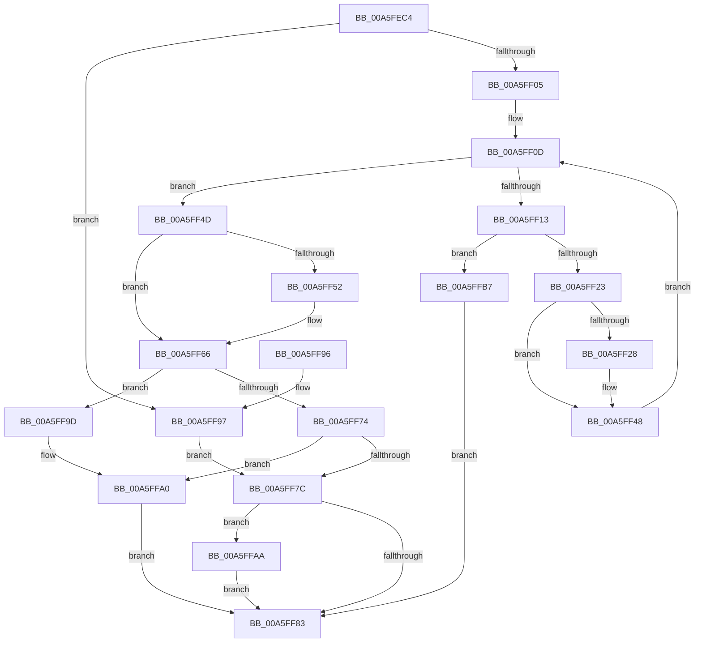

# EtwpGetTraceGuidList

- RVA: `0x00A5FEC4`–`0x00A5FFC2` (길이 `254` bytes)
- VA: `0x0000000140A5FEC4`
- 실행 섹션: `PAGE`
- PDB 이름 있음: `예`; PDB Function 태그: `아니요`
- unwind 정보 RVA: `0x000B2E80`
- 디코드: `74`개 명령, `254/254` bytes 표시
- 미해석 바이트: `0` (있으면 어셈블리에 `.byte`로 보존)

> 이 문서는 커널 이미지의 기계어와 PDB 기호를 분석해 생성했습니다. 4번과 5번은 함수 원형과 자료형을 바이너리 사용 방식에서 추정한 C 해석이며 원본 소스 복구 결과는 아닙니다.

## 1. Dependencies

- 직접 호출 지점: **3**; 고유 호출 대상: **3**
- 직접 호출자로 확인된 함수: **1**
- RIP 상대 이미지 참조: **1**

### Outgoing calls
- `0x00A5FEF2` → [EtwpGetGuidList](../8C/EtwpGetGuidList_function_008C2F00.md) (function, `0x008C2F00`)
- `0x00A5FF61` → [EtwpCopyMetaProviderGuids](../../text/49/EtwpCopyMetaProviderGuids_function_00498BF0.md) (function, `0x00498BF0`)
- `0x00A5FF66` → [EtwpMetaProviderCount](../../text/4B/EtwpMetaProviderCount_function_004BD854.md) (function, `0x004BD854`)

### Direct callers
- [NtTraceControl](../A9/NtTraceControl_function_00A9ED40.md) at `0x00A9F37D`

### Static image references
- `0x00A5FF2B` → RVA `0x00B4C360` (`EtwpUmglProviders`; read)

## 2. Other-region calls and transfers

- 다른 실행 섹션으로 향하는 call: **2**
  - `0x00A5FF61` → [EtwpCopyMetaProviderGuids](../../text/49/EtwpCopyMetaProviderGuids_function_00498BF0.md) (`PAGE` → `.text`)
  - `0x00A5FF66` → [EtwpMetaProviderCount](../../text/4B/EtwpMetaProviderCount_function_004BD854.md) (`PAGE` → `.text`)
- 별도 외부 분기/꼬리 이동을 확인하지 못했습니다.

## 3. Assembly (complete function range)

```asm
00A5FEC4  48 8B C4                        mov rax, rsp
00A5FEC7  48 89 58 08                     mov qword ptr [rax + 8], rbx
00A5FECB  48 89 70 10                     mov qword ptr [rax + 0x10], rsi
00A5FECF  57                              push rdi
00A5FED0  48 83 EC 30                     sub rsp, 0x30
00A5FED4  83 60 20 00                     and dword ptr [rax + 0x20], 0
00A5FED8  48 8D 40 20                     lea rax, [rax + 0x20]
00A5FEDC  49 8B F9                        mov rdi, r9
00A5FEDF  48 89 44 24 20                  mov qword ptr [rsp + 0x20], rax
00A5FEE4  45 8B C8                        mov r9d, r8d
00A5FEE7  41 8B D8                        mov ebx, r8d
00A5FEEA  4C 8B C2                        mov r8, rdx
00A5FEED  48 8B F2                        mov rsi, rdx
00A5FEF0  33 D2                           xor edx, edx
00A5FEF2  E8 09 30 E6 FF                  call 0x1408c2f00
00A5FEF7  44 8B D0                        mov r10d, eax
00A5FEFA  3D 05 00 00 80                  cmp eax, 0x80000005
00A5FEFF  0F 84 92 00 00 00               je 0x140a5ff97
00A5FF05  44 8B 5C 24 58                  mov r11d, dword ptr [rsp + 0x58]
00A5FF0A  45 33 C0                        xor r8d, r8d
00A5FF0D  41 83 F8 0A                     cmp r8d, 0xa
00A5FF11  73 3A                           jae 0x140a5ff4d
00A5FF13  41 FF C3                        inc r11d
00A5FF16  41 81 FB FF FF FF 0F            cmp r11d, 0xfffffff
00A5FF1D  0F 87 94 00 00 00               ja 0x140a5ffb7
00A5FF23  44 3B DB                        cmp r11d, ebx
00A5FF26  77 20                           ja 0x140a5ff48
00A5FF28  41 8B C0                        mov eax, r8d
00A5FF2B  48 8D 15 2E C4 0E 00            lea rdx, [rip + 0xec42e]
00A5FF32  48 03 C0                        add rax, rax
00A5FF35  41 8D 4B FF                     lea ecx, [r11 - 1]
00A5FF39  48 03 C9                        add rcx, rcx
00A5FF3C  48 8B 14 C2                     mov rdx, qword ptr [rdx + rax*8]
00A5FF40  0F 10 02                        movups xmm0, xmmword ptr [rdx]
00A5FF43  F3 0F 7F 04 CE                  movdqu xmmword ptr [rsi + rcx*8], xmm0
00A5FF48  41 FF C0                        inc r8d
00A5FF4B  EB C0                           jmp 0x140a5ff0d
00A5FF4D  41 3B DB                        cmp ebx, r11d
00A5FF50  72 14                           jb 0x140a5ff66
00A5FF52  8B D3                           mov edx, ebx
00A5FF54  41 8B CB                        mov ecx, r11d
00A5FF57  48 C1 E1 04                     shl rcx, 4
00A5FF5B  41 2B D3                        sub edx, r11d
00A5FF5E  48 03 CE                        add rcx, rsi
00A5FF61  E8 8A 8C A3 FF                  call 0x140498bf0
00A5FF66  E8 E9 D8 A5 FF                  call 0x1404bd854
00A5FF6B  42 8D 0C 18                     lea ecx, [rax + r11]
00A5FF6F  41 3B CB                        cmp ecx, r11d
00A5FF72  72 29                           jb 0x140a5ff9d
00A5FF74  81 F9 FF FF FF 0F               cmp ecx, 0xfffffff
00A5FF7A  77 24                           ja 0x140a5ffa0
00A5FF7C  89 0F                           mov dword ptr [rdi], ecx
00A5FF7E  45 85 D2                        test r10d, r10d
00A5FF81  79 27                           jns 0x140a5ffaa
00A5FF83  48 8B 5C 24 40                  mov rbx, qword ptr [rsp + 0x40]
00A5FF88  41 8B C2                        mov eax, r10d
00A5FF8B  48 8B 74 24 48                  mov rsi, qword ptr [rsp + 0x48]
00A5FF90  48 83 C4 30                     add rsp, 0x30
00A5FF94  5F                              pop rdi
00A5FF95  C3                              ret
00A5FF96  CC                              int3
00A5FF97  8B 4C 24 58                     mov ecx, dword ptr [rsp + 0x58]
00A5FF9B  EB DF                           jmp 0x140a5ff7c
00A5FF9D  83 C9 FF                        or ecx, 0xffffffff
00A5FFA0  41 BA 05 00 00 80               mov r10d, 0x80000005
00A5FFA6  89 0F                           mov dword ptr [rdi], ecx
00A5FFA8  EB D9                           jmp 0x140a5ff83
00A5FFAA  3B CB                           cmp ecx, ebx
00A5FFAC  B8 23 00 00 C0                  mov eax, 0xc0000023
00A5FFB1  44 0F 47 D0                     cmova r10d, eax
00A5FFB5  EB CC                           jmp 0x140a5ff83
00A5FFB7  41 BA 05 00 00 80               mov r10d, 0x80000005
00A5FFBD  44 89 1F                        mov dword ptr [rdi], r11d
00A5FFC0  EB C1                           jmp 0x140a5ff83
```

## 4. C-style interpretation (structured pseudocode)

```c
__int64 __fastcall EtwpGetTraceGuidList(__int64 a1, __int64 a2, int a3, __int64 a4)
{
    __int64 result;
    __int64 v_r10;
    __int64 v_r11;
    __int64 v_rsp;
    unsigned __int64 v_stack_m18;
    unsigned __int64 v_stack_p10;
    unsigned int v_stack_p20;
    unsigned int v_stack_p58;
    unsigned __int64 v_stack_p8;

    *(unsigned __int64 *)(v_rsp + 8) = v_rbx;
    *(unsigned __int64 *)(v_rsp + 16) = v_rsi;
    v_rsp = (v_rsp) - (48);
    v_stack_m18 = v_rsp + 32;
    a2 = 0;
    result = EtwpGetGuidList(a1, a2, a2, (unsigned int)(a3));
    if (((unsigned int)(result)) == 0x80000005ULL) goto loc_00A5FF97;
    a3 = 0;
loc_00A5FF0D:
    if (0 >= 10) goto loc_00A5FF4D;
    v_r11 = (unsigned int)(((unsigned int)(v_stack_p20)) + 1);
    if (((unsigned int)(v_r11)) > 0xFFFFFFFULL) goto loc_00A5FFB7;
    if (((unsigned int)(v_r11)) <= ((unsigned int)((unsigned int)(a3)))) {
        result = 0;
        a2 = v_rip + 967726;
        result = (result) + (result);
        a1 = v_r11 - 1;
        a1 = (a1) + (a1);
        a2 = *(unsigned __int64 *)(a2 + result * 8);
        *(unsigned __int64 *)(a2 + a1 * 8) = v_xmm0;
    }
    a3 = (unsigned int)((a3) + 1);
    goto loc_00A5FF0D;
loc_00A5FF4D:
    if (((unsigned int)((unsigned int)(a3))) >= ((unsigned int)(v_r11))) {
        a2 = (unsigned int)((unsigned int)(a3));
        a1 = (unsigned int)(v_r11);
        a1 = (a1) << (4);
        a2 = (unsigned int)((a2) - ((unsigned int)(v_r11)));
        a1 = (a1) + (a2);
        result = EtwpCopyMetaProviderGuids(a1, a2, a3, (unsigned int)(a3));
    }
    result = EtwpMetaProviderCount(a1, a2, a3, (unsigned int)(a3));
    if (((unsigned int)(result + v_r11 * 1)) < ((unsigned int)(v_r11))) goto loc_00A5FF9D;
    if (((unsigned int)(result + v_r11 * 1)) > 0xFFFFFFFULL) goto loc_00A5FFA0;
loc_00A5FF7C:
    *(unsigned int *)(a4) = (unsigned int)(result + v_r11 * 1);
    if (!sign_flag) goto loc_00A5FFAA;
loc_00A5FF83:
    v_rsp = (v_rsp) + (48);
    return (unsigned int)((unsigned int)((unsigned int)((unsigned int)(result))));
loc_00A5FF97:
    goto loc_00A5FF7C;
loc_00A5FF9D:
    a1 = (unsigned int)(((unsigned int)(v_stack_p58)) | (0xFFFFFFFFULL));
loc_00A5FFA0:
    *(unsigned int *)(a4) = (unsigned int)(a1);
    goto loc_00A5FF83;
loc_00A5FFAA:
    v_r10 = (unsigned int)(0x80000005ULL);
    if (((unsigned int)(a1)) > ((unsigned int)(v_stack_p8))) { v_r10 = (unsigned int)((unsigned int)(0xC0000023ULL)); }
    goto loc_00A5FF83;
loc_00A5FFB7:
    *(unsigned int *)(a4) = (unsigned int)(v_r11);
    goto loc_00A5FF83;
}
```

## 5. (Beta) C Style

```c
int64_t EtwpGetTraceGuidList(int64_t Arg1, void *Arg2, int32_t Arg3, void *Arg4)
{
    uint8_t *arg2 = (uint8_t *)Arg2;
    uint8_t *arg4 = (uint8_t *)Arg4;

    int64_t result;
    int64_t local_r10;
    int64_t local_r11;
    int64_t local_rsp;
    uint64_t v_stack_m18;
    uint64_t v_stack_p10;
    uint32_t v_stack_p20;
    uint32_t v_stack_p58;
    uint64_t v_stack_p8;

    *(uint64_t *)(local_rsp + 0x8) = local_rbx;
    *(uint64_t *)(local_rsp + 0x10) = local_rsi;
    local_rsp = (local_rsp) - (48);
    v_stack_m18 = local_rsp + 32;
    Arg2 = 0;
    result = EtwpGetGuidList(Arg1, Arg2, Arg2, (uint32_t)(Arg3));
    if (((uint32_t)(result)) == 0x80000005ULL) goto loc_00A5FF97;
    Arg3 = 0;
loc_00A5FF0D:
    if (0 >= 10) goto loc_00A5FF4D;
    local_r11 = (uint32_t)(((uint32_t)(v_stack_p20)) + 1);
    if (((uint32_t)(local_r11)) > 0xFFFFFFFULL) goto loc_00A5FFB7;
    if (((uint32_t)(local_r11)) <= ((uint32_t)((uint32_t)(Arg3)))) {
        result = 0;
        Arg2 = v_rip + 967726;
        result = (result) + (result);
        Arg1 = local_r11 - 1;
        Arg1 = (Arg1) + (Arg1);
        Arg2 = *(uint64_t *)(arg2 + result * 8);
        *(uint64_t *)(arg2 + Arg1 * 8) = v_xmm0;
    }
    Arg3 = (uint32_t)((Arg3) + 1);
    goto loc_00A5FF0D;
loc_00A5FF4D:
    if (((uint32_t)((uint32_t)(Arg3))) >= ((uint32_t)(local_r11))) {
        Arg2 = (uint32_t)((uint32_t)(Arg3));
        Arg1 = (uint32_t)(local_r11);
        Arg1 = (Arg1) << (4);
        Arg2 = (uint32_t)((Arg2) - ((uint32_t)(local_r11)));
        Arg1 = (Arg1) + (Arg2);
        result = EtwpCopyMetaProviderGuids(Arg1, Arg2, Arg3, (uint32_t)(Arg3));
    }
    result = EtwpMetaProviderCount(Arg1, Arg2, Arg3, (uint32_t)(Arg3));
    if (((uint32_t)(result + local_r11 * 1)) < ((uint32_t)(local_r11))) goto loc_00A5FF9D;
    if (((uint32_t)(result + local_r11 * 1)) > 0xFFFFFFFULL) goto loc_00A5FFA0;
loc_00A5FF7C:
    *(uint32_t *)(arg4) = (uint32_t)(result + local_r11 * 1);
    if (!sign_flag) goto loc_00A5FFAA;
loc_00A5FF83:
    local_rsp = (local_rsp) + (48);
    return (uint32_t)((uint32_t)((uint32_t)((uint32_t)(result))));
loc_00A5FF97:
    goto loc_00A5FF7C;
loc_00A5FF9D:
    Arg1 = (uint32_t)(((uint32_t)(v_stack_p58)) | (0xFFFFFFFFULL));
loc_00A5FFA0:
    *(uint32_t *)(arg4) = (uint32_t)(Arg1);
    goto loc_00A5FF83;
loc_00A5FFAA:
    local_r10 = (uint32_t)(0x80000005ULL);
    if (((uint32_t)(Arg1)) > ((uint32_t)(v_stack_p8))) { local_r10 = (uint32_t)((uint32_t)(0xC0000023ULL)); }
    goto loc_00A5FF83;
loc_00A5FFB7:
    *(uint32_t *)(arg4) = (uint32_t)(local_r11);
    goto loc_00A5FF83;
}
```

### 관측된 메모리 오프셋

구조체 형식이 확인되지 않은 접근은 인자 기준의 오프셋으로만 기록했습니다.

| 기준 인자 | 오프셋 표현 | 폭 (bit) | 접근 |
|---|---:|---:|---|
| `Arg2` | `+ 0x0 + rcx*8` | `128` | `W` |
| `Arg4` | `+ 0x0` | `32` | `W` |

## 6. Execution-region graph

[열기: 2D/3D 그래프와 함수 탐색 컨트롤 패널](../../../control-panel.html?section=page&rva=0x00A5FEC4&view=graph)

- 2D 그래프는 위에서 아래로 흐르고, 3D 그래프는 빈 공간을 드래그해 회전합니다. Shift+드래그는 이동, 휠은 확대·축소, 함수 노드 선택은 대상 보고서 이동입니다.

### Static fallback


