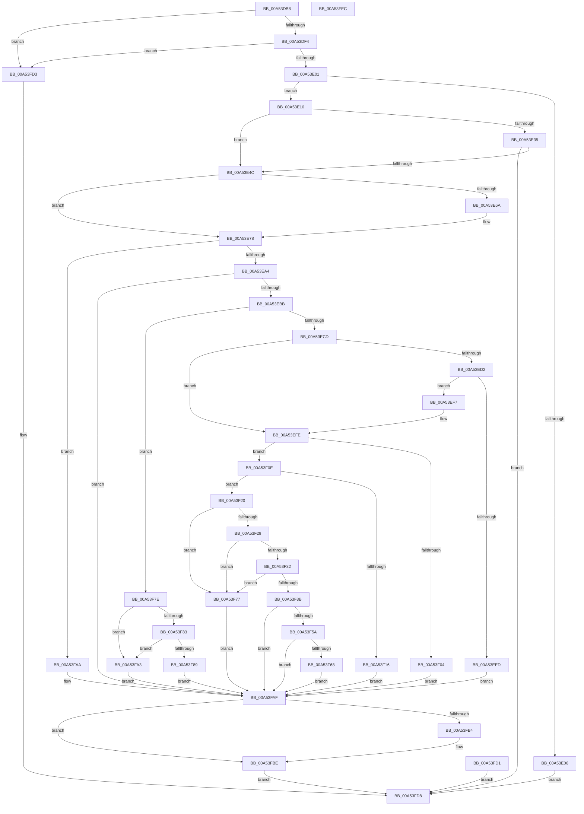

# EtwpSetSoftRestartInformation

- RVA: `0x00A53DB8`–`0x00A53FED` (길이 `565` bytes)
- VA: `0x0000000140A53DB8`
- 실행 섹션: `PAGE`
- PDB 이름 있음: `예`; PDB Function 태그: `아니요`
- unwind 정보 RVA: `0x000B1000`
- 디코드: `144`개 명령, `565/565` bytes 표시
- 미해석 바이트: `0` (있으면 어셈블리에 `.byte`로 보존)

> 이 문서는 커널 이미지의 기계어와 PDB 기호를 분석해 생성했습니다. 4번과 5번은 함수 원형과 자료형을 바이너리 사용 방식에서 추정한 C 해석이며 원본 소스 복구 결과는 아닙니다.

## 1. Dependencies

- 직접 호출 지점: **13**; 고유 호출 대상: **11**
- 직접 호출자로 확인된 함수: **1**
- RIP 상대 이미지 참조: **3**

### Outgoing calls
- `0x00A53DF4` → [PsIsCurrentThreadInServerSilo](../../text/43/PsIsCurrentThreadInServerSilo_function_004362E0.md) (function, `0x004362E0`)
- `0x00A53E17` → [RtlInitUnicodeString](../../text/42/RtlInitUnicodeString_function_0042A780.md) (function, `0x0042A780`)
- `0x00A53E3F` → [EtwpCaptureString](../9B/EtwpCaptureString_function_009BD754.md) (function, `0x009BD754`)
- `0x00A53E93` → [EtwpAcquireLoggerContextByLoggerId](../93/EtwpAcquireLoggerContextByLoggerId_function_00932920.md) (function, `0x00932920`)
- `0x00A53EAC` → [EtwpCheckLoggerControlAccess](../8C/EtwpCheckLoggerControlAccess_function_008C0AE0.md) (function, `0x008C0AE0`)
- `0x00A53EE0` → [ExAllocatePool2](../../poolcode/B8/ExAllocatePool2_function_00B820F0.md) (function, `0x00B820F0`)
- `0x00A53F5D` → [EtwpPreserveLogger](../7B/EtwpPreserveLogger_function_007BEF4C.md) (function, `0x007BEF4C`)
- `0x00A53F70` → [RtlFreeAnsiString](../9C/RtlFreeAnsiString_function_009C0800.md) (function, `0x009C0800`)
- `0x00A53F8C` → [EtwpCancelMemoryPreservation](../7B/EtwpCancelMemoryPreservation_function_007BEC0C.md) (function, `0x007BEC0C`)
- `0x00A53F95` → [RtlFreeAnsiString](../9C/RtlFreeAnsiString_function_009C0800.md) (function, `0x009C0800`)
- `0x00A53FB9` → [EtwpReleaseLoggerContext](../A0/EtwpReleaseLoggerContext_function_00A04160.md) (function, `0x00A04160`)
- `0x00A53FC3` → [RtlFreeAnsiString](../9C/RtlFreeAnsiString_function_009C0800.md) (function, `0x009C0800`)
- `0x00A53FC8` → [KeLeaveCriticalRegion](../../text/25/KeLeaveCriticalRegion_function_0025D8B0.md) (function, `0x0025D8B0`)

### Direct callers
- [EtwSetPerformanceTraceInformation](EtwSetPerformanceTraceInformation_function_00A53928.md) at `0x00A53B88`

### Static image references
- `0x00A53DE2` → RVA `0x00FD9F38` (`PAGEDATA`; read)
- `0x00A53E6A` → RVA `0x00FC6AA8` (`ALMOSTRO`; read)
- `0x00A53F51` → RVA `0x00FD9A72` (`PAGEDATA`; read)

## 2. Other-region calls and transfers

- 다른 실행 섹션으로 향하는 call: **4**
  - `0x00A53DF4` → [PsIsCurrentThreadInServerSilo](../../text/43/PsIsCurrentThreadInServerSilo_function_004362E0.md) (`PAGE` → `.text`)
  - `0x00A53E17` → [RtlInitUnicodeString](../../text/42/RtlInitUnicodeString_function_0042A780.md) (`PAGE` → `.text`)
  - `0x00A53EE0` → [ExAllocatePool2](../../poolcode/B8/ExAllocatePool2_function_00B820F0.md) (`PAGE` → `POOLCODE`)
  - `0x00A53FC8` → [KeLeaveCriticalRegion](../../text/25/KeLeaveCriticalRegion_function_0025D8B0.md) (`PAGE` → `.text`)
- 별도 외부 분기/꼬리 이동을 확인하지 못했습니다.

## 3. Assembly (complete function range)

```asm
00A53DB8  48 8B C4                        mov rax, rsp
00A53DBB  48 89 58 08                     mov qword ptr [rax + 8], rbx
00A53DBF  48 89 70 10                     mov qword ptr [rax + 0x10], rsi
00A53DC3  57                              push rdi
00A53DC4  41 56                           push r14
00A53DC6  41 57                           push r15
00A53DC8  48 83 EC 50                     sub rsp, 0x50
00A53DCC  8B DA                           mov ebx, edx
00A53DCE  48 8B F9                        mov rdi, rcx
00A53DD1  0F 57 C0                        xorps xmm0, xmm0
00A53DD4  0F 11 40 C0                     movups xmmword ptr [rax - 0x40], xmm0
00A53DD8  0F 57 C9                        xorps xmm1, xmm1
00A53DDB  0F 11 48 D0                     movups xmmword ptr [rax - 0x30], xmm1
00A53DDF  45 33 FF                        xor r15d, r15d
00A53DE2  4C 39 3D 4F 61 58 00            cmp qword ptr [rip + 0x58614f], r15
00A53DE9  0F 95 C0                        setne al
00A53DEC  84 C0                           test al, al
00A53DEE  0F 84 DF 01 00 00               je 0x140a53fd3
00A53DF4  E8 E7 24 9E FF                  call 0x1404362e0
00A53DF9  84 C0                           test al, al
00A53DFB  0F 85 D2 01 00 00               jne 0x140a53fd3
00A53E01  83 FB 18                        cmp ebx, 0x18
00A53E04  73 0A                           jae 0x140a53e10
00A53E06  B8 0D 00 00 C0                  mov eax, 0xc000000d
00A53E0B  E9 C8 01 00 00                  jmp 0x140a53fd8
00A53E10  33 D2                           xor edx, edx
00A53E12  48 8D 4C 24 28                  lea rcx, [rsp + 0x28]
00A53E17  E8 64 69 9D FF                  call 0x14042a780
00A53E1C  48 8D 47 12                     lea rax, [rdi + 0x12]
00A53E20  48 89 44 24 40                  mov qword ptr [rsp + 0x40], rax
00A53E25  66 83 EB 12                     sub bx, 0x12
00A53E29  66 89 5C 24 38                  mov word ptr [rsp + 0x38], bx
00A53E2E  66 89 5C 24 3A                  mov word ptr [rsp + 0x3a], bx
00A53E33  74 17                           je 0x140a53e4c
00A53E35  48 8D 54 24 28                  lea rdx, [rsp + 0x28]
00A53E3A  48 8D 4C 24 38                  lea rcx, [rsp + 0x38]
00A53E3F  E8 10 99 F6 FF                  call 0x1409bd754
00A53E44  85 C0                           test eax, eax
00A53E46  0F 88 8C 01 00 00               js 0x140a53fd8
00A53E4C  48 8B 4F 08                     mov rcx, qword ptr [rdi + 8]
00A53E50  48 89 8C 24 80 00 00 00         mov qword ptr [rsp + 0x80], rcx
00A53E58  8A 47 10                        mov al, byte ptr [rdi + 0x10]
00A53E5B  88 44 24 20                     mov byte ptr [rsp + 0x20], al
00A53E5F  0F B7 D1                        movzx edx, cx
00A53E62  81 FA FF FF 00 00               cmp edx, 0xffff
00A53E68  75 0E                           jne 0x140a53e78
00A53E6A  48 8B 05 37 2C 57 00            mov rax, qword ptr [rip + 0x572c37]
00A53E71  0F B6 90 98 11 00 00            movzx edx, byte ptr [rax + 0x1198]
00A53E78  65 48 8B 04 25 88 01 00 00      mov rax, qword ptr gs:[0x188]
00A53E81  66 FF 88 E4 01 00 00            dec word ptr [rax + 0x1e4]
00A53E88  90                              nop
00A53E89  41 B0 01                        mov r8b, 1
00A53E8C  48 8B 0D 15 2C 57 00            mov rcx, qword ptr [rip + 0x572c15]
00A53E93  E8 88 EA ED FF                  call 0x140932920
00A53E98  48 8B F0                        mov rsi, rax
00A53E9B  48 85 C0                        test rax, rax
00A53E9E  0F 84 06 01 00 00               je 0x140a53faa
00A53EA4  48 8B D0                        mov rdx, rax
00A53EA7  B9 80 00 00 00                  mov ecx, 0x80
00A53EAC  E8 2F CC E6 FF                  call 0x1408c0ae0
00A53EB1  8B D8                           mov ebx, eax
00A53EB3  85 C0                           test eax, eax
00A53EB5  0F 88 F4 00 00 00               js 0x140a53faf
00A53EBB  48 8B BE 48 05 00 00            mov rdi, qword ptr [rsi + 0x548]
00A53EC2  44 38 7C 24 20                  cmp byte ptr [rsp + 0x20], r15b
00A53EC7  0F 84 B1 00 00 00               je 0x140a53f7e
00A53ECD  48 85 FF                        test rdi, rdi
00A53ED0  75 2C                           jne 0x140a53efe
00A53ED2  8D 57 28                        lea edx, [rdi + 0x28]
00A53ED5  B9 00 01 00 00                  mov ecx, 0x100
00A53EDA  41 B8 45 74 77 4B               mov r8d, 0x4b777445
00A53EE0  E8 0B E2 12 00                  call 0x140b820f0
00A53EE5  48 8B F8                        mov rdi, rax
00A53EE8  48 85 C0                        test rax, rax
00A53EEB  75 0A                           jne 0x140a53ef7
00A53EED  BB 17 00 00 C0                  mov ebx, 0xc0000017
00A53EF2  E9 B8 00 00 00                  jmp 0x140a53faf
00A53EF7  48 89 86 48 05 00 00            mov qword ptr [rsi + 0x548], rax
00A53EFE  44 38 7F 20                     cmp byte ptr [rdi + 0x20], r15b
00A53F02  74 0A                           je 0x140a53f0e
00A53F04  BB 03 03 00 C0                  mov ebx, 0xc0000303
00A53F09  E9 A1 00 00 00                  jmp 0x140a53faf
00A53F0E  66 44 39 7C 24 28               cmp word ptr [rsp + 0x28], r15w
00A53F14  75 0A                           jne 0x140a53f20
00A53F16  BB 98 00 00 C0                  mov ebx, 0xc0000098
00A53F1B  E9 8F 00 00 00                  jmp 0x140a53faf
00A53F20  F7 46 0C 00 04 00 00            test dword ptr [rsi + 0xc], 0x400
00A53F27  74 4E                           je 0x140a53f77
00A53F29  83 BE 2C 01 00 00 01            cmp dword ptr [rsi + 0x12c], 1
00A53F30  74 45                           je 0x140a53f77
00A53F32  F7 46 04 FF 0F 00 00            test dword ptr [rsi + 4], 0xfff
00A53F39  75 3C                           jne 0x140a53f77
00A53F3B  0F 10 44 24 28                  movups xmm0, xmmword ptr [rsp + 0x28]
00A53F40  F3 0F 7F 47 10                  movdqu xmmword ptr [rdi + 0x10], xmm0
00A53F45  4C 89 7C 24 30                  mov qword ptr [rsp + 0x30], r15
00A53F4A  C6 47 20 01                     mov byte ptr [rdi + 0x20], 1
00A53F4E  41 8B DF                        mov ebx, r15d
00A53F51  44 38 3D 1A 5B 58 00            cmp byte ptr [rip + 0x585b1a], r15b
00A53F58  74 55                           je 0x140a53faf
00A53F5A  48 8B CE                        mov rcx, rsi
00A53F5D  E8 EA AF D6 FF                  call 0x1407bef4c
00A53F62  8B D8                           mov ebx, eax
00A53F64  85 C0                           test eax, eax
00A53F66  79 47                           jns 0x140a53faf
00A53F68  44 88 7F 20                     mov byte ptr [rdi + 0x20], r15b
00A53F6C  48 8D 4F 10                     lea rcx, [rdi + 0x10]
00A53F70  E8 8B C8 F6 FF                  call 0x1409c0800
00A53F75  EB 38                           jmp 0x140a53faf
00A53F77  BB BB 00 00 C0                  mov ebx, 0xc00000bb
00A53F7C  EB 31                           jmp 0x140a53faf
00A53F7E  48 85 FF                        test rdi, rdi
00A53F81  74 20                           je 0x140a53fa3
00A53F83  44 38 7F 20                     cmp byte ptr [rdi + 0x20], r15b
00A53F87  74 1A                           je 0x140a53fa3
00A53F89  48 8B CE                        mov rcx, rsi
00A53F8C  E8 7B AC D6 FF                  call 0x1407bec0c
00A53F91  48 8D 4F 10                     lea rcx, [rdi + 0x10]
00A53F95  E8 66 C8 F6 FF                  call 0x1409c0800
00A53F9A  44 88 7F 20                     mov byte ptr [rdi + 0x20], r15b
00A53F9E  41 8B DF                        mov ebx, r15d
00A53FA1  EB 0C                           jmp 0x140a53faf
00A53FA3  BB 02 03 00 C0                  mov ebx, 0xc0000302
00A53FA8  EB 05                           jmp 0x140a53faf
00A53FAA  BB 96 02 00 C0                  mov ebx, 0xc0000296
00A53FAF  48 85 F6                        test rsi, rsi
00A53FB2  74 0A                           je 0x140a53fbe
00A53FB4  B2 01                           mov dl, 1
00A53FB6  48 8B CE                        mov rcx, rsi
00A53FB9  E8 A2 01 FB FF                  call 0x140a04160
00A53FBE  48 8D 4C 24 28                  lea rcx, [rsp + 0x28]
00A53FC3  E8 38 C8 F6 FF                  call 0x1409c0800
00A53FC8  E8 E3 98 80 FF                  call 0x14025d8b0
00A53FCD  8B C3                           mov eax, ebx
00A53FCF  EB 07                           jmp 0x140a53fd8
00A53FD1  EB 05                           jmp 0x140a53fd8
00A53FD3  B8 BB 00 00 C0                  mov eax, 0xc00000bb
00A53FD8  48 8B 5C 24 70                  mov rbx, qword ptr [rsp + 0x70]
00A53FDD  48 8B 74 24 78                  mov rsi, qword ptr [rsp + 0x78]
00A53FE2  48 83 C4 50                     add rsp, 0x50
00A53FE6  41 5F                           pop r15
00A53FE8  41 5E                           pop r14
00A53FEA  5F                              pop rdi
00A53FEB  C3                              ret
00A53FEC  CC                              int3
```

## 4. C-style interpretation (structured pseudocode)

```c
__int64 __fastcall EtwpSetSoftRestartInformation(__int64 a1, int a2)
{
    __int64 result;
    __int64 v_r15;
    __int64 v_rbx;
    __int64 v_rsp;
    unsigned __int64 v_stack_m28;
    unsigned __int16 v_stack_m2E;
    unsigned __int16 v_stack_m30;
    unsigned __int64 v_stack_m38;
    unsigned __int64 v_stack_m40;
    unsigned __int8 v_stack_m48;
    unsigned __int64 v_stack_p10;
    unsigned __int64 v_stack_p18;
    unsigned __int64 v_stack_p8;

    *(unsigned __int64 *)(v_rsp + 8) = v_rbx;
    *(unsigned __int64 *)(v_rsp + 16) = v_rsi;
    v_rsp = (v_rsp) - (80);
    *(unsigned __int64 *)(v_rsp - 64) = v_xmm0;
    *(unsigned __int64 *)(v_rsp - 48) = v_xmm1;
    v_r15 = 0;
    result = ((*(unsigned __int64 *)(v_rip + 5792079)) != 0) ? 1 : 0;
    if ((unsigned __int8)(result) == 0) goto loc_00A53FD3;
    result = PsIsCurrentThreadInServerSilo(a1, a2, a3, a4);
    if ((unsigned __int8)(result) != 0) goto loc_00A53FD3;
    if (((unsigned int)((unsigned int)(a2))) >= 24) goto loc_00A53E10;
    goto loc_00A53FD8;
loc_00A53E10:
    a2 = 0;
    result = RtlInitUnicodeString(v_stack_m40, a2, a3, a4);
    v_stack_m28 = a1 + 18;
    v_rbx = (unsigned __int16)(((unsigned int)(a2)) - (18));
    v_stack_m30 = (unsigned __int16)(v_rbx);
    v_stack_m2E = (unsigned __int16)(v_rbx);
    if (condition_is_equal) goto loc_00A53E4C;
    result = EtwpCaptureString(v_stack_m30, v_stack_m40, a3, a4);
    if (sign_flag) goto loc_00A53FD8;
loc_00A53E4C:
    v_stack_p18 = *(unsigned __int64 *)(a1 + 8);
    v_stack_m48 = (unsigned __int8)(*(unsigned __int8 *)(a1 + 16));
    result = *(unsigned __int8 *)(a1 + 16);
    if (((unsigned int)((unsigned __int16)(*(unsigned __int64 *)(a1 + 8)))) == 0xFFFFULL) {
        result = *(unsigned __int64 *)(v_rip + 5712951);
        a2 = *(unsigned __int8 *)(result + 4504);
    }
    result = EtwpAcquireLoggerContextByLoggerId(*(unsigned __int64 *)(v_rip + 5712917), a2, 1, a4);
    if (result == 0) goto loc_00A53FAA;
    result = EtwpCheckLoggerControlAccess(128, result, 1, a4);
    if (sign_flag) goto loc_00A53FAF;
    if (v_stack_m48 == 0) goto loc_00A53F7E;
    if (*(unsigned __int64 *)(result + 1352) != 0) goto loc_00A53EFE;
    result = ExAllocatePool2(256, *(unsigned __int64 *)(result + 1352) + 40, (unsigned int)(0x4B777445ULL), a4);
    if (result != 0) goto loc_00A53EF7;
    goto loc_00A53FAF;
loc_00A53EF7:
    *(unsigned __int64 *)(result + 1352) = result;
loc_00A53EFE:
    if ((*(unsigned __int8 *)(result + 32)) == 0) goto loc_00A53F0E;
    goto loc_00A53FAF;
loc_00A53F0E:
    if (v_stack_m40 != 0) goto loc_00A53F20;
    goto loc_00A53FAF;
loc_00A53F20:
    if (((*(unsigned int *)(result + 12)) & (0x400ULL)) == 0) goto loc_00A53F77;
    if ((*(unsigned int *)(result + 300)) == 1) goto loc_00A53F77;
    if (((*(unsigned int *)(result + 4)) & (0xFFFULL)) != 0) goto loc_00A53F77;
    *(unsigned __int64 *)(result + 16) = v_xmm0;
    v_stack_m38 = 0;
    *(unsigned __int8 *)(result + 32) = 1;
    if ((*(unsigned __int8 *)(v_rip + 5790490)) == 0) goto loc_00A53FAF;
    result = EtwpPreserveLogger(result, *(unsigned __int64 *)(result + 1352) + 40, (unsigned int)(0x4B777445ULL), a4);
    if (!sign_flag) goto loc_00A53FAF;
    *(unsigned __int8 *)(result + 32) = 0;
    result = RtlFreeAnsiString(result + 16, *(unsigned __int64 *)(result + 1352) + 40, (unsigned int)(0x4B777445ULL), a4);
    goto loc_00A53FAF;
loc_00A53F77:
    goto loc_00A53FAF;
loc_00A53F7E:
    if (result == 0) goto loc_00A53FA3;
    if ((*(unsigned __int8 *)(result + 32)) == 0) goto loc_00A53FA3;
    result = EtwpCancelMemoryPreservation(result, *(unsigned __int64 *)(result + 1352) + 40, (unsigned int)(0x4B777445ULL), a4);
    result = RtlFreeAnsiString(result + 16, *(unsigned __int64 *)(result + 1352) + 40, (unsigned int)(0x4B777445ULL), a4);
    *(unsigned __int8 *)(result + 32) = 0;
    goto loc_00A53FAF;
loc_00A53FA3:
    goto loc_00A53FAF;
loc_00A53FAA:
loc_00A53FAF:
    if (result != 0) {
        a2 = 1;
        a1 = result;
        result = EtwpReleaseLoggerContext(a1, a2, (unsigned int)(0x4B777445ULL), a4);
    }
    result = RtlFreeAnsiString(v_stack_m40, a2, (unsigned int)(0x4B777445ULL), a4);
    result = KeLeaveCriticalRegion(v_stack_m40, a2, (unsigned int)(0x4B777445ULL), a4);
    goto loc_00A53FD8;
loc_00A53FD3:
loc_00A53FD8:
    v_rsp = (v_rsp) + (80);
    return (unsigned int)(0xC00000BBULL);
}
```

## 5. (Beta) C Style

```c
int64_t EtwpSetSoftRestartInformation(void *Arg1, int32_t Arg2)
{
    uint8_t *arg1 = (uint8_t *)Arg1;

    int64_t result;
    int64_t local_r15;
    int64_t local_rbx;
    int64_t local_rsp;
    uint64_t v_stack_m28;
    uint16_t v_stack_m2E;
    uint16_t v_stack_m30;
    uint64_t v_stack_m38;
    uint64_t v_stack_m40;
    uint8_t v_stack_m48;
    uint64_t v_stack_p10;
    uint64_t v_stack_p18;
    uint64_t v_stack_p8;

    *(uint64_t *)(local_rsp + 0x8) = local_rbx;
    *(uint64_t *)(local_rsp + 0x10) = local_rsi;
    local_rsp = (local_rsp) - (80);
    *(uint64_t *)(local_rsp - 0x40) = v_xmm0;
    *(uint64_t *)(local_rsp - 0x30) = v_xmm1;
    local_r15 = 0;
    result = ((*(uint64_t *)(v_rip + 0x58614F)) != 0) ? 1 : 0;
    if ((uint8_t)(result) == 0) goto loc_00A53FD3;
    result = PsIsCurrentThreadInServerSilo(Arg1, Arg2, a3, a4);
    if ((uint8_t)(result) != 0) goto loc_00A53FD3;
    if (((uint32_t)((uint32_t)(Arg2))) >= 24) goto loc_00A53E10;
    goto loc_00A53FD8;
loc_00A53E10:
    Arg2 = 0;
    result = RtlInitUnicodeString(v_stack_m40, Arg2, a3, a4);
    v_stack_m28 = Arg1 + 18;
    local_rbx = (uint16_t)(((uint32_t)(Arg2)) - (18));
    v_stack_m30 = (uint16_t)(local_rbx);
    v_stack_m2E = (uint16_t)(local_rbx);
    if (condition_is_equal) goto loc_00A53E4C;
    result = EtwpCaptureString(v_stack_m30, v_stack_m40, a3, a4);
    if (sign_flag) goto loc_00A53FD8;
loc_00A53E4C:
    v_stack_p18 = *(uint64_t *)(arg1 + 0x8);
    v_stack_m48 = (uint8_t)(*(uint8_t *)(arg1 + 0x10));
    result = *(uint8_t *)(arg1 + 0x10);
    if (((uint32_t)((uint16_t)(*(uint64_t *)(arg1 + 0x8)))) == 0xFFFFULL) {
        result = *(uint64_t *)(v_rip + 0x572C37);
        Arg2 = *(uint8_t *)(result + 0x1198);
    }
    result = EtwpAcquireLoggerContextByLoggerId(*(uint64_t *)(v_rip + 0x572C15), Arg2, 1, a4);
    if (result == 0) goto loc_00A53FAA;
    result = EtwpCheckLoggerControlAccess(128, result, 1, a4);
    if (sign_flag) goto loc_00A53FAF;
    if (v_stack_m48 == 0) goto loc_00A53F7E;
    if (*(uint64_t *)(result + 0x548) != 0) goto loc_00A53EFE;
    result = ExAllocatePool2(256, *(uint64_t *)(result + 0x548) + 40, (uint32_t)(0x4B777445ULL), a4);
    if (result != 0) goto loc_00A53EF7;
    goto loc_00A53FAF;
loc_00A53EF7:
    *(uint64_t *)(result + 0x548) = result;
loc_00A53EFE:
    if ((*(uint8_t *)(result + 0x20)) == 0) goto loc_00A53F0E;
    goto loc_00A53FAF;
loc_00A53F0E:
    if (v_stack_m40 != 0) goto loc_00A53F20;
    goto loc_00A53FAF;
loc_00A53F20:
    if (((*(uint32_t *)(result + 0xC)) & (0x400ULL)) == 0) goto loc_00A53F77;
    if ((*(uint32_t *)(result + 0x12C)) == 1) goto loc_00A53F77;
    if (((*(uint32_t *)(result + 0x4)) & (0xFFFULL)) != 0) goto loc_00A53F77;
    *(uint64_t *)(result + 0x10) = v_xmm0;
    v_stack_m38 = 0;
    *(uint8_t *)(result + 0x20) = 1;
    if ((*(uint8_t *)(v_rip + 0x585B1A)) == 0) goto loc_00A53FAF;
    result = EtwpPreserveLogger(result, *(uint64_t *)(result + 0x548) + 40, (uint32_t)(0x4B777445ULL), a4);
    if (!sign_flag) goto loc_00A53FAF;
    *(uint8_t *)(result + 0x20) = 0;
    result = RtlFreeAnsiString(result + 16, *(uint64_t *)(result + 0x548) + 40, (uint32_t)(0x4B777445ULL), a4);
    goto loc_00A53FAF;
loc_00A53F77:
    goto loc_00A53FAF;
loc_00A53F7E:
    if (result == 0) goto loc_00A53FA3;
    if ((*(uint8_t *)(result + 0x20)) == 0) goto loc_00A53FA3;
    result = EtwpCancelMemoryPreservation(result, *(uint64_t *)(result + 0x548) + 40, (uint32_t)(0x4B777445ULL), a4);
    result = RtlFreeAnsiString(result + 16, *(uint64_t *)(result + 0x548) + 40, (uint32_t)(0x4B777445ULL), a4);
    *(uint8_t *)(result + 0x20) = 0;
    goto loc_00A53FAF;
loc_00A53FA3:
    goto loc_00A53FAF;
loc_00A53FAA:
loc_00A53FAF:
    if (result != 0) {
        Arg2 = 1;
        Arg1 = result;
        result = EtwpReleaseLoggerContext(Arg1, Arg2, (uint32_t)(0x4B777445ULL), a4);
    }
    result = RtlFreeAnsiString(v_stack_m40, Arg2, (uint32_t)(0x4B777445ULL), a4);
    result = KeLeaveCriticalRegion(v_stack_m40, Arg2, (uint32_t)(0x4B777445ULL), a4);
    goto loc_00A53FD8;
loc_00A53FD3:
loc_00A53FD8:
    local_rsp = (local_rsp) + (80);
    return (uint32_t)(0xC00000BBULL);
}
```

### 관측된 메모리 오프셋

구조체 형식이 확인되지 않은 접근은 인자 기준의 오프셋으로만 기록했습니다.

| 기준 인자 | 오프셋 표현 | 폭 (bit) | 접근 |
|---|---:|---:|---|
| `Arg1` | `+ 0x8` | `64` | `R` |
| `Arg1` | `+ 0x10` | `8` | `R` |
| `Arg1` | `+ 0x12` | `64` | `R` |

## 6. Execution-region graph

[열기: 2D/3D 그래프와 함수 탐색 컨트롤 패널](../../../control-panel.html?section=page&rva=0x00A53DB8&view=graph)

- 2D 그래프는 위에서 아래로 흐르고, 3D 그래프는 빈 공간을 드래그해 회전합니다. Shift+드래그는 이동, 휠은 확대·축소, 함수 노드 선택은 대상 보고서 이동입니다.

### Static fallback


