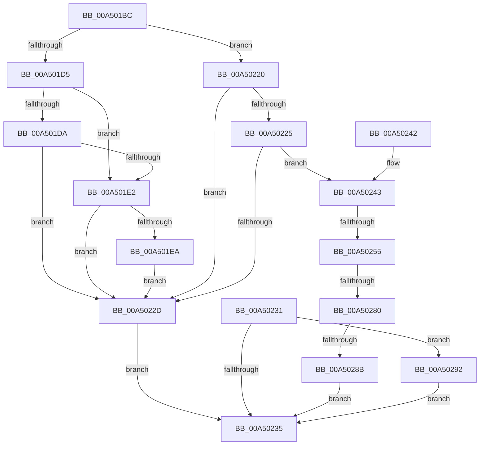

# EtwpUpdateFileInfoDriverState

- RVA: `0x00A501BC`–`0x00A502B9` (길이 `253` bytes)
- VA: `0x0000000140A501BC`
- 실행 섹션: `PAGE`
- PDB 이름 있음: `예`; PDB Function 태그: `예`
- unwind 정보 RVA: `0x000B09B0`
- 디코드: `64`개 명령, `253/253` bytes 표시
- 미해석 바이트: `0` (있으면 어셈블리에 `.byte`로 보존)

> 이 문서는 커널 이미지의 기계어와 PDB 기호를 분석해 생성했습니다. 4번과 5번은 함수 원형과 자료형을 바이너리 사용 방식에서 추정한 C 해석이며 원본 소스 복구 결과는 아닙니다.

## 1. Dependencies

- 직접 호출 지점: **9**; 고유 호출 대상: **6**
- 직접 호출자로 확인된 함수: **2**
- RIP 상대 이미지 참조: **3**

### Outgoing calls
- `0x00A501F1` → [WmiTraceRundownNotify](../9E/WmiTraceRundownNotify_function_009E46E0.md) (function, `0x009E46E0`)
- `0x00A501F8` → [EtwpUpdateFileInfoDriverRegistration](../7B/EtwpUpdateFileInfoDriverRegistration_function_007B8B1C.md) (function, `0x007B8B1C`)
- `0x00A50209` → [RtlInitUnicodeString](../../text/42/RtlInitUnicodeString_function_0042A780.md) (function, `0x0042A780`)
- `0x00A50213` → [ZwUnloadDriver](../../text/6B/ZwUnloadDriver_function_006B0C10.md) (function, `0x006B0C10`)
- `0x00A50243` → [WmiQueryTraceProviderCount](../../text/4A/WmiQueryTraceProviderCount_function_004A24C8.md) (function, `0x004A24C8`)
- `0x00A50261` → [RtlInitUnicodeString](../../text/42/RtlInitUnicodeString_function_0042A780.md) (function, `0x0042A780`)
- `0x00A5026B` → [ZwLoadDriver](../../text/6A/ZwLoadDriver_function_006AF290.md) (function, `0x006AF290`)
- `0x00A5029E` → [RtlInitUnicodeString](../../text/42/RtlInitUnicodeString_function_0042A780.md) (function, `0x0042A780`)
- `0x00A502A8` → [ZwUnloadDriver](../../text/6B/ZwUnloadDriver_function_006B0C10.md) (function, `0x006B0C10`)

### Direct callers
- [EtwpEnableKernelTrace](../A4/EtwpEnableKernelTrace_function_00A4FBCC.md) at `0x00A4FC79`
- [EtwpInitialize](../../init/C4/EtwpInitialize_function_00C4DBCC.md) at `0x00C4E18B`

### Static image references
- `0x00A501E2` → RVA `0x00E68488` (`.data`; read)
- `0x00A501FD` → RVA `0x00B07530` (` ?? ::NNGAKEGL::`string'`; read)
- `0x00A50218` → RVA `0x00E68488` (`.data`; read/write)

## 2. Other-region calls and transfers

- 다른 실행 섹션으로 향하는 call: **7**
  - `0x00A50209` → [RtlInitUnicodeString](../../text/42/RtlInitUnicodeString_function_0042A780.md) (`PAGE` → `.text`)
  - `0x00A50213` → [ZwUnloadDriver](../../text/6B/ZwUnloadDriver_function_006B0C10.md) (`PAGE` → `.text`)
  - `0x00A50243` → [WmiQueryTraceProviderCount](../../text/4A/WmiQueryTraceProviderCount_function_004A24C8.md) (`PAGE` → `.text`)
  - `0x00A50261` → [RtlInitUnicodeString](../../text/42/RtlInitUnicodeString_function_0042A780.md) (`PAGE` → `.text`)
  - `0x00A5026B` → [ZwLoadDriver](../../text/6A/ZwLoadDriver_function_006AF290.md) (`PAGE` → `.text`)
  - `0x00A5029E` → [RtlInitUnicodeString](../../text/42/RtlInitUnicodeString_function_0042A780.md) (`PAGE` → `.text`)
  - `0x00A502A8` → [ZwUnloadDriver](../../text/6B/ZwUnloadDriver_function_006B0C10.md) (`PAGE` → `.text`)
- call이 아닌 외부 분기/꼬리 이동: **3**
  - `0x00A5024F` → [sub_00B3C5FE + 0x8](../B3/Unknown_function_00B3C5FE.md) (`tail-transfer`)
  - `0x00A5027A` → [sub_00B3C5FE](../B3/Unknown_function_00B3C5FE.md) (`tail-transfer`)
  - `0x00A50285` → [sub_00B3C5FE](../B3/Unknown_function_00B3C5FE.md) (`tail-transfer`)

## 3. Assembly (complete function range)

```asm
00A501BC  48 89 5C 24 08                  mov qword ptr [rsp + 8], rbx
00A501C1  57                              push rdi
00A501C2  48 83 EC 30                     sub rsp, 0x30
00A501C6  33 FF                           xor edi, edi
00A501C8  0F 57 C0                        xorps xmm0, xmm0
00A501CB  0F 11 44 24 20                  movups xmmword ptr [rsp + 0x20], xmm0
00A501D0  45 85 C0                        test r8d, r8d
00A501D3  75 4B                           jne 0x140a50220
00A501D5  48 85 C9                        test rcx, rcx
00A501D8  74 08                           je 0x140a501e2
00A501DA  F7 01 00 02 00 06               test dword ptr [rcx], 0x6000200
00A501E0  75 4B                           jne 0x140a5022d
00A501E2  39 3D A0 82 41 00               cmp dword ptr [rip + 0x4182a0], edi
00A501E8  74 43                           je 0x140a5022d
00A501EA  8B 54 24 60                     mov edx, dword ptr [rsp + 0x60]
00A501EE  49 8B 09                        mov rcx, qword ptr [r9]
00A501F1  E8 EA 44 F9 FF                  call 0x1409e46e0
00A501F6  33 C9                           xor ecx, ecx
00A501F8  E8 1F 89 D6 FF                  call 0x1407b8b1c
00A501FD  48 8D 15 2C 73 0B 00            lea rdx, [rip + 0xb732c]
00A50204  48 8D 4C 24 20                  lea rcx, [rsp + 0x20]
00A50209  E8 72 A5 9D FF                  call 0x14042a780
00A5020E  48 8D 4C 24 20                  lea rcx, [rsp + 0x20]
00A50213  E8 F8 09 C6 FF                  call 0x1406b0c10
00A50218  21 3D 6A 82 41 00               and dword ptr [rip + 0x41826a], edi
00A5021E  EB 0D                           jmp 0x140a5022d
00A50220  48 85 D2                        test rdx, rdx
00A50223  74 08                           je 0x140a5022d
00A50225  F7 02 00 02 00 06               test dword ptr [rdx], 0x6000200
00A5022B  75 16                           jne 0x140a50243
00A5022D  33 DB                           xor ebx, ebx
00A5022F  EB 04                           jmp 0x140a50235
00A50231  85 FF                           test edi, edi
00A50233  75 5D                           jne 0x140a50292
00A50235  8B C3                           mov eax, ebx
00A50237  48 8B 5C 24 40                  mov rbx, qword ptr [rsp + 0x40]
00A5023C  48 83 C4 30                     add rsp, 0x30
00A50240  5F                              pop rdi
00A50241  C3                              ret
00A50242  CC                              int3
00A50243  E8 80 22 A5 FF                  call 0x1404a24c8
00A50248  BB 01 00 00 00                  mov ebx, 1
00A5024D  85 C0                           test eax, eax
00A5024F  0F 85 B1 C3 0E 00               jne 0x140b3c606
00A50255  48 8D 15 D4 72 0B 00            lea rdx, [rip + 0xb72d4]
00A5025C  48 8D 4C 24 20                  lea rcx, [rsp + 0x20]
00A50261  E8 1A A5 9D FF                  call 0x14042a780
00A50266  48 8D 4C 24 20                  lea rcx, [rsp + 0x20]
00A5026B  E8 20 F0 C5 FF                  call 0x1406af290
00A50270  BA 00 00 00 80                  mov edx, 0x80000000
00A50275  8D 0C 10                        lea ecx, [rax + rdx]
00A50278  85 CA                           test edx, ecx
00A5027A  0F 85 7E C3 0E 00               jne 0x140b3c5fe
00A50280  3D 0E 01 00 C0                  cmp eax, 0xc000010e
00A50285  0F 84 73 C3 0E 00               je 0x140b3c5fe
00A5028B  BB 6C 02 00 C0                  mov ebx, 0xc000026c
00A50290  EB A3                           jmp 0x140a50235
00A50292  48 8D 15 97 72 0B 00            lea rdx, [rip + 0xb7297]
00A50299  48 8D 4C 24 20                  lea rcx, [rsp + 0x20]
00A5029E  E8 DD A4 9D FF                  call 0x14042a780
00A502A3  48 8D 4C 24 20                  lea rcx, [rsp + 0x20]
00A502A8  E8 63 09 C6 FF                  call 0x1406b0c10
00A502AD  83 25 D4 81 41 00 00            and dword ptr [rip + 0x4181d4], 0
00A502B4  E9 7C FF FF FF                  jmp 0x140a50235
```

## 4. C-style interpretation (structured pseudocode)

```c
__int64 __fastcall EtwpUpdateFileInfoDriverState(__int64 a1, __int64 a2, int a3, __int64 a4, unsigned int a5)
{
    __int64 result;
    __int64 v_rbx;
    __int64 v_rdi;
    __int64 v_rsp;
    unsigned __int64 v_stack_m18;
    unsigned __int64 v_stack_p20;
    unsigned __int64 v_stack_p8;

    v_stack_p8 = v_rbx;
    v_rsp = (v_rsp) - (48);
    v_rdi = 0;
    v_stack_m18 = v_xmm0;
    if (a3 != 0) goto loc_00A50220;
    if (a1 == 0) goto loc_00A501E2;
    if (((*(unsigned int *)(a1)) & (0x6000200ULL)) != 0) goto loc_00A5022D;
loc_00A501E2:
    if ((*(unsigned int *)(v_rip + 4293280)) == 0) goto loc_00A5022D;
    result = WmiTraceRundownNotify(*(unsigned __int64 *)(a4), (unsigned int)(a5), a3, a4);
    a1 = 0;
    result = EtwpUpdateFileInfoDriverRegistration(a1, (unsigned int)(a5), a3, a4);
    result = RtlInitUnicodeString(v_stack_m18, v_rip + 750380, a3, a4);
    result = ZwUnloadDriver(v_stack_m18, v_rip + 750380, a3, a4);
    goto loc_00A5022D;
loc_00A50220:
    if (v_rip + 750380 == 0) goto loc_00A5022D;
    if (((*(unsigned int *)(v_rip + 750380)) & (0x6000200ULL)) != 0) goto loc_00A50243;
loc_00A5022D:
    v_rbx = 0;
    goto loc_00A50235;
loc_00A50235:
    v_rsp = (v_rsp) + (48);
    return 0;
loc_00A50243:
    result = WmiQueryTraceProviderCount(v_stack_m18, v_rip + 750380, a3, a4);
    result = RtlInitUnicodeString(v_stack_p20, v_rip + 750292, a3, a4);
    result = ZwLoadDriver(v_stack_p20, v_rip + 750292, a3, a4);
    goto loc_00A50235;
}
```

## 5. (Beta) C Style

```c
int64_t EtwpUpdateFileInfoDriverState(int64_t Arg1, int64_t Arg2, int32_t Arg3, void *Arg4, uint32_t Arg5)
{
    uint8_t *arg4 = (uint8_t *)Arg4;

    int64_t result;
    int64_t local_rbx;
    int64_t local_rdi;
    int64_t local_rsp;
    uint64_t v_stack_m18;
    uint64_t v_stack_p20;
    uint64_t v_stack_p8;

    v_stack_p8 = local_rbx;
    local_rsp = (local_rsp) - (48);
    local_rdi = 0;
    v_stack_m18 = v_xmm0;
    if (Arg3 != 0) goto loc_00A50220;
    if (Arg1 == 0) goto loc_00A501E2;
    if (((*(uint32_t *)(Arg1)) & (0x6000200ULL)) != 0) goto loc_00A5022D;
loc_00A501E2:
    if ((*(uint32_t *)(v_rip + 0x4182A0)) == 0) goto loc_00A5022D;
    result = WmiTraceRundownNotify(*(uint64_t *)(arg4), (uint32_t)(Arg5), Arg3, Arg4);
    Arg1 = 0;
    result = EtwpUpdateFileInfoDriverRegistration(Arg1, (uint32_t)(Arg5), Arg3, Arg4);
    result = RtlInitUnicodeString(v_stack_m18, v_rip + 750380, Arg3, Arg4);
    result = ZwUnloadDriver(v_stack_m18, v_rip + 750380, Arg3, Arg4);
    goto loc_00A5022D;
loc_00A50220:
    if (v_rip + 750380 == 0) goto loc_00A5022D;
    if (((*(uint32_t *)(v_rip + 0xB732C)) & (0x6000200ULL)) != 0) goto loc_00A50243;
loc_00A5022D:
    local_rbx = 0;
    goto loc_00A50235;
loc_00A50235:
    local_rsp = (local_rsp) + (48);
    return 0;
loc_00A50243:
    result = WmiQueryTraceProviderCount(v_stack_m18, v_rip + 750380, Arg3, Arg4);
    result = RtlInitUnicodeString(v_stack_p20, v_rip + 750292, Arg3, Arg4);
    result = ZwLoadDriver(v_stack_p20, v_rip + 750292, Arg3, Arg4);
    goto loc_00A50235;
}
```

### 관측된 메모리 오프셋

구조체 형식이 확인되지 않은 접근은 인자 기준의 오프셋으로만 기록했습니다.

| 기준 인자 | 오프셋 표현 | 폭 (bit) | 접근 |
|---|---:|---:|---|
| `Arg4` | `+ 0x0` | `64` | `R` |

## 6. Execution-region graph

[열기: 2D/3D 그래프와 함수 탐색 컨트롤 패널](../../../control-panel.html?section=page&rva=0x00A501BC&view=graph)

- 2D 그래프는 위에서 아래로 흐르고, 3D 그래프는 빈 공간을 드래그해 회전합니다. Shift+드래그는 이동, 휠은 확대·축소, 함수 노드 선택은 대상 보고서 이동입니다.

### Static fallback


